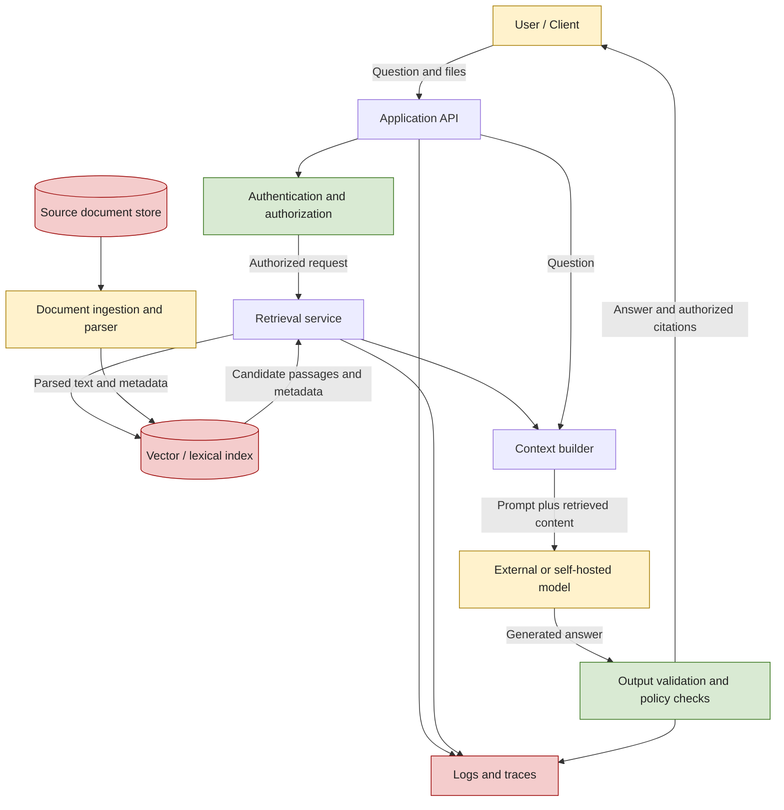

# 01. Security Risks Specific to GenAI Systems

> **Level:** 14 — GenAI Security and Responsible AI  
> **Goal:** Identify the assets, entry points, and failure modes in a GenAI application, and distinguish model-quality failures from application-security failures.

 

## Learning objectives

By the end of this chapter, you should be able to:

- Inventory prompts, documents, embeddings, model artifacts, outputs, and connected capabilities as assets or entry points.
- Compare confidentiality, integrity, availability, and responsible-use concerns.
- Distinguish a model failure from an application vulnerability.
- Explain why fluent answers and apparent instruction-following do not establish security.
- Create a first-pass asset and external-service inventory for a small retrieval-augmented generation (RAG) application.

 

## 1. Why GenAI security is different

A GenAI application is more than a model. It is a system that combines software, data, model behavior, and often external services. A typical RAG application may accept a question, retrieve passages from a knowledge base, send the question and passages to a model, and return an answer with citations.

Each component introduces different risks:

- **The model** can produce inaccurate, biased, inconsistent, or instruction-following output that was not intended.
- **The application** can expose data, mishandle output, skip authorization checks, or give a component excessive privileges.
- **The data pipeline** can ingest malicious, corrupted, outdated, or unauthorized content.
- **Connected services** can create additional exposure through APIs, vector databases, file parsers, logs, caches, and storage.
- **People and processes** can introduce risk through poor access practices, unreviewed data, unsafe deployment, or excessive trust in generated answers.

Security therefore cannot be delegated to a system prompt or to the model itself. The application must enforce security-critical decisions using ordinary, testable controls such as authentication, authorization, validation, access filtering, resource limits, and safe output handling.

 

### Model behavior versus system security

| Question | Primary concern | Example |
|---|---|---|
| Is the answer correct? | Quality / reliability | The model gives the wrong return policy. |
| Is the user allowed to see the source? | Confidentiality / authorization | A customer receives another customer's document. |
| Can an attacker change trusted data? | Integrity | A malicious source is added to the knowledge base. |
| Can the service remain available? | Availability | Huge uploads exhaust parser memory or model budget. |
| Is the use appropriate and fair? | Responsible use | The system makes an unsupported high-impact recommendation. |

These categories overlap. For example, poisoned documents can reduce answer quality and undermine integrity; a cross-tenant retrieval bug can expose confidential information and violate organizational policy.

 

## 2. Assets and entry points

An **asset** is something valuable that must be protected. An **entry point** is a place through which input, access, or influence can enter the system. One component can be both: a document repository is an asset, while its upload endpoint is an entry point.

 

### 2.1 Core GenAI assets

| Asset | Why it matters | Example risk | Example protection |
|---|---|---|---|
| System and developer prompts | May contain business rules, internal instructions, or workflow details | Prompt disclosure or prompt manipulation | Keep secrets out of prompts; treat prompts as configuration, not authorization |
| User prompts and conversation history | May contain personal, confidential, or attacker-controlled content | Sensitive data sent to an external model or reused across users | Minimize data, enforce access controls, apply retention rules |
| Source documents and uploaded files | May contain confidential facts or malicious instructions | Unauthorized disclosure, malicious document content, parser exploitation | Validate file types and size, scan or quarantine where appropriate, enforce source permissions |
| Parsed text, OCR, and metadata | Can preserve hidden or unexpected document content | Prompt injection in extracted text; sensitive metadata leakage | Treat extracted content as untrusted; validate and preserve provenance |
| Embeddings and vector indexes | Encode information derived from source content and support retrieval | Unauthorized retrieval, cross-tenant leakage, stale or poisoned index entries | Apply permission-aware retrieval, tenant isolation, deletion/update controls |
| Model weights, adapters, tokenizers, and configuration | Influence model behavior and may come from external sources | Tampered artifact, unsafe loading, untrusted remote code | Verify provenance, pin versions, review licenses and loading behavior |
| Generated answers and citations | May disclose information or be used by downstream systems | Hallucinated citations, sensitive output, unsafe rendering | Validate and authorize citations; handle output safely |
| Logs, traces, and evaluation datasets | Help debugging but may contain prompts, outputs, and identifiers | Secret leakage or excessive retention | Allowlist logged fields, redact carefully, restrict access and retention |
| Credentials and service identities | Grant access to model APIs, storage, databases, or tools | Credential theft or excessive privileges | Secret manager/environment configuration, least privilege, rotation |
| Application capabilities | Include retrieval, file access, network requests, and business actions | Unauthorized or attacker-influenced action | Allowlist capabilities, validate arguments, authorize server-side, bound execution |

**Important:** Embeddings are not automatically anonymous or safe. They are derived from source data, can support information retrieval, and should be protected according to the sensitivity and access rules of the underlying content.

 

### 2.2 Common entry points

- Chat, completion, and API request endpoints.
- File upload, document ingestion, OCR, and parsing pipelines.
- Retrieved documents, web pages, metadata, and citation targets.
- Model-provider APIs and other external model services.
- Vector database, search index, cache, and database interfaces.
- Tool or function-call interfaces, including any application-controlled action.
- Output renderers, export features, and downstream systems consuming model output.
- Admin interfaces, configuration files, CI/CD pipelines, and model-artifact download paths.

For each entry point, ask: **Who can reach it? What can they control? What data or capability can it influence? What limits and checks apply?**

 

## 3. Four security objectives and responsible use

A practical first pass uses the **CIA triad**—confidentiality, integrity, and availability—plus responsible-use concerns. These categories help organize risks; they are not a complete threat model.

 

### 3.1 Confidentiality

Confidentiality means information is available only to authorized identities and purposes.

GenAI-specific exposure paths include:

- A model receives more context than the user is allowed to access.
- Retrieved passages from one tenant enter another tenant's prompt.
- Prompts, outputs, or credentials are captured in logs or traces.
- A response repeats sensitive data found in a document.
- A citation or document title reveals the existence of a restricted source.

**Example:** A support assistant retrieves order records. If the backend filters only by semantic relevance and not by the authenticated customer's identity, a plausible answer can disclose another customer's order details.

**Key control:** Enforce access before sensitive content is placed in the model context, then recheck access when serving source text or citations. Do not rely on the model to decide whether a user is authorized.

 

### 3.2 Integrity

Integrity means data, configuration, and operations remain accurate and are changed only through authorized processes.

Relevant risks include:

- Poisoned or misleading documents entering the RAG corpus.
- Unauthorized changes to prompts, retrieval settings, model versions, or policy configuration.
- Model-generated JSON being accepted without schema and business-rule validation.
- Generated text being interpreted as SQL, HTML, shell commands, or file paths.
- Evaluation data being contaminated, making a weak system appear reliable.

**Example:** An attacker uploads a document claiming that a fake refund policy is official. If ingestion has no source verification or review, retrieval may repeatedly surface the false policy.

**Key control:** Restrict who can modify data and configuration; preserve source provenance and versions; validate generated output before it changes application state.

 

### 3.3 Availability

Availability means authorized users can access the service when needed.

Relevant risks include:

- Oversized prompts or files consuming memory and CPU.
- Very long retrieved contexts increasing latency and model cost.
- Repeated requests exhausting provider quotas or a spending budget.
- Unbounded retries, concurrency, batch jobs, or tool execution.
- A provider outage causing the application to fail without a controlled fallback.

**Example:** A public endpoint accepts arbitrarily large documents and sends all extracted text to a model. A small number of requests can exhaust the parser's memory or consume the application's model budget.

**Key control:** Apply request and file-size limits, deadlines, output-token caps, concurrency limits, bounded retries, per-user/tenant quotas, and budget alerts. An output-token cap alone does not constrain all parsing, retrieval, or input-token costs.

 

### 3.4 Responsible use

Responsible use asks whether the system is appropriate, fair, transparent, and suitably supervised for its intended context.

Relevant concerns include:

- Biased or uneven performance across user groups or languages.
- Unsupported claims presented with excessive confidence.
- Inappropriate use in consequential decisions without qualified review.
- Missing disclosure that content is AI-generated or that evidence is incomplete.
- Data collection or reuse beyond the stated purpose or permitted rights.

**Example:** A model summarizes job applications and consistently misinterprets nonstandard language patterns. Even if the API is technically secure, using those summaries as an unreviewed hiring decision could create unfair outcomes.

**Key control:** Define intended and excluded uses, evaluate relevant user/task groups, communicate uncertainty, provide appropriate human review, and document known limitations. A disclaimer is not a substitute for effective controls.

 

### 3.5 Comparison table

| Objective | Core question | Example failure | Typical controls |
|---|---|---|---|
| Confidentiality | Can unauthorized people access information? | Cross-tenant document disclosure | Authorization, retrieval filters, data minimization, log controls |
| Integrity | Can unauthorized or untrusted input change data or behavior? | Poisoned source changes the answer | Source validation, change control, provenance, output validation |
| Availability | Can the service be exhausted or disrupted? | Huge requests consume budget and capacity | Size limits, quotas, deadlines, concurrency and budget controls |
| Responsible use | Is the system used appropriately and fairly? | Unreviewed biased recommendation | Evaluations, transparency, human review, use restrictions |

 

## 4. A small RAG application: components and trust boundaries

A trust boundary is a point where data or control crosses between components with different levels of trust. A boundary deserves attention when untrusted input reaches a privileged component, sensitive data crosses into an external service, or output is consumed by another system.

The following diagram illustrates a simplified RAG system. It is a conceptual map, not a complete production architecture.

 

### Trust-boundary observations

1. **User to API:** The user controls the request. Validate its shape and size, authenticate the caller, and authorize requested resources.
2. **Ingestion to index:** Uploaded or externally sourced content is untrusted even after parsing. Parsing does not establish truth or safety.
3. **Index to context builder:** Retrieved content is evidence, not application instruction. Apply permissions before the content reaches the model.
4. **Application to model provider:** Prompts and retrieved context may leave the application's infrastructure. Minimize data and review the provider's current data-use, retention, and security terms.
5. **Model to output handler:** Generated content is untrusted output. Validate and safely handle it before rendering, storing, or forwarding it.
6. **Application to logs:** Logs can duplicate sensitive data. Log only what is needed and verify actual records from both successful and failed requests.

The model is not the authorization boundary. A secure design makes access decisions in application code and limits the information and capabilities available to the model.

 

## 5. Model failures versus application vulnerabilities

A **model failure** is a failure of the model's output or behavior, such as a factual error, an unsupported claim, or inconsistent instruction following. An **application vulnerability** is a weakness in the surrounding software, configuration, data controls, or operational process that can violate a security requirement.

The distinction is useful, but not absolute: a model failure can expose a weakness in the application, and a vulnerability can make an ordinary model error harmful.

| Scenario | Primary classification | Why |
|---|---|---|
| The model invents a nonexistent product feature | Model-quality failure | The answer is factually wrong |
| The model follows malicious instructions inside a retrieved page | Model behavior failure / injection exposure | Untrusted content influences generation |
| The backend retrieves a private document without checking the user's permissions | Application vulnerability | Authorization was not enforced |
| The model outputs malformed JSON and the API returns a validation error | Model/output-quality failure handled safely | The application rejects invalid output |
| The model outputs JSON containing an unauthorized account ID and the backend performs the action | Application vulnerability, potentially triggered by model output | The backend failed to authorize the operation |
| Generated HTML is inserted into a page without safe rendering | Application vulnerability | Untrusted output reaches a dangerous sink |
| The service accepts unlimited uploads and exhausts memory | Application/operational vulnerability | Resource limits are missing |
| The answer cites a source the user is not allowed to view | Application vulnerability if access control failed | Citation access must be authorized independently |

 

### A practical diagnostic

When investigating an incident, ask these questions in order:

1. **What was the expected secure behavior?** State the requirement precisely.
2. **What actually happened?** Preserve a minimal reproduction using synthetic data where possible.
3. **Was the content wrong, or was a security boundary crossed?** Incorrect text and unauthorized disclosure are different outcomes.
4. **Which component should have prevented it?** For example, authorization middleware, retrieval filtering, output validation, or model instructions.
5. **Did a deterministic control fail?** Check code, permissions, logs, and test assertions rather than assuming the model is responsible.
6. **What evidence proves the fix?** Add a regression test that verifies the protected property.

 

## 6. Why fluent answers and instruction following are not security guarantees

Modern models can produce coherent, confident language and often follow instructions well. Neither property proves that the answer is true, that the user is authorized, or that a requested action is safe.

 

### 6.1 Fluency is not factual correctness

A model generates likely output based on learned patterns and the supplied context. It can produce plausible details when evidence is absent, ambiguous, outdated, or contradictory. This is commonly called **hallucination**.

**Security implication:** Do not use confidence of tone as evidence of correctness. Ground answers in authorized sources, validate structured results, and define behavior for missing evidence.

 

### 6.2 Instruction following is not access control

A prompt such as “Never reveal private documents” is useful guidance, but it is not a substitute for server-side permission checks. A model can misinterpret or fail to follow instructions, especially when untrusted content attempts to redirect the task.

**Security implication:** Keep credentials and privileged decisions out of model context where possible. Enforce identity, permissions, and action limits in application code.

 

### 6.3 Delimiters and labels do not make data trustworthy

Wrapping a retrieved passage in tags such as `<document>...</document>` can clarify structure, but it does not create a hard security boundary. The passage may still contain text that attempts to influence the model.

**Security implication:** Mark untrusted content clearly, test injection attempts, minimize its privileges, and ensure sensitive operations require independent authorization.

 

### 6.4 A refusal does not prove the system is secure

A model may refuse a malicious request in one test and comply in another. A refusal also does not prove that sensitive text was never sent to the provider, stored in logs, or retrieved internally.

**Security implication:** Test the full data flow and enforce controls at the component that owns the data or action.

 

### 6.5 Valid format does not mean valid permission

A response can be valid JSON and still contain a forbidden operation, an unauthorized resource ID, or a harmful recommendation.

**Security implication:** Use layered checks:
- **Structural validation:** Does the output match the schema?
- **Semantic validation:** Are values meaningful and internally consistent?
- **Authorization:** Is this user permitted to perform this operation on this resource?
- **Policy validation:** Is the operation allowed under application rules?
- **Safe execution:** Can the operation be performed with bounded, least-privilege capabilities?

 

## 7. Practice: inventory assets and external services for a small RAG application

### Scenario

Imagine a customer-support assistant that answers questions using company policy documents and customer-specific support records. It accepts user questions, retrieves relevant passages, calls a hosted language model, and returns an answer with citations.

Assume the application has:
- A web client and backend API.
- An identity provider or authentication middleware.
- A document/object store.
- A parser for PDF and text files.
- A vector database or search index.
- A hosted embedding model and a hosted generation model.
- Application logs and traces.
- A cache for repeated queries or results.

Use synthetic names and records for testing. Do not place real credentials or customer data in a learning exercise.

 

### 7.1 Asset inventory template

| Asset / component | Data or capability | Trust / sensitivity | Main concern | Initial control |
|---|---|---|---|---|
| User question and history | User-supplied text; may contain personal data | Untrusted input; sensitivity varies | Injection and data exposure | Input limits, data minimization, session isolation |
| Source documents | Policy and support records | May be confidential; source content is untrusted | Unauthorized access and poisoning | Source ownership, access policy, provenance, ingestion review |
| Parser / OCR | Converts files to text | Processes untrusted files | Parser vulnerabilities and resource exhaustion | Supported formats, size limits, isolation, timeouts |
| Embedding service | Sends text to an embedding model | External processing boundary if hosted | Data exposure and provider dependency | Minimize text; review provider terms; restrict outbound access |
| Vector index | Embeddings, IDs, metadata, possibly text | Sensitive derived data | Cross-tenant retrieval and stale records | Permission filters, tenant isolation, update/deletion tests |
| Generation model | Receives prompt and retrieved context | External or separately privileged component | Injection, leakage, incorrect output | Context minimization, provider review, output validation |
| Backend API | Identity, policy enforcement, orchestration | Privileged application component | Broken authorization and unsafe execution | Server-side authorization, least privilege, request limits |
| Logs / traces | Operational metadata and possibly content | Sensitive operational data | Prompt/response/secret leakage | Allowlisted fields, redaction, access and retention controls |
| Cache | Query or response results | May contain tenant-specific information | Cross-user or stale-data leakage | Tenant-aware keys, permission checks, bounded retention |
| Citations / source links | Source IDs, titles, URLs, snippets | May expose restricted metadata | Unauthorized source discovery or access | Reauthorize source access before display and retrieval |
| API credentials | Model and storage access | Secret | Theft, accidental disclosure, excessive scope | Secret store, rotation, scoped credentials |
| Model and software artifacts | Weights, tokenizer, libraries, parser packages | Supply-chain inputs | Tampering or unsafe loading | Version pinning, provenance and integrity review |

 

### 7.2 External-service inventory

For every service outside the main application process, record the service, the data sent, the identity used, and the failure behavior.

| External service | Data crossing the boundary | Questions to verify |
|---|---|---|
| Hosted embedding provider | Document chunks and/or user queries | Is the data permitted to be sent? What are retention and data-use terms? |
| Hosted generation provider | User prompt and retrieved passages | Could sensitive data be included? What logging/retention controls apply? |
| Identity provider | Authentication claims and tokens | Are tokens validated correctly? Are scopes and expiration enforced? |
| Cloud object storage | Uploaded source files and parsed artifacts | Are access policies, encryption, and deletion behavior configured? |
| Vector database / search service | Embeddings, metadata, possibly text | Are tenant filters mandatory? Who can administer or export the index? |
| Observability service | Logs, traces, metrics | Are prompts and outputs captured? Who can access them, and for how long? |

Do not assume that self-hosting removes all privacy or security risks. It changes the trust boundary and operational responsibilities; access controls, patching, monitoring, and data handling are still required.

 

### 7.3 Threat-to-control worksheet

Fill in this worksheet for the application. The examples below are starter hypotheses, not claims that a real system has these vulnerabilities.

| Threat scenario | Security objective | Component expected to enforce control | Verification evidence |
|---|---|---|---|
| User A retrieves User B's support record | Confidentiality | Backend authorization and retrieval layer | Cross-user test returns no private text, metadata, or citation |
| Uploaded document contains “ignore previous instructions” | Integrity / safe behavior | Ingestion policy, context construction, application controls | Synthetic injection test does not trigger an unauthorized action |
| Huge PDF exhausts parser memory | Availability | Upload API and parser worker | Oversized input is rejected or safely bounded |
| Model output contains HTML/script-like text | Integrity / safe output handling | Output renderer | Inert test string is displayed as text, not executed |
| Debug log records a synthetic secret canary | Confidentiality | Logging and observability pipeline | Inspect actual success and error logs; canary is absent or safely redacted |

 

### 7.4 Suggested inventory procedure

1. Draw the data flow from user request through retrieval, model call, response, and logs.
2. List every data store, external service, model artifact, and capability.
3. Mark each item as public, internal, confidential, personal, or secret as appropriate to the application.
4. Identify who can read or modify each item and which service identity can access it.
5. Mark every boundary where untrusted data enters or sensitive data leaves a component.
6. Assign an owner and a control to each important risk.
7. Define a test that could demonstrate whether the control works.
8. Record unknowns as unresolved questions rather than assuming the configuration is safe.

 

## 8. Exercise and revision questions

### Questions

1. What is the difference between an asset and an entry point? Give one example that is both.
2. A model invents a policy detail, but the application does not expose private data or execute an action. What type of failure is this?
3. A user receives a document belonging to another tenant. Why is this more than an answer-quality issue?
4. Why should embeddings and logs be included in an asset inventory?
5. Why is a system prompt saying “never reveal secrets” insufficient as the only confidentiality control?
6. Name two availability controls beyond an output-token limit.
7. A generated response matches a JSON schema but asks to delete a resource the user does not own. Which checks are still required?
8. What should be tested when a RAG response includes citations?
9. Does a model's refusal to reveal a canary prove that the canary was never exposed? Explain.
10. Identify three external services in the example RAG application and one security question for each.

 

### Answer key

1. An **asset** is something valuable to protect; an **entry point** is where input or influence enters. A document-upload endpoint is an entry point, while the uploaded document is an asset. The document store can be both an asset and a point of influence through its ingestion interface.
2. Primarily a **model-quality failure** (hallucination). It still requires mitigation if users may rely on the answer, but no application security boundary has necessarily been crossed.
3. It violates **confidentiality and authorization**. The backend or retrieval layer should have prevented unauthorized evidence from being fetched or served, regardless of how the model described it.
4. Embeddings can support retrieval of sensitive source information, while logs can preserve prompts, responses, identifiers, and secrets. Both may create additional copies or exposure paths.
5. Model instruction-following is probabilistic and can be influenced by untrusted input. Authorization and data access must be enforced by application code, and secrets should be kept out of model context where possible.
6. Examples: request/file-size limits, deadlines, concurrency caps, per-user quotas, bounded retries, queue-depth limits, and total budget limits.
7. Structural validation is not enough. Apply semantic/business-rule validation, server-side authorization for the specific resource, policy checks, and safe bounded execution.
8. Check that the source exists, the user is authorized to access it, the cited content supports the claim, and titles/snippets/URLs do not leak restricted metadata.
9. No. The canary might already have been sent to an external provider, captured in logs, or retrieved internally. Inspect the complete data flow and emitted records.
10. Examples: hosted embedding provider—what text is sent and under what retention terms? Hosted generation provider—does the prompt include sensitive passages? Observability service—are prompts or outputs recorded, and who can read them?

 

## 9. Chapter checkpoint

**Checkpoint:** Separate an incorrect answer from an unauthorized action or data disclosure.

Use this quick classification:

- **Incorrect answer:** The model states a false return period based on incomplete evidence. Primarily a quality/reliability issue.
- **Unauthorized action:** The model proposes or emits a tool/function request, and the backend performs a refund without verifying the user's permissions. An application-security failure.
- **Data disclosure:** The retrieval layer includes another tenant's private record in the prompt or response. A confidentiality and authorization failure, even if the answer is otherwise accurate.
- **Unsafe output handling:** The model emits script-like content and the application executes it when rendering a page. An application vulnerability.
- **Service exhaustion:** The application accepts oversized inputs and uses excessive resources. An availability failure.

The decisive question is not simply **“Did the model answer correctly?”** It is also **“Did the system preserve its security and responsible-use requirements throughout the data flow?”**

A model can be wrong without a security breach; it can also produce fluent, apparently correct text while the application has already violated confidentiality or authorization.

 

## 10. Further reading

Use authoritative documentation for implementation-specific decisions, and verify current provider terms and configuration before deploying.

- [OWASP Top 10 for Large Language Model Applications](https://owasp.org/www-project-top-10-for-large-language-model-applications/) — common LLM application risk categories and mitigations.
- [NIST AI Risk Management Framework](https://www.nist.gov/itl/ai-risk-management-framework) — a framework for identifying and managing AI-related risks.
- [NIST AI 600-1: Generative Artificial Intelligence Profile](https://doi.org/10.6028/NIST.AI.600-1) — GenAI-specific risk considerations.
- [MITRE ATLAS](https://atlas.mitre.org/) — knowledge base of adversary tactics and techniques targeting AI-enabled systems.
- [Google Secure AI Framework (SAIF)](https://safety.google/cybersecurity-advancements/saif/) — security-oriented guidance for AI systems.
- [OWASP Cheat Sheet Series](https://cheatsheetseries.owasp.org/) — practical application-security guidance relevant to validation, logging, access control, and output handling.

 

## Summary

- A GenAI application is a system of models, prompts, data pipelines, stores, connected services, outputs, and operational controls.
- Inventory both **assets** and **entry points**, including embeddings, logs, artifacts, and downstream capabilities.
- Use confidentiality, integrity, and availability to organize security risks; assess responsible-use concerns separately and alongside them.
- Distinguish model-quality failures from application vulnerabilities by identifying the security requirement and the component responsible for enforcing it.
- Fluent output, instruction following, refusal behavior, delimiters, and valid JSON do not establish security.
- Enforce authorization and bounded capabilities in application code, treat retrieved content and generated output as untrusted, and verify controls with repeatable tests.
