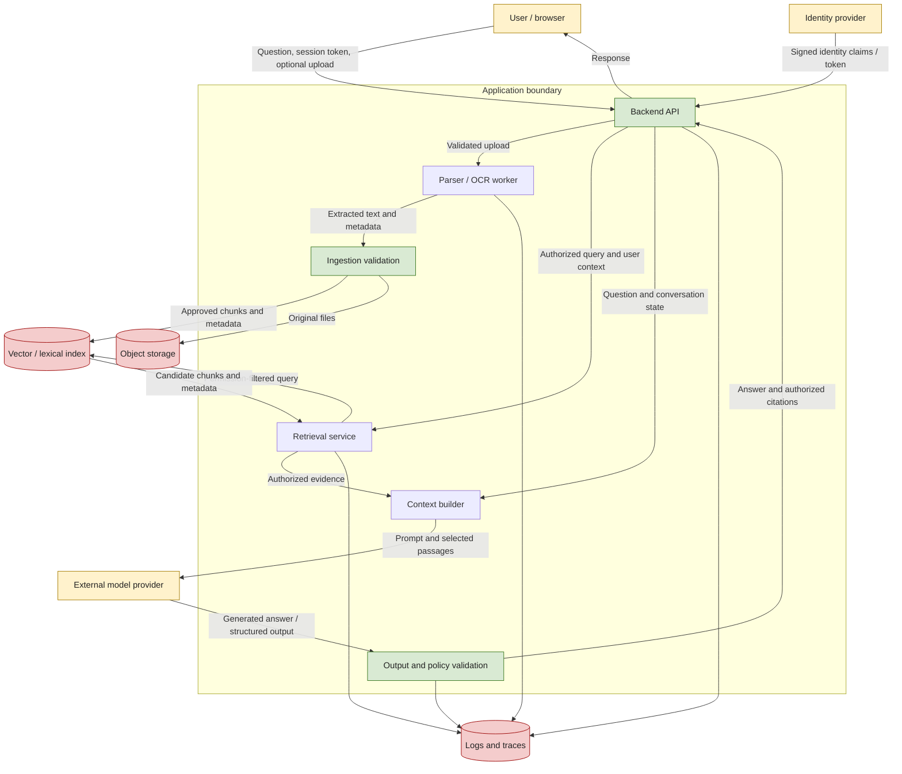

# 02. Threat Modeling and Trust Boundaries

> **Level:** 14 — GenAI Security and Responsible AI  
> **Goal:** Map the data flow of a GenAI application, identify trust boundaries and realistic threats, and assign each security decision to the component responsible for enforcing it.

 

## Learning objectives

By the end of this chapter, you should be able to:

- Diagram users, backend services, model providers, parsers, indexes, storage, and logs.
- Distinguish trusted instructions, untrusted data, identity sources, and downstream sinks.
- Define threat scenarios with explicit preconditions and potential impact.
- Prioritize mitigations using impact, exposure, and feasibility.
- Record assumptions and identify controls that require ongoing operational support.
- Build a threat register linking each scenario to a trust boundary, mitigation, and verification step.

 

## 1. What is threat modeling?

**Threat modeling** is a structured process for understanding what a system protects, how data and control move through it, where trust changes, how an attacker might misuse those paths, and which controls reduce the resulting risk.

It is not simply a list of possible attacks. A useful threat model connects:

1. **Assets:** What needs protection?
2. **Actors:** Who or what can interact with the system?
3. **Entry points:** Where can input or influence enter?
4. **Trust boundaries:** Where does data or control cross between components with different trust or privilege?
5. **Threat scenarios:** What could go wrong, under which preconditions, and with what impact?
6. **Mitigations:** Which component can prevent, detect, or limit the event?
7. **Verification:** What test or evidence demonstrates that the control works?
8. **Assumptions and residual risk:** What has not been verified, and what remains possible?

Threat modeling is iterative. A new model provider, retrieval strategy, tool, data source, or logging configuration can introduce new boundaries and invalidate previous assumptions.

 

### Threat versus vulnerability versus risk

- **Threat:** A potential cause of harm, such as a malicious user attempting cross-tenant retrieval.
- **Vulnerability:** A weakness that makes the threat scenario possible, such as a missing tenant filter.
- **Risk:** The combination of likelihood and impact in a specific context.
- **Mitigation/control:** A measure intended to prevent, detect, or reduce the scenario.
- **Verification evidence:** The result of a test, review, or operational check showing whether the control behaves as expected.

Example: “A customer may access another customer's documents” is a threat scenario. “The retrieval query does not enforce tenant permissions” is a possible vulnerability. The risk depends on exposure, data sensitivity, and the likelihood of exploitation. A cross-tenant test that returns no unauthorized content is useful evidence, but it does not prove every retrieval path is safe.

 

## 2. Define the system and its scope

Before drawing a diagram, define what you are modeling. For this chapter, use a small **RAG customer-support assistant**:

- Users ask questions through a web client.
- A backend API authenticates requests and applies application rules.
- A parser extracts text and metadata from uploaded documents.
- Source files are stored in object storage.
- Parsed chunks and embeddings are stored in a search index.
- A retrieval service selects relevant passages.
- A model provider generates an answer from the question and retrieved context.
- The application returns an answer and citations.
- Logs and traces record operational information.

The system boundary should include the code and infrastructure your team controls, while clearly marking external services and dependencies. Do not treat a service as trusted merely because it is managed by a vendor. Instead, document what the service receives, what it returns, what assurances you rely on, and what failure behavior is possible.

 

### Scope questions

- Which users and roles may use the application?
- Which documents are public, internal, confidential, or tenant-specific?
- Which components are under your operational control?
- Which data is sent to external model, embedding, storage, or monitoring providers?
- Can model output trigger a downstream action, or is it displayed only as text?
- Are uploads allowed from users, administrators, or automated ingestion jobs?
- Which threats are in scope for this exercise, and which require specialist review?

Write down exclusions. For example, this exercise may test an owned local application with synthetic data, but not perform penetration testing against a provider or third-party service.

 

## 3. Diagram data flow and trust boundaries

A **data-flow diagram (DFD)** shows components, data stores, data flows, external entities, and boundaries. For a GenAI application, label the important flows with the data being transferred—not just arrows between boxes.

This is a conceptual diagram. Actual deployments may split these components across separate services or providers. If a component is outside your administrative control, draw the boundary accordingly.

 

### 3.1 How to read the diagram

- **External entities:** Users, identity providers, and hosted model providers interact with the application but are not necessarily controlled by the application team.
- **Processes:** APIs, parsers, retrieval services, and validators transform or route data.
- **Data stores:** Source files, indexes, caches, logs, and traces retain information.
- **Data flows:** Questions, tokens, extracted text, embeddings, retrieved passages, prompts, generated outputs, and telemetry move between components.
- **Trust boundaries:** Places where privilege, ownership, or administrative control changes. A boundary can exist between services inside one organization as well as between an organization and an external provider.

 

### 3.2 Boundaries worth marking

1. **Browser → backend:** The client is not authoritative. Requests and client-side role claims can be modified.
2. **Identity provider → backend:** Identity claims must be validated for issuer, signature, audience, expiration, and other required properties.
3. **Upload → parser:** Files and extracted content are untrusted. Parsing must be bounded and isolated where appropriate.
4. **Ingestion → index:** Only content accepted by the ingestion policy should become retrievable; preserve source identity and access metadata.
5. **Retrieval → context builder:** Candidate passages must be filtered by the authenticated user's permissions before they enter the prompt.
6. **Application → model provider:** Data may leave the application's environment. Review data minimization, provider configuration, retention, and access terms.
7. **Model → downstream sink:** Generated content is untrusted until validated for its intended use.
8. **Application → logs and traces:** Operational records can duplicate sensitive content and must have their own access and retention controls.
9. **Cache → response:** Cached data can bypass fresh retrieval or authorization if keys and invalidation are designed incorrectly.

A boundary is not automatically a vulnerability. It is a location where assumptions and controls need to be explicit.

 

## 4. Identify trusted instructions, untrusted data, identity sources, and sinks

Threat modeling improves when each data item is classified by its origin and role. “Trusted” should be scoped: a source may be trusted for identity but not for every claim it contains.

 

### 4.1 Trusted instructions

Trusted instructions are application-controlled policy and task configuration, such as server-managed prompts and validated workflow settings. They guide model behavior, but they do **not** replace application-enforced security controls.

Examples:
- A version-controlled system prompt describing the assistant's role.
- Server-side policy configuration defining supported operations.
- An application-owned allowlist of functions the model may request.

Threat-model question: **Who can change these instructions or settings, and how is that change reviewed and deployed?**

 

### 4.2 Untrusted data

Treat these as untrusted unless the application has independently established the specific property it needs:

- User messages and conversation history.
- Uploaded documents and OCR output.
- Retrieved web pages and knowledge-base passages.
- Document titles, metadata, hyperlinks, and filenames.
- Model-generated text, JSON, tool-call arguments, and citations.
- External API responses and cached values whose provenance is uncertain.

Untrusted does not mean useless or necessarily malicious. It means the application must not grant it authority merely because it is present or well-formed.

 

### 4.3 Identity sources

Identity must come from a validated authentication mechanism, not from a user's natural-language claim or the model's interpretation.

Examples:
- A validated session or access token.
- A trusted gateway that passes authenticated identity using a protected channel.
- A service identity assigned to a backend workload.

Do not treat statements such as “I am an administrator” in a prompt as proof of identity. Do not accept model-generated claims that a user has permission. Authorization must be checked against server-side policy and the requested resource.

 

### 4.4 Downstream sinks

A **sink** is a component that consumes data in a way that may have security consequences. Typical sinks include:

- HTML or Markdown renderers.
- SQL or other database queries.
- Shell commands and code execution environments.
- File paths and file-writing operations.
- URLs, HTTP clients, and network destinations.
- Business actions such as refunds, account changes, or ticket closure.
- Logs, analytics platforms, and monitoring systems.
- Email, messaging, or other external delivery services.

The correct protection depends on the sink. For example, use parameterized queries for database values, context-appropriate escaping for HTML, allowlisted destinations for network requests, and explicit server-side authorization for business actions. Do not rely on a generic “sanitize the model output” step to cover every context.

 

## 5. Define realistic threat scenarios

A threat scenario should be specific enough to test. A useful structure is:

> **Given** a particular actor and precondition, **when** a specific input or event crosses a boundary, **then** an asset or security property may be harmed because a control is absent, weak, or bypassed.

For each scenario, record:

- **Actor:** Who can initiate the event?
- **Preconditions:** What access, configuration, or system state is required?
- **Entry point and boundary:** Where does the event enter or cross?
- **Asset/property:** What could be affected?
- **Impact:** What would happen if the scenario succeeds?
- **Existing controls:** What currently limits the scenario?
- **Mitigation:** What additional control is proposed?
- **Verification:** What test or review would demonstrate the expected behavior?
- **Assumptions/residual risk:** What remains unverified?

 

### Example scenarios

| ID | Scenario and preconditions | Boundary / asset | Potential impact |
|---|---|---|---|
| T-01 | An authenticated user queries for another tenant's document; retrieval lacks a mandatory permission predicate | Retrieval service ↔ index; confidential records | Cross-tenant disclosure |
| T-02 | A user uploads a document containing instructions that attempt to redirect the model; the application passes retrieved text without robust capability limits | Ingestion/index ↔ context builder ↔ model; prompts and capabilities | Task manipulation or attempted data disclosure |
| T-03 | A parser accepts a very large or malformed file without resource bounds | Upload ↔ parser; service capacity | Memory exhaustion, long processing, or service disruption |
| T-04 | The model emits a URL and the application fetches it without destination restrictions | Model output ↔ network client; internal services and data | Server-side request forgery or unintended network access |
| T-05 | Logs capture complete prompts and outputs, including synthetic secrets or personal data | Application ↔ observability service; sensitive records | Data exposure through logs |
| T-06 | A model output is valid JSON but contains a resource identifier the user is not authorized to modify | Model ↔ business-action handler; protected resources | Unauthorized operation if server authorization is missing |
| T-07 | A shared cache returns a prior user's response because the cache key omits tenant or authorization context | Cache ↔ response; tenant-specific content | Cross-user disclosure or stale permission behavior |
| T-08 | A production deployment loads an unreviewed model artifact or dependency with unsafe loading behavior | Build/deployment ↔ artifact source; runtime integrity | Code execution or compromised service, depending on loading path |

These are candidate scenarios, not claims that every RAG system has these weaknesses. Confirm the actual architecture, preconditions, and controls before assigning a final risk rating.

 

## 6. Prioritize risks and controls

A threat register becomes actionable when risks are prioritized consistently. For this learning exercise, use a simple qualitative rubric based on **impact, exposure, and feasibility**. This is a practical triage method, not a formal or calibrated risk model.

 

### 6.1 Rate each dimension

**Impact**
- **High:** Could expose highly sensitive data, enable a consequential unauthorized action, compromise the service, or cause major disruption.
- **Medium:** Could expose limited internal information, degrade important behavior, or cause a contained operational incident.
- **Low:** Limited harm with straightforward recovery and no meaningful security boundary crossed.

**Exposure**
- **High:** Reachable through a public endpoint, broadly available feature, or common workflow.
- **Medium:** Requires an authenticated user, a specific role, or a less common workflow.
- **Low:** Requires privileged access or a narrow, strongly controlled precondition.

**Feasibility**
- **High:** Low skill or effort; repeatable with ordinary access.
- **Medium:** Requires specific knowledge, multiple steps, or a less common configuration.
- **Low:** Requires substantial access, unusual conditions, or a difficult exploit path.

Rate based on evidence. Unknown exposure or feasibility should be marked **unknown**, not automatically treated as low.

 

### 6.2 Simple prioritization matrix

Use this table to assign a review order, not to calculate a false sense of numerical precision.

| Impact | Exposure | Feasibility | Initial priority guidance |
|---|---|---|---|
| High | High | High or Medium | Critical / urgent review |
| High | Medium or Low | High | High; assess the precondition carefully |
| High | High | Low | High; investigate why exploitation is difficult |
| Medium | High | High | High or Medium depending on reach and scope |
| Medium | Medium | Medium | Medium |
| Low | Low | Low | Lower, while recording assumptions |

The exact label depends on organizational policy and the asset's sensitivity. If a scenario could disclose another tenant's confidential data, do not downgrade it merely because exploitation requires a valid account.

 

### 6.3 Choose controls by impact, exposure, and feasibility

Prioritize controls that:
1. Protect high-impact assets at exposed boundaries.
2. Are enforced by a component that can reliably make the decision.
3. Are feasible to implement and verify.
4. Reduce risk even when the model behaves unexpectedly.
5. Can be maintained after deployment.

Examples:
- Mandatory server-side authorization before retrieval and before business actions.
- File and request limits before expensive parsing or inference.
- Tenant-aware cache keys and authorization checks on cache hits.
- Output validation and context-specific safe handling before downstream sinks.
- Allowlisted network destinations before the application fetches model-suggested URLs.
- Minimal logging with access restrictions and tested redaction.

A prompt-only mitigation may reduce the chance of a model behavior failure, but it should not be the sole control for a high-impact security requirement.

 

## 7. Threat register template

A threat register links a scenario to the boundary, asset, control owner, verification, and remaining uncertainty. The following Markdown table can be copied into a project report.

| ID | Asset / property | Threat scenario and preconditions | Boundary | Impact | Exposure | Feasibility | Priority | Mitigation / control owner | Verification evidence | Assumptions / residual risk |
|---|---|---|---|---|---|---|---|---|---|---|
| T-01 | Confidential documents | User queries another tenant's records; permission filter is absent | Retrieval ↔ index | High | Medium/High | Medium | High | Backend authorization + retrieval service | Cross-tenant test returns no text, metadata, or citations | All retrieval modes and source endpoints must be tested |
| T-02 | Service availability | Oversized upload reaches parser without bounds | API ↔ parser | Medium/High | High | High | High | API and parser worker owners | Oversized file rejected; worker remains within resource limits | Runtime limits and queue behavior require production monitoring |
| T-03 | Sensitive logs | Prompt capture includes a synthetic secret | Application ↔ logging provider | Medium/High | Medium | Medium | High/Medium | Logging pipeline owner | Inspect success/error traces and confirm canary handling | Third-party retention and replicas must be verified |
| T-04 | Protected operation | Valid JSON requests an action on a resource the user does not own | Model output ↔ action handler | High | Medium | Medium | High | Business API / authorization owner | Forbidden action is rejected server-side | Recheck permissions at execution time |

These rows are examples. Adjust ratings to the actual system and organization policy. Avoid assigning a control owner such as “the model”; name the API, retrieval service, identity layer, storage policy, or operational team that can enforce or maintain it.

 

### Verification evidence should be concrete

Weak evidence:
- “The prompt tells the model not to reveal data.”
- “The application uses a secure model.”
- “The response looked safe in one manual test.”

Stronger evidence:
- A test with two synthetic tenants proves that tenant B's content, title, metadata, and citation are not returned to tenant A.
- A test confirms that a forbidden action is rejected even when the model produces valid, well-formed arguments.
- A test inspects actual success and error logs for a synthetic canary.
- A resource-limit test confirms that an oversized upload is rejected before unbounded parsing begins.
- A review records the provider, model, configuration, and retention assumptions used for the test.

A test result applies to the tested paths and configuration. It is not proof of complete security.

 

## 8. Assumptions and operational support

Threat models often fail because a control is documented but its ongoing dependencies are not. Record assumptions explicitly and assign someone to verify them.

| Assumption or dependency | Why it matters | Operational follow-up |
|---|---|---|
| Identity tokens are validated correctly | Authorization depends on trustworthy identity | Test issuer, audience, signature, expiration, and key rotation behavior |
| Every retrieval path applies permissions | Dense, lexical, hybrid, and parent-document retrieval may use different code paths | Regression tests for every retrieval mode and citation endpoint |
| Provider data terms match the intended use | Prompts or retrieved passages may leave the application environment | Review current terms, settings, retention, and contractual requirements |
| Logs do not retain sensitive payloads unexpectedly | Frameworks may capture request bodies or exceptions | Inspect emitted logs and traces after configuration changes |
| Dependencies and model artifacts are reviewed | Updates can change behavior or introduce new risks | Pin versions where appropriate, review changes, patch, and preserve provenance |
| Rate limits and budgets are enforced in production | Local tests do not establish real operational limits | Monitor usage, alert on thresholds, and rehearse limit behavior |
| Permission changes propagate to indexes and caches | Stale records may remain available after access is revoked | Test revocation, deletion, cache invalidation, and re-indexing |
| Incident ownership is defined | Detection without response may not reduce harm | Assign owners, escalation paths, and remediation deadlines |

Document whether an assumption is **verified**, **partially verified**, or **unverified**. “Managed by a cloud provider” is not itself evidence that the application's authorization, logging, or retention settings are correct.

 

## 9. Practice: build a threat register

### Scenario

Use a local or otherwise authorized RAG prototype with two synthetic tenants:

- **Tenant A:** `tenant-a`, with a private document `A-PRIVATE-001`.
- **Tenant B:** `tenant-b`, with a private document `B-PRIVATE-001`.
- A shared public policy document accessible to both tenants.
- A parser, vector index, hosted or mock model interface, and application logs.

Use fake content and synthetic canary strings only. Do not test against systems you do not own or have permission to assess.

 

### Tasks

1. Draw the data-flow diagram and mark at least five trust boundaries.
2. Identify trusted instructions, untrusted data, identity sources, and downstream sinks.
3. Write at least six threat scenarios. Include cross-tenant retrieval, indirect prompt injection, log leakage, resource exhaustion, unsafe output handling, and unauthorized actions.
4. State the preconditions for each scenario. Avoid vague statements such as “the AI gets hacked.”
5. Rate impact, exposure, and feasibility, and document why each rating was chosen.
6. Name the component that owns each mitigation.
7. Define one repeatable verification step per scenario, with an expected secure result.
8. Record assumptions that require deployment-time or operational verification.

 

### Expected secure behavior examples

- Tenant A cannot retrieve Tenant B's text, document title, metadata, or citation target.
- An injected instruction in a synthetic document does not grant access to a protected resource or cause an unauthorized operation.
- Synthetic secrets do not appear in emitted logs unless explicitly approved and safely handled for a documented purpose.
- Oversized input is rejected or processed within defined resource limits.
- Generated HTML, SQL, URLs, or action arguments are treated according to the relevant sink's security requirements.
- An action on a resource is denied when the authenticated user lacks permission, regardless of what the model requests.

 

### Completion criteria

The exercise is complete when each high-priority threat has:
- A clear scenario and precondition.
- A named boundary and protected asset.
- A mitigation enforced by an identifiable component.
- A test or review with recorded evidence.
- An explicit assumption or residual-risk statement.

 

## 10. Exercise and revision questions

### Questions

1. Define threat, vulnerability, risk, mitigation, and verification evidence.
2. Why should a hosted model provider appear in a RAG data-flow diagram?
3. What is the difference between trusted instructions and application-enforced authorization?
4. Why are retrieved documents considered untrusted even when they come from an internal knowledge base?
5. Identify the boundary crossed when a model-generated URL is fetched by a backend HTTP client.
6. Why should risk ratings consider impact, exposure, and feasibility separately?
7. What is wrong with assigning “the model” as the owner of a cross-tenant authorization control?
8. Give two examples of assumptions that require operational verification after deployment.
9. What evidence would demonstrate that tenant isolation works for citations as well as retrieved text?
10. If an application passes every prompt-injection test in a small sample, can it be declared secure? Why or why not?

 

### Answer key

1. A **threat** is a potential cause of harm; a **vulnerability** is a weakness that may allow it; **risk** describes the likelihood and impact in context; a **mitigation** reduces the risk; **verification evidence** records a test or review showing whether the control works.
2. The provider may receive prompts, retrieved passages, or other sensitive content. It is a separate administrative and data-processing boundary whose terms, configuration, and failure behavior need review.
3. Trusted instructions guide model behavior. Authorization is a security decision that must be enforced by server-side application logic using validated identity and policy.
4. Internal documents can be outdated, incorrectly labeled, compromised, or contain malicious instructions. Internal origin does not establish that every claim is true or that the content should control the model.
5. The model-output-to-network-client boundary. The URL must be checked by application-controlled destination policy; generated text should not directly authorize arbitrary network access.
6. A severe threat may have low exposure but very high impact, while a highly exposed threat may be easier to mitigate. Separating dimensions makes the rationale visible and avoids hiding important preconditions in one score.
7. The model cannot reliably enforce permissions, and it does not own the database or authorization policy. The backend/retrieval layer must apply and verify the control.
8. Examples: provider retention settings match expectations; all retrieval paths enforce permissions; caches invalidate after access revocation; production logs do not capture request bodies; quotas and alerts are active.
9. Test two synthetic tenants against retrieval results, document metadata, source-view endpoints, citations, and cache paths. Confirm unauthorized information is not returned or accessible.
10. No. Tests cover selected cases and configurations. Other inputs, paths, model versions, dependencies, and operational conditions may differ. Record coverage and residual risks and keep testing after changes.

 

## 11. Chapter checkpoint

**Checkpoint:** Explain which component enforces each security decision.

Use this responsibility map:

| Security decision | Component that should enforce it | Why |
|---|---|---|
| Is the caller authenticated? | Authentication middleware / backend identity validation | Establishes identity from validated credentials |
| May this user read this document? | Backend authorization and retrieval/data-access layer | Enforces resource permissions before data reaches the model |
| May this uploaded file be parsed? | Upload API and ingestion pipeline | Enforces supported types, size limits, and ingestion policy |
| May retrieved text influence a protected operation? | Application policy and capability controls | Untrusted text cannot grant privileges |
| Is generated JSON structurally valid? | Output parser / schema validator | Rejects malformed or unexpected structures |
| May the user perform the requested action? | Business API / authorization layer at execution time | Rechecks identity, resource ownership, and policy |
| Is generated content safe to render? | Context-aware output renderer | Prevents unsafe interpretation in the destination context |
| What is retained in logs? | Logging configuration and observability pipeline | Controls capture, access, and retention |
| Is a request within resource budgets? | API gateway, application limits, queue/worker controls, and provider budget controls as applicable | Bounds work before costs and resource use grow unchecked |
| Is a model artifact acceptable to deploy? | Build/release process and artifact review controls | Verifies source, version, integrity, and loading assumptions |

**Core principle:** Assign each security decision to the component that has the authority and information to enforce it. The model may help classify or recommend, but it must not be the sole authority for identity, authorization, data access, execution, or resource limits.

 

## 12. Further reading

- [OWASP Top 10 for Large Language Model Applications](https://owasp.org/www-project-top-10-for-large-language-model-applications/) — LLM-specific threat categories and mitigations.
- [OWASP Threat Modeling](https://owasp.org/www-community/Threat_Modeling) — threat-modeling concepts and process.
- [NIST AI Risk Management Framework](https://www.nist.gov/itl/ai-risk-management-framework) — identify, assess, and manage AI-related risks.
- [NIST AI 600-1: Generative Artificial Intelligence Profile](https://doi.org/10.6028/NIST.AI.600-1) — GenAI-specific risk considerations.
- [MITRE ATLAS](https://atlas.mitre.org/) — adversary tactics and techniques targeting AI-enabled systems.
- [OWASP Cheat Sheet Series](https://cheatsheetseries.owasp.org/) — practical application-security guidance.

 

## Summary

- Threat modeling maps assets, actors, entry points, boundaries, scenarios, controls, verification, and residual risks.
- A data-flow diagram should show parsers, storage, indexes, model providers, downstream sinks, and logs—not only the model call.
- Classify trusted instructions, untrusted data, validated identity sources, and downstream sinks explicitly.
- Describe threats with realistic preconditions and prioritize them using impact, exposure, and feasibility.
- Assign security decisions to application components that can enforce them deterministically.
- Record assumptions that need deployment-time verification and operational ownership.
- Passing a finite set of tests is evidence about the tested scenarios, not a guarantee that the application is secure.
