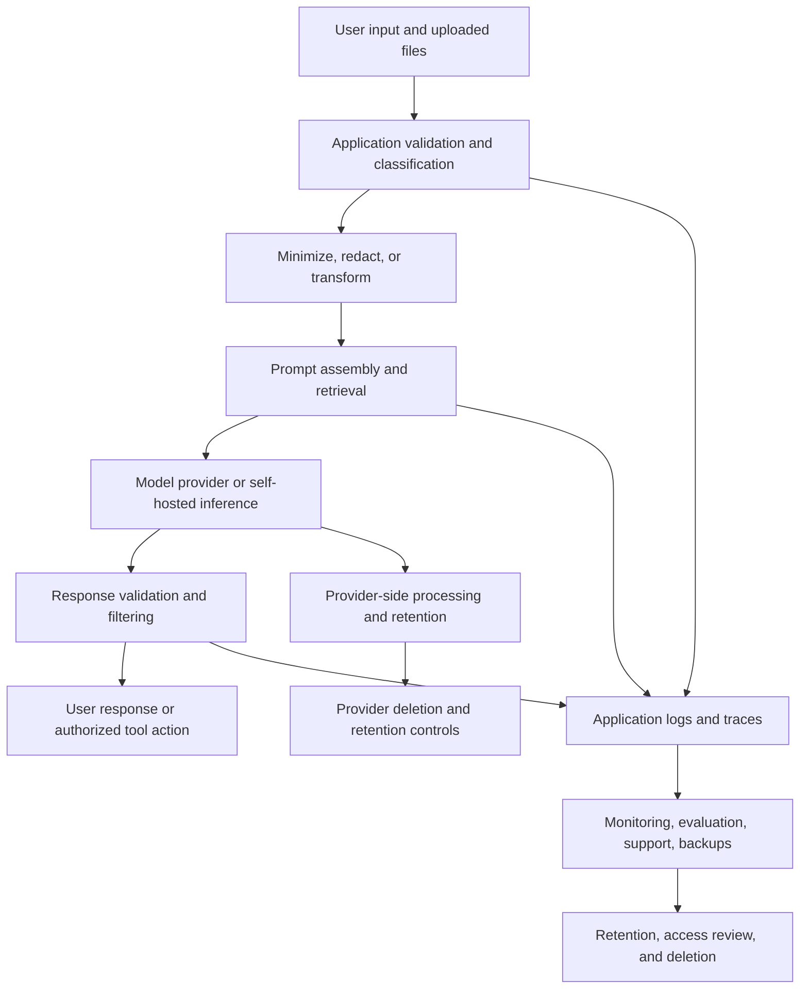

# Chapter 05 — Sensitive-Data Exposure and Privacy

## Learning objectives

By the end of this chapter, you should be able to:

- Classify public, personal, confidential, and secret information before sending it to a model.
- Trace sensitive fields through an application's request lifecycle and identify unnecessary copies.
- Apply data minimization and choose among redaction, pseudonymization, access controls, and other safeguards.
- Evaluate provider configuration, retention settings, and data-use terms without assuming that defaults are suitable.
- Explain why self-hosting can reduce some exposure paths but does not automatically make a system private or secure.

<br/>

## 1. Why sensitive-data exposure matters in GenAI

GenAI applications can move information through more components than a conventional form or database application. A single request may be copied into a prompt template, retrieval context, model-provider request, tool call, trace, error report, analytics event, cache, and final response.

Each copy is another place where information may be retained, accessed, misrouted, or exposed. The goal is not merely to remove a name from a prompt. The goal is to understand **which information is needed, where it travels, who can access it, how long it remains, and whether each copy is justified**.

Sensitive-data exposure can happen through:

- Excessive information included in a prompt or retrieved context.
- A model or external service receiving data it does not need.
- Debug logs, traces, evaluation datasets, crash reports, or support tickets containing raw prompts.
- Broad permissions that let a user retrieve another person's or tenant's information.
- Responses that repeat confidential details unnecessarily.
- Retention or reuse practices that differ from the application's assumptions.
- Copies that remain after the source record is corrected or deleted.
- Secrets placed in prompts, source code, environment dumps, or tool results.

Privacy is broader than confidentiality. A system can prevent unauthorized access and still collect more personal data than necessary, keep it too long, or use it for an unexpected purpose.

<br/>

## 2. Information classification

Classification gives teams a consistent way to decide what processing is permitted. The following four-level scheme is a practical starting point; organizations may use different names or more detailed classifications.

| Class | Typical examples | Default handling |
|---|---|---|
| **Public** | Published documentation, public product descriptions, public help articles | May be processed according to ordinary content and licensing rules; still validate provenance and integrity |
| **Personal** | Names, email addresses, phone numbers, account identifiers, location history, support conversations linked to a person | Process only for a defined purpose; minimize, restrict access, and apply retention rules |
| **Confidential** | Internal strategy, non-public contracts, customer records, source code, unreleased product plans, proprietary documents | Need-to-know access; verify whether each model or service is approved to receive it |
| **Secret / highly restricted** | API keys, passwords, private keys, session tokens, recovery codes, signing keys | Do not place in ordinary prompts or logs; use a secrets manager and narrowly scoped runtime access |

These categories can overlap. A customer contract may contain personal data and confidential business terms. A secret can also be personal or confidential. When categories overlap, apply the stricter relevant handling rule.

<br/>

### 2.1 Classification questions

For every field or document, ask:

1. **Whose information is it?** A user, employee, customer, partner, or organization?
2. **What harm could disclosure cause?** Identity theft, account compromise, financial loss, embarrassment, commercial harm, or regulatory exposure?
3. **Is it required for this task?** Would the model produce a useful result without it?
4. **Who is allowed to see it?** The end user, the application server, a model provider, a human reviewer, or an observability vendor?
5. **How long must it be retained?** Can it be deleted after the request or purpose is complete?
6. **Are there restrictions on location, transfer, purpose, or onward processing?**

Classification should be recorded in a data inventory or schema, not left only in an engineer's memory.

<br/>

## 3. Data minimization and purpose limitation

**Data minimization** means processing only the information reasonably needed for the stated task. **Purpose limitation** means using the information for the purpose for which it was collected or another permitted purpose—not silently repurposing it.

Before calling a model:

- Select only the fields needed for the task.
- Filter retrieved passages to the minimum relevant context.
- Avoid sending full database rows when a few derived values suffice.
- Avoid including entire conversation history when only the latest turn is needed.
- Do not send credentials or authentication tokens as context.
- Avoid putting raw identifiers in analytics, trace names, or error messages.
- Prefer local deterministic processing for simple tasks that do not need a model.
- Separate model-visible content from server-side metadata and authorization state.

<br/>

### Example: unnecessary versus minimized context

**Unnecessary:** Send a full customer record containing name, address, phone number, date of birth, account notes, and billing history so the model can draft a response about a delayed shipment.

**Minimized:** Send the shipment status, estimated delivery window, and a neutral order reference. The application can insert the customer's name or address later if genuinely required and authorized.

A useful design test is: *If this field were removed, would the model's task materially change?* If not, remove it unless there is a documented reason to retain it.

<br/>

## 4. Follow data through the request lifecycle

Privacy review must examine the entire lifecycle, not only the prompt.



This diagram is intentionally broader than a simple request/response flow. Logging, evaluation, support, backups, and provider processing can create additional copies outside the main application path.

<br/>

### 4.1 Lifecycle inventory

For each component, record:

- Data fields present.
- Why the component needs them.
- Whether the component stores or forwards them.
- Who can access the copy.
- Retention and deletion behavior.
- Whether the copy is encrypted in transit and at rest where applicable.
- Whether the component is operated by your organization or a third party.
- Which policy, contract, or configuration governs it.

| Lifecycle stage | Common unnecessary copy | Review question |
|---|---|---|
| Browser or client | Persisted draft, local cache, browser telemetry | Does the client need to retain the raw content? |
| API gateway | Full request-body logging | Can body logging be disabled or safely sampled/redacted? |
| Application service | Debug print, exception payload, temporary file | Can the value remain in memory only for the shortest necessary period? |
| Prompt construction | Entire conversation or database row | Which fields are required for the current task? |
| Retrieval / RAG | Unfiltered documents or broad search results | Is every passage authorized and necessary for this user and purpose? |
| Model provider | Prompt, response, uploaded file, provider trace | What is sent, retained, reviewed, or used for service improvement under the applicable terms? |
| Tool execution | Full model output, credentials, raw tool arguments | Can the tool receive a typed, minimal argument set instead? |
| Observability | Raw prompts, completions, headers, identifiers | Can telemetry use redacted fields, IDs, counts, or sampled metadata instead? |
| Evaluation | Production conversations copied into test sets | Is there a lawful basis, approved access, minimization, and a deletion process? |
| Backups and exports | Copies outside the primary deletion path | How are backup expiry and downstream deletion handled? |

<br/>

## 5. Redaction, pseudonymization, and access restrictions

These controls solve different problems. They are often used together rather than as substitutes.

### 5.1 Redaction

**Redaction** removes or masks sensitive content before it reaches a component.

Examples:

- `amaresh@example.com` → `[EMAIL]`
- `Account 839201` → `[ACCOUNT_ID]`
- A full street address → `[ADDRESS REMOVED]`

**Advantages**
- Can prevent the downstream component from receiving the original value.
- Simple redaction can reduce exposure in prompts, logs, and evaluation sets.
- Does not require a mapping table if the original value is discarded.

**Limitations**
- Context can still identify a person even when direct identifiers are removed.
- Poor pattern matching can miss formats, multilingual content, images, OCR text, or indirect identifiers.
- Over-redaction may remove information needed for the task.
- Redaction is not a substitute for authorization or retention controls.

<br/>

### 5.2 Pseudonymization

**Pseudonymization** replaces identifiers with stable or semi-stable tokens, such as `CUSTOMER_1042`. The original values may be recoverable through a separate mapping or key.

**Advantages**
- Preserves relationships across records when a stable token is useful.
- Can support testing and analytics without exposing direct identifiers to every component.
- Enables controlled re-identification by an authorized service when necessary.

**Limitations**
- Pseudonymized data is not necessarily anonymous.
- A mapping table, key, rare attributes, or external information may re-identify a person.
- Stable tokens can enable cross-session linkage.
- The tokenization service and mapping store become sensitive assets and must be protected.

Use separate storage and permissions for the mapping. Do not send the mapping to the model if the model only needs the token.

<br/>

### 5.3 Access restrictions

Access restrictions ensure that only authorized users and services can read data or perform actions. Controls include:

- Role-based access control (RBAC) or attribute-based access control (ABAC).
- Tenant-aware retrieval filters and server-side ownership checks.
- Least-privilege service identities.
- Separate permissions for production data, logs, and evaluation sets.
- Time-limited, audited access for support and incident response.

**Limitations:** Access control does not minimize the data already sent to an authorized but unnecessary component. It also cannot protect against every compromised account or overly privileged service.

<br/>

### 5.4 Encryption and tokenization are complementary

Encryption in transit and at rest reduces exposure if traffic or storage is accessed improperly, but authorized services may still decrypt data for processing. Tokenization replaces selected values with substitutes, but it does not automatically prevent inference from surrounding context. Neither control eliminates the need for minimization, authorization, retention limits, and monitoring.

| Control | Main purpose | Does not guarantee |
|---|---|---|
| Redaction | Remove selected sensitive values | No re-identification from remaining context |
| Pseudonymization | Replace identifiers while preserving useful linkage | Anonymity |
| Access restriction | Limit who can access data | That authorized components receive only necessary data |
| Encryption | Protect data in transit or storage | Protection from an authorized endpoint or compromised key |
| Data minimization | Reduce the data collected and exposed | Correct handling of the data that remains |
| Retention limits | Reduce the time data persists | Deletion from every copy unless downstream systems are covered |

<br/>

## 6. Re-identification risk after obvious identifiers are removed

Removing a name and email address is not the same as anonymizing a record. Remaining fields can identify a person alone or in combination.

Examples of potentially identifying attributes include:

- Exact date of birth or a narrow age range.
- Precise location, workplace, school, or travel pattern.
- Rare job title, unusual event, or distinctive medical or support history.
- Timestamps combined with public posts or known appointments.
- A unique sequence of purchases, interactions, or locations.
- Quoted text that can be searched elsewhere.
- Stable pseudonyms reused across datasets.

<br/>

### Example

A record without a name says: “A senior engineer at the only local robotics lab reported a rare incident at 02:13 on a particular date.” The combination of job, location, event, and time may be distinctive enough to identify the person.

<br/>

### Practical mitigation

- Generalize or suppress quasi-identifiers where feasible, such as reducing precise location to a broader region.
- Remove unnecessary timestamps and rare attributes.
- Avoid stable tokens when cross-record linkage is not required.
- Assess combinations of fields, not just each field independently.
- Restrict access to the transformed dataset and its mapping information.
- Use synthetic or appropriately de-identified data for development when practical.
- Test re-identification risk against realistic auxiliary information and the intended release context.

No transformation provides universal anonymity in every context. The required protection depends on the data, recipient, purpose, available auxiliary information, and consequences of re-identification.

<br/>

## 7. Provider configuration, retention, and data-use terms

Do not assume that all model providers, products, account tiers, or endpoints have identical data practices. Implementation notes should record the exact product and configuration being used, and should be checked against current official documentation and applicable contractual terms.

Review these dimensions:

1. **Training and service improvement:** Is submitted content used to train models or improve services? Are settings or account types relevant?
2. **Retention:** What prompt, response, file, abuse-monitoring, or diagnostic data is retained, and for how long?
3. **Deletion:** Which API or account controls exist? Do deletion guarantees cover files, vector stores, caches, logs, and backups?
4. **Human access:** Under what circumstances can provider personnel or subcontractors access content?
5. **Data location and transfers:** Where is processing performed, and are there residency or cross-border transfer commitments?
6. **Subprocessors:** Which third parties may handle the information?
7. **Security and compliance:** Which contractual commitments, audits, or certifications apply to the specific service?
8. **Configuration scope:** Do settings apply to the organization, project, endpoint, dataset, or individual request?
9. **Exceptions:** Are there separate rules for abuse monitoring, support, file uploads, fine-tuning, or other features?
10. **Change management:** Who reviews provider-term changes, product updates, and configuration drift?

<br/>

### Record a verifiable implementation note

For each external service, document:

- Provider, product, endpoint, and account tier.
- Data categories permitted for submission.
- Relevant retention and training/data-use settings.
- Source URLs and the date those sources were reviewed.
- Required contractual approvals or regional constraints.
- Owner responsible for periodic revalidation.
- Fallback behavior if the service or approved configuration is unavailable.

Useful official references to review for the actual provider and product in use:

- OpenAI API data controls: https://platform.openai.com/docs/guides/your-data
- OpenAI business privacy: https://openai.com/enterprise-privacy/
- Google Cloud privacy resources: https://cloud.google.com/privacy
- AWS privacy resources: https://aws.amazon.com/compliance/data-privacy/
- Microsoft Azure OpenAI data, privacy, and security: https://learn.microsoft.com/azure/ai-services/openai/

These links are starting points, not a claim that every feature or account has the same terms. Verify the current documentation, service-specific conditions, and signed agreement before approving a data flow.

<br/>

## 8. Self-hosting does not equal complete privacy protection

Self-hosting can reduce reliance on an external model API and may provide greater control over network routing, storage, logging, and deployment. However, it does not automatically eliminate privacy or security risks.

Self-hosted systems may still expose data through:

- Application logs, tracing agents, crash dumps, and local caches.
- Shared GPU servers, orchestration platforms, administrators, or overly broad service accounts.
- External embedding, reranking, OCR, speech, moderation, or observability services.
- Model downloads, telemetry, update mechanisms, and software dependencies.
- Unencrypted disks, snapshots, backups, and exported datasets.
- Prompt-injection attacks that cause authorized tools to disclose data.
- Poor deletion practices or retention policies.
- Unauthorized access to the underlying database or vector index.

<br/>

### Deployment comparison

| Dimension | Hosted model API | Self-hosted model |
|---|---|---|
| Operational control | Shared between customer and provider, according to service boundary | Greater control over infrastructure and configuration |
| External data transfer | Prompt/output may cross the provider boundary | Can be reduced if the full path stays internal |
| Infrastructure responsibility | Provider operates part of the serving stack | Organization operates and secures more of the stack |
| Privacy work still required | Minimize, configure, contract, restrict, audit, and manage retention | Minimize, restrict, secure infrastructure, audit, and manage retention |
| Common mistaken assumption | “The provider automatically protects every use case” | “Data never leaves our control, so privacy is solved” |

Choose deployment based on the threat model, data classification, operational capability, legal requirements, latency, and cost—not on the word *self-hosted* alone.

<br/>

## 9. Practical implementation pattern

The following Python example demonstrates a narrow allowlist, basic redaction, and a minimized payload. It is illustrative rather than a complete privacy filter: real systems need schema-aware processing, robust parsing, access control, and tests for their data formats.

```python
import re
from typing import Any

EMAIL_RE = re.compile(r"\b[A-Za-z0-9._%+-]+@[A-Za-z0-9.-]+\.[A-Za-z]{2,}\b")
PHONE_RE = re.compile(r"(?<!\w)(?:\+?\d[\d .()-]{7,}\d)(?!\w)")

def redact_text(text: str) -> str:
    """Basic example only; not a comprehensive PII detector."""
    text = EMAIL_RE.sub("[EMAIL]", text)
    text = PHONE_RE.sub("[PHONE]", text)
    return text

def build_model_payload(ticket: dict[str, Any]) -> dict[str, str]:
    # Allowlist only fields needed to summarize a delivery issue.
    allowed_fields = {
        "issue_summary",
        "shipment_status",
        "estimated_delivery",
    }

    selected = {
        key: ticket[key]
        for key in allowed_fields
        if key in ticket and isinstance(ticket[key], str)
    }

    # Redact free text as a defense-in-depth measure.
    return {
        key: redact_text(value)
        for key, value in selected.items()
    }

ticket = {
    "customer_name": "Example Customer",
    "email": "customer@example.com",
    "issue_summary": "Package delayed; contact customer@example.com",
    "shipment_status": "Delayed at regional depot",
    "estimated_delivery": "Friday",
    "billing_history": "Sensitive data not needed for this task",
}

payload = build_model_payload(ticket)
print(payload)
```

Important observations:

- The allowlist is the primary minimization control in this example.
- Redaction is an additional safeguard, not the sole privacy boundary.
- A real implementation should validate the input schema and define behavior for missing or malformed fields.
- Do not log the original `ticket` or the redacted payload by default.
- Keep authorization and customer identity checks in trusted application code, not in the model's natural-language judgment.
- Review whether even the shipment details could identify a person in the specific context.

<br/>

### 9.1 Safer logging pattern

Prefer structured, minimal telemetry over raw request/response logging:

```python
def audit_event(
    *,
    request_id: str,
    operation: str,
    outcome: str,
    input_bytes: int,
) -> dict[str, object]:
    # Deliberately excludes raw prompts, names, emails, and completions.
    return {
        "request_id": request_id,
        "operation": operation,
        "outcome": outcome,
        "input_bytes": input_bytes,
    }
```

A request ID can itself become linkable if it is joined to another dataset. Apply access controls and retention limits to metadata too. Do not put secrets, session tokens, or raw user content in exception messages.

<br/>

## 10. Privacy review checklist

Before production release, confirm:

- [ ] Data classes and allowed uses are documented.
- [ ] Each field sent to a model has a stated purpose.
- [ ] Secrets and unnecessary identifiers are excluded.
- [ ] Retrieval respects user, role, and tenant permissions before content enters the prompt.
- [ ] Redaction and pseudonymization have tests for known formats and failure cases.
- [ ] Logs, traces, analytics, caches, evaluation sets, exports, and backups are included in the data map.
- [ ] Provider configuration and contractual terms have been reviewed for the exact service.
- [ ] Retention and deletion behavior is documented and tested where possible.
- [ ] Access to production content and evaluation data is restricted and audited.
- [ ] A process exists for privacy incidents, access requests, and approved deletion requests.
- [ ] Self-hosted infrastructure and all auxiliary services are included in the threat model.
- [ ] The system has a safe fallback if the approved processing path is unavailable.

<br/>

## 11. Practice: map sensitive fields through a request lifecycle

### Scenario

A support assistant drafts responses about delayed orders. The input record includes:

```json
{
  "customer_name": "Riya Sen",
  "email": "riya@example.com",
  "phone": "+91 90000 12345",
  "order_id": "ORD-73184",
  "shipment_status": "Delayed at regional depot",
  "estimated_delivery": "Friday",
  "billing_history": ["..."],
  "internal_account_notes": "...",
  "session_token": "SECRET_VALUE"
}
```

The task is to explain the shipment delay and estimated delivery date. Assume the model does not need to authenticate the customer, issue a refund, or access billing history.

<br/>

### Exercise A — classify fields

Assign each field a class: public, personal, confidential, or secret. Note that classifications can overlap and should reflect the organization's policy.

<br/>

### Exercise B — trace the lifecycle

For every field, record whether it appears in:

1. Client request
2. Application memory
3. Prompt or retrieved context
4. Model provider or inference endpoint
5. Tool arguments
6. Logs and traces
7. Evaluation dataset
8. Backups or exports

Mark each appearance as **required**, **optional**, or **unnecessary** for the task.

<br/>

### Exercise C — identify unnecessary copies

Look for copies created by:

- Full request-body debug logging.
- Prompt logging in a tracing tool.
- Reusing raw production conversations in an evaluation dataset.
- Saving a request to a temporary file for troubleshooting.
- Copying all customer fields into a retrieval document.

For each copy, propose a safer alternative and specify an owner and retention rule.

<br/>

### Exercise D — propose a minimized payload

A reasonable starting point might be:

```json
{
  "shipment_status": "Delayed at regional depot",
  "estimated_delivery": "Friday"
}
```

Whether the order ID is needed depends on the task. If the application uses it to retrieve authorized shipment status, it may be needed in trusted application logic but not necessarily in the model prompt. The session token should not be sent to the model.

<br/>

### Exercise E — validate the design

Test that:

- The model payload excludes the name, email, phone, billing history, internal notes, and session token unless a documented task requirement changes the design.
- Logs contain no raw prompt or secret.
- Unauthorized users cannot retrieve the order record.
- A deletion request is handled across applicable downstream stores and retention windows.
- Removing direct identifiers does not leave a distinctive combination of attributes that can identify the customer.

<br/>

## 12. Checkpoint: what remains exposed after removing obvious identifiers?

Removing names, emails, and phone numbers does **not** guarantee anonymity. Exposure may remain through quasi-identifiers, rare events, precise timestamps or locations, distinctive free-text quotations, stable pseudonyms, linked datasets, model/provider retention, logs, caches, backups, and overly broad access permissions.

A strong answer should explain all of the following:

1. **Residual identification:** Remaining attributes may identify a person in combination.
2. **Residual copies:** Redaction in the prompt does not remove the original from application logs, traces, or backups.
3. **Residual access risk:** An authorized but over-privileged component may still receive unnecessary data.
4. **Residual processing risk:** Provider terms and configuration determine how submitted data is processed and retained.
5. **Residual inference risk:** A model or recipient may infer sensitive attributes from context even when those attributes were not explicitly provided.
6. **Residual linkage risk:** Stable tokens or request IDs can connect otherwise separated records.

The practical objective is risk reduction through layered controls: classify data, minimize it, transform it where useful, restrict access, secure every processing boundary, govern retention, and test the complete lifecycle.

<br/>

## 13. Review questions and answers

**Q1. Is pseudonymized data anonymous?**  
No. It may be re-identified through a mapping table, stable token, rare attributes, or auxiliary information.

**Q2. Why is data minimization often stronger than redaction alone?**  
Minimization prevents unnecessary fields from entering the processing path in the first place. Redaction can miss formats or contextual identifiers and may leave the original in other copies.

**Q3. If prompts are not used for model training, is privacy guaranteed?**  
No. Training use is only one dimension. Retention, abuse monitoring, human access, subprocessors, regional processing, logs, backups, and the application's own controls also matter.

**Q4. Does self-hosting guarantee that data stays private?**  
No. It can reduce external transfers, but local infrastructure, administrators, logs, backups, auxiliary services, and application vulnerabilities remain relevant.

**Q5. Which fields should be included in a prompt?**  
Only the fields needed for the model's specific task, after considering classification, authorization, context, and the applicable provider or deployment policy.

**Q6. Why should logs be treated as sensitive data stores?**  
Logs can duplicate raw prompts, outputs, identifiers, tool arguments, and error details. They often have separate access, retention, export, and backup paths.

**Q7. What should provider implementation notes include?**  
The exact product and endpoint, permitted data classes, relevant retention and data-use configuration, contractual constraints, source links and review date, and the owner responsible for revalidation.

<br/>

## 14. Further reading

Use current official documentation and organizational policies for implementation decisions:

- [NIST Privacy Framework](https://www.nist.gov/privacy-framework)
- [NIST Privacy Engineering Program](https://www.nist.gov/itl/applied-cybersecurity/privacy-engineering)
- [OWASP Top 10 for LLM Applications](https://owasp.org/www-project-top-10-for-large-language-model-applications/)
- [OpenAI API data controls](https://platform.openai.com/docs/guides/your-data)
- [OpenAI enterprise privacy](https://openai.com/enterprise-privacy/)
- [Google Cloud privacy](https://cloud.google.com/privacy)
- [AWS data privacy](https://aws.amazon.com/compliance/data-privacy/)
- [Microsoft Azure OpenAI data, privacy, and security](https://learn.microsoft.com/azure/ai-services/openai/)

Provider terms and product features can change. Re-check the exact service and account configuration before sending sensitive or regulated data.


<br/>


## Chapter summary

- Classify information before deciding where it may be processed.
- Minimize data before prompt assembly; do not rely on redaction alone.
- Treat redaction, pseudonymization, access restrictions, encryption, and retention controls as complementary.
- Map every copy across clients, applications, providers, tools, telemetry, evaluation, exports, and backups.
- Verify provider-specific data-use and retention terms rather than relying on assumptions.
- Self-hosting changes the trust boundary; it does not remove the need for privacy engineering.
- Removing obvious identifiers reduces risk but does not guarantee anonymity.
