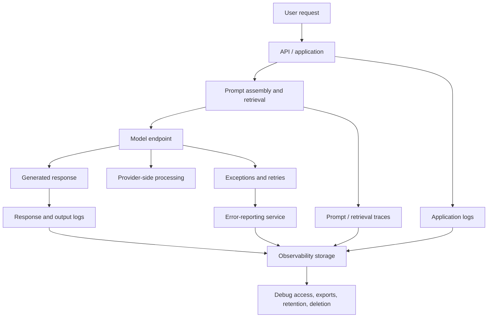
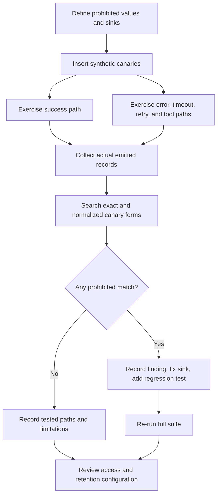

# Chapter 06 — Leakage Through Prompts, Logs, and Responses

## Learning objectives

By the end of this chapter, you should be able to:

- Inspect application logs, traces, exceptions, prompt capture, and generated responses for sensitive-data leakage.
- Use synthetic canary values to detect unintended exposure without using real secrets or personal data.
- Design allowlisted metadata logging and apply controlled redaction at relevant boundaries.
- Restrict debugging records and define retention and deletion requirements.
- Explain why hidden system instructions must never contain credentials and must not be treated as authorization secrets.
- Test success and failure paths by examining the records actually emitted by the application.

<br/>

## 1. What leakage looks like in a GenAI application

Sensitive information can escape through the main response or through supporting infrastructure. A response that looks safe to the user does not prove that the request was handled safely: the original prompt may already have been copied into a trace, exception, analytics event, or debugging record.

Common leakage paths include:

- **Prompt capture:** tracing frameworks or debug middleware store full system prompts, user messages, retrieved passages, and tool outputs.
- **Application logs:** request-body logging, debug prints, structured fields, or access logs include content or identifiers.
- **Traces and observability:** spans record prompts, completions, tool arguments, retrieved context, or model metadata.
- **Exceptions:** errors include request payloads, headers, file paths, SQL parameters, or third-party response bodies.
- **Generated responses:** the model repeats hidden context, internal notes, personal data, or a canary value.
- **Tool calls:** arguments contain more data than the tool needs, or tool output returns sensitive records to the model.
- **Evaluation and support artifacts:** captured production conversations are copied into test fixtures, tickets, screenshots, or bug reports.
- **Caches and temporary files:** raw content remains in files, notebooks, local caches, or exported traces.
- **Security controls themselves:** a redaction filter is configured for one logger but not for a separate tracing SDK or error-reporting service.

A complete review follows the data through all outputs and sinks—not just the final answer shown in the user interface.

<br/>

## 2. Model the leak paths



The diagram identifies multiple output channels. For each channel, determine:

1. What fields can be emitted?
2. Which component creates the record?
3. Which sinks receive it?
4. Who can read or export it?
5. How long is it retained?
6. How is deletion handled?
7. What tests demonstrate the expected behavior?

<br/>

## 3. Data inventory for logging and observability

Start with an inventory of record types rather than assuming that “logging” is one feature.

| Record type | Potentially sensitive content | Safer default |
|---|---|---|
| HTTP access log | URL query parameters, user IDs, headers, request sizes | Log route template, status, duration, and a non-sensitive request ID; omit authorization headers and bodies |
| Application event | User input, account data, internal notes | Allowlist event fields; avoid raw content |
| Prompt trace | System prompt, conversation history, retrieved documents | Disable content capture by default or use a reviewed, redacted trace mode |
| Model response trace | Completion, tool calls, refusal details | Record status and bounded metadata; capture content only with explicit need and access controls |
| Exception record | Payload fragments, tokens, provider response body, filesystem paths | Log error class, safe error code, operation, and request ID; sanitize external messages |
| Tool execution log | Arguments, query results, command output | Log tool name, validated argument categories, outcome, and duration—not raw values by default |
| Evaluation artifact | Real user conversations, labels, reviewer comments | Prefer synthetic or approved minimized datasets; limit access and retention |
| Support ticket or screenshot | Prompts, output, user identity, internal context | Share a minimal reproduction with synthetic values |
| Cache / temporary file | Raw prompt, uploaded content, completion | Avoid if unnecessary; apply expiry, access controls, and secure cleanup where feasible |

Logs can contain personal, confidential, or secret information even when the application database is properly secured. Treat telemetry stores as data stores with their own threat model.

<br/>

## 4. Allowlisted metadata logging

An **allowlist** specifies which fields may be emitted. This is safer than recording everything and trying to remove known sensitive patterns afterward.

Potentially useful metadata includes:

- Request or correlation ID generated for operational tracing.
- Operation name or route template.
- Outcome category and HTTP status code.
- Duration and approximate input/output byte or token counts.
- Model identifier and configuration version, when appropriate.
- Error class or controlled error code.
- Tool name and success/failure outcome.

Fields that should generally be excluded from routine logs include:

- Raw prompts and generated completions.
- Authorization headers, API keys, passwords, session tokens, and cookies.
- Full request and response bodies.
- Retrieved document text and full tool outputs.
- Personal identifiers unless a documented operational purpose requires a protected representation.
- Arbitrary provider exception messages that may echo the request.

Even metadata may be sensitive or linkable. Request IDs can be joined to other systems, timestamps can reveal behavior, and model configuration can expose internal details. Minimize metadata too, and apply access and retention controls.

<br/>

### 4.1 Example: allowlist-based event construction

```python
from dataclasses import asdict, dataclass
from time import time
from typing import Literal
import json
import logging

logger = logging.getLogger("genai.audit")

Outcome = Literal["success", "validation_error", "provider_error"]

@dataclass(frozen=True)
class AuditEvent:
    request_id: str
    operation: str
    outcome: Outcome
    duration_ms: int
    input_bytes: int

def emit_audit_event(event: AuditEvent) -> None:
    # Only explicitly approved fields are serialized.
    logger.info(json.dumps(asdict(event), separators=(",", ":")))

event = AuditEvent(
    request_id="req-demo-001",
    operation="draft_support_reply",
    outcome="success",
    duration_ms=182,
    input_bytes=240,
)
emit_audit_event(event)
```

This example intentionally does not accept a prompt, completion, header dictionary, or arbitrary payload. That design makes accidental inclusion harder. In a production implementation, validate field formats and lengths, protect log transport, and ensure the logging configuration does not attach sensitive contextual fields elsewhere.

Do not treat this example as a complete audit system. A production system also needs log integrity, access control, monitoring, time synchronization, retention, and incident-response procedures.

<br/>

## 5. Controlled redaction: defense in depth

Redaction is useful when a record must contain some text, but it should not be the primary reason a system is permitted to log raw content. The preferred order is:

1. **Avoid capture:** do not record raw content unless there is a justified requirement.
2. **Allowlist fields:** construct a record from approved fields only.
3. **Transform before emission:** redact or tokenize the few text fields that are required.
4. **Restrict access:** separate routine operational logs from approved sensitive debugging records.
5. **Limit retention:** delete records when their defined purpose expires.
6. **Test the emitted artifact:** inspect what actually reaches each sink.

<br/>

### 5.1 Example redaction helper

```python
import re

EMAIL_RE = re.compile(
    r"\b[A-Za-z0-9._%+-]+@[A-Za-z0-9.-]+\.[A-Za-z]{2,}\b"
)
TOKEN_LIKE_RE = re.compile(
    r"\b(?:sk-[A-Za-z0-9_-]{12,}|Bearer\s+[A-Za-z0-9._~-]+)\b",
    re.IGNORECASE,
)

def redact_for_debug(text: str) -> str:
    """Illustrative filter; not a complete DLP or secret detector."""
    text = EMAIL_RE.sub("[EMAIL]", text)
    text = TOKEN_LIKE_RE.sub("[TOKEN]", text)
    return text
```

**Limitations:**

- Pattern-based filters can miss unfamiliar token formats, multiline secrets, encoded values, structured files, image content, or non-English identifiers.
- A filter can redact a value in a message but miss it in a nested exception, trace attribute, tool argument, or provider SDK log.
- Redaction can occur after the raw value has already been sent to another sink.
- Redaction rules may create false positives or damage useful diagnostic context.
- A redaction library's presence does not prove that every logger uses it.

For high-risk data, prefer not to emit it. Where content capture is required, use a tested data-loss-prevention strategy appropriate to the data types and formats, and document its known gaps.

<br/>

## 6. Exceptions, retries, and debugging paths

Failure paths often leak more than success paths because developers add diagnostic detail when something goes wrong.

Inspect:

- Validation failures that echo submitted values.
- Provider exceptions that include request or response bodies.
- Stack traces that expose local paths, environment details, or variable representations.
- Retry middleware that logs every attempt with the full payload.
- Tool errors that include database rows or command output.
- Dead-letter queues and failed-job payloads.
- Error-reporting SDKs that capture local variables or request context automatically.
- Fallback logic that prints the original prompt when a model call fails.

<br/>

### Safer exception-handling pattern

```python
import logging

logger = logging.getLogger("genai.service")

class SafeProviderError(RuntimeError):
    pass

def call_model_safely(model_client, payload, request_id: str):
    try:
        return model_client.generate(payload)
    except Exception as exc:
        # Log only controlled metadata; do not log payload or raw exception text.
        logger.error(
            "model_call_failed request_id=%s error_type=%s",
            request_id,
            type(exc).__name__,
        )
        # Preserve a generic error for upstream callers.
        raise SafeProviderError("Model service request failed") from None
```

This pattern avoids exposing the payload and suppresses the original exception chain from the caller. However, a runtime or error-monitoring agent may still capture the original exception before it is handled. Review the SDK's automatic capture behavior and test it. In some systems, retaining the exception chain in a restricted internal channel is operationally necessary; if so, apply a deliberate policy and avoid unrestricted raw-payload capture.

Also ensure that callers do not return raw exception strings to end users.

<br/>

## 7. Synthetic canaries for leakage detection

A **canary** is a unique, synthetic marker placed in a controlled test input so that unintended copying or disclosure can be detected. A canary is not a real credential, and it should never grant access to anything.

Example canary values:

- `CANARY_EMAIL_7f31@example.invalid`
- `CANARY_SECRET_4a91_NOT_A_REAL_KEY`
- `CANARY_DOC_MARKER_8c2e`

Use unmistakable values that are not valid credentials or real personal data. Avoid reusing the same canary across every environment indefinitely; a known value can become noisy or be intentionally filtered. Generate per-test or per-run markers where practical.

<br/>

### 7.1 What canaries can reveal

A synthetic canary can help detect:

- A raw prompt written to a log.
- A prompt or retrieved passage captured by tracing.
- A value echoed into a generated response.
- A secret-like field copied into tool arguments.
- An exception or retry record containing original content.
- A raw value present in a test export or evaluation artifact.

Canaries provide evidence about the paths exercised by the test. They do **not** prove that every possible path is safe, nor do they detect all leakage when a system transforms, encodes, truncates, or summarizes the value.

<br/>

### 7.2 Example test strategy

1. Generate a unique canary for the run.
2. Submit it through a controlled test request in a field that should not be logged or returned.
3. Exercise a successful model response.
4. Exercise validation failure, provider failure, timeout, retry, and tool failure where test infrastructure permits.
5. Collect the emitted application logs, trace records, error-monitoring events, and test responses.
6. Search for the exact canary and known encodings or transformations.
7. Fail the test if the canary appears in a prohibited sink.
8. Store the test result and sink inventory, not the raw sensitive test payload.
9. Repeat after changing logging, SDK, middleware, or provider configuration.

<br/>

### 7.3 Example canary assertion

The following is a small test pattern. The `captured_records` collection should contain actual records exported by the test harness from the sinks under review—not a manually prepared string that merely resembles a log.

```python
def assert_canary_absent(
    canary: str,
    captured_records: list[str],
    *,
    prohibited_sinks: list[str],
) -> None:
    findings = [
        sink
        for sink, record in zip(prohibited_sinks, captured_records)
        if canary in record
    ]
    if findings:
        raise AssertionError(
            f"Synthetic canary found in prohibited sinks: {findings}"
        )
```

This simple example assumes one record per sink and exact-string matching. A real test harness should model each sink explicitly, handle multiple records per sink, and search expected encodings or normalized forms. It should also distinguish permitted test-input storage from prohibited production-like logging.

<br/>

## 8. Hidden instructions are not secrets or authorization controls

System and developer instructions can guide model behavior, but they are not a secure storage mechanism. They may be exposed through prompt-injection attacks, debugging tools, accidental prompt capture, model behavior, or misconfigured endpoints.

**Never place credentials or reusable secrets in hidden instructions.** Examples include API keys, database passwords, private keys, session tokens, and long-lived access tokens.

Hidden instructions must not act as authorization secrets because:

- The model may disclose or paraphrase them.
- They can be copied into logs, traces, evaluation artifacts, or provider requests.
- A prompt is not a reliable access-control boundary.
- The model may be induced to ignore or reinterpret instructions.
- Knowing a hidden instruction should not grant permission to read data or perform an action.

<br/>

### Correct separation of responsibilities

- **Prompt instructions:** describe the task, constraints, and expected response format.
- **Authentication:** establish the identity of the caller through trusted application mechanisms.
- **Authorization:** enforce whether that identity may access a record or perform an action, in application or tool code.
- **Secrets management:** store credentials in a dedicated secret store or protected runtime configuration.
- **Logging policy:** determine which metadata may be recorded and which content must be excluded.
- **Canary tests:** verify that sensitive markers do not appear in prohibited outputs.

A prompt may say, “Only summarize documents the user is authorized to access,” but this statement is not sufficient. The retrieval service must enforce authorization before returning documents to the model.

<br/>

## 9. Access control and retention for debugging records

Debugging data often receives weaker protection than primary production data even though it may contain the same sensitive values. Treat logs and traces as governed data stores.

### Access controls

- Use role-based or attribute-based access controls.
- Separate routine operations access from exceptional access to sensitive traces.
- Require approval or time-limited access for production content.
- Audit access, exports, and permission changes.
- Keep test and production observability projects separate.
- Disable automatic local-variable capture unless it is explicitly needed and safe.
- Restrict log-search and export permissions; read-only access can still enable bulk exfiltration.
- Avoid placing sensitive records in shared dashboards, screenshots, or public issue trackers.

<br/>

### Retention controls

Define retention by purpose and record class. Do not retain raw prompts indefinitely “just in case.”

A retention policy should specify:

- Which record types are retained.
- The business or security purpose for retention.
- The maximum retention period or deletion trigger.
- Who owns the policy and approves exceptions.
- How deletion works for primary stores, replicas, exports, and backups.
- How legal holds or incident investigations are handled.
- How compliance is verified.

A log-expiry setting is not proof that all copies are deleted. Verify actual behavior for trace storage, object storage, exports, backups, and third-party monitoring services.

<br/>

## 10. Practical verification workflow

Use the following repeatable workflow for a GenAI service.



<br/>

### Test matrix

| Test path | Example trigger | Evidence to inspect |
|---|---|---|
| Successful request | Normal request containing a canary in a designated test-only field | Application logs, prompt traces, provider instrumentation, output |
| Input validation failure | Invalid schema or oversized test input | HTTP response, validation log, error-monitoring record |
| Provider failure | Mocked provider exception containing a canary | Exception record, retry logs, returned error |
| Timeout and retry | Controlled timeout with retry enabled | Every attempt, queue record, final error |
| Tool failure | Mock tool returns a canary in its error | Tool logs, agent trace, final response |
| Output leakage | Controlled test context includes a canary that must not be disclosed | Final response, response logs, trace records |
| Background processing | Failed queued job or dead-letter path | Queue payload, worker logs, error capture |
| Export / evaluation | Export test records to an evaluation pipeline | Files, dataset rows, metadata, access permissions |

Tests should use isolated non-production environments where possible. If production verification is required, use approved synthetic markers, limited scope, and a documented rollback plan.

<br/>

## 11. Practice: trigger success and error paths

### Scenario

A GenAI support assistant receives a test-only canary in an input field that must not be logged or included in the answer:

`CANARY_SECRET_4a91_NOT_A_REAL_KEY`

The application uses:
- A web API and request middleware.
- A prompt template and model client.
- A tracing SDK.
- Structured application logging.
- Error monitoring.
- A retry wrapper.
- A support-response renderer.

<br/>

### Exercise A — define expected behavior

Write down the sinks where the canary is prohibited. At minimum, consider routine application logs, traces, error-monitoring records, user-visible output, and evaluation exports. If a specific test fixture is intentionally allowed to contain the canary, document that exception.

<br/>

### Exercise B — run the success path

Submit a valid test request and collect the actual records emitted by all relevant sinks. Search for the canary in the response and every collected record.

<br/>

### Exercise C — run failure paths

Use controlled mocks to trigger:
- Input validation failure.
- Provider exception.
- Timeout and retry.
- Tool exception.
- Output validation failure.

Inspect the response, logs, trace spans, exception reporter, and any failed-job record. Do not assume that a failure was safe because the user received a generic message.

<br/>

### Exercise D — verify redaction coverage

Check whether each sink applies the intended policy. Determine whether redaction occurs before emission or only in the dashboard presentation layer. Confirm whether the tracing SDK or error reporter independently captures raw data.

<br/>

### Exercise E — fix and regress

If the canary appears in a prohibited sink:
1. Identify the component that emitted the record.
2. Remove unnecessary content capture or replace it with an allowlisted event.
3. Restrict access to existing exposed records.
4. Apply the defined deletion or retention process.
5. Add a regression test for that exact path.
6. Re-run the entire test matrix, not just the path that originally failed.

<br/>

## 12. Checkpoint: inspect emitted records, not configuration claims

A redaction setting is only a hypothesis until its effect is verified at each output boundary. A logger may redact message text but not structured attributes; a tracing SDK may capture prompts independently; an error reporter may attach local variables; a retry wrapper may log raw inputs; and a dashboard may hide values that remain in the stored event.

A strong checkpoint answer should explain:

1. **Sink coverage:** Every relevant output channel was enumerated.
2. **Path coverage:** Success, validation error, provider error, timeout, retry, tool failure, and background-job paths were tested as applicable.
3. **Actual evidence:** Tests inspected records emitted by the running system or test harness, not just configuration files.
4. **Canary handling:** Unique synthetic markers were searched for in prohibited sinks, including relevant normalized forms.
5. **Access and retention:** Debug records have explicit permissions, audit trails, and expiry/deletion rules.
6. **Secret separation:** Hidden instructions contain no credentials and are not relied upon for authentication or authorization.
7. **Known limits:** Untested sinks and transformations are recorded rather than silently treated as safe.

<br/>

## 13. Review questions and answers

**Q1. Why is checking the final model response insufficient?**  
The prompt or tool output may already have been copied to logs, traces, exception reports, or evaluation datasets even when the user-facing response is safe.

**Q2. What is a synthetic canary?**  
A unique, non-secret test marker used to detect unintended copying or disclosure through controlled application paths.

**Q3. Do canaries prove that the system never leaks data?**  
No. They provide evidence for the paths, formats, and sinks tested. Other paths, encodings, transformations, or sensitive values may behave differently.

**Q4. Why prefer allowlisted logging over broad logging plus redaction?**  
Allowlisting starts from a small set of approved fields and reduces dependence on detecting every possible sensitive value. Redaction remains useful as defense in depth.

**Q5. Why must exceptions be inspected separately?**  
Exceptions, retries, and error-reporting SDKs may include request bodies, provider response content, local variables, or other diagnostic details that are absent from success logs.

**Q6. Can a hidden system prompt be used to store an API key safely?**  
No. Prompts can be disclosed or captured and are not designed to protect credentials. Keep secrets in a secrets manager and enforce permissions in trusted code.

**Q7. What proves that a redaction rule is effective?**  
Tests against actual emitted records from each relevant sink and execution path, with documented coverage and known limitations.

<br/>

## 14. Further reading

- [OWASP Top 10 for LLM Applications](https://owasp.org/www-project-top-10-for-large-language-model-applications/)
- [OWASP Logging Cheat Sheet](https://cheatsheetseries.owasp.org/cheatsheets/Logging_Cheat_Sheet.html)
- [OWASP Secrets Management Cheat Sheet](https://cheatsheetseries.owasp.org/cheatsheets/Secrets_Management_Cheat_Sheet.html)
- [NIST Privacy Framework](https://www.nist.gov/privacy-framework)
- [OpenTelemetry documentation](https://opentelemetry.io/docs/)
- [OpenAI API data controls](https://platform.openai.com/docs/guides/your-data)

Review the current behavior and configuration of the specific logging, tracing, model, and error-monitoring products in your stack. General documentation cannot establish that your deployed system emits safe records.


<br/>


## Chapter summary

- Leakage can occur in prompts, responses, logs, traces, exceptions, retries, tools, evaluation artifacts, caches, and exports.
- Use allowlisted metadata and avoid raw-content capture by default.
- Treat redaction as defense in depth; it can miss alternate sinks and failure paths.
- Use synthetic canaries to detect unintended exposure in actual emitted records.
- Test success and failure paths, then preserve regression tests.
- Restrict debugging records and define retention, deletion, and audit procedures.
- Never place credentials in hidden instructions or treat prompt secrecy as an authorization mechanism.
