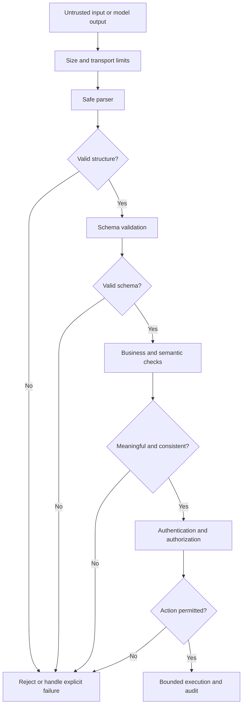
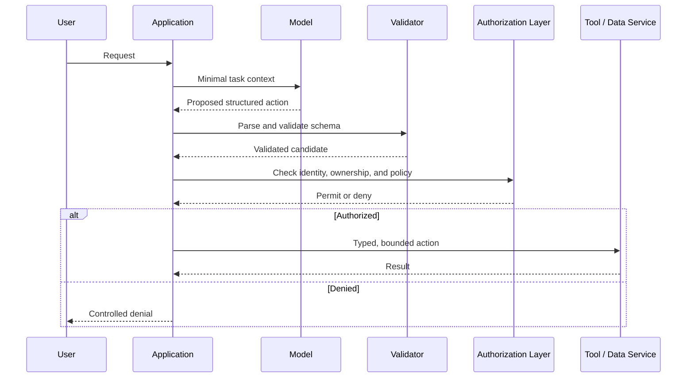

# Chapter 07 — Input Validation, Output Validation, and Safe Parsing

## Learning objectives

By the end of this chapter, you should be able to:

- Validate types, lengths, sizes, enumerated values, required fields, and permitted operations at application boundaries.
- Parse JSON using standard parsing libraries and validate structured data with Pydantic.
- Apply business rules and semantic checks after structural schema validation.
- Handle refusals, incomplete output, invalid values, and failed validation explicitly.
- Avoid execution-based parsing and unbounded repair or retry loops.
- Explain why structurally valid data is not automatically authorized or safe to use.

<br/>

## 1. Why validation matters in GenAI applications

A model response is data from a probabilistic system. Even when prompted to return a particular format, it may return malformed JSON, omit required fields, produce an unexpected enum, invent an identifier, or provide a syntactically valid value that violates application rules.

Validation is therefore an application responsibility—not a formatting preference delegated to the model.

A robust pipeline separates at least five questions:

1. **Parsing:** Can the bytes or text be interpreted using the expected format?
2. **Structural validation:** Does the parsed value match the expected types, fields, constraints, and schema?
3. **Semantic validation:** Do the values make sense together under the domain rules?
4. **Authorization:** Is this caller permitted to perform the requested action on the specified resource?
5. **Execution safety:** Can the validated, authorized action be performed safely, with bounded resource use and controlled side effects?

Passing one stage does not imply passing the next.



For user-supplied input, authentication and authorization may happen earlier as well; the diagram emphasizes that permission must be checked before protected data access or side effects.

<br/>

## 2. Validate at every trust boundary

Validate data when it enters the application, when it crosses service boundaries, and before a model-generated value is used to query data or trigger an action.

Common boundaries include:

- HTTP request bodies and query parameters.
- Uploaded files and extracted document content.
- Retrieved content transformed into structured fields.
- Model-generated JSON and tool-call arguments.
- Results returned by external APIs or tools.
- Data loaded from queues, caches, or persistent stores.
- Values passed to database queries, shell commands, file paths, or other sensitive operations.

A value validated by one component should not automatically be trusted by another component if it can be modified in transit or if the second component has different constraints.

<br/>

## 3. Structural validation: types, lengths, sizes, and enums

### 3.1 Types and required fields

A schema should state which fields are required, which are optional, and what types they accept. Avoid relying on implicit conversions such as turning arbitrary strings into numbers without checking whether the conversion is appropriate.

For example, an order lookup might require:
- `order_id`: a bounded string matching the application's identifier format.
- `reason`: an enum from a fixed set.
- `include_history`: a Boolean with an explicit default, if omission is permitted.

Reject unexpected fields when practical for security-sensitive operations. Otherwise, extra fields may be silently ignored by one component but interpreted by another.

<br/>

### 3.2 Length and size limits

Apply limits before expensive parsing or model calls:

- Maximum HTTP body size.
- Maximum string length per field.
- Maximum number of array elements and object properties.
- Maximum nesting depth where supported.
- Maximum uploaded file size and extracted-text size.
- Maximum number of tool calls, retrieval results, and output tokens.
- Timeouts and bounded resource use for parsing and validation.

Schema-level string constraints do not replace transport-level request limits. A huge body can consume resources before field validation runs.

<br/>

### 3.3 Enumerated values and allowed operations

Use enums or literal sets for fields with a finite set of valid values. Avoid asking the model to produce an arbitrary operation name, URL, database table, shell command, or permission level.

For example, allow `operation="lookup_order"` or `operation="summarize_policy"` instead of allowing a free-form `operation` string to decide what code executes.

<br/>

### 3.4 Example validation checklist

| Constraint | Example check | Failure behavior |
|---|---|---|
| Type | `order_id` must be a string | Reject request |
| Required field | `operation` must be present | Reject request |
| Length | `order_id` length is bounded | Reject request |
| Enum | `operation` must be in an allowlist | Reject request |
| Size | Request body is below configured limit | Return a controlled size error |
| Collection bound | At most 20 requested IDs | Reject or ask caller to narrow scope |
| Format | Identifier matches a defined pattern | Reject request |
| Unknown field | No unrecognized action parameters | Reject for sensitive action schemas |
| Timeout | Parsing or downstream call completes within a limit | Abort safely |
| Authorization | Caller owns or may access the resource | Deny without exposing protected data |

<br/>

## 4. Safe JSON parsing

Use a standard JSON parser such as Python's `json` module. Do not evaluate model output as source code.

**Never use `eval()` or `exec()` to parse JSON-like model output.** These functions execute Python expressions and can turn untrusted text into code execution.

Unsafe pattern:

```python
# DO NOT DO THIS:
# data = eval(model_output)
```

Safer parsing starts with a size limit and a JSON parser:

```python
import json

MAX_OUTPUT_CHARS = 20_000

def parse_json_object(text: str) -> dict:
    if not isinstance(text, str):
        raise ValueError("Expected text output")

    if len(text) > MAX_OUTPUT_CHARS:
        raise ValueError("Output exceeds permitted size")

    try:
        value = json.loads(text)
    except json.JSONDecodeError as exc:
        raise ValueError("Output is not valid JSON") from None

    if not isinstance(value, dict):
        raise ValueError("Expected a JSON object")

    return value
```

This code checks the text length and top-level type. It does not yet validate field constraints, semantic meaning, authorization, or all resource-exhaustion risks. For untrusted inputs with high complexity, use parser and transport limits appropriate to the environment.

Avoid ad hoc parsing of JSON with regular expressions. Regular expressions are not a reliable replacement for a JSON parser.

<br/>

## 5. Schema validation with Pydantic

Pydantic can validate parsed data against explicit types and constraints. The following example uses Pydantic v2 style.

```python
from typing import Literal
from pydantic import BaseModel, ConfigDict, Field, ValidationError

class OrderLookupRequest(BaseModel):
    model_config = ConfigDict(extra="forbid", strict=True)

    operation: Literal["lookup_order"]
    order_id: str = Field(
        min_length=6,
        max_length=32,
        pattern=r"^[A-Z0-9-]+$",
    )
    include_history: bool = False

def validate_lookup_payload(raw: object) -> OrderLookupRequest:
    return OrderLookupRequest.model_validate(raw, strict=True)

candidate = {
    "operation": "lookup_order",
    "order_id": "ORD-73184",
    "include_history": False,
}

try:
    request = validate_lookup_payload(candidate)
except ValidationError:
    # Do not expose internal schema details or submitted sensitive values by default.
    raise ValueError("Invalid order lookup request") from None
```

What this provides:

- Required fields and declared types.
- A bounded identifier string with a format pattern.
- A finite allowed operation.
- Explicit rejection of unexpected fields.
- Strict validation to reduce implicit coercion.

What this does **not** provide:

- Proof that the order exists.
- Proof that the caller owns or may access the order.
- Proof that history access is permitted.
- Proof that a lookup is appropriate for the current business workflow.
- Protection against all resource exhaustion or downstream injection.

A schema is a contract for shape and constraints, not an authorization policy.

<br/>

## 6. Business rules and semantic checks

Structurally valid data can still be impossible, inconsistent, misleading, or unauthorized.

Examples:

- `start_date` is later than `end_date`.
- A refund amount is negative or exceeds the refundable balance.
- An order ID has the correct format but does not belong to the authenticated user.
- A generated age is outside the domain's allowed range.
- A requested operation is valid but not available in the current workflow.
- A date is syntactically valid but falls outside an allowed booking window.
- A model invents a product ID that matches the pattern but does not exist.
- A generated summary claims a field was verified even though no trusted source supports it.

Semantic checks should be implemented in trusted application code and, where possible, against authoritative sources.

<br/>

### 6.1 Example: cross-field validation

```python
from datetime import date
from pydantic import BaseModel, ConfigDict, Field, model_validator

class DateRange(BaseModel):
    model_config = ConfigDict(extra="forbid", strict=True)

    start_date: date
    end_date: date
    max_days: int = Field(default=31, ge=1, le=366)

    @model_validator(mode="after")
    def check_range(self):
        if self.start_date > self.end_date:
            raise ValueError("start_date must not be after end_date")

        duration = (self.end_date - self.start_date).days
        if duration > self.max_days:
            raise ValueError("Requested date range is too large")

        return self
```

This example enforces cross-field consistency and a bounded range. In a real API, consider whether `max_days` should be a server-owned configuration value rather than a caller-controlled field. A user should not be able to increase their own limit by submitting a larger value.

<br/>

### 6.2 Check against authoritative data

If a model proposes `order_id="ORD-73184"`, verify existence and access using the application's database or service:

```python
def authorize_order_lookup(user, order_id: str, order_repository):
    order = order_repository.get_by_id(order_id)
    if order is None:
        raise LookupError("Order not found")

    if not user.can_access_order(order):
        # Consider a uniform response to avoid disclosing whether another
        # user's order exists.
        raise PermissionError("Order unavailable")

    return order
```

The example assumes `user.can_access_order` and the repository are trusted application interfaces. In production, enforce authorization server-side on every request and consider whether different error messages reveal resource existence.

<br/>

## 7. Output validation and model response states

Model output needs an explicit state model. Do not treat every response as a successful, complete, usable result.

Possible states include:

- **Success:** output is complete, parseable, structurally valid, semantically valid, and authorized for its intended use.
- **Refusal:** the model declined the request or returned a refusal state supported by the API.
- **Incomplete / truncated:** generation stopped before a complete response was produced, such as because of a token limit or interruption.
- **Malformed:** JSON or another required format could not be parsed.
- **Schema-invalid:** parsed output fails the declared schema.
- **Semantically invalid:** schema passes, but business rules fail.
- **Unauthorized proposal:** output requests a valid operation on a resource the caller may not access.
- **Provider or transport failure:** no reliable model result is available.
- **Unknown state:** an API or SDK returns an unrecognized status; fail closed for sensitive actions.

The exact status fields differ across model APIs and SDKs. Check the actual response metadata supplied by the provider rather than inferring completion solely from the presence of text.

<br/>

### Recommended handling

| State | Recommended behavior |
|---|---|
| Complete and valid | Continue to semantic checks and authorization before use |
| Refusal | Preserve refusal state; do not parse it as a successful business result |
| Incomplete | Do not execute partial output; retry only under a bounded policy if appropriate |
| Malformed | Reject or make one constrained retry if safe and useful |
| Schema-invalid | Reject; record a safe error category and add a regression case |
| Semantically invalid | Reject or request a correction under bounded rules; never silently coerce critical values |
| Unauthorized | Deny in trusted application code; do not let the model approve itself |
| Provider failure | Return a controlled failure or safe fallback |
| Unknown state | Fail closed for consequential operations and alert if appropriate |

A “repair” prompt can sometimes fix a formatting problem, but it does not establish correctness, authorization, or truth. Do not repeatedly ask a model to repair output until it happens to pass.

<br/>

## 8. Bounded repair and retry behavior

Retries can increase cost, latency, and exposure. A loop that repeatedly sends malformed output back to the model can also amplify prompt injection or leak more context.

A safer retry policy defines:

- A small maximum number of attempts.
- Which failures are retryable.
- A strict timeout and token budget.
- Whether the original prompt or sensitive context must be resent.
- Whether a retry can repeat side effects.
- A terminal failure state and useful telemetry.
- A backoff strategy for transient provider failures, separate from format-repair retries.

<br/>

### Example: one bounded format retry

```python
def get_validated_result(call_model, initial_prompt, schema_validator):
    # Maximum of two total attempts: initial call plus one repair attempt.
    for attempt in range(2):
        output = call_model(initial_prompt)

        if output.refusal:
            return {"status": "refusal"}

        if not output.complete:
            if attempt == 0:
                continue
            return {"status": "incomplete"}

        try:
            parsed = parse_json_object(output.text)
            validated = schema_validator(parsed)
            return {"status": "success", "data": validated}
        except (ValueError, TypeError):
            if attempt == 0:
                initial_prompt = (
                    initial_prompt
                    + "\nReturn only a complete JSON object matching the required schema."
                )
            else:
                return {"status": "invalid_output"}

    return {"status": "invalid_output"}
```

This is illustrative: production code must align `output.refusal` and `output.complete` with the actual provider response structure, avoid concatenating untrusted text into instructions, and ensure that retries do not duplicate actions. A dedicated repair prompt should include only the minimum necessary information. For a consequential operation, it is often safer to return a controlled failure than to repair automatically.

<br/>

## 9. Avoid execution-based and ambiguous parsing

Do not use:

- `eval()` or `exec()` on model output.
- Dynamic imports or arbitrary code execution to interpret a response.
- Shell commands constructed from free-form model text.
- SQL constructed by string concatenation from generated values.
- Regular expressions as a general-purpose JSON parser.
- “Best effort” parsing that silently drops invalid fields from a high-impact request.
- Automatic type coercion for money, permissions, identities, or other consequential values without explicit rules.

Prefer:

- Standard parsers for the declared data format.
- Pydantic or another well-maintained schema-validation library.
- Parameterized database queries.
- Enumerated operations and allowlisted destinations.
- Explicit conversion and range checks.
- Fail-closed handling for protected actions.
- Human review for ambiguous or high-impact cases.

Structured output features from a model provider can reduce formatting errors, but application-side validation remains necessary. A schema-conforming output can still contain fabricated values or request an unauthorized action.

<br/>

## 10. Safe integration pattern for tool calls

A model may propose a tool call, but the application should treat the proposal as untrusted input.



The application—not the model—must make the final authorization decision. Tool functions should validate their own arguments and enforce permissions as well, especially when they can be called from multiple paths.

<br/>

## 11. Practice: malformed, oversized, unauthorized, and semantically invalid data

### Scenario

An assistant can look up an order and draft a summary. It must not perform refunds. The only allowed model-proposed operation is `lookup_order`.

<br/>

### Test A — malformed input

Examples:
- Broken JSON: `{"operation": "lookup_order",`
- A string where an object is required.
- Duplicate or conflicting fields, if your parser or interface permits them.

**Expected result:** safe parser or schema validation rejects the input. No protected lookup occurs.

<br/>

### Test B — oversized input

Examples:
- Request body exceeds the configured maximum.
- `order_id` contains thousands of characters.
- An array contains an excessive number of IDs.
- A deeply nested JSON object attempts to consume excessive resources.

**Expected result:** transport or schema limits reject it before expensive processing. No unbounded parsing, retrieval, or model call occurs.

<br/>

### Test C — valid but unauthorized input

Example:

```json
{
  "operation": "lookup_order",
  "order_id": "ORD-73184",
  "include_history": true
}
```

Assume the schema is valid but the authenticated user does not own the order.

**Expected result:** the server-side authorization layer denies access. Schema validation must not be treated as permission.

<br/>

### Test D — semantically invalid input

Examples:
- `start_date` is later than `end_date`.
- A requested amount is negative.
- A valid identifier format refers to a nonexistent record.
- A valid enum is not allowed in the current workflow.

**Expected result:** business rules or authoritative data checks reject it before side effects.

<br/>

### Test E — invalid model output

Examples:
- Invalid JSON.
- Missing required field.
- Unknown enum.
- A syntactically valid but impossible date range.
- A refusal or incomplete response treated incorrectly as a successful result.

**Expected result:** output state is classified explicitly; no action occurs until all required checks pass.

<br/>

### Test F — retry bounds

Mock the model so that it returns invalid output repeatedly. Verify that the application stops after the configured maximum number of attempts and returns a controlled failure.

<br/>

## 12. Checkpoint: valid structure is not permission

A valid schema establishes only that data conforms to a declared format. It does not prove that the data is true, appropriate, safe, or authorized.

For example, this object may be structurally valid:

```json
{
  "operation": "lookup_order",
  "order_id": "ORD-73184",
  "include_history": true
}
```

But the application must still verify:

- The caller is authenticated.
- The caller may access this specific order.
- History access is permitted for the current purpose.
- The order exists and its state supports the requested operation.
- The request fits rate, size, and resource limits.
- Any resulting action is safe and properly audited.

A strong checkpoint answer distinguishes **parsing**, **schema validation**, **semantic validation**, **authorization**, and **safe execution**. These are separate gates. Passing an earlier gate must never bypass a later one.

<br/>

## 13. Review questions and answers

**Q1. Why should model output be treated as untrusted input?**  
Because it can be malformed, incomplete, fabricated, manipulated by untrusted context, or structurally valid while violating business or security rules.

**Q2. Is valid JSON enough to safely use a model response?**  
No. JSON parsing verifies syntax. Schema, semantic, authorization, and execution checks are still required.

**Q3. Why is `eval()` unsafe for parsing model output?**  
It executes Python expressions instead of merely parsing data, potentially enabling arbitrary code execution if untrusted output is evaluated.

**Q4. What does Pydantic validate?**  
It validates data against declared types and constraints. It does not independently verify ownership, permissions, factual correctness, or business authorization.

**Q5. How should incomplete output be handled?**  
Treat it as a distinct failure state. Do not execute partial output; retry only if the policy allows a bounded, safe retry.

**Q6. Why are unbounded repair loops dangerous?**  
They can amplify cost, latency, sensitive-data transmission, and failure complexity, while still not guaranteeing a correct result.

**Q7. What should happen when the schema is valid but the user is unauthorized?**  
The trusted application authorization layer must deny the operation. The model and schema validator cannot grant permission.

**Q8. Do provider structured-output features remove the need for application validation?**  
No. They may improve format adherence, but applications must still validate values, enforce business rules, and authorize actions.

<br/>

## 14. Further reading

- [Python `json` module](https://docs.python.org/3/library/json.html)
- [Pydantic documentation](https://docs.pydantic.dev/latest/)
- [OWASP Input Validation Cheat Sheet](https://cheatsheetseries.owasp.org/cheatsheets/Input_Validation_Cheat_Sheet.html)
- [OWASP Top 10 for LLM Applications](https://owasp.org/www-project-top-10-for-large-language-model-applications/)
- [OWASP SQL Injection Prevention Cheat Sheet](https://cheatsheetseries.owasp.org/cheatsheets/SQL_Injection_Prevention_Cheat_Sheet.html)
- [JSON Schema](https://json-schema.org/)

Check the versions and APIs used by your project. Examples in this chapter use Python and Pydantic v2 conventions.


<br/>


## Chapter summary

- Validate data at every trust boundary.
- Apply size limits before expensive parsing or model processing.
- Use standard parsers and explicit schemas; never use execution-based parsing for model output.
- Add semantic checks against domain rules and authoritative sources.
- Treat refusal, incomplete, malformed, schema-invalid, and unauthorized states separately.
- Bound repair and retry attempts, cost, time, and side effects.
- Enforce authorization in trusted application code.
- Remember: **valid structure is not permission to use the contents**.
