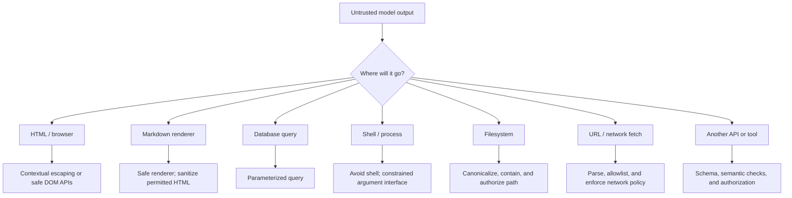

# Chapter 08 — Insecure Output Handling

## Learning objectives

By the end of this chapter, you should be able to:

- Treat generated HTML, Markdown, SQL, shell text, file paths, URLs, and other model output as untrusted data.
- Select context-appropriate escaping, sanitization, parameterized queries, and constrained interfaces.
- Prevent model-generated code or commands from executing arbitrarily.
- Restrict file operations and network destinations through trusted application controls.
- Validate output before rendering it, storing it, or forwarding it to another system.
- Identify the downstream sink and choose a protection suited to that context.

<br/>

## 1. What is insecure output handling?

Insecure output handling occurs when an application trusts or uses model-generated content without applying the protections required by the destination where that content is consumed.

A model can produce text that looks harmless but becomes dangerous when interpreted by another system. The risk depends on the **downstream sink**: the component that receives and interprets the output.

Examples include:

- Generated HTML inserted into a web page and interpreted by the browser.
- Markdown rendered with unsafe HTML enabled.
- Generated SQL concatenated into a database query.
- Model-written shell commands passed to a command interpreter.
- Generated file paths used to read or overwrite files.
- Model-generated URLs fetched by a server or embedded in a page.
- Structured output forwarded to an API that performs a privileged action.
- Generated templates, configuration, or code executed by a runtime.

The core rule is:

> Model output is data until a trusted application component explicitly validates it and decides how it may be used. Never treat natural-language confidence or schema conformity as proof of safety.

<br/>

## 2. Identify the downstream sink

The same string may be safe in one context and unsafe in another. There is no universal “sanitize this string” function.



Before forwarding output, answer:

1. What component consumes it?
2. Will that component interpret it as code, markup, a query, a path, or a command?
3. Which parser or interpreter will be used?
4. What trusted control constrains the operation?
5. What happens if validation fails?
6. Can the same value later reach a different sink?

A value safe for display as plain text may be unsafe if later used as HTML, SQL, or a shell argument.

<br/>

## 3. HTML and browser output

### 3.1 Cross-site scripting (XSS)

If model-generated HTML is inserted into a page as executable markup, it may alter the page, run script, steal accessible session data, or perform actions as the current user. The precise impact depends on browser protections, application architecture, and available privileges.

**Unsafe pattern:**

```javascript
// Unsafe: treats untrusted model output as HTML.
container.innerHTML = modelOutput;
```

**Safer default: render as text.**

```javascript
// Safe for displaying literal text; markup is not interpreted.
container.textContent = modelOutput;
```

When HTML formatting is a genuine requirement:

- Prefer a vetted HTML sanitizer configured for the exact allowed tags, attributes, and URL schemes.
- Use contextual output encoding for the exact insertion context.
- Avoid constructing HTML with string concatenation.
- Avoid inline event-handler attributes and dangerous URL schemes.
- Apply a Content Security Policy (CSP) as defense in depth, not as a substitute for safe rendering.
- Keep trusted templates separate from untrusted content.

HTML text, HTML attributes, JavaScript strings, CSS, and URL contexts have different encoding rules. Escaping for one context does not make a value safe for every other context.

<br/>

### 3.2 Example: safe display of model output

```html
<div id="answer"></div>
<script>
  const answer = /* model output supplied by application */;
  document.getElementById("answer").textContent = answer;
</script>
```

This pattern displays the output literally. If the application requires rich HTML, do not switch to `innerHTML` without a deliberate sanitization policy and tests.

<br/>

## 4. Markdown rendering

Markdown is often treated as plain text, but renderers may support embedded HTML, links, images, and other features that can create risk.

Safer practices:

- Use a maintained Markdown renderer with unsafe raw HTML disabled where possible.
- If raw HTML is allowed, sanitize it with a well-maintained HTML sanitizer and a restrictive allowlist.
- Restrict allowed URL schemes and validate link destinations.
- Consider whether remote images can reveal a viewer's IP address or browsing activity.
- Avoid rendering generated Markdown inside a privileged administrative interface without appropriate controls.
- Test how the chosen renderer handles HTML, links, images, code blocks, and malformed markup.

Code fences are a display convention, not a security boundary. Do not execute code merely because it appears in a Markdown code block.

<br/>

## 5. SQL and database operations

### 5.1 Use parameterized queries

Never concatenate model-generated values into SQL syntax. Use the database driver's parameterized-query interface.

**Unsafe pattern:**

```python
# DO NOT construct SQL this way.
query = "SELECT * FROM orders WHERE order_id = '" + model_order_id + "'"
```

**Safer pattern:**

```python
def get_order(connection, order_id: str):
    cursor = connection.cursor()
    cursor.execute(
        "SELECT order_id, status FROM orders WHERE order_id = ?",
        (order_id,),
    )
    return cursor.fetchone()
```

The placeholder syntax depends on the database driver. Follow the driver's documented parameter style.

Parameterized queries separate values from SQL syntax, but they do not replace authorization, business rules, or query limits.

<br/>

### 5.2 Values versus SQL structure

Parameters generally protect values, not arbitrary SQL identifiers or clauses. If a feature needs a selectable sort order or column, map a small enum to trusted SQL fragments.

```python
SORT_COLUMNS = {
    "date": "created_at",
    "status": "status",
}

def build_order_query(sort_key: str):
    column = SORT_COLUMNS.get(sort_key)
    if column is None:
        raise ValueError("Unsupported sort option")

    # The SQL fragment comes from a fixed server-side allowlist.
    return f"SELECT order_id, status FROM orders ORDER BY {column}"
```

The interpolated `column` is safe here only because it is selected from a fixed allowlist of trusted constants. Never interpolate an arbitrary model-generated identifier.

Also enforce:
- Per-user and per-tenant authorization.
- Read/write separation and least-privilege database accounts.
- Row limits, timeouts, and query-cost constraints.
- Explicit allowlists for supported operations.
- Human approval or additional safeguards for destructive changes.

<br/>

## 6. Shell commands and generated code

Generated shell text and code must not be executed simply because a model proposed it. Shell interpreters perform expansion, substitution, redirection, and command chaining that can make apparently simple strings dangerous.

**Unsafe pattern:**

```python
# DO NOT execute model-generated shell text.
# subprocess.run(model_command, shell=True)
```

Prefer a fixed executable and a list of separately validated arguments:

```python
import subprocess

ALLOWED_REPORTS = {
    "daily": "/srv/reports/daily.json",
    "weekly": "/srv/reports/weekly.json",
}

def generate_report(report_type: str) -> str:
    report_path = ALLOWED_REPORTS.get(report_type)
    if report_path is None:
        raise ValueError("Unsupported report type")

    result = subprocess.run(
        ["/usr/local/bin/report-generator", "--input", report_path],
        shell=False,
        check=True,
        capture_output=True,
        text=True,
        timeout=10,
    )
    return result.stdout
```

This design uses a fixed executable, fixed option, allowlisted path, no shell, and a timeout. Production code should additionally constrain environment variables, working directory, filesystem permissions, output size, and process privileges.

If model-generated code must be evaluated as part of a legitimate product feature, treat execution as a separate high-risk subsystem. Use an isolated sandbox with restricted filesystem access, network access disabled by default, resource limits, timeouts, and no ambient credentials. A container alone is not automatically a sufficient security boundary.

<br/>

## 7. File paths and filesystem access

A generated filename or path may attempt to escape an intended directory, overwrite a sensitive file, or access another tenant's data.

Common risks include:

- Path traversal, such as `../` segments.
- Absolute paths supplied where only a filename should be accepted.
- Symlink and race-condition behavior.
- Overwriting existing files or writing to executable locations.
- Unbounded output sizes or too many generated files.
- Using a user-controlled filename directly in a storage key.

Prefer an application-generated identifier or a narrow filename format instead of accepting arbitrary paths. Resolve and verify containment, enforce authorization, and use filesystem permissions to limit impact.

<br/>

### Example: restrict writes to a designated directory

```python
from pathlib import Path
import re

BASE_DIR = Path("/srv/app/generated").resolve()
SAFE_NAME = re.compile(r"^[A-Za-z0-9][A-Za-z0-9_-]{0,63}\.txt$")

def safe_output_path(filename: str) -> Path:
    if not SAFE_NAME.fullmatch(filename):
        raise ValueError("Invalid filename")

    candidate = (BASE_DIR / filename).resolve()

    # Ensure the resolved target remains under the approved directory.
    if candidate.parent != BASE_DIR:
        raise ValueError("Path is outside the permitted directory")

    return candidate
```

This is a useful basic pattern, not a universal defense against all filesystem races or symlink configurations. For high-risk writes, use directory/file APIs and permissions designed for the platform, avoid attacker-controlled symlinks, and ensure the directory is not writable by untrusted principals. Use atomic file creation where appropriate and define overwrite behavior explicitly.

<br/>

## 8. URLs and server-side network requests

A model-generated URL is untrusted. If a server fetches it, an attacker may try to reach internal services, cloud metadata endpoints, loopback addresses, or other destinations that should not be accessible. This class of risk is often associated with server-side request forgery (SSRF).

Safer design:

1. Parse the URL with a standard URL parser.
2. Allow only required schemes, usually `https`.
3. Prefer a hostname allowlist over a broad blocklist when the business use case permits it.
4. Reject embedded credentials and unexpected ports.
5. Resolve hostnames and enforce network-level egress controls.
6. Re-check redirect destinations; do not assume the original hostname remains the destination.
7. Set connection and total timeouts, response-size limits, and content-type restrictions.
8. Do not pass arbitrary URLs to privileged internal services.
9. Enforce the same controls at the network boundary, because application checks can be bypassed by DNS changes or parsing discrepancies.

A simple string prefix check such as `url.startswith("https://trusted.example")` is not a safe URL validation strategy. Parse components and compare normalized hostnames against an explicit policy.

<br/>

## 9. Constrained interfaces for tools and APIs

Instead of allowing the model to generate an arbitrary command, SQL statement, URL, or API request, expose a small set of typed operations.

For example, rather than allowing a free-form action:

```json
{
  "command": "arbitrary model-generated command text"
}
```

use a constrained proposal:

```json
{
  "operation": "lookup_order",
  "order_id": "ORD-73184"
}
```

The application should then:

- Parse and validate the proposal against a schema.
- Reject unknown operations and unexpected fields.
- Verify the authenticated caller's authorization for the specific resource.
- Apply rate, size, and time limits.
- Invoke a fixed server-side function using validated arguments.
- Validate and minimize the result before returning it to the model or user.
- Audit the operation using allowlisted metadata.

Constrained interfaces reduce the range of actions a model can propose. They do not eliminate the need for server-side permission checks.

<br/>

## 10. Validate before rendering, storing, or forwarding

Output handling should be reviewed at each downstream sink.

| Sink | Primary protection | Additional controls |
|---|---|---|
| Browser HTML | Contextual encoding; safe DOM APIs | Sanitizer for allowed rich HTML, CSP, safe URL policy |
| Markdown renderer | Safe renderer configuration | HTML sanitization, URL scheme allowlist, remote-resource policy |
| SQL database | Parameterized queries | Authorization, fixed allowlists for identifiers, row limits, least privilege |
| Shell/process | Avoid shell; fixed executable and argument list | Allowlisted arguments, timeout, restricted environment and privileges |
| Filesystem | Constrained filenames and canonical path containment | Permissions, symlink/race review, size limits, overwrite policy |
| URL fetcher | Parsed URL and explicit destination policy | Redirect checks, egress firewall, DNS controls, timeouts, response limits |
| External API/tool | Typed schema and fixed operation set | Authorization, quotas, response validation, audit trail |
| Persistent storage | Validate schema and business rules | Data minimization, access controls, retention, integrity checks |

The same generated value may be safe to display as literal text but unsafe to store as a future executable template. Consider downstream use now and later.

<br/>

## 11. Practice: prove generated content is displayed as data

### Goal

Use inert test strings to confirm that generated content is rendered as literal data and is not interpreted as HTML, JavaScript, SQL, a shell command, or a filesystem path.

Use an isolated test environment. Do not use real credentials, real user data, production databases, or destructive commands.

<br/>

### Test strings

These examples are intentionally inert. They are designed to expose whether a component interprets special syntax; they do not need to execute any action.

```text
HTML-like text: <tag data-test="canary">DISPLAY_ONLY</tag>
Markdown-like text: [display only](https://example.invalid/test)
SQL-like text: ' OR 'x'='x
Shell-like text: ; echo DISPLAY_ONLY
Path-like text: ../display-only.txt
URL-like text: https://example.invalid/test
```

<br/>

### Exercise A — browser rendering

1. Pass the HTML-like string through the same rendering path used for model output.
2. Verify that the browser displays the literal characters rather than creating an element.
3. Inspect the DOM to confirm the value was inserted as text.
4. If rich HTML is required, test the configured sanitizer with both allowed and disallowed markup.

**Expected result:** inert test markup is displayed as data in the plain-text path.

<br/>

### Exercise B — Markdown rendering

1. Render the Markdown-like test string using the production renderer configuration.
2. Check whether links and raw HTML are interpreted.
3. Verify the policy for allowed link schemes and remote resources.

**Expected result:** behavior matches the documented renderer and sanitizer policy; no unsafe raw HTML or disallowed URL scheme is accepted.

<br/>

### Exercise C — database access

1. Pass the SQL-like string as a parameter to a test query.
2. Verify that it is treated as a value and does not alter query structure.
3. Confirm that the test account has only the permissions needed for the test.

**Expected result:** the input does not change the query's intended logic.

<br/>

### Exercise D — process execution

1. Verify that model output is never passed directly to a shell.
2. Test that unknown operation names and arguments are rejected.
3. Inspect the actual process invocation in a safe test harness.

**Expected result:** no arbitrary command is executed; only explicitly supported operations can run.

<br/>

### Exercise E — filesystem and URL controls

1. Verify that a path containing `../` is rejected by the filename policy.
2. Test URL validation with an unapproved host and an unexpected scheme.
3. Confirm redirects and network egress are controlled in the test setup.

**Expected result:** unapproved paths and destinations are rejected before file access or network access.

<br/>

### Exercise F — forwarding and storage

Check whether the same generated string is later placed in a template, query, tool argument, log, or file. A value safely displayed once can become dangerous if another component interprets it later.

Record the sink, the control, the expected result, the observed result, and the regression test added.

<br/>

## 12. Checkpoint: choose protection based on the sink

A strong answer identifies the **specific consumer** and selects a matching protection:

- Browser HTML → contextual encoding or safe DOM APIs; sanitize if rich HTML is intentionally supported.
- Markdown → safe renderer configuration and sanitization of permitted HTML.
- SQL → parameterized values and allowlisted SQL structure.
- Shell → avoid shell interpretation; use fixed executables and validated argument lists.
- Filesystem → validate filenames, contain canonical paths, and restrict permissions.
- URL fetch → parse and validate destinations, control redirects, and enforce network egress policy.
- API/tool call → validate schema and business rules, authorize the caller, and use constrained operations.

Do not answer merely “sanitize the output.” State **what sink receives the value, how that sink interprets it, which control is appropriate, and how the control is tested**.

<br/>

## 13. Review questions and answers

**Q1. Why is there no universal sanitization function?**  
Because different sinks interpret data differently. HTML, JavaScript, SQL, shell, paths, and URLs have distinct grammars and security requirements.

**Q2. Is generated HTML safe because the model was instructed not to produce scripts?**  
No. Instructions are not a security boundary. Use safe rendering, contextual encoding, and sanitization when required.

**Q3. Do parameterized SQL queries solve every database security issue?**  
No. They protect parameterized values from changing query syntax, but authorization, query structure, resource limits, and database privileges still matter.

**Q4. Why is `shell=False` helpful?**  
It avoids passing a command string through a shell interpreter. The application should still use a fixed executable, validate arguments, apply timeouts, and restrict privileges.

**Q5. Does canonicalizing a path guarantee safe filesystem access?**  
Not universally. Symlinks, race conditions, directory permissions, and platform behavior also matter. Use appropriate filesystem APIs and isolation for high-risk operations.

**Q6. Why are model-generated URLs risky for server-side fetching?**  
They may target internal or otherwise restricted services, follow redirects to disallowed destinations, or exploit parsing and DNS behavior. Use destination policies and network egress controls.

**Q7. What should be done before forwarding model output to another system?**  
Identify the sink, parse and validate the data, enforce semantic rules and authorization, apply sink-specific protections, constrain side effects, and test the actual integration path.

<br/>

## 14. Further reading

- [OWASP Cross Site Scripting Prevention Cheat Sheet](https://cheatsheetseries.owasp.org/cheatsheets/Cross_Site_Scripting_Prevention_Cheat_Sheet.html)
- [OWASP SQL Injection Prevention Cheat Sheet](https://cheatsheetseries.owasp.org/cheatsheets/SQL_Injection_Prevention_Cheat_Sheet.html)
- [OWASP OS Command Injection Defense Cheat Sheet](https://cheatsheetseries.owasp.org/cheatsheets/OS_Command_Injection_Defense_Cheat_Sheet.html)
- [OWASP Path Traversal](https://owasp.org/www-community/attacks/Path_Traversal)
- [OWASP Server-Side Request Forgery Prevention Cheat Sheet](https://cheatsheetseries.owasp.org/cheatsheets/Server_Side_Request_Forgery_Prevention_Cheat_Sheet.html)
- [OWASP Top 10 for LLM Applications](https://owasp.org/www-project-top-10-for-large-language-model-applications/)
- [MDN: `textContent`](https://developer.mozilla.org/docs/Web/API/Node/textContent)
- [Python `subprocess` documentation](https://docs.python.org/3/library/subprocess.html)

Use current, framework-specific guidance for the actual renderer, database driver, runtime, and network client in your application.


<br/>


## Chapter summary

- Treat model output as untrusted until it has been validated for its intended use.
- Identify the downstream sink before choosing a protection.
- Render plain text as text; sanitize only when rich markup is intentionally allowed.
- Use parameterized database queries and allowlisted SQL structure.
- Avoid executing model-generated shell commands or code; use constrained interfaces and isolation where execution is unavoidable.
- Restrict filesystem operations and network destinations in trusted application and infrastructure controls.
- Validate before rendering, storing, executing, or forwarding output.
- Test with inert strings and verify the actual behavior of each sink.
