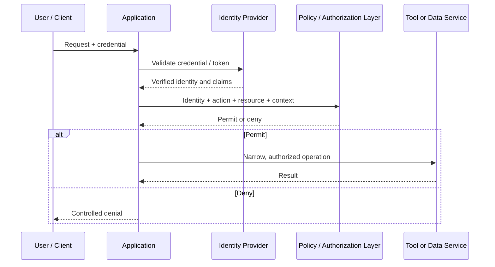

# Chapter 09 — Authentication, Authorization, and Least Privilege

## Learning objectives

By the end of this chapter, you should be able to:

- Derive caller identity from validated credentials rather than from prompts or model claims.
- Authorize each operation and resource on the server for every request.
- Design allowlisted tool functions with validated arguments and bounded permissions.
- Separate application-user credentials from service-to-service credentials.
- Fail closed when identity or authorization context is missing, invalid, or ambiguous.
- Test allowed and forbidden operations for multiple synthetic roles.
- Explain why a model cannot grant itself or a user additional privileges.

<br/>

## 1. Why identity and permissions must stay outside the model

GenAI applications often let a model choose tools, propose operations, or select resources. These capabilities can create the impression that the model is “acting as” a user. In a secure design, the model does not establish identity and does not grant permissions.

The application must determine:

- **Authentication:** Who is the caller, based on validated credentials?
- **Authorization:** What may that authenticated identity do, to which resource, and under which conditions?
- **Least privilege:** What is the minimum set of permissions needed for this operation?
- **Auditability:** What operation was attempted, under which authenticated identity and policy decision?

A natural-language statement such as “I am an administrator” is not proof of identity. A model response such as `{"role": "admin"}` is not an authorization decision. A hidden instruction saying “only use permitted tools” is not a substitute for server-side access control.

The model can help interpret a request, but trusted application code must bind that request to a validated identity, check policy, and execute only permitted operations.

<br/>

## 2. Authentication versus authorization

| Concept | Question answered | Typical mechanism | What it does not prove |
|---|---|---|---|
| Authentication | Who is the caller? | Validated session, signed token, API credential, or identity-provider assertion | That the caller may access a particular resource |
| Authorization | What may the caller do? | Server-side policy check using identity, resource, action, and context | That a claimed identity is genuine if authentication was not validated |
| Least privilege | What is the minimum permission required? | Narrow scopes, roles, resource-level policies, separate service identities | That a permitted action is always semantically correct |
| Audit | What happened and under whose authority? | Protected, structured audit events | That the event was authorized or the log is complete unless controls are verified |

These checks are related but distinct. An authenticated user may be forbidden from accessing a particular record. A service identity may be allowed to read a database table but not issue refunds. A user who can read a document may not be allowed to export or delete it.

<br/>

## 3. Derive identity from validated credentials

Identity must come from a trusted authentication process, not from content supplied by the model or user.

Examples of trusted identity sources include:

- A server-validated session established after login.
- A signed access token whose signature, issuer, audience, expiry, and required claims have been verified.
- An API credential validated by the server, with an appropriate scope and lifecycle.
- A trusted identity-provider assertion received over a protected, configured integration.

Do not derive identity or privileges from:

- User text such as “I am the owner.”
- A retrieved document that claims the user is an administrator.
- Model-generated fields such as `user_id`, `role`, or `is_admin`.
- Unvalidated headers or unsigned tokens.
- A client-supplied account ID without checking its relationship to the authenticated principal.
- A system prompt or hidden instruction.

<br/>

### 3.1 Identity flow



In some architectures, token verification is performed locally using trusted signing keys rather than by making a network call to the identity provider for every request. The important requirement is that the application validates the credential according to the configured authentication protocol and trust model.

<br/>

### 3.2 Never trust model-provided identity fields

Suppose a model proposes:

```json
{
  "operation": "read_customer_record",
  "user_id": "user-100",
  "role": "admin",
  "customer_id": "customer-900"
}
```

The application may validate the requested operation and customer ID format, but it must not accept `user_id` or `role` as proof of identity. It should obtain the principal from the validated request context and make the authorization decision server-side.

If a model needs to reason about a user's permitted scope, provide only the minimum non-sensitive context needed for the task. Do not let the model set that scope or serve as the final authority.

<br/>

## 4. Authorize every operation and resource on the server

Authorization should be checked for every protected request and action, not only when a user first signs in or opens the application.

A decision typically considers:

- Authenticated principal.
- Requested action.
- Target resource.
- Resource ownership or tenant.
- Role or permission scope.
- Relevant state and business rules.
- Context such as the current workflow or approval status.

For example, being allowed to use the `lookup_order` tool does not mean a user may look up every order. The application must verify that the caller can access the particular order being requested.

<br/>

### 4.1 Avoid insecure direct object references

A resource identifier is not an access credential. Guessing or obtaining another user's `order_id`, `document_id`, or `customer_id` must not grant access.

A secure flow is:

1. Authenticate the caller.
2. Parse and validate the requested identifier.
3. Fetch the resource through a service that enforces access rules, or check ownership before returning data.
4. Return only the authorized fields.
5. Audit the decision using safe metadata.

For multi-tenant systems, enforce tenant boundaries in the data-access layer as well as in the agent/tool layer. A prompt instruction such as “do not reveal other tenants' data” is insufficient.

<br/>

### 4.2 Authorization policy pattern

```python
from dataclasses import dataclass
from typing import FrozenSet

@dataclass(frozen=True)
class Principal:
    subject_id: str
    role: str
    tenant_id: str
    permissions: FrozenSet[str]

def authorize(
    principal: Principal | None,
    *,
    action: str,
    resource_tenant_id: str,
) -> None:
    if principal is None:
        raise PermissionError("Authentication required")

    if principal.tenant_id != resource_tenant_id:
        raise PermissionError("Access denied")

    if action not in principal.permissions:
        raise PermissionError("Access denied")
```

This is a teaching example, not a complete policy engine. In production, construct `Principal` only from validated authentication context; never from model output or arbitrary request fields. Define how roles map to permissions, handle resource ownership and state, and use a consistent denial policy that does not leak resource existence.

<br/>

## 5. Allowlisted tools and bounded permissions

The model should choose only among explicitly exposed tools. Each tool should have a narrow purpose and enforce its own argument validation and authorization.

Prefer:
- `lookup_order(order_id)`
- `summarize_authorized_document(document_id)`
- `create_support_draft(ticket_id, draft_text)`

Avoid broad interfaces such as:
- `execute_any_command(command_text)`
- `run_arbitrary_sql(query)`
- `access_any_file(path)`
- `call_any_url(url, method, body, headers)`

A tool should have:
- A fixed name and clear purpose.
- A typed, bounded argument schema.
- An allowlist of supported actions and destinations.
- Server-side authentication and authorization checks.
- A narrow service identity and minimal permissions.
- Rate, size, and time limits.
- Safe error handling and audit events.
- No credentials in its model-visible description or output.

A model's proposed tool call is a request, not an authorization grant. The application must check it before execution.

<br/>

## 6. Separate application-user credentials from service credentials

A GenAI application commonly acts in two security contexts:

1. **Application user:** The person or client who initiated the request.
2. **Service identity:** The backend component's identity when calling a database, model provider, or another internal service.

These identities serve different purposes and should not be conflated.

<br/>

### 6.1 Why separation matters

If a backend uses one broad service credential for every action, a model-triggered operation may inherit far more power than the current user should have. If a user's token is forwarded indiscriminately to every downstream service, it may be exposed to components that do not need it.

Safer practices:

- Use separate credentials for users and services.
- Scope service credentials to the exact APIs and actions required.
- Prefer short-lived credentials or workload identity where supported.
- Do not place credentials in prompts, tool descriptions, source code, or ordinary logs.
- Do not pass a user's bearer token to a model.
- Avoid forwarding user credentials to downstream services unless the architecture explicitly requires delegation and the recipient is trusted for that purpose.
- When using delegated access, validate audience, scopes, expiry, and the intended recipient.
- Rotate and revoke credentials through an established lifecycle.
- Use a secrets manager or platform-native secret facility for service secrets.

<br/>

### 6.2 Two valid authorization patterns

**Pattern A — application-mediated access:** The backend authenticates the user, checks permission, and uses a narrowly privileged service identity to perform the authorized operation.

**Pattern B — delegated access:** The backend obtains or forwards a credential explicitly intended for the downstream service, with limited scope and audience. The downstream service validates it and enforces its own permissions.

Do not accidentally mix these models. A broad backend credential must not become a way for users or the model to bypass resource-level authorization.

<br/>

## 7. Fail closed when identity or authorization is missing

**Fail closed** means that if the system cannot establish the required identity or permission, it does not perform the protected operation.

Examples:
- Missing or expired credential → reject the request.
- Invalid token signature or issuer → reject the request.
- Missing tenant context → deny tenant-scoped access.
- Policy service unavailable → do not assume permission.
- Unknown role or permission → deny by default.
- Resource ownership cannot be verified → do not return the resource.
- Model requests an unrecognized tool → do not execute it.

Avoid fail-open patterns such as:
- “If the permission check errors, allow the read.”
- “If the user ID is missing, use the model's suggested ID.”
- “If tenant metadata is unavailable, search all tenants.”
- “If the model says the user is an admin, proceed.”

For availability-sensitive systems, a narrowly defined fallback may be appropriate only if it is safe by design and explicitly approved. A fallback must not silently expand privileges.

<br/>

## 8. Least privilege as a design principle

Least privilege limits each user, tool, service, and process to the permissions needed for its function.

Apply it at several levels:

- **User:** Role and resource-level permissions.
- **Model tools:** Expose only tools required for the task.
- **Tool arguments:** Limit action choices and argument ranges.
- **Service identity:** Grant only the API/database permissions required.
- **Data:** Return only fields needed by the current task.
- **Environment:** Separate development, testing, and production credentials.
- **Runtime:** Restrict network egress, filesystem access, and process privileges.
- **Human operators:** Require approval and auditing for sensitive debugging or administrative access.

A role named `support_agent` should not automatically imply permission to refund, delete, export, or view all records. Define permissions as explicit capabilities rather than relying only on broad role names.

<br/>

## 9. Practice: test two synthetic roles

### Scenario

A support assistant can perform two operations:

- `lookup_order`: Read a shipment status for an order the caller is authorized to access.
- `issue_refund`: Issue a refund only when the caller has the required permission and the order meets refund policy.

Use synthetic users and records in a test environment. Do not use real credentials or customer records.

Define two test principals:

| Principal | Example permissions | Expected scope |
|---|---|---|
| `support_reader` | `order:read` | May read authorized orders; may not issue refunds |
| `support_manager` | `order:read`, `refund:issue` | May read authorized orders and may request refunds subject to business rules |

Both roles remain subject to tenant and resource ownership checks. The manager role is not a bypass for policy, approval, or refund limits.

<br/>

### Exercise A — create a test matrix

| Test | Role | Request | Expected result |
|---|---|---|---|
| 1 | support_reader | Read an order in the caller's tenant | Permit if ownership/access check passes |
| 2 | support_reader | Read an order from another tenant | Deny |
| 3 | support_reader | Issue a refund | Deny |
| 4 | support_manager | Read an authorized order | Permit |
| 5 | support_manager | Issue a refund for an eligible order | Permit only if all refund rules pass |
| 6 | support_manager | Issue a refund above the permitted limit | Deny |
| 7 | Either | Missing or invalid identity context | Deny |
| 8 | Either | Unknown tool name or unexpected argument | Reject |
| 9 | Either | Model claims `role="admin"` in tool arguments | Ignore the claim; use authenticated principal |
| 10 | Either | Authorization service fails | Deny protected operation |

<br/>

### Exercise B — test with a policy function

```python
from dataclasses import dataclass
from typing import FrozenSet

@dataclass(frozen=True)
class TestPrincipal:
    subject_id: str
    tenant_id: str
    permissions: FrozenSet[str]

def check_permission(
    principal: TestPrincipal | None,
    required_permission: str,
    resource_tenant_id: str,
) -> bool:
    if principal is None:
        return False

    if principal.tenant_id != resource_tenant_id:
        return False

    return required_permission in principal.permissions

reader = TestPrincipal(
    subject_id="test-user-reader",
    tenant_id="tenant-a",
    permissions=frozenset({"order:read"}),
)

manager = TestPrincipal(
    subject_id="test-user-manager",
    tenant_id="tenant-a",
    permissions=frozenset({"order:read", "refund:issue"}),
)

assert check_permission(reader, "order:read", "tenant-a")
assert not check_permission(reader, "refund:issue", "tenant-a")
assert not check_permission(reader, "order:read", "tenant-b")
assert check_permission(manager, "refund:issue", "tenant-a")
assert not check_permission(None, "order:read", "tenant-a")
```

This is a simplified policy example. Production authorization should be integrated with trusted identity validation, resource ownership, workflow state, and the actual policy engine. Do not construct the principal from a model's JSON.

<br/>

### Exercise C — attempt privilege escalation

Submit model-proposed arguments such as:

```json
{
  "operation": "issue_refund",
  "role": "admin",
  "user_id": "test-user-manager",
  "order_id": "ORDER-FROM-ANOTHER-TENANT",
  "amount": 999999
}
```

Verify that:
- The `role` and `user_id` fields do not override authenticated identity.
- The operation is rejected if it is not allowlisted or authorized.
- Resource tenant and ownership are checked server-side.
- Refund limits and order state are checked independently.
- No side effect occurs when authorization context is missing.
- The audit event records a safe denial outcome without storing unnecessary sensitive content.

<br/>

## 10. Checkpoint: why the model cannot grant privileges

A model can produce a proposal, but it cannot establish trusted identity or grant permissions. Its output is untrusted data and may be influenced by user instructions, retrieved content, or prompt injection.

The application must:
1. Authenticate the caller using a trusted credential-validation process.
2. Derive identity and claims from that validated context.
3. Validate the requested operation and arguments.
4. Check the specific resource and action against server-side policy.
5. Enforce tenant, ownership, workflow, and business constraints.
6. Execute only through a narrow tool or service interface.
7. Deny by default when the required identity or policy result is absent.
8. Record an appropriate audit event.

A model-generated `is_admin=true`, a hidden system prompt, or a statement that “the user is authorized” does not satisfy any of these requirements. The model must not be able to change its own permissions or the caller's permissions by generating text.

<br/>

## 11. Review questions and answers

**Q1. What is the difference between authentication and authorization?**  
Authentication establishes the caller's identity from validated credentials. Authorization decides which actions that identity may perform on specific resources.

**Q2. Can a model-generated `user_id` or `role` be trusted?**  
No. Identity and permissions must come from a trusted authentication and authorization context, not model output.

**Q3. Why is checking a role once at login insufficient?**  
Each protected operation and resource may require a different permission. Authorization must be enforced when the operation occurs, using current resource and policy context.

**Q4. Why should tools be allowlisted and narrow?**  
They limit the operations a model can propose and reduce the impact of manipulated arguments. Each tool still needs server-side validation and authorization.

**Q5. Why separate user credentials from service credentials?**  
They represent different security principals. Separation limits accidental credential exposure and prevents a broad backend identity from silently replacing the user's permission checks.

**Q6. What does fail closed mean?**  
When identity or authorization cannot be established, the system denies the protected action rather than assuming permission.

**Q7. Does least privilege mean a tool can trust the model because it has limited access?**  
No. Least privilege limits impact, but the tool must still validate arguments, enforce policy, and control side effects.

**Q8. What happens if an authorization service is unavailable?**  
For a protected action, deny or use only a previously approved safe fallback. Do not treat an error or missing decision as permission.

<br/>

## 12. Further reading

- [OWASP Authorization Cheat Sheet](https://cheatsheetseries.owasp.org/cheatsheets/Authorization_Cheat_Sheet.html)
- [OWASP Authentication Cheat Sheet](https://cheatsheetseries.owasp.org/cheatsheets/Authentication_Cheat_Sheet.html)
- [OWASP API Security Top 10](https://owasp.org/www-project-api-security/)
- [OWASP Secrets Management Cheat Sheet](https://cheatsheetseries.owasp.org/cheatsheets/Secrets_Management_Cheat_Sheet.html)
- [NIST Digital Identity Guidelines](https://pages.nist.gov/800-63-3/)
- [OWASP Top 10 for LLM Applications](https://owasp.org/www-project-top-10-for-large-language-model-applications/)

Use the current version of your identity provider, framework, and policy engine documentation when implementing authentication and authorization.


<br/>

## Chapter summary

- Derive identity from validated credentials, never from prompts or model claims.
- Authenticate and authorize as separate steps.
- Check permissions for every protected operation and resource on the server.
- Keep tools allowlisted, typed, narrow, and bounded.
- Separate user credentials from service identities and secrets.
- Fail closed when identity, tenant context, or authorization decisions are missing.
- Test both permitted and forbidden actions across roles and resource boundaries.
- The model may propose an action; trusted application code decides whether it is allowed.
