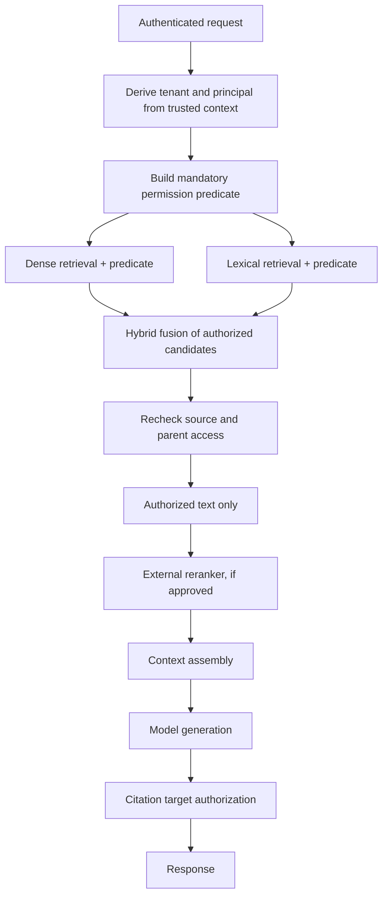

# Chapter 10 — Retrieval Access Controls and Tenant Isolation

## Learning objectives

By the end of this chapter, you should be able to:

- Enforce mandatory permission predicates across dense, lexical, hybrid, and parent-document retrieval.
- Recheck source access when fetching document text and serving citation targets.
- Isolate conversation history, caches, namespaces, and stored results according to the security model.
- Handle permission changes, revocation, and metadata or title leakage.
- Prevent unauthorized evidence from reaching prompts, rerankers, logs, or other external services.
- Test isolation independently of whether a generated answer happens to reveal private content.

<br/>

## 1. Why retrieval access control is a security boundary

Retrieval-augmented generation (RAG) systems fetch documents or passages and place some of their content into a model's context. If retrieval is not access-controlled, the application may expose information even when the final answer appears harmless.

Potential leakage includes:

- A private passage being included in the prompt but omitted from the final response.
- A document title, filename, snippet, score, or existence being exposed in search results.
- Unauthorized text being sent to an external reranker or embedding service.
- A citation linking to a document that the user cannot open.
- A parent-document fetch returning restricted sections after a child chunk passed retrieval filters.
- A cached answer or search result being served to a different tenant.
- A conversation history carrying context across users or tenants.
- A permission change taking effect in the source system but not in a stale vector index or cache.

**The security goal is to prevent unauthorized evidence from entering the processing path**, not merely to hope the model will avoid mentioning it.

<br/>

## 2. Retrieval pipeline and mandatory authorization predicates

A typical RAG pipeline may include query rewriting, lexical search, dense vector search, hybrid fusion, reranking, parent-document expansion, context assembly, generation, and citation rendering. Every stage that accesses or exposes protected data needs a defined authorization boundary.



This flow is a conceptual design. In a real system, reranking may happen before or after fusion, and dense and lexical candidates may be fused in different ways. The invariant is more important than the ordering: **unauthorized candidates must be filtered before their content or sensitive metadata reaches a component that is not allowed to receive them**.

<br/>

### 2.1 Build predicates from trusted identity context

A permission predicate may include:

- Tenant or organization ID.
- Document-level ACLs.
- User or group membership.
- Classification level.
- Allowed purpose or workflow.
- Document status, such as active versus revoked.
- Effective permission version or policy state, where supported.

Never take the authoritative tenant ID or role from a model-generated query, retrieved document, or arbitrary client field. Derive it from validated authentication context and trusted server-side policy.

Conceptual predicate:

```text
tenant_id = authenticated_principal.tenant_id
AND document_status = "active"
AND caller_has_read_permission(document_id, authenticated_principal)
```

The exact query syntax depends on the vector database, search engine, and policy model. The predicate must be mandatory and cannot be removed by a model-generated filter or user-supplied search expression.

<br/>

## 3. Apply access controls across every retrieval mode

### 3.1 Dense vector retrieval

Dense retrieval ranks vectors by semantic similarity. Similarity is not authorization. A semantically relevant vector from another tenant must not be eligible merely because it is a strong match.

Controls:

- Apply tenant and ACL filters in the vector query where the index supports them.
- If the engine cannot reliably enforce filters during search, isolate collections, indexes, or databases by tenant or security domain.
- Do not retrieve broad results and rely on the model to ignore unauthorized passages.
- Ensure that metadata filters cannot be overridden by user or model input.
- Test approximate-nearest-neighbor behavior and filter semantics for the actual engine and version.

<br/>

### 3.2 Lexical retrieval

Lexical search includes keyword or full-text systems such as BM25. It requires the same access predicates as vector search.

Controls:

- Apply access filters before returning document text, snippets, facets, or highlights.
- Ensure autocomplete, spelling suggestions, counts, and facets do not disclose restricted content.
- Do not expose unauthorized titles or snippets merely because the full document body is hidden.
- Check query expansion and synonym services for cross-tenant metadata leakage.

<br/>

### 3.3 Hybrid retrieval

Hybrid retrieval combines dense and lexical results, often with rank fusion or a reranker.

Controls:

- Enforce access constraints independently in each retrieval branch.
- Fuse only authorized candidates.
- Do not allow a permissive branch to reintroduce results rejected by another branch.
- If filtering occurs after fusion, verify that unauthorized candidate text and metadata were not already sent to a reranker, logger, or external service.
- Test tie-breaking, deduplication, and fallback paths for consistent policy enforcement.

<br/>

### 3.4 Parent-child and document expansion

Parent-child retrieval often searches small chunks and then fetches a larger parent document or neighboring chunks for context. A child chunk may be readable while the parent contains restricted sections—or permissions may have changed since indexing.

Controls:

- Recheck authorization when fetching the parent or neighboring chunks.
- Apply access predicates to each expanded chunk or section, not only the initially retrieved child.
- Avoid returning a whole parent document when only one authorized section is needed.
- Ensure document-level and section-level permissions are represented correctly.
- Reject expansion if the source ACL cannot be evaluated.

<br/>

### 3.5 Retrieval mode checklist

| Retrieval stage | Mandatory control | Common failure |
|---|---|---|
| Dense vector search | Tenant/ACL predicate or security-domain isolation | Similarity search crosses tenant boundaries |
| Lexical search | Same permission model applied before snippets and hits are returned | Title, highlight, or count leaks restricted records |
| Hybrid fusion | Both branches independently enforce access | One branch reintroduces unauthorized candidates |
| Reranking | Only authorized candidate text and necessary metadata is sent | Private passages leave the trust boundary |
| Parent expansion | Reauthorize parent and every expanded segment | Authorized child leads to restricted parent text |
| Context assembly | Include only approved, necessary evidence | Earlier filtering is bypassed by another source |
| Citation rendering | Recheck access to source target | Link reveals private document or existence |
| Cache lookup | Scope cache key and validate current permission | Result from one tenant is served to another |

<br/>

## 4. Recheck source access when fetching text and serving citations

Search indexes are often derived from a source of record. Permissions can change in the source system before the search index or cached metadata is updated.

Use the source system or an authoritative policy service to verify access when:

- Fetching full text after a chunk match.
- Expanding a parent document.
- Loading neighboring passages.
- Returning a citation link or preview.
- Downloading an original file.
- Serving a stored answer that depends on protected evidence.
- Reusing an earlier retrieval result after a permission change.

A citation is not merely decorative. It may reveal a document title, path, ID, excerpt, or even whether a confidential record exists. Citation URLs should pass through an access-controlled application endpoint or the source system's authorization layer.

<br/>

### 4.1 Avoid time-of-check/time-of-use gaps

A permission check can become stale between retrieval and content delivery. Reduce this risk by:

- Keeping checks close to the protected fetch or action.
- Using source-side authorization at the point of access where feasible.
- Avoiding long-lived cached grants for sensitive content.
- Using versioned ACLs or permission epochs if supported.
- Invalidating or revalidating caches after permission changes.
- Defining how the system behaves when the source authorization service is unavailable.

For high-sensitivity data, deny access if current authorization cannot be verified. The exact strategy depends on the source system's consistency guarantees and the acceptable revocation delay.

<br/>

## 5. Conversation history, caches, namespaces, and stored results

Isolation must extend beyond the retrieval index.

### 5.1 Conversation history

- Bind each conversation to an authenticated principal and the appropriate tenant or workspace.
- Verify ownership every time history is loaded or appended.
- Do not accept a conversation ID as proof of access.
- Avoid reusing prior turns across users, even when prompts appear similar.
- Recheck access to documents cited or summarized in old messages when serving them again, according to the application's revocation policy.

A conversation may contain sensitive evidence even if the latest user message does not.

<br/>

### 5.2 Cache isolation

Caches can leak information if their keys omit security-relevant context.

A cache key may need to include:
- Tenant or workspace ID.
- Principal or effective permission scope.
- Normalized query and relevant filters.
- Retrieval configuration/version.
- ACL or permission version.
- Data/index version.
- Model/prompt version where output is cached.

The exact key design should avoid storing unnecessary personal identifiers while still preventing collisions across security boundaries.

**Important:** Including tenant ID in a key is not sufficient if users within a tenant have different document permissions. Scope the cache to the effective authorization boundary and revalidate access before returning sensitive cached content.

<br/>

### 5.3 Namespaces and indexes

- Use separate namespaces, collections, indexes, or databases where the threat model requires strong tenant isolation.
- Ensure the caller cannot choose arbitrary namespace names.
- Derive namespace selection from trusted server-side identity and policy.
- Verify that background ingestion jobs cannot write documents into the wrong tenant namespace.
- Test administrative and maintenance paths, not just the main query API.

Physical separation can reduce the risk of filter mistakes, but it still requires correct identity mapping, credentials, network policy, and operational controls.

<br/>

### 5.4 Stored answers and derived artifacts

A generated answer, summary, embedding, extracted entity list, or cached citation may reveal facts from its source. Apply access and retention rules to derived artifacts according to their sensitivity and dependencies.

When source permissions change:
- Invalidate or re-evaluate cached answers.
- Remove or restrict stale search results as required.
- Review exported evaluation records and stored summaries.
- Decide whether prior conversation content remains visible or must be redacted under the applicable policy.
- Document any expected delay in revocation propagation.

<br/>

## 6. Permission changes, revocation, and stale indexes

A common failure is updating permissions in the source system but leaving old access metadata in the retrieval index.

Design a revocation process that covers:

1. Source-of-record permission change.
2. ACL or metadata update event.
3. Search index and vector metadata update.
4. Cache invalidation or permission-version change.
5. Parent/child and derived-artifact revalidation.
6. Citation and document-download authorization.
7. Verification that access is denied after the expected propagation interval.

For high-risk resources, use authoritative source checks at fetch time rather than relying solely on eventually consistent index metadata.

If access has been revoked, a stale vector should not be allowed into the prompt merely because it remains semantically relevant. The safe behavior is to exclude it until current authorization is established.

<br/>

## 7. Prevent metadata and title leakage

A search result can reveal sensitive information without exposing its body. Potentially sensitive metadata includes:

- Document title or filename.
- Existence of a case, project, customer, or investigation.
- Snippet, highlight, or autocomplete suggestion.
- Result count, ranking, or similarity score.
- Owner, author, department, or timestamp.
- Citation URL, storage path, or opaque identifier that can be guessed.
- Error differences that reveal whether a document exists.

Apply the same access policy to:
- Search results and snippets.
- Facets, counts, autocomplete, and query suggestions.
- Citation labels and previews.
- File listings and metadata APIs.
- Error messages and timing where resource-existence disclosure is a concern.

Use opaque identifiers where appropriate, but remember that obscurity is not authorization. A guessed or leaked document ID must not bypass the permission check.

<br/>

## 8. Keep unauthorized evidence away from external rerankers

Rerankers and embedding services may run outside the application's primary trust boundary. Sending a candidate to a service is itself a disclosure, even if the final answer never cites it.

Before invoking an external service:

- Filter candidates using trusted ACL and tenant predicates.
- Recheck source access if the permission state may have changed.
- Send only the text and metadata required for ranking.
- Remove unnecessary identifiers and internal metadata.
- Confirm the service is approved for the relevant data classification and provider terms.
- Apply timeouts, output validation, retention review, and access controls to its results.
- Do not assume that a service is safe merely because it is used only for ranking.

The same rule applies to external embeddings, query rewriting, summarization, OCR, translation, analytics, and observability services. Evaluate every recipient that receives document text or sensitive metadata.

<br/>

## 9. Example: authorization-aware retrieval interface

The following Python example illustrates the design principle. It is not a drop-in implementation for a specific vector database.

```python
from dataclasses import dataclass
from typing import Protocol

@dataclass(frozen=True)
class Principal:
    subject_id: str
    tenant_id: str

@dataclass(frozen=True)
class RetrievedChunk:
    chunk_id: str
    document_id: str
    tenant_id: str
    text: str

class SearchBackend(Protocol):
    def search(
        self,
        query: str,
        *,
        tenant_id: str,
        limit: int,
    ) -> list[RetrievedChunk]: ...

class SourceAuthorization(Protocol):
    def can_read_document(self, principal: Principal, document_id: str) -> bool: ...

def retrieve_authorized_context(
    query: str,
    *,
    principal: Principal | None,
    search_backend: SearchBackend,
    source_auth: SourceAuthorization,
    limit: int = 8,
) -> list[RetrievedChunk]:
    if principal is None:
        raise PermissionError("Authentication required")

    if not 1 <= limit <= 20:
        raise ValueError("Invalid retrieval limit")

    # Tenant filter is derived from trusted principal context.
    candidates = search_backend.search(
        query,
        tenant_id=principal.tenant_id,
        limit=limit,
    )

    authorized: list[RetrievedChunk] = []
    for chunk in candidates:
        # Defense in depth: reject cross-tenant results even if backend filtering fails.
        if chunk.tenant_id != principal.tenant_id:
            continue

        # Recheck current source permission before using text.
        if not source_auth.can_read_document(principal, chunk.document_id):
            continue

        authorized.append(chunk)

    return authorized
```

Key points:

- The principal is expected to come from validated authentication context.
- The tenant predicate is generated by trusted server-side code.
- The result is checked again rather than blindly trusting backend filters.
- Source authorization is checked before the text is returned for prompt assembly.

For a production implementation, consider:
- Whether the search backend returns text before the post-query check. If unauthorized text crosses into application memory or logs, post-filtering may be too late; enforce filtering inside the search boundary or use isolated indexes.
- Section-level ACLs and parent-document expansion.
- Current permission version and revocation consistency.
- Safe handling of exceptions and missing policy results.
- The exact authorization semantics of the vector and lexical engines.

<br/>

## 10. Example: reauthorize citation access

A citation target should not be served solely because its ID appeared in a model response or retrieval result.

```python
def serve_citation(
    principal,
    document_id: str,
    source_auth,
    document_store,
):
    if principal is None:
        raise PermissionError("Authentication required")

    if not source_auth.can_read_document(principal, document_id):
        # Use a uniform response if revealing existence is sensitive.
        raise PermissionError("Document unavailable")

    document = document_store.get_document(document_id)
    if document is None:
        raise LookupError("Document unavailable")

    return {
        "document_id": document.id,
        "title": document.title,
        "content": document.content,
    }
```

In a production system, authorization should ideally be enforced as close as possible to the source fetch to reduce time-of-check/time-of-use gaps. The citation endpoint should validate the caller on every request, and the returned fields should be minimized.

<br/>

## 11. Practice: test cross-tenant retrieval and citation isolation

### Scenario

A RAG assistant serves two synthetic tenants:
- `tenant-red`
- `tenant-blue`

Each tenant has private documents, conversation history, and cached summaries. Some users within a tenant also have different document-level permissions.

Use synthetic documents and non-sensitive test content.

<br/>

### Exercise A — cross-tenant queries

1. Create one document in each tenant with a unique marker such as `RED_DOC_CANARY_17` and `BLUE_DOC_CANARY_29`.
2. Query using a principal from `tenant-red`.
3. Try exact keyword search, semantic paraphrase, and hybrid search for the blue marker.
4. Inspect returned candidate IDs, snippets, metadata, reranker inputs, prompt context, and logs.

**Expected result:** no unauthorized blue document content or sensitive metadata crosses into a component that is not authorized to receive it.

<br/>

### Exercise B — guessed document IDs

1. Give a red-tenant principal a known blue-tenant document ID.
2. Attempt to fetch the document directly.
3. Attempt to open a citation URL for the same ID.
4. Try a parent-document or neighboring-chunk fetch.

**Expected result:** each path independently denies access. A guessed ID is not a credential.

<br/>

### Exercise C — shared-cache behavior

1. Have a permitted user retrieve a private document and cache the result.
2. Submit the same normalized query from another user with a different permission scope.
3. Inspect cache keys and cache-hit behavior.
4. Change the first user's document permission and repeat the request.

**Expected result:** the second user receives no content outside their scope, and revocation is reflected within the documented consistency window.

<br/>

### Exercise D — conversation and namespace isolation

1. Attempt to load a conversation ID belonging to the other tenant.
2. Try to select the other tenant's namespace through user-controlled input.
3. Inspect background ingestion and maintenance jobs for tenant assignment.

**Expected result:** ownership and namespace selection are enforced server-side.

<br/>

### Exercise E — external reranker boundary

1. Instrument the test reranker to capture candidate IDs and text.
2. Run cross-tenant and document-level access tests.
3. Inspect the actual request sent to the reranker.

**Expected result:** unauthorized evidence is filtered before the external service receives it.

<br/>

### Exercise F — permission revocation

1. Retrieve and cache an authorized document.
2. Revoke access in the source system.
3. Repeat retrieval, parent expansion, citation fetch, and cached-answer requests.
4. Measure how long until access is denied across all paths.

**Expected result:** revocation meets the documented policy; high-sensitivity content is not served solely from stale retrieval metadata.

<br/>

## 12. Checkpoint: isolation is not measured by answer wording

A generated answer that does not mention private information does not prove the retrieval system is isolated. Unauthorized content may have entered the prompt, been sent to an external reranker, been stored in a trace, or been cached even if the model omits it.

A strong verification report should show:

1. **Predicate enforcement:** Dense, lexical, hybrid, and parent-document paths enforce the required permissions.
2. **Candidate evidence:** Unauthorized IDs, text, snippets, and metadata do not reach unauthorized components.
3. **Source rechecks:** Full-text fetches and citation endpoints verify current access.
4. **State isolation:** Conversation history, caches, namespaces, and stored results respect the relevant principal and permission scope.
5. **Revocation:** Permission changes invalidate or revalidate stale indexes and derived artifacts according to the documented policy.
6. **External boundary:** Rerankers and other external processors receive only authorized, necessary content.
7. **Negative tests:** Guessed IDs, cross-tenant queries, cache collisions, and stale citations are tested.
8. **Observed evidence:** Tests inspect actual candidate sets, outbound requests, stored records, and access decisions—not only final answer text.

<br/>

## 13. Review questions and answers

**Q1. Why is semantic relevance not a permission check?**  
A vector or lexical score measures relevance, not whether the caller may access the document. Access predicates must be enforced separately.

**Q2. Why must dense and lexical search both enforce permissions?**  
A hybrid system can leak through whichever branch is permissive. Every retrieval branch must apply the same required authorization policy before unauthorized content reaches later stages.

**Q3. Why recheck access when fetching a parent document?**  
The parent may contain restricted sections, or permissions may have changed after the child chunk was indexed.

**Q4. Can a citation URL rely on an opaque document ID?**  
No. IDs can be guessed or leaked. The citation endpoint must independently authorize the caller and avoid leaking sensitive titles or existence.

**Q5. Why can a shared cache cause cross-tenant leakage?**  
A cache key that omits tenant or effective permission scope can return one user's result to another. Permission changes can also make cached results stale.

**Q6. Why filter before an external reranker?**  
Sending unauthorized text to a reranker is already a disclosure, even if the final answer does not reveal it.

**Q7. What is the risk of checking permissions only in vector metadata?**  
Index metadata may be stale or incomplete. The source of record or authoritative policy service may need to recheck access at fetch time, especially after revocation.

**Q8. What is the strongest evidence of tenant isolation?**  
Observed tests demonstrating that unauthorized content and metadata are excluded from candidates, prompts, outbound service calls, caches, citations, and stored results across the tested paths.

<br/>

## 14. Further reading

- [OWASP Top 10 for LLM Applications](https://owasp.org/www-project-top-10-for-large-language-model-applications/)
- [OWASP Authorization Cheat Sheet](https://cheatsheetseries.owasp.org/cheatsheets/Authorization_Cheat_Sheet.html)
- [NIST Zero Trust Architecture (SP 800-207)](https://csrc.nist.gov/pubs/sp/800/207/final)
- [OpenSearch document-level security](https://docs.opensearch.org/latest/security/access-control/document-level-security/)
- [Elasticsearch document-level security](https://www.elastic.co/guide/en/elasticsearch/reference/current/document-level-security.html)
- [Pinecone documentation](https://docs.pinecone.io/)
- [Qdrant documentation](https://qdrant.tech/documentation/)

The exact filter syntax, ACL semantics, and consistency guarantees vary by search backend and version. Verify them against the deployed engine and test the actual query and fetch paths.


<br/>


## Chapter summary

- Enforce access predicates in every dense, lexical, hybrid, and parent-document retrieval path.
- Recheck source permissions when fetching content and serving citations.
- Isolate conversation history, caches, namespaces, and stored results by effective authorization scope.
- Treat titles, snippets, counts, IDs, and citation targets as potential information leaks.
- Apply permission changes to indexes, caches, and derived artifacts.
- Filter unauthorized evidence before it reaches external rerankers or other processors.
- Verify isolation using actual candidate sets, requests, caches, and citation endpoints—not merely the final generated answer.
