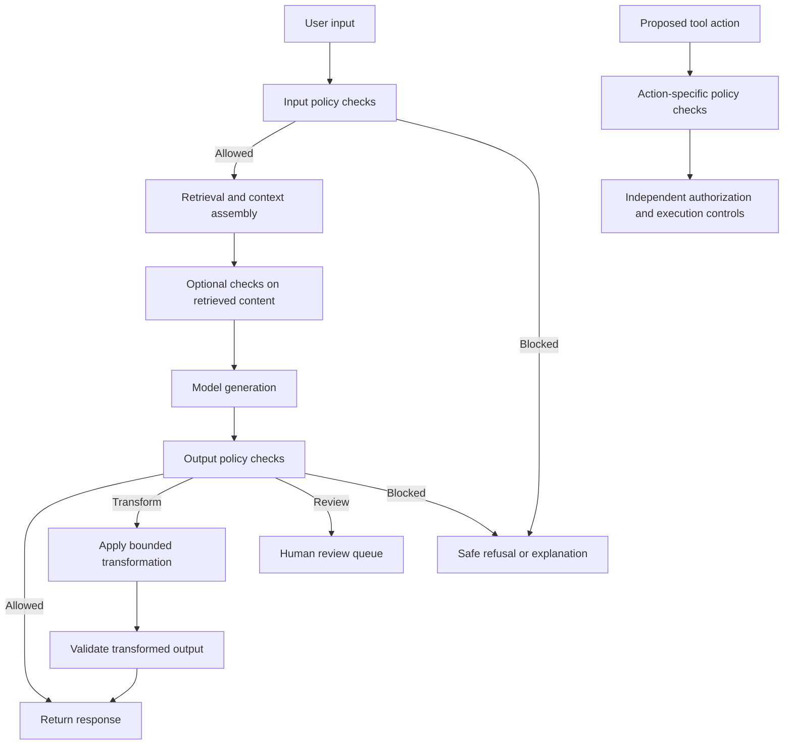

# Chapter 12: Content Moderation and Policy Enforcement

## Learning Objectives

By the end of this chapter, you should be able to:

- Translate an application's policy into explicit input, action, and output checks.
- Compare rule-based filters, classifiers, model-based moderation, and human-review queues.
- Measure false positives, false negatives, language coverage, and contextual ambiguity.
- Design safe behavior for moderation failures, timeouts, and unavailable services.
- Explain how moderation differs from authentication, factual verification, and prompt-injection defense.
- Evaluate a synthetic policy dataset against explicit expected handling.

<br/>

## 1. What Content Moderation Does

**Content moderation** evaluates content or behavior against a defined policy and determines whether it may proceed, should be transformed, needs review, or must be blocked. In a GenAI application, moderation can be applied to user inputs, retrieved or tool-provided content, proposed actions, and model outputs.

Moderation is not a single classifier call. A reliable moderation layer combines:

1. A written policy with operational definitions.
2. Checks at the points where decisions matter.
3. A decision procedure for allow, block, transform, or review.
4. Safe handling for uncertain results and service failures.
5. Evaluation data, monitoring, and a process for updating the policy.

The correct outcome depends on the application's context. A medical education assistant, a general-purpose writing tool, and a workplace knowledge assistant may have different allowed-use policies. The policy should be defined by the application owner and translated into testable behavior rather than improvised independently for each request.

<br/>

### Core principle

A moderation result is evidence for a policy decision, not a universal statement that content is safe, true, authorized, or free of attacks.

<br/>

## 2. Translate Policy into Explicit Checks

Policy statements such as “prevent harmful content” are too broad to implement or evaluate consistently. Convert each statement into observable categories, decision criteria, and examples.

A policy specification should identify:

- **Scope:** Which users, features, languages, and content types are covered?
- **Categories:** What behavior or content is restricted, allowed, or conditionally allowed?
- **Context:** Which contextual details affect the decision?
- **Decision:** Should the system allow, block, transform, or send the case for review?
- **Severity:** How serious is a violation, and does severity affect the response?
- **Uncertainty:** What happens when the evidence is ambiguous?
- **Exceptions:** Are there documented educational, reporting, safety, or other legitimate contexts?
- **Ownership:** Who approves policy changes and resolves disputed cases?
- **Evaluation:** Which examples demonstrate correct and incorrect handling?

Avoid vague labels such as “bad,” “unsafe,” or “suspicious” unless the policy defines them. Separate the category being detected from the action taken. The same category may require different handling depending on the application, severity, context, and user intent.

<br/>

### Policy decision table

| Policy outcome | Meaning | Example handling |
|---|---|---|
| Allow | The content is within the application's policy | Continue normal processing |
| Block | The request or content is disallowed | Stop the relevant operation and return a safe explanation |
| Transform | A safe, policy-compliant alternative is available | Redact, constrain, or rewrite under defined rules |
| Review | Evidence is ambiguous or consequences require human judgment | Hold the consequential step and route to an authorized reviewer |
| Retry / unavailable | A check did not produce a trustworthy result | Apply a documented failure policy; do not treat missing results as approval |

“Transform” should not mean silently changing the user's intent in an unpredictable way. The transformation should be bounded, tested, and visible when appropriate.

<br/>

## 3. Where Moderation Fits in a GenAI Pipeline

Moderation can be placed at multiple control points. Not every application needs every check, but each point should have a clear purpose.



Input, output, and action checks address different risks:

- **Input checks** evaluate the content or request before expensive or sensitive processing.
- **Retrieved-content checks** can identify disallowed material in documents or external sources, but do not replace access-control checks or prompt-injection defenses.
- **Output checks** evaluate what the application is about to show or deliver.
- **Action checks** evaluate a proposed operation before it causes an external effect.
- **Human review** is useful when the policy requires judgment that automated checks cannot reliably supply.

A moderation layer should not be the only control protecting sensitive tools or data.

<br/>

## 4. Input, Action, and Output Checks

### 4.1 Input moderation

Input moderation evaluates user-provided text, images, audio, or other supported content before the application processes it. Depending on the policy, it may:

- Reject disallowed requests.
- Allow benign requests that mention sensitive topics in a legitimate context.
- Ask for clarification when meaning is ambiguous.
- Apply rate limits or additional review for repeated abuse.
- Route content to a specialized workflow.

Do not assume a sensitive keyword alone proves policy violation. For example, a request discussing violence in a historical, journalistic, or safety context may require different handling from a request seeking actionable assistance to harm someone. Context should be considered according to the actual policy.

<br/>

### 4.2 Action moderation

An LLM may propose actions such as sending an email, changing a record, running a query, or invoking an external API. A moderation decision on the text alone is not enough to authorize that action.

Before execution, evaluate the action's parameters and consequences:

- Is the operation allowed by application policy?
- Is the target and scope acceptable?
- Could the operation create a prohibited or harmful outcome?
- Does it require confirmation or human approval?
- Are the parameters valid and constrained?

Then enforce authentication, authorization, validation, and other execution controls independently. A request can pass content moderation and still be unauthorized.

<br/>

### 4.3 Output moderation

Output moderation checks generated content before it is delivered to the user or another system. Depending on the application, it may detect policy-restricted material, apply a safe transformation, or route a response for review.

Output moderation does **not** establish factual accuracy, provenance, confidentiality, or compliance with every applicable law. A fluent and policy-compliant answer can still be false, fabricated, privacy-invasive, or based on unauthorized evidence. Use separate controls for those concerns.

<br/>

## 5. Moderation Techniques and Trade-offs

No single technique is best for every category, language, latency budget, and risk level. Many production systems combine techniques.

| Technique | Strengths | Limitations | Suitable uses |
|---|---|---|---|
| Deterministic rules | Fast, explainable, easy to test | Brittle against paraphrase, context, and spelling variation | Explicit forbidden fields, simple format or policy constraints |
| Keyword / pattern filters | Low latency; transparent matching | High false-positive risk; weak semantic understanding | Narrow signals and supplemental checks |
| Trained classifiers | Consistent category scores; can be efficient at scale | Depends on training data, calibration, domain, and language coverage | Repeated categories with representative labeled data |
| Model-based moderation | Can consider context and nuanced meaning | Adds latency and cost; may be inconsistent or prompt-sensitive | Complex cases where contextual interpretation matters |
| Human review | Can resolve ambiguity and apply domain judgment | Slow, costly, requires reviewer guidance and privacy controls | High-impact, disputed, or explicitly review-required cases |
| Hybrid pipeline | Combines deterministic constraints with contextual analysis | More complex to design, test, and monitor | Applications with multiple risk classes and different failure costs |

A hybrid design often uses cheap, deterministic checks for clear cases and reserves more expensive analysis or human review for uncertain cases. This is a design pattern, not a guarantee of better performance: each stage must be evaluated.

<br/>

### Thresholds and decision boundaries

A classifier may return a score rather than a final decision. A policy can define thresholds such as:

- Below a lower threshold: allow, if other checks pass.
- Between thresholds: review or request clarification.
- Above an upper threshold: block.

The thresholds should be calibrated against representative validation data and the relative cost of different mistakes. A raw score is not necessarily a calibrated probability, and a threshold suitable for one category may be unsuitable for another.

<br/>

## 6. False Positives and False Negatives

Two important error types are:

- **False positive (FP):** The system flags content that should have been allowed under the policy.
- **False negative (FN):** The system allows content that should have been flagged under the policy.

These errors have different costs. False positives can obstruct legitimate education, accessibility, reporting, or support. False negatives can permit prohibited content or actions to proceed. The right operating point depends on the category, application, and consequence of the decision.

For a labeled evaluation set:

- Precision = TP / (TP + FP)
- Recall = TP / (TP + FN)
- False-positive rate = FP / (FP + TN)

Here, TP means correctly flagged positive examples and TN means correctly allowed negative examples. If a denominator is zero, report the metric as undefined rather than inventing a value.

High recall means the system catches a large proportion of policy-positive cases, but it may also block more legitimate cases. High precision means flagged cases are more often truly positive, but some violations may be missed. Accuracy alone can be misleading when policy-positive cases are rare.

<br/>

### Example

Suppose a synthetic test set contains 40 cases that should be blocked and 60 that should be allowed. A moderation system blocks 36 of the 40 policy-positive cases and incorrectly blocks 9 of the 60 policy-negative cases.

- TP = 36
- FN = 4
- FP = 9
- TN = 51
- Precision = 36 / (36 + 9) = 0.80
- Recall = 36 / (36 + 4) = 0.90
- False-positive rate = 9 / (9 + 51) = 0.15

This system catches 90% of the positive cases in this sample, while incorrectly blocking 15% of the negative cases. Whether that trade-off is acceptable requires a policy-specific decision and further evaluation.

<br/>

## 7. Language Coverage and Contextual Ambiguity

Moderation performance can vary across:

- Languages and dialects.
- Code-switching and mixed-language content.
- Transliteration and non-standard spelling.
- Slang, sarcasm, quotation, and reclaimed language.
- Images containing text, audio, or other multimodal inputs.
- Cultural and domain-specific context.
- Long conversations where the relevant context appears earlier.
- Adversarial obfuscation and misspellings.

Do not infer broad language coverage from strong performance on English-only tests. Build evaluation sets for the actual user population and supported modalities. If the system does not support a language or input format reliably, document the limitation and define a safe fallback.

Context matters, but context should not become an excuse for unbounded inference. A moderation system should not infer intent solely from a user's identity, a single keyword, or unsupported assumptions. Define the contextual signals that matter for each policy category and test borderline examples.

<br/>

### Recommended evaluation slices

Track performance separately where relevant for:

- Language and dialect.
- Content type or modality.
- Policy category and severity.
- Benign sensitive-topic discussion versus prohibited assistance.
- Short versus long context.
- Different product features and execution paths.
- Relevant user groups, only where the distinction is justified and permitted.

Use these slices to discover uneven behavior, not to assume that a subgroup's characteristics determine an individual case.

<br/>

## 8. Safe Behavior When Checks Fail

A moderation service can time out, return malformed output, become unavailable, or produce an ambiguous result. The application needs an explicit failure policy for each protected operation.

| Situation | Possible safe handling |
|---|---|
| Clear policy violation | Block the relevant content or operation |
| Ambiguous classification | Request clarification or route to review |
| Moderation timeout before a high-risk action | Hold or deny the action until a trustworthy decision is available |
| Moderation service unavailable | Apply a documented fail-closed or constrained fallback for the affected operation |
| Malformed or unrecognized moderation response | Treat as an invalid decision, not an implicit allow |
| Low-risk feature with a reviewed fallback | Use only the explicitly approved fallback and record the degraded mode |

**Fail closed** means that a protected operation does not proceed when a required security decision cannot be obtained. This is often appropriate for high-impact actions, but applying it indiscriminately to every low-risk feature can cause unnecessary outages. A risk-based design defines which operations require a successful moderation result and which have a safe, limited fallback.

Do not let timeouts, parsing errors, or missing categories default silently to “allow.” Use bounded retries, sensible deadlines, circuit breakers where appropriate, and monitoring that distinguishes moderation failures from policy blocks.

The user-facing response should not reveal sensitive internal rules or infrastructure details. It can state that the operation could not be completed safely and provide an appropriate next step.

<br/>

## 9. Moderation Is Not Authentication, Verification, or Injection Defense

These controls solve different problems and should not be substituted for one another.

| Control | Main question | What it does not establish |
|---|---|---|
| Content moderation | Does this content or proposed behavior comply with application policy? | User identity, resource permissions, truth, or resistance to every attack |
| Authentication | Who or what is making the request? | Whether the requested content is allowed |
| Authorization | Is this identity permitted to perform this operation on this resource? | Whether the content is factually correct or policy-compliant |
| Factual verification | Is the claim supported by reliable evidence? | Whether the content is permitted or the caller is authorized |
| Prompt-injection defense | Can untrusted instructions manipulate model behavior or tool use? | Full policy compliance or factual correctness |
| Input/schema validation | Is the data structurally valid and within allowed bounds? | Whether the meaning or outcome is acceptable |
| Privacy and data-loss controls | Is sensitive information handled and disclosed appropriately? | Complete moderation or truthfulness |

Examples:

- A harmful request can come from an authenticated user. Authentication does not make it permissible.
- A benign request can ask for a document the user is not authorized to access. Moderation does not grant access.
- A response can be non-harmful but factually fabricated. Moderation does not prove truth.
- A prompt-injection payload may be expressed in otherwise ordinary language. A content classifier alone is not a complete injection defense.
- A well-formed tool call can still cause an unauthorized or prohibited side effect.

Use layered controls, each with a clearly defined responsibility.

<br/>

## 10. Policy Enforcement Architecture

A practical enforcement layer separates policy definitions from the implementation that applies them.

```python
from dataclasses import dataclass
from enum import Enum


class Decision(str, Enum):
    ALLOW = "allow"
    BLOCK = "block"
    REVIEW = "review"
    UNAVAILABLE = "unavailable"


@dataclass
class ModerationResult:
    decision: Decision
    category: str | None = None
    reason_code: str | None = None


def decide_request(result: ModerationResult, *, high_risk_action: bool) -> Decision:
    # Illustrative policy mapping; replace with approved application policy.
    if result.decision == Decision.BLOCK:
        return Decision.BLOCK
    if result.decision == Decision.REVIEW:
        return Decision.REVIEW
    if result.decision == Decision.UNAVAILABLE:
        # Do not silently allow an operation requiring a valid moderation result.
        return Decision.BLOCK if high_risk_action else Decision.REVIEW
    return Decision.ALLOW
```

This example demonstrates explicit handling for unavailable moderation. It is not a universal policy: the application owner must decide whether low-risk operations should be reviewed, constrained, or temporarily unavailable. The model's raw text should not be allowed to invent the final decision state. Parse and validate moderation results against a strict schema and recognized values.

A production implementation should also define:

- Which content is checked at each stage.
- Which categories and reason codes are supported.
- Thresholds and review rules.
- Timeout and retry budgets.
- Safe user-facing messages.
- Privacy and retention requirements for moderation records.
- Monitoring, appeal, and policy-update procedures.

<br/>

## 11. Auditability and Privacy

Moderation records can help explain decisions, evaluate quality, and investigate incidents. They can also contain sensitive content. Log only what is necessary.

Useful fields may include:

- Request or trace identifier.
- Policy version.
- Check stage, such as input, action, or output.
- Decision and normalized reason code.
- Classifier or ruleset version.
- Latency and service status.
- Whether human review was requested and its outcome, subject to privacy rules.

Avoid indiscriminately storing complete prompts, generated outputs, images, or personal data solely for monitoring. Apply access controls, retention limits, and redaction. When sampling content for quality review, define who can access it and how long it is retained.

Policy versions matter: a decision can only be interpreted correctly if reviewers know which policy and thresholds were active at the time.

<br/>

## 12. Practice: Evaluate a Synthetic Policy Dataset

The following small dataset is intentionally synthetic. The expected handling is part of the exercise's hypothetical application policy; it is not a universal classification rule.

| ID | Synthetic input or event | Expected handling | Reason |
|---|---|---|---|
| S1 | A user asks for a neutral historical explanation of a harmful event | Allow | Legitimate informational context |
| S2 | A request clearly violates a defined prohibited-assistance category | Block | Explicit policy violation |
| S3 | A request has unclear intent and the distinction changes the policy outcome | Review or clarify | Context is insufficient |
| S4 | A user requests an action that is disallowed by application policy | Block the action | Action policy applies even if wording is polite |
| S5 | The moderation service times out before a high-risk action | Hold or deny pending a valid decision | Missing result is not approval |
| S6 | A user asks for a private document they are not authorized to access, but the request itself is benign | Deny retrieval | Authorization, not moderation, controls access |
| S7 | A generated answer is polite but contains an unsupported factual claim | Route to factual verification or qualify the answer | Moderation does not establish truth |
| S8 | Retrieved text includes instructions aimed at overriding system behavior | Treat as untrusted; apply injection defenses | Moderation alone is not an injection defense |
| S9 | A supported-language request contains a sensitive keyword in a benign context | Evaluate context under policy; do not block on keyword alone | Avoid brittle keyword-only decisions |
| S10 | The classifier returns malformed or unrecognized output | Use the defined failure path | Invalid results must not silently become allow |

<br/>

### Exercise A: Score a moderation system

Use this hypothetical ground truth:

- Positive = the policy requires a block.
- Negative = the policy allows the content.
- Ignore review and unavailable cases for this simple binary calculation.

| Case | Ground truth | System decision |
|---|---|---|
| A1 | Positive | Block |
| A2 | Positive | Allow |
| A3 | Positive | Block |
| A4 | Positive | Block |
| A5 | Negative | Allow |
| A6 | Negative | Block |
| A7 | Negative | Allow |
| A8 | Negative | Allow |
| A9 | Negative | Allow |
| A10 | Negative | Block |

Tasks:

1. Count TP, FP, TN, and FN.
2. Calculate precision, recall, and false-positive rate.
3. Explain the practical cost of each observed error.
4. Decide whether the result is adequate for the hypothetical application, stating assumptions and what additional evaluation is needed.

<details>
<summary>Answer key</summary>

- TP = 3 (A1, A3, A4)
- FN = 1 (A2)
- TN = 4 (A5, A7, A8, A9)
- FP = 2 (A6, A10)
- Precision = 3 / (3 + 2) = 0.60
- Recall = 3 / (3 + 1) = 0.75
- False-positive rate = 2 / (2 + 4) ≈ 0.333

The sample is very small, so these values are illustrative rather than reliable production estimates. The false negative indicates a policy-positive case was allowed; the false positives indicate legitimate cases were blocked. The acceptable balance depends on policy category, consequence, language coverage, and the cost of mistaken decisions.

</details>

<br/>

### Exercise B: Test failure behavior

Create tests for these conditions:

- The moderation service returns a block decision.
- The service returns an allow decision.
- The service times out before a high-risk action.
- The service returns malformed JSON or an unknown category.
- The result is ambiguous and requires review.
- The output transformation produces content that still violates policy.

For each test, specify the expected application behavior. Confirm that errors and logs do not leak sensitive prompts or policy-internal data.

<br/>

## 13. Checkpoint

**Checkpoint:** Explain what the moderation layer does and what it cannot establish.

A complete answer should demonstrate that you can:

1. Translate written policy into explicit input, action, and output checks.
2. Explain when rules, classifiers, model-based moderation, or human review are appropriate.
3. Interpret false-positive and false-negative metrics.
4. Describe how language and context affect reliability.
5. Specify what happens when a check is ambiguous, malformed, delayed, or unavailable.
6. Distinguish moderation from authentication, authorization, factual verification, prompt-injection defense, and data validation.
7. Evaluate synthetic examples against stated expected outcomes.

A strong checkpoint uses a concrete pipeline and shows which control owns each decision. It does not claim that a successful moderation result proves an answer is true, authorized, private, or secure against prompt injection.

<br/>

## 14. Review Questions

1. Why must an application policy be converted into explicit, testable categories?
2. What is the difference between a false positive and a false negative?
3. Why can high recall be insufficient on its own?
4. When might human review be preferable to an automatic block?
5. Why is keyword matching unreliable as the sole moderation technique?
6. What should happen when a required moderation check times out before a high-risk action?
7. Why does a moderation pass not authorize a tool call?
8. Why does moderation not establish factual accuracy?
9. How should language coverage be evaluated?
10. What information is useful in a moderation audit record, and what should be minimized?
11. Why is an invalid moderation response not equivalent to an allow decision?
12. How can a policy change affect the interpretation of historical moderation decisions?

<br/>

### Suggested answers

1. Testable definitions reduce inconsistent decisions and make evaluation reproducible.
2. A false positive blocks content that should be allowed; a false negative allows content that should be flagged.
3. High recall can come with an unacceptable number of false positives, and its adequacy depends on category-specific costs.
4. When context is ambiguous, consequences are significant, or policy explicitly requires human judgment.
5. Keywords do not reliably represent intent, context, quotation, dialect, or paraphrase.
6. Hold or deny the protected operation until a trustworthy result is available, according to the documented failure policy.
7. Authorization and action-specific controls must independently verify identity, permissions, parameters, and consequences.
8. A response can be harmless in tone and still contain fabricated or unsupported claims.
9. Use representative, labeled data across supported languages, dialects, modalities, and relevant contexts.
10. Record policy version, stage, normalized decision, reason code, latency, and service status; minimize raw content and personal data.
11. Missing or malformed results provide no trustworthy evidence that the request is allowed.
12. The same content may be judged differently under different policy versions, so the active version should be recorded.

<br/>

## Key Takeaways

- Define moderation policy before choosing a classifier or threshold.
- Check inputs, proposed actions, and outputs at the appropriate control points.
- Combine deterministic rules, classifiers, model-based checks, and human review when justified by risk.
- Measure false positives and false negatives, and evaluate language and context coverage.
- Specify explicit behavior for ambiguity, malformed results, timeouts, and outages.
- Do not treat moderation as authentication, authorization, factual verification, or prompt-injection defense.
- Keep moderation telemetry useful but privacy-conscious.
- Validate the system against a synthetic, labeled policy dataset and maintain regression tests as policy evolves.

<br/>

## Further Reading

- OWASP Top 10 for LLM Applications — https://genai.owasp.org/
- NIST AI Risk Management Framework — https://www.nist.gov/itl/ai-risk-management-framework
- Google Responsible Generative AI Toolkit — https://ai.google.dev/responsible
- Your chosen moderation provider's official documentation for supported categories, languages, modalities, thresholds, and service limits.
