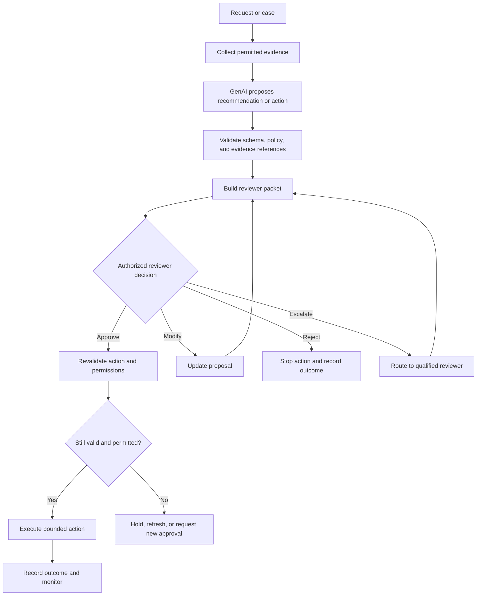

# Chapter 13: Human Review for Consequential Decisions

## Learning Objectives

By the end of this chapter, you should be able to:

- Identify GenAI-assisted actions that require qualified review, explicit confirmation, or restricted automation.
- Present relevant evidence, uncertainty, limitations, and alternatives in a reviewer-friendly interface.
- Design approval workflows that encourage independent judgment rather than automatic acceptance.
- Record decisions, escalations, overrides, and review failures proportionately.
- Restrict what a system can do before approval and revalidate an approved action immediately before execution.
- Test a human-review gate using synthetic cases and explicit expected outcomes.

<br/>

## 1. Why Human Review Matters

GenAI systems can classify information, draft recommendations, summarize records, and propose actions. However, a generated recommendation is not automatically a valid basis for a consequential decision. The system may misunderstand context, omit evidence, overstate certainty, or produce an incorrect conclusion.

**Human review** is a designed control in which an authorized person can meaningfully assess a proposed decision or action and decide whether to approve, modify, defer, escalate, or reject it.

A review gate is effective only when the reviewer has:

- The authority and competence to assess the case.
- Sufficient evidence and relevant context.
- A clear explanation of uncertainty and limitations.
- Time and interface support to make an independent judgment.
- The ability to stop or change the proposed action.
- A safe process for escalation and correction.

A button labeled “Approve” does not, by itself, create meaningful oversight. If the action has already occurred, if the reviewer cannot see the supporting evidence, or if the workflow pressures them to accept every suggestion, review may be only ceremonial.

<br/>

### Core principle

For a consequential workflow, human review must be capable of changing the outcome before the system commits the action.

<br/>

## 2. Identify Consequential Decisions

A decision is consequential when an error could materially affect a person's rights, safety, finances, access to services, employment, education, health, privacy, or other significant interests. The specific threshold depends on the application and governing policy.

Examples that may require additional safeguards include:

- Recommending or making decisions about hiring, promotion, or dismissal.
- Assessing eligibility for benefits, credit, housing, education, or essential services.
- Producing clinical or safety-related recommendations.
- Approving high-value financial transactions or changes to financial records.
- Sending legally significant notices or committing a binding agreement.
- Changing access privileges or taking an action that could expose sensitive data.
- Deleting important records or executing an irreversible operation.
- Making a decision that is difficult to appeal or correct after the fact.

Not every consequential workflow must use the same review pattern. A qualified professional may need to review one type of decision, while another workflow may require explicit user confirmation, dual authorization, or a prohibition on automated execution.

<br/>

### Risk factors to assess

Consider:

1. **Severity:** How harmful could an incorrect action be?
2. **Reversibility:** Can the action be undone reliably?
3. **Uncertainty:** How incomplete or ambiguous is the evidence?
4. **Scope:** How many people, records, or systems could be affected?
5. **Vulnerability:** Could the affected person have limited ability to detect or challenge an error?
6. **Time sensitivity:** Is there enough time for meaningful review?
7. **Legal and policy obligations:** Are there rules requiring qualified human judgment or a specific procedure?

Use these factors to define review requirements in advance, rather than deciding ad hoc after a model produces an answer.

<br/>

## 3. Choose the Right Review Pattern

A workflow can use different levels of human involvement. The correct pattern should follow the risk assessment and application policy.

| Pattern | What it means | Appropriate use pattern |
|---|---|---|
| Human-in-the-loop approval | A person reviews and approves each covered action before execution | Consequential or restricted actions |
| Human confirmation | The user confirms a clearly presented action and its material consequences | User-controlled operations where confirmation is an adequate safeguard |
| Human-on-the-loop monitoring | A person supervises an automated process and can intervene | Bounded, monitored automation where policy permits it |
| Exception-based review | Routine low-risk cases proceed under policy; uncertain or high-risk cases are escalated | Workflows with validated, explicit criteria for routing |
| Dual control | Two authorized people must approve a defined action | High-impact operations where separation of duties is justified |
| Restricted automation | The system may assist or prepare work but cannot make the final decision or execute a prohibited action | Domains where automated decisions are not permitted or are not adequately validated |

Human confirmation is not interchangeable with qualified review. Asking a person to click “Continue” may not satisfy a requirement for independent professional judgment.

<br/>

## 4. Design the Review Gate

A reliable review gate separates **proposal**, **review**, **authorization**, and **execution**.



Important properties:

- The model proposes; a trusted application component controls the workflow.
- The reviewer sees a bounded, validated proposal rather than an unconstrained model-generated command.
- Approval applies to a specific action, target, scope, and version of the relevant evidence.
- Permissions and preconditions are checked again immediately before execution.
- Any material change invalidates the old approval and requires a new decision.
- Rejection and escalation are supported outcomes, not exceptional paths that the interface makes difficult to use.

<br/>

## 5. What Reviewers Need to See

A reviewer should not have to reconstruct the case from a long chat transcript or trust an unsupported model conclusion. Present a compact, evidence-oriented review packet.

<br/>

### Recommended contents

1. **Decision or action requested:** State precisely what would happen if approved.
2. **Affected entity and scope:** Identify the person, record, account, or system involved, using only information the reviewer is authorized to see.
3. **Supporting evidence:** Link to source records or provide traceable excerpts, timestamps, and provenance.
4. **Evidence gaps:** Show missing, conflicting, stale, or low-quality information.
5. **Uncertainty:** Explain what is uncertain and why. Do not present an uncalibrated model score as a reliable probability.
6. **Alternatives:** Present reasonable options, including defer, request more information, or take no action.
7. **Consequences and reversibility:** Describe material effects and whether correction is possible.
8. **Policy constraints:** Identify relevant decision criteria and any mandatory review requirement.
9. **Model limitations:** Surface known limitations relevant to this case, not generic disclaimers alone.
10. **Proposed next step:** Make clear what approval authorizes and what it does not authorize.

<br/>

### Evidence quality

A model-generated summary is not a substitute for the underlying evidence when the decision requires inspection of that evidence. Provide source links or records where appropriate, and make it possible to distinguish source facts from model interpretations.

If the evidence is missing or the system cannot trace a claim to a reliable source, the interface should make that limitation visible. It should not invent supporting evidence or imply that an unsupported conclusion is verified.

<br/>

## 6. Prevent Automation Bias

**Automation bias** occurs when a person gives undue weight to an automated recommendation, especially when the system appears confident, is presented as authoritative, or is faster than independent assessment.

A review interface can unintentionally encourage automatic acceptance through:

- A large, visually dominant “Approve” button and hidden rejection options.
- Preselected approval or one-click approval without inspecting material details.
- Model-generated conclusions displayed without source evidence.
- Unsupported confidence percentages or authoritative language.
- Excessive case volume, unrealistic review deadlines, or productivity targets based only on approval speed.
- Repeated low-risk cases that train reviewers to approve without reading.
- Failure to show alternative interpretations or conflicting evidence.

<br/>

### Design against automation bias

- Present evidence and relevant criteria before or alongside the recommendation.
- Use neutral labels such as **Approve**, **Modify**, **Reject**, **Defer**, and **Escalate**.
- Keep rejection and escalation as accessible as approval.
- Require reviewers to inspect key evidence for higher-risk decisions.
- Show material uncertainty, missing data, and plausible alternatives.
- Use independent review or second-person approval when risk warrants it.
- Monitor reviewer disagreement, override rates, processing time, and quality—not only throughput.
- Train reviewers on known failure modes and the limits of model outputs.
- Avoid forcing reviewers to provide a rationale that merely restates the model's recommendation.

A high approval rate does not prove model quality or reviewer competence. It may reflect excellent recommendations, but it may also indicate automation bias, poor interface design, or pressure to approve.

<br/>

## 7. Define What May Happen Before Approval

A key design question is what the system is allowed to do while the case awaits review.

Generally safer pre-approval activities include:

- Preparing a draft that is not sent.
- Collecting evidence the requester is authorized to access.
- Running reversible, read-only analysis within permitted scope.
- Validating structure and checking policy constraints.
- Reserving a resource temporarily, if the reservation is safe and clearly bounded.

Potentially unsafe pre-approval activities include:

- Sending a notice, email, payment, or external message.
- Changing a person's status or access privileges.
- Publishing content or submitting a binding form.
- Deleting or irreversibly altering records.
- Disclosing sensitive information to an unauthorized recipient.
- Triggering a downstream action that cannot be reliably recalled.

Define the pre-approval boundary explicitly. “The final click requires approval” is insufficient if earlier steps have already caused the material effect.

<br/>

### Bound side effects

Use technical controls to make the boundary real:

- Generate a draft or action proposal rather than executing it.
- Use read-only credentials for evidence gathering where possible.
- Queue actions behind a server-side approval record.
- Prevent the model from bypassing the queue by calling an alternate tool.
- Apply idempotency controls to avoid duplicate execution.
- Use transactions, staged changes, or compensating actions where appropriate.
- Set expiration times for pending approvals and proposals.

<br/>

## 8. Bind Approval to the Exact Action

Approval should authorize a specific proposal, not a vague instruction such as “approve the model’s recommendation.”

The approval record should bind to relevant fields, such as:

- Action type.
- Target resource or affected entity.
- Parameters and scope.
- Proposal version or content hash.
- Evidence snapshot or version references.
- Policy version.
- Reviewer identity and decision time.
- Expiration or other validity conditions.

If the target, amount, recipient, permissions, or other material parameter changes after approval, the system must not silently reuse the old approval.

<br/>

### Example

A reviewer approves sending a notice to a specified recipient with a specific body and attachment. If the recipient changes, an attachment is replaced, or the body is materially edited, the system should treat the updated action as a new proposal and obtain the required approval again.

A version or hash can help detect changes, but it does not replace authorization checks, evidence validation, or a correct policy implementation.

<br/>

## 9. Revalidate Immediately Before Execution

An approval may become stale. Permissions may be revoked, source evidence may change, an account may be disabled, or the proposed action may expire.

Immediately before execution, a trusted service should verify:

1. The approval is authentic and belongs to an authorized reviewer.
2. The approval is still valid and has not expired or been revoked.
3. The proposal matches the exact approved version.
4. The acting user or service remains authorized.
5. The target resource and parameters remain within scope.
6. Required evidence and preconditions are still valid.
7. No policy or safety rule now prohibits the action.
8. The action has not already been executed.

If a required condition fails, hold the action. Refresh the evidence, request a new approval, or escalate according to policy. Do not ask the model to decide whether its own stale approval should be accepted.

<br/>

## 10. Escalation, Rejection, and Review Failure

A review process needs defined paths for cases that cannot be safely resolved by the first reviewer.

### Escalation triggers

- Evidence conflicts or is incomplete.
- The case falls outside the reviewer's qualifications or authority.
- The proposed action exceeds an approved threshold.
- The reviewer suspects bias, manipulation, or a policy violation.
- Affected people raise a dispute or provide new information.
- The review system is unavailable or the deadline cannot be met safely.
- The decision could have unusually severe or irreversible consequences.

<br/>

### Safe outcomes

- **Reject:** Stop the proposed action.
- **Defer:** Wait for missing evidence or a later decision.
- **Escalate:** Route to a qualified reviewer or designated authority.
- **Request information:** Ask for additional permitted evidence.
- **Cancel:** Close the proposal when it is no longer needed or valid.

Define what happens when no reviewer is available. For a decision that requires human approval, an unavailable reviewer should not automatically cause the system to execute the action. Use a hold, expiry, alternate reviewer, or documented emergency procedure.

Avoid escalation loops in which a case repeatedly returns to the same reviewer without new evidence or a clear resolution path.

<br/>

## 11. Decision Records and Auditability

Record enough information to reconstruct what was proposed, what the reviewer decided, and what the system actually did. Do not collect more sensitive content than the workflow requires.

A decision record may include:

- Case or request identifier.
- Proposal identifier and version.
- Decision type: approve, modify, reject, defer, or escalate.
- Reviewer identity and role, subject to privacy and retention requirements.
- Timestamp and policy version.
- Evidence references or versions used for the decision.
- Reason codes and concise reviewer notes where appropriate.
- Whether the proposal was modified or approval was withdrawn.
- Revalidation results before execution.
- Execution status, outcome, and any error or rollback.
- Escalation path and resolution.

Keep the record of the **decision** distinct from the record of **execution**. An approval is not proof that the action succeeded, and a failed execution should not be recorded as completed.

Protect review records with access controls, retention limits, and redaction. Avoid copying full prompts or sensitive source records into audit logs when references and minimal metadata are sufficient.

<br/>

## 12. A Simple Review-Gate Model

The following Python example illustrates the control flow. It is intentionally simplified; a production implementation needs authenticated identities, durable storage, concurrency control, robust policy checks, and a secure execution service.

```python
from dataclasses import dataclass
from enum import Enum


class ReviewDecision(str, Enum):
    APPROVE = "approve"
    MODIFY = "modify"
    REJECT = "reject"
    DEFER = "defer"
    ESCALATE = "escalate"


@dataclass(frozen=True)
class Proposal:
    proposal_id: str
    version: int
    action: str
    target: str
    parameters_hash: str


@dataclass(frozen=True)
class Approval:
    proposal_id: str
    version: int
    parameters_hash: str
    reviewer_id: str
    decision: ReviewDecision


def approval_matches(proposal: Proposal, approval: Approval) -> bool:
    return (
        approval.proposal_id == proposal.proposal_id
        and approval.version == proposal.version
        and approval.parameters_hash == proposal.parameters_hash
        and approval.decision == ReviewDecision.APPROVE
    )


def may_execute(
    proposal: Proposal,
    approval: Approval,
    *,
    reviewer_authorized: bool,
    actor_still_authorized: bool,
    preconditions_valid: bool,
) -> bool:
    return (
        approval_matches(proposal, approval)
        and reviewer_authorized
        and actor_still_authorized
        and preconditions_valid
    )
```

This code shows that approval must match the proposal version and parameters, and that reviewer authorization, actor authorization, and preconditions are separate checks. It does not implement secure authentication, tamper-resistant approval storage, expiration, race-condition protection, or execution itself.

In a real system, approval and execution should be handled by trusted backend services. Do not trust client-supplied fields such as `reviewer_authorized=True`; derive authority from authenticated identity and server-side policy.

<br/>

## 13. Practice: Design a Review Gate with Synthetic Cases

### Scenario

An internal operations assistant summarizes cases and proposes changes to account status. Some changes are routine and reversible; others can suspend access to essential services or permanently remove records. The model can prepare proposals but must not execute restricted changes on its own.

The examples below are synthetic. The expected handling is based on this exercise's hypothetical policy.

| Case | Situation | Expected handling |
|---|---|---|
| H1 | A routine, reversible draft is prepared with complete evidence; policy permits automated preparation | Allow draft preparation; do not execute any restricted change |
| H2 | A proposed suspension has conflicting source records | Defer or escalate; do not execute |
| H3 | A qualified reviewer approves a specific suspension proposal, but the target account changes afterward | Invalidate approval and request a new review |
| H4 | The reviewer rejects the proposed action | Stop the action and record rejection |
| H5 | The reviewer lacks the required role | Reject the approval attempt and route to an authorized reviewer |
| H6 | The review service is unavailable for an action that requires approval | Hold or expire the action; do not bypass review |
| H7 | The evidence used for approval has materially changed before execution | Refresh evidence and obtain new approval if required |
| H8 | A reviewer approves an action, but the execution service reports that it already ran | Prevent duplicate execution and reconcile the recorded outcome |
| H9 | A case exceeds the first reviewer's authority | Escalate to the designated authority |
| H10 | The model proposes a permanent deletion, but policy forbids autonomous deletion | Keep the proposal unexecuted and route through the required approval process—or reject it if policy prohibits the action entirely |

<br/>

### Tasks

1. Define which actions require qualified review, explicit confirmation, dual control, or restricted automation.
2. Design the reviewer packet: evidence, source references, uncertainty, alternatives, and consequences.
3. List every side effect that is prohibited before approval.
4. Specify which fields bind the approval to the exact proposal.
5. Define the revalidation checks immediately before execution.
6. Create a rejection and escalation path, including reviewer unavailability.
7. Define the minimal decision and execution records.
8. Write tests for all ten synthetic cases.
9. Demonstrate that modifying the target or parameters after approval prevents execution.
10. Explain how a reviewer can stop or change the action rather than merely acknowledge the model's output.

<br/>

### Example test assertions

```python
def test_changed_proposal_invalidates_approval():
    approved = Proposal(
        proposal_id="case-001",
        version=1,
        action="suspend_account",
        target="account-A",
        parameters_hash="hash-original",
    )
    approval = Approval(
        proposal_id="case-001",
        version=1,
        parameters_hash="hash-original",
        reviewer_id="reviewer-123",
        decision=ReviewDecision.APPROVE,
    )

    changed = Proposal(
        proposal_id="case-001",
        version=2,
        action="suspend_account",
        target="account-B",
        parameters_hash="hash-changed",
    )

    assert not approval_matches(changed, approval)
```

The test uses synthetic identifiers and hashes. Extend it to cover authorization revocation, expired approvals, changed evidence, duplicate execution, and reviewer unavailability.

<br/>

## 14. Checkpoint

**Checkpoint:** Explain how review can change or stop an action rather than merely acknowledge it.

A complete submission should demonstrate:

1. **Risk classification:** Which decisions require review and why.
2. **Evidence presentation:** How reviewers inspect source evidence, uncertainty, gaps, and alternatives.
3. **Independent judgment:** How the interface avoids automatic acceptance and supports modification, rejection, deferral, and escalation.
4. **Pre-approval boundary:** Which operations are prohibited until approval.
5. **Approval binding:** How approval is tied to the exact proposal, target, parameters, and evidence version.
6. **Revalidation:** How permissions and preconditions are checked again immediately before execution.
7. **Failure handling:** What happens when a reviewer, review service, or execution service is unavailable.
8. **Auditability:** How the system records the decision separately from execution.

A strong answer shows a workflow where rejection stops the action, modification changes the proposal and triggers any required new review, and stale or mismatched approvals cannot authorize execution.

<br/>

## 15. Review Questions

1. What makes a decision consequential, and which risk factors should influence the review requirement?
2. Why is a confirmation click not always equivalent to qualified human review?
3. What information should a reviewer see before deciding?
4. How can interface design create automation bias?
5. Why must side effects be bounded before approval?
6. Why should approval be bound to a particular proposal version?
7. Which checks should be repeated immediately before execution?
8. What should happen if no qualified reviewer is available?
9. Why should approval records and execution records be distinct?
10. How can a system demonstrate that review has real authority to stop or change an action?

<br/>

### Suggested answers

1. A decision is consequential when an error can materially affect significant interests; assess severity, reversibility, uncertainty, scope, vulnerability, time sensitivity, and applicable obligations.
2. A click may confirm receipt without providing competence, context, independent judgment, or authority to alter the outcome.
3. The proposed action, affected target, traceable evidence, uncertainty, gaps, alternatives, consequences, and relevant policy constraints.
4. Dominant approval buttons, hidden alternatives, unsupported confidence, pressure to process cases quickly, and recommendations without evidence can encourage uncritical acceptance.
5. An action may already cause harm even if the final step is nominally gated.
6. A changed target or parameter may make the original decision inapplicable.
7. Verify approval validity, proposal identity/version, reviewer authority, current actor permissions, target scope, evidence and policy preconditions, and duplicate-execution status.
8. Hold, expire, or escalate the action according to policy; do not silently bypass a mandatory review.
9. Approval shows what was authorized; execution records what actually happened.
10. Test rejection, modification, escalation, stale approval, and reviewer-unavailability paths and verify that prohibited actions do not execute.

<br/>

## Key Takeaways

- Identify consequential actions and define review requirements before deployment.
- Human review is meaningful only when reviewers have evidence, competence, time, and authority to change the outcome.
- Present uncertainty and alternatives; do not rely on model confidence or a single generated summary.
- Bound side effects before approval and prevent alternate paths from bypassing the gate.
- Bind approval to the exact proposal and revalidate it immediately before execution.
- Provide accessible rejection, deferral, modification, and escalation paths.
- Record decisions separately from execution outcomes.
- Use synthetic regression tests to prove that stale, unauthorized, or mismatched approvals cannot trigger an action.

<br/>

## Further Reading

- NIST AI Risk Management Framework — https://www.nist.gov/itl/ai-risk-management-framework
- NIST AI Risk Management Framework: Generative AI Profile — https://www.nist.gov/itl/ai-risk-management-framework
- OECD AI Principles — https://oecd.ai/en/ai-principles
- ISO/IEC 42001, Artificial intelligence management systems — consult the official ISO catalogue for the current standard and applicable guidance.
- Applicable organizational policies and legal requirements for human oversight, appeal, audit, and consequential automated decision-making.
