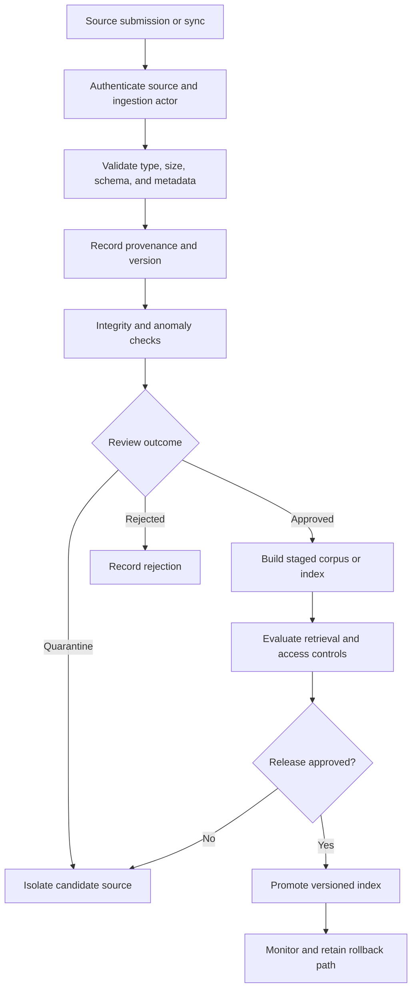

# Chapter 16: Training, Fine-Tuning, and Retrieval-Corpus Poisoning

## Learning Objectives

By the end of this chapter, you should be able to:

- Distinguish poisoning in training examples, labels, retrieved sources, and metadata.
- Investigate suspicious duplicates, conflicting targets, manipulated provenance, and unexpected source changes.
- Restrict ingestion and dataset-update authority, especially for high-impact changes.
- Quarantine questionable data while preserving version history and rollback capability.
- Explain the limits of automated poisoning detection and the difficulty of removing influence from already trained artifacts.
- Add a clearly labeled synthetic poisoned record and verify that review and ingestion controls prevent its unapproved use.
- Distinguish artifact integrity checks from evidence that the underlying content is truthful.

<br/>

## 1. What Is Data Poisoning?

**Data poisoning** is the deliberate or accidental introduction of data that degrades a model or retrieval system, changes its behavior in an unintended way, or undermines the integrity of its outputs. Poisoning can target different stages of a GenAI lifecycle: pretraining, fine-tuning, evaluation, retrieval-corpus ingestion, metadata processing, or updates to a knowledge base.

Not every incorrect record is a poisoning attack. Errors may come from ordinary data quality problems, outdated documentation, labeling mistakes, extraction failures, or benign disagreement between sources. Security controls should detect suspicious patterns, preserve evidence, and route questionable records for review without assuming that every anomaly is malicious.

The important question is not only “Does this record look unusual?” but also:

- Who supplied it, and through what process?
- Is its provenance verifiable?
- Does it conflict with established sources or labels?
- What systems will consume it?
- What is the impact if it is accepted?
- Can the record and any resulting artifacts be traced and rolled back?

<br/>

## 2. Four Main Poisoning Surfaces

| Surface | What is contaminated? | Potential effect | Example warning sign |
|---|---|---|---|
| Training examples | Text, images, audio, or other training records | Model learns unintended patterns or associations | Unexplained cluster of near-duplicate records from an unknown source |
| Labels and targets | Labels, preference pairs, rankings, or expected answers | Supervised behavior or evaluation is distorted | Labels conflict with documented criteria or trusted adjudication |
| Retrieval corpus | Documents, chunks, indexed passages, or external sources | RAG responses use misleading or malicious evidence | A new source contradicts an approved policy and has weak provenance |
| Metadata and provenance | Source identity, timestamps, permissions, tenant tags, or document relationships | Incorrect ranking, access filtering, attribution, or trust decisions | Unexpected owner change, altered timestamp, or inconsistent tenant metadata |

These surfaces can interact. For example, a document may be ingested into a retrieval index, used later to generate synthetic training examples, and then included in a fine-tuning dataset. A weak source-tracking process can make it difficult to discover where its influence has spread.

<br/>

## 3. Training-Data Poisoning

Training data influences model behavior through repeated examples, targets, and optimization. Poisoning may attempt to change general behavior, teach a specific trigger-response pattern, distort preferences, or weaken performance on selected cases.

Potential warning signs include:

- Unexplained spikes in records from one contributor or source.
- Near-duplicates added in large quantities.
- Examples with inconsistent formatting or unexpected language patterns.
- A cluster of targets that conflicts with the labeling rubric.
- Changes in class distribution without a corresponding product or data explanation.
- Synthetic examples whose generation process or approval is undocumented.
- Evaluation examples accidentally included in training data.
- Data added after a known cutoff without a recorded change request.

These signals are not proof of malicious activity. A legitimate source migration or class-balancing operation can also produce distribution changes. Investigate against source history, documented transformations, and the intended dataset specification.

<br/>

### Training examples versus labels

A record can be problematic because its input is misleading, because its target label is wrong, or because the pair is inconsistent. Review these separately.

For supervised fine-tuning, for example, the question is not only whether the prompt is a valid example, but also whether the target response follows the approved task and policy. For preference data, check whether the chosen/rejected ordering is supported by the stated preference criteria.

A high-impact change to a training set should have a reviewable diff, an identified owner, a documented rationale, and a reproducible build of the resulting dataset.

<br/>

## 4. Label and Evaluation Contamination

Labels are part of the specification that a model or evaluation process is asked to learn or measure. Poisoned or unreliable labels can create misleading training signals and falsely reassuring evaluation results.

Controls include:

- Written labeling guidelines with examples and edge cases.
- Versioned label schemas and annotation instructions.
- Independent review or adjudication for high-impact or disputed labels.
- Sampling for inter-annotator disagreement and unexpected class shifts.
- Separation between training, validation, and test datasets.
- Duplicate and near-duplicate checks across dataset splits.
- Access controls for golden evaluation sets.
- Traceability from a label to its annotator, source, and review decision, subject to privacy requirements.

Evaluation contamination deserves special attention. If test cases leak into training or prompt tuning, reported performance may overstate generalization. If a small group can alter the reference answers without review, it may also be possible to manipulate the apparent success of a model change.

Do not assume that agreement between annotators proves a label is correct. Annotators may share the same incomplete instructions or flawed source. Use a documented adjudication process and independent evidence where available.

<br/>

## 5. Retrieval-Corpus Poisoning

In retrieval-augmented generation (RAG), the system retrieves passages that may become evidence in a model response. A poisoned corpus can influence answers even when the base model has not changed.

Possible sources include:

- A compromised or misconfigured document repository.
- An unauthorized upload to a knowledge base.
- A modified webpage or document that is ingested automatically.
- A malicious or misleading passage mixed into otherwise legitimate material.
- Stale documentation that contradicts current policy.
- A document whose provenance or authority is misrepresented.
- A record that is associated with the wrong tenant, owner, date, or permission metadata.

Retrieval poisoning can target ranking as well as content. A source may be written to appear unusually relevant, repeated to dominate retrieval results, or given misleading metadata. Detection should therefore examine source authority, duplication, provenance, change history, and the effect of a candidate update on retrieval behavior.

<br/>

### RAG ingestion control points



A source passing ingestion validation is not automatically truthful or authoritative. The pipeline establishes whether the source was accepted under the defined controls, not whether every statement in it is correct.

<br/>

## 6. Metadata and Provenance Manipulation

Metadata often determines which sources are trusted, searchable, current, or accessible. Incorrect metadata can undermine controls even when the document bytes are unchanged.

Review fields such as:

- Source system and stable source identifier.
- Publisher, owner, and ingestion actor.
- Creation, modification, and ingestion timestamps.
- Document version and content hash.
- Tenant, collection, classification, and access-control attributes.
- Parent-child relationships and chunk references.
- Trust or authority labels used in ranking.
- Links to approval records and source change history.

Treat metadata from an untrusted source as a claim to validate, not as an instruction to trust. A document should not be able to grant itself an “approved” status or assign itself to a privileged tenant simply by supplying those fields.

Generate security-sensitive metadata from trusted systems where possible. For example, derive tenant identity from authenticated ingestion context rather than from a free-form field in the uploaded document. Preserve original source claims separately when they are useful for audit.

<br/>

## 7. Duplicates, Conflicts, and Distribution Shifts

Automated checks can flag anomalies that merit review.

### Duplicate and near-duplicate detection

Exact duplicates may be identified using hashes over canonicalized content. Near-duplicates may require text similarity, perceptual hashes for images, or embedding similarity. Normalize carefully: aggressive canonicalization can hide meaningful distinctions, while weak normalization can miss equivalent content.

Duplicates can arise legitimately through repeated publication, syndicated content, or overlapping exports. Review the source relationships and dataset purpose before removing them. In training data, duplicates can unintentionally overweight certain examples. In retrieval, repeated content can dominate ranking or create redundant context.

<br/>

### Conflicting targets or sources

Conflicts can indicate label errors, stale documents, legitimate policy changes, or attempted manipulation. Preserve both the conflict and its resolution rather than silently overwriting one value.

A review record should state:

- Which records conflict.
- Which authority or rule resolves the conflict.
- Whether the issue is time-sensitive.
- Which downstream datasets or indexes may be affected.
- Whether a re-index, retraining run, or evaluation rerun is required.

<br/>

### Distribution-shift monitoring

Track changes in source counts, label frequencies, language distribution, document age, contributor patterns, and retrieval outcomes. Use alert thresholds as investigation triggers, not as automatic proof of an attack.

<br/>

## 8. Restrict Ingestion Authority

Ingestion should be treated as a privileged operation because accepted data can influence many future model responses or training runs.

Recommended controls:

- Authenticate ingestion jobs and identify the submitting actor.
- Separate permission to submit content from permission to approve and publish it.
- Require review for high-impact sources, bulk updates, permission metadata changes, or changes to trusted-source configuration.
- Limit each ingestion identity to the collections and operations it needs.
- Validate metadata against trusted source records.
- Use staged ingestion and release gates rather than writing directly to the production index.
- Apply per-source and per-batch size limits.
- Record a reproducible change manifest.
- Alert on unusual update volume or changes to critical documents.
- Require a second reviewer for especially sensitive changes where justified.

For automated source synchronization, constrain the connector's identity and verify that the remote source is still the expected source. An authenticated connector can still import compromised or incorrect content from an authorized system.

<br/>

## 9. Quarantine, Versioning, and Rollback

**Quarantine** means isolating a questionable record or artifact so it cannot affect production retrieval or training while it is investigated.

A useful quarantine process:

1. Assign a stable identifier to the candidate record or batch.
2. Preserve the received bytes, metadata, source reference, and relevant timestamps in a controlled evidence store.
3. Record why it was flagged and which automated checks ran.
4. Restrict access and prevent the record from entering production prompts, indexes, or training builds.
5. Review provenance, content, labels, and downstream dependencies.
6. Approve, repair, or reject the record with a documented decision.
7. If approved, release it through the normal staged pipeline.
8. If rejected, remove it from active systems and record the disposition.
9. If already released, identify affected versions and follow the rollback or remediation plan.

Do not destroy all evidence immediately when a suspicious record is detected. Retain only what is necessary under the organization's privacy, security, and retention rules, with access controls and a defined retention period.

<br/>

### Version the full data path

Keep versions of source snapshots, transformation code, label schemas, dataset manifests, embedding models, index builds, and model checkpoints. This allows investigators to answer: “Which source version influenced this index or model build?”

A content hash can show that bytes match a prior snapshot, but it cannot establish that the content is truthful. Version history makes changes traceable; it does not validate the meaning of the data.

<br/>

## 10. Automated Detection: Useful but Limited

No single detector reliably identifies every poisoned example. Automated checks can miss subtle, context-dependent manipulation and can flag legitimate unusual data.

| Detection method | Useful signal | Limitation |
|---|---|---|
| Hash-based duplicate checks | Exact byte or canonical-content duplicates | Misses paraphrases and semantically equivalent examples |
| Similarity search | Near-duplicates and repeated semantic patterns | Can flag legitimate related records and miss carefully varied content |
| Label consistency checks | Conflicting targets or unexpected label patterns | A consistent label can still be wrong |
| Source/provenance checks | Unknown origins, unexpected ownership or revision changes | An authorized source can still be compromised or inaccurate |
| Distribution monitoring | Sudden changes in volume, labels, language, or source mix | Legitimate updates can look anomalous; gradual poisoning may evade thresholds |
| Retrieval regression tests | Changed ranking or answer evidence after an update | Test coverage may not represent all queries or hidden failure modes |
| Human review | Contextual assessment and adjudication | Limited capacity, reviewer error, and possible shared assumptions |

Combine signals and prioritize by impact. Keep detection results explainable enough that reviewers can investigate the underlying record. Avoid automatically deleting every record that scores as anomalous; use quarantine and review for uncertain cases.

<br/>

## 11. What If Poisoning Has Already Reached a Trained Model?

Removing a record from the original dataset does not automatically remove its influence from a model that has already been trained or fine-tuned. The learned parameters may encode patterns influenced by many examples, and there may be no simple mapping from a particular record to a specific set of weights.

Possible responses include:

- Stop further training or release promotion while the incident is assessed.
- Identify model checkpoints, adapters, and evaluation artifacts produced from the affected dataset version.
- Rebuild from a clean, versioned dataset when feasible.
- Retrain or fine-tune with corrected data and rerun relevant evaluation and security tests.
- Compare the rebuilt artifact against a known-good baseline.
- Restrict or withdraw an affected model version if risk warrants it.
- Preserve lineage so that future builds do not reintroduce the questionable records.

Removing a record and retraining may reduce its influence, but it does not automatically prove that all effects have disappeared. Formal machine unlearning is a specialized problem and may require separate methods and verification. Do not claim that a model has “forgotten” a record solely because the source row was deleted or a new checkpoint was produced.

For retrieval systems, remediation is often more direct but still needs care: remove or correct the source, rebuild affected chunks and indexes, invalidate caches, verify access metadata, and rerun retrieval regression tests. Copies may remain in logs, caches, exports, derived datasets, or previously generated outputs.

<br/>

## 12. Practical Dataset and Corpus Controls

A staged ingestion pipeline should make its acceptance decision explicit. A simplified design might use states such as:

- `pending`: received but not yet approved.
- `quarantined`: flagged for investigation and excluded from production use.
- `approved`: passed required checks and review.
- `rejected`: not permitted into the target dataset or corpus.
- `released`: included in a versioned production build.

The state transition should be controlled by trusted application code, not by a field supplied by the record itself.

Example pseudocode:

```python
ALLOWED_STATES = {"pending", "quarantined", "approved", "rejected", "released"}

def ingest_candidate(record, trusted_context):
    validate_schema(record)
    validate_size(record)
    verify_source_identity(trusted_context)
    validate_metadata_against_trusted_context(record, trusted_context)

    findings = run_anomaly_checks(record)

    if findings.require_review:
        return quarantine(record, findings)

    # A clean automated result is not proof of truth.
    return stage_for_approval(record, findings)
```

This is illustrative pseudocode: functions such as `verify_source_identity`, `quarantine`, and `stage_for_approval` must be implemented with appropriate authentication, storage, access control, and audit behavior. In a high-impact workflow, automated checks should not bypass a required human approval merely because no anomaly was detected.

<br/>

## 13. Practice: Add a Synthetic Poisoned Record

Use a clearly labeled synthetic record in an isolated test fixture. Do not introduce deceptive content into a production corpus or a real training dataset.

### Synthetic fixture

```json
{
  "record_id": "SYNTH-POISON-001",
  "source_id": "unverified-test-source",
  "document_version": "test-v1",
  "status": "pending",
  "content": "[SYNTHETIC TEST ONLY] This statement intentionally conflicts with the approved test policy. It must not be treated as authoritative.",
  "expected_review": "quarantine",
  "test_only": true
}
```

This record is deliberately labeled as synthetic. Its purpose is to test controls, not to supply real-world information.

<br/>

### Tasks

1. Confirm the fixture is stored only in a test dataset or isolated staging area.
2. Submit it through the normal ingestion interface using a test identity.
3. Verify that the source is marked unverified and that the conflict signal triggers quarantine or the required review path.
4. Confirm the record cannot be retrieved by the production search path or included in a production training manifest.
5. Verify that changing `status` in the input record cannot make it approved or released.
6. Confirm that tenant and permission metadata come from trusted context, not from the record's own claims.
7. Review the audit event and ensure it records a synthetic test identifier without exposing secrets.
8. Test the rollback path by removing a previously staged synthetic record and rebuilding the test index.
9. Add a regression test proving that a quarantined record is excluded from retrieval and dataset exports.
10. Document what the test proves and what it does not prove.

<br/>

### Expected interpretation

A successful test demonstrates that the ingestion workflow enforces its configured review and state-transition rules for this synthetic case. It does not prove that every possible poisoned record will be detected, or that every accepted real-world source is truthful.

<br/>

## 14. Checkpoint

**Checkpoint:** Distinguish integrity checks from proof that every accepted source is truthful.

A complete answer should explain:

1. How training examples, labels, retrieval sources, and metadata can each be poisoned.
2. Why duplicates, conflicting targets, manipulated provenance, and unusual source changes warrant investigation.
3. How ingestion authority and high-impact corpus updates are restricted.
4. How quarantine, versioning, lineage, and rollback prevent questionable data from silently affecting production.
5. What automated detectors can reveal and where they can fail.
6. Why removing a source does not automatically remove its influence from an already trained model.
7. Why hashes and signatures can verify identity or integrity relative to a trusted reference but cannot establish semantic truth.
8. How a synthetic poisoned record can test controls safely without contaminating production.

A strong answer separates three claims:

- **Integrity:** The bytes match a known version or trusted record.
- **Provenance:** The source and path are traceable to an identified origin.
- **Truthfulness and authority:** The content is accurate and appropriate for the intended use.

These claims are related but not equivalent. A source can be authentic and unchanged yet outdated, incorrect, misleading, or unauthorized for a particular decision.

<br/>

## 15. Review Questions

1. How does training-data poisoning differ from retrieval-corpus poisoning?
2. Why must labels and preference targets be reviewed separately from the input examples?
3. What risks arise when metadata such as tenant, owner, or approval status is accepted directly from an untrusted document?
4. Why can exact-duplicate detection miss poisoning?
5. Why should an anomalous record usually be quarantined rather than automatically deleted?
6. What is the purpose of staging a corpus update before production promotion?
7. What can a checksum establish, and what can it not establish?
8. Why does deleting a training row not guarantee that a trained model has forgotten it?
9. Which artifacts and records should be traced after a suspected poisoning incident?
10. How can a synthetic test demonstrate that ingestion controls work without proving universal detection?
11. Why is an authenticated source connector not sufficient to guarantee trustworthy content?
12. What evidence should accompany a high-impact dataset or corpus update?

<br/>

### Suggested answers

1. Training poisoning influences examples or targets used to optimize a model; retrieval poisoning changes the evidence available to a RAG system at query time.
2. A valid input can have an incorrect target, and a plausible label can still be inconsistent with the documented rubric.
3. Attackers may manipulate trust, attribution, ranking, or access boundaries by supplying misleading metadata.
4. Poisoned examples can be paraphrased or varied, and legitimate duplicate content also exists.
5. Quarantine preserves evidence and allows review while preventing immediate production influence; deletion may destroy useful investigation data.
6. Staging enables validation, retrieval regression testing, access-control checks, and approval before release.
7. A checksum shows that bytes match an expected digest; it does not prove that the content is true, benign, or authorized.
8. The record's influence may already be encoded in model parameters, so remediation may require rebuilding and additional evaluation.
9. Source snapshots, transformation code, dataset manifests, label versions, index builds, adapters, checkpoints, caches, and derived artifacts where applicable.
10. It verifies a defined control path for a known case; it does not cover all possible attacks or source errors.
11. The authorized source may itself be compromised, outdated, or wrong.
12. A change manifest, source provenance, version and integrity records, anomaly results, review decision, and required evaluation results.

<br/>

## Key Takeaways

- Treat training data, labels, retrieval sources, and metadata as distinct poisoning surfaces.
- Use provenance, versioning, duplicate/conflict checks, and distribution monitoring as complementary signals.
- Restrict ingestion authority and stage high-impact changes before release.
- Quarantine questionable records and preserve sufficient lineage for investigation and rollback.
- Automated anomaly detection is useful but incomplete; absence of an alert is not proof of safety.
- Removing a source does not automatically remove its influence from a trained model.
- Integrity, provenance, truthfulness, and authority are separate properties.
- Use clearly labeled synthetic fixtures to test ingestion controls without contaminating production data.

<br/>

## Further Reading

- OWASP Top 10 for LLM Applications — https://genai.owasp.org/
- NIST AI Risk Management Framework — https://www.nist.gov/itl/ai-risk-management-framework
- NIST AI Risk Management Framework: Generative AI Profile — https://www.nist.gov/itl/ai-risk-management-framework
- MITRE ATLAS — https://atlas.mitre.org/
- Your data platform's official documentation for dataset versioning, access control, lineage, and rollback.
- Your model framework's documentation for checkpoint lineage, fine-tuning reproducibility, and evaluation.
