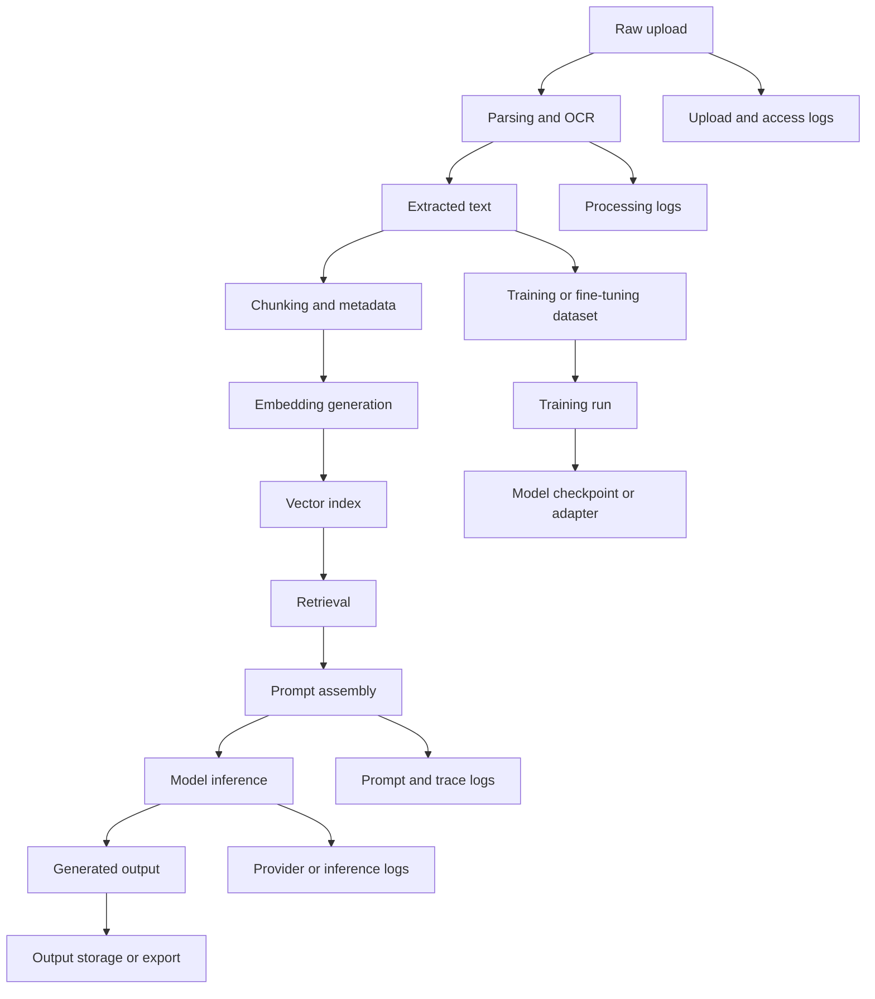
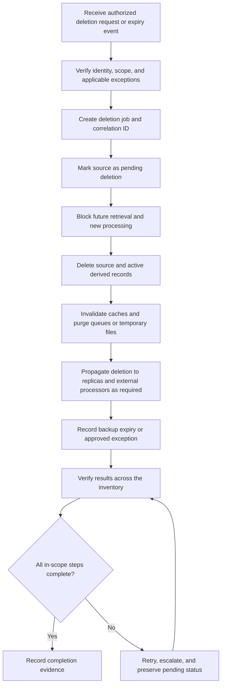

# Chapter 18: Data Retention, Licensing, and Provenance

## Overview

Generative AI applications create and transform data at many points in a system. A user may upload a document, the application may extract text, split it into chunks, create embeddings, retrieve passages, assemble prompts, call a model, log events, and store a response. Fine-tuning or other customization can introduce additional artifacts. Each representation can have a different purpose, access policy, retention period, and deletion mechanism.

Responsible data lifecycle management therefore requires more than deleting the original upload. Teams need to know what data exists, why it exists, who owns it, what rules apply, where copies may persist, and how to verify that retention and deletion controls actually work.

This chapter focuses on five connected responsibilities:

1. Map data classes and their movement through the application.
2. Define retention and deletion behavior for active storage, caches, replicas, and backups.
3. Track permissions and licensing for data, models, and generated media.
4. Preserve provenance and lineage while avoiding unnecessary sensitive copies.
5. Verify requirements and terms that apply to the concrete implementation.

> **Scope note:** This chapter provides an engineering framework, not legal advice. Legal obligations, contractual terms, model-provider policies, and organizational requirements vary by jurisdiction, product, data type, and deployment. Verify the current rules that apply to the actual system before implementation.

<br/>

## Learning Objectives

By the end of this chapter, you should be able to:

- Inventory raw uploads, parsed text, chunks, embeddings, prompts, logs, outputs, and trained artifacts.
- Assign an owner, purpose, access policy, retention period, and deletion procedure to each data class.
- Explain the difference between removing data from active retrieval and completing deletion across retained copies.
- Design deletion workflows that account for caches, replicas, indexes, derived artifacts, and backups.
- Record source permissions, model licenses, and generated-media terms in a traceable way.
- Maintain lineage from input sources through transformations to outputs without duplicating sensitive content.
- Test lifecycle controls and document exceptions, residual risk, and evidence.


<br/>


## 1. Map the Data Lifecycle

### 1.1 Typical lifecycle

A document-grounded assistant may follow this sequence:



This is an illustrative flow, not a required architecture. A specific application may omit some components or add others, such as speech transcripts, image crops, reranker inputs, evaluation datasets, human-review queues, or observability traces.

<br/>

### 1.2 Inventory data classes explicitly

A lifecycle inventory should include both original content and derived representations.

| Data class | Examples | Why it may exist | Common lifecycle concern |
|---|---|---|---|
| Raw uploads | PDF, DOCX, CSV, image, audio, video | User-provided source material | Sensitive originals may remain after processing |
| Parsed content | OCR text, extracted tables, transcripts | Make source material searchable or processable | Extraction may expose content not obvious in the original file |
| Chunks and metadata | Text segments, page numbers, document IDs, access labels | Support retrieval and citations | Chunk copies may outlive the source |
| Embeddings | Vector representations of chunks or images | Semantic search and similarity matching | Must be tracked as derived data; do not assume they are harmless or automatically exempt from controls |
| Index records | Vector-store entries, lexical index terms | Retrieval and filtering | Index entries can remain after source deletion unless explicitly removed |
| Prompts and context | System/developer instructions, user input, retrieved passages | Model inference | May combine user data with internal or third-party content |
| Logs and traces | Request IDs, errors, tool calls, timing, prompt traces | Debugging, security, audit, evaluation | Diagnostic logging can capture more content than intended |
| Generated outputs | Answers, summaries, code, images, audio | Deliver a user-facing result | May reproduce or transform source material |
| Evaluation data | Golden examples, ratings, annotations, failure cases | Measure quality and regressions | Test fixtures can become an overlooked secondary dataset |
| Training data | Fine-tuning examples, preference data, labels | Customize a model | Rights, consent, leakage, and deletion implications need review |
| Model artifacts | Checkpoints, adapters, merged weights | Deploy customized models | A trained artifact may be difficult to trace to a particular source record |
| Backups and replicas | Snapshots, replicated databases, disaster-recovery copies | Resilience and recovery | Deletion may be delayed or require expiration of backup generations |
| Exported copies | Downloads, reports, analytics extracts | User workflows and reporting | Copies may leave centrally controlled systems |

<br/>

### 1.3 Map data flows and trust boundaries

For every transition, document:

- **Source and destination:** Which service reads and writes the data?
- **Transformation:** Is it parsed, normalized, chunked, redacted, embedded, summarized, or generated?
- **Identity and ownership:** Which user, tenant, team, or business process does it belong to?
- **Purpose:** What specific feature or operational need justifies keeping it?
- **Access:** Which service accounts, people, tools, and external providers can access it?
- **Location:** Which database, object store, vector index, cache, log platform, region, or provider handles it?
- **Retention:** When does it expire, and what event starts the retention clock?
- **Deletion propagation:** Which derived records and copies must be removed or invalidated?
- **Evidence:** Which logs, job records, or tests demonstrate the policy was applied?

Create a data-flow diagram alongside the inventory. A table alone can miss hidden copies created by retries, dead-letter queues, observability tools, exports, or model-provider integrations.

<br/>

### 1.4 Assign a data owner

The data owner is accountable for the purpose and policy of a data class. A service owner may implement the controls, while a privacy, security, legal, or compliance function may advise on requirements. Do not assume that a single engineering team owns every decision.

Useful ownership fields include:

- Business or data owner
- Technical service owner
- Approver for access changes
- Retention-policy owner
- Deletion-workflow owner
- Escalation contact for failed deletion


<br/>


## 2. Define Retention and Deletion Behavior

### 2.1 Retention is a policy, not just a TTL

A time-to-live (TTL) setting is one mechanism, not a complete retention policy. A useful policy defines:

1. **Purpose:** Why the data is needed.
2. **Start event:** When retention begins, such as upload, last use, account closure, or case completion.
3. **Retention period:** A justified duration or event-based rule.
4. **Expiration behavior:** What system action occurs when the period ends.
5. **Exceptions:** Approved legal holds, incident investigations, or other authorized reasons to retain data.
6. **Copy coverage:** Which replicas, caches, indexes, logs, exports, and backups are in scope.
7. **Verification:** How the organization proves the rule ran successfully.

Avoid selecting a universal duration for all data. Raw user files, security audit events, model artifacts, and backups may have different purposes and constraints. A duration should be set after verifying applicable legal, contractual, operational, and product requirements.

<br/>

### 2.2 Active storage, caches, replicas, and backups

Deletion can involve several distinct layers:

- **Active storage:** The primary database or object store used by the application.
- **Derived stores:** Parsed text, chunks, embeddings, search indexes, and generated previews.
- **Caches:** Temporary copies used to reduce latency or cost.
- **Replicas:** Copies used for availability, scaling, or regional distribution.
- **Queues and temporary files:** Pending jobs, retry payloads, scratch storage, and dead-letter queues.
- **Logs and traces:** Operational records that may contain identifiers or content.
- **Backups and snapshots:** Recovery copies that may not support immediate item-level deletion.
- **Exports:** Files downloaded or copied to systems outside the application’s direct control.
- **External processors:** Model APIs, OCR services, storage vendors, and observability platforms subject to their own documented behavior and terms.

A deletion design must identify which layers can be updated immediately, which are eventually consistent, which expire on a schedule, and which cannot be selectively edited.

<br/>

### 2.3 Distinguish deletion states

Use precise status names rather than a single ambiguous `deleted` flag.

| State | Meaning | What it does not prove |
|---|---|---|
| Access revoked | The requester or application can no longer access the record | The record or its copies are gone |
| Removed from active retrieval | Search and retrieval no longer return the item | Cached, logged, exported, or backup copies are gone |
| Active-store deletion complete | The primary record and specified active derived records have been deleted | Backups or external copies have been erased |
| Deletion propagation pending | Some downstream systems have not yet confirmed processing | Deletion is complete |
| Backup expiry pending | The data is no longer active but remains in a retained backup generation | All retained copies are gone |
| Deletion complete under defined policy | All in-scope systems have confirmed deletion, or documented policy-defined expiry has occurred | Uncontrolled recipient copies or excluded legal holds are necessarily erased |

The exact meaning of each state must be documented for the implementation. Do not report “complete deletion” when only retrieval access has been removed.

<br/>

### 2.4 A robust deletion workflow



Important implementation details:

1. **Authenticate and authorize the request.** Confirm that the requester has authority over the relevant data.
2. **Resolve the scope.** Use stable identifiers and lineage records to find source and derived objects.
3. **Stop new work.** Prevent background workers from recreating embeddings or outputs from a source being deleted.
4. **Apply tombstones or suppression markers carefully.** A tombstone can prevent re-indexing while physical cleanup proceeds, but it is not itself proof of erasure.
5. **Make jobs idempotent.** Retrying a deletion job should not restore or corrupt data.
6. **Handle partial failure.** Record which targets succeeded, failed, or are pending; alert on deadlines and repeated failures.
7. **Verify by querying systems of record.** Confirm absence or the expected state in storage, indexes, caches, and other in-scope components.
8. **Retain minimal evidence.** A deletion receipt may need request ID, timestamps, target systems, status, and exception codes. Avoid copying the deleted content into the receipt.

<br/>

### 2.5 Backup realities and policy-defined completion

Backups are designed to preserve recoverability, so they may not support immediate deletion of one item. Common strategies include:

- Expire backup generations according to a documented schedule.
- Use per-record encryption and key-destruction approaches only where the architecture and threat model support them.
- Maintain a suppression or deletion ledger so restored data is re-deleted or excluded before it becomes available.
- Test restore procedures to ensure deleted records do not silently re-enter active retrieval.
- Define how legal holds and other authorized exceptions affect completion status.

Cryptographic erasure is not a universal shortcut: it depends on key separation, encryption coverage, key-copy handling, and whether plaintext or derived copies remain elsewhere. A backup-expiry policy should state the expected maximum time until copies age out and what happens if a restore occurs first.

<br/>

### 2.6 Deletion propagation for RAG

For retrieval-augmented generation (RAG), deleting the uploaded document alone is insufficient if derived records remain. Track relationships such as:

`source_document_id → parsed_document_id → chunk_ids → embedding_ids → index_records`

Also consider:

- Cached retrieval results and response caches
- Precomputed summaries and extracted tables
- Reranker inputs and stored scores
- Prompt traces and model-evaluation examples
- Outputs that quote or summarize the source
- Fine-tuning datasets or trained artifacts that used the source

Not every derived output can be reliably identified or reversed. The policy should distinguish directly addressable records from artifacts requiring retraining, replacement, or risk assessment.


<br/>


## 3. Permissions and Licensing

### 3.1 Permission is not the same as possession

Being able to download, read, or upload a file does not automatically establish the right to store it indefinitely, index it, send it to a model provider, use it for training, or redistribute generated results.

For each source, record what is known about:

- Source and creator or rights holder
- License or contractual basis
- Allowed purposes and transformations
- Whether commercial use is permitted
- Attribution or notice requirements
- Redistribution and derivative-work restrictions
- Restrictions on personal, confidential, or regulated information
- Whether processing by external services is permitted
- Expiration, revocation, or removal conditions
- Evidence and date of verification

Do not infer rights from a filename, website availability, or the fact that content is publicly accessible.

<br/>

### 3.2 Track model and service terms separately

For each model or service, maintain a record of:

- Provider and exact model/version identifier
- Model license or service terms and the version/date reviewed
- Allowed and prohibited uses
- Input and output handling terms
- Retention and training-use settings, where applicable
- Regional or deployment constraints
- Attribution, notice, or redistribution requirements
- Known limitations and required approvals
- Owner responsible for reviewing changes

Open-weight does not necessarily mean unrestricted. Model weights, code, training data, hosted inference, and generated outputs may be governed by different terms. Verify the license and any additional conditions for the exact version being deployed.

<br/>

### 3.3 Generated media and outputs

Generated text, images, audio, video, and code may raise questions about:

- The terms of the model or generation service
- Rights in source materials supplied by the user
- Third-party material that may be reproduced or closely resemble existing work
- Consent and permissions for identifiable people, voices, or likenesses
- Attribution, disclosure, or labeling obligations
- Restrictions on sensitive or deceptive use
- Whether the output can be published, sold, or redistributed

Do not treat model output as automatically rights-cleared merely because it was generated. Apply review proportionate to the use case, particularly for commercial publication, public distribution, or outputs involving identifiable people.

<br/>

### 3.4 A practical rights register

| Field | Example of what to record |
|---|---|
| Asset ID | `asset_1042` |
| Asset type | Source document, model, dataset, generated image |
| Origin | Internal repository, user upload, vendor, public source |
| Rights basis | License identifier, contract, permission record, or unresolved |
| Permitted uses | Search, summarization, internal analysis, commercial publication |
| Restrictions | Attribution, no redistribution, limited purpose, expiry |
| External processing | Allowed, prohibited, or requires approval |
| Evidence | Reference to license text, agreement, approval, or review record |
| Reviewed by / date | Responsible owner and review date |
| Review trigger | License change, new use, provider change, or publication |

If the rights basis is unknown or conflicting, route the asset for review instead of silently assuming broad permission.


<br/>

## 4. Provenance and Lineage

### 4.1 What provenance records

**Provenance** describes where data came from and the permissions or context under which it was obtained. **Lineage** records how data moved through transformations and which inputs produced a derived artifact.

For a generated answer, useful lineage may include:

- Request or interaction ID
- Source document identifiers and version IDs
- Retrieved chunk IDs and source locations
- Parser, OCR, chunker, and embedding model versions
- Index version and retrieval configuration
- Prompt-template version
- Inference model and version
- Tool calls and transformation versions
- Output ID and timestamp
- Evaluation or review status, where relevant

Record only the level of detail necessary for reproducibility, debugging, accountability, or compliance. Provenance should not become a second database of sensitive source content.

<br/>

### 4.2 Store references instead of duplicate content

Prefer stable identifiers, content hashes where appropriate, version references, and structured metadata over copying full documents into every trace.

For example, a trace may store:

```json
{
  "request_id": "req_8f21",
  "source_document_ids": ["doc_1042"],
  "retrieved_chunk_ids": ["chunk_1042_03", "chunk_1042_07"],
  "prompt_template_version": "rag_prompt_v5",
  "embedding_model_version": "embed_model_v2",
  "generation_model_version": "model_version_recorded_by_deployment",
  "output_id": "out_9031",
  "created_at": "2026-10-15T10:30:00Z"
}
```

These identifiers are illustrative. The model version should be the exact version used by the deployment, and timestamps should use the system's defined convention. Do not place API keys, credentials, full confidential prompts, or raw personal data in a lineage record merely for convenience.

A hash can help detect changes or match known content, but it is not anonymization by itself. A hash of a predictable or low-entropy value may be guessable. Protect identifiers and hashes according to their sensitivity and the threat model.

<br/>

### 4.3 Reproducibility versus data minimization

There is a trade-off between keeping enough information to reproduce a result and minimizing sensitive retention.

| Need | Lower-retention approach | Potential limitation |
|---|---|---|
| Debug a failed request | Request ID, error category, component versions | May not reproduce a content-dependent failure |
| Explain a RAG answer | Source IDs, chunk IDs, offsets, index version | Source may later be deleted or access revoked |
| Compare model configurations | Dataset version, prompt version, evaluation scores | Exact inputs may not be available if data was deleted |
| Audit a deletion | Job ID, target system, status, timestamps | Must avoid retaining the deleted content itself |
| Reproduce a model output | Exact prompt and configuration under controlled access | Exact prompt may contain sensitive information and require strict retention |

Where full content is genuinely necessary for a defined purpose, use explicit access controls, a short justified retention period, and a documented deletion procedure. Consider redaction, sampling, synthetic test cases, or secure references as alternatives.

<br/>

### 4.4 Provenance should support deletion

Lineage is especially useful when a source is deleted or its permission changes. A source-to-derived-artifact graph can identify which chunks, embeddings, evaluation records, or model-training datasets may need action.

Keep lineage metadata minimal but durable enough to resolve dependencies. Define how lineage records themselves are retained and deleted; do not preserve sensitive content indefinitely simply because it is useful for audit.

For trained models, exact source-level deletion may not be possible without retraining or other specialized procedures. Do not promise that removing a training example from a dataset automatically removes its influence from already-trained weights. Record the training dataset version, run ID, artifact ID, and the procedure used to assess a deletion or rights request.


<br/>


## 5. Verify Applicable Requirements and Current Terms

### 5.1 Build an implementation-specific checklist

Before deploying, identify the requirements that apply to the actual system. Review, as relevant:

- Applicable privacy and data-protection law
- Sector-specific rules and organizational policies
- Customer, partner, employment, or vendor contracts
- Data residency and cross-border processing constraints
- Model-provider terms and configuration
- Open-source and model licenses
- Records-management, audit, and legal-hold requirements
- Internal incident-response and deletion procedures

The list is not exhaustive. Applicability depends on the system, data, users, geography, and intended use.

<br/>

### 5.2 Verify current terms rather than relying on memory

For concrete implementations:

1. Identify the exact service, model, version, plan, and deployment mode.
2. Locate the currently applicable official documentation, license, contract, and privacy terms.
3. Record the source, version or effective date, review date, and reviewer.
4. Confirm input retention, output retention, training use, logging, deletion, subprocessors, and regional processing where relevant.
5. Validate any account-level or deployment-level settings that change default behavior.
6. Re-review when a model, provider, plan, jurisdiction, data category, or product purpose changes.

A general statement about a provider or model family is not a substitute for checking the actual terms and configuration used by the application.

<br/>

### 5.3 Evidence for assurance

Evidence may include:

- Approved data inventory and retention schedule
- Access-control configuration and access-review records
- Automated expiry-job metrics
- Deletion job logs and reconciliation reports
- Index and cache deletion tests
- Backup expiration and restore-test records
- License and provider-term review register
- Data-processing agreements or internal approvals
- Exception register and remediation tickets

Evidence should demonstrate that controls operate, not merely that a policy document exists. Keep the evidence itself proportionate and avoid collecting sensitive content unnecessarily.


<br/>


## 6. Worked Example: Document Q&A Service

Assume a team operates a multi-tenant RAG application for internal documents. The following table is a **sample design**, not a legal retention schedule. Durations and decisions must be replaced with values approved for the real system.

| Data class | Owner | Purpose | Retention rule | Access | Deletion handling |
|---|---|---|---|---|---|
| Raw uploads | Tenant data owner; storage service owner | Preserve user-provided source | Until configured expiry, user deletion, or an approved exception | Authorized tenant users and processing service | Delete object; stop processing; record job status |
| Parsed text and OCR | Search service owner | Make content searchable | No longer than needed for retrieval and approved processing | Retrieval service; authorized operators | Delete extracted records linked to source ID |
| Chunks and metadata | RAG service owner | Retrieval and citations | Tied to source lifecycle unless a documented exception applies | Tenant-scoped retrieval services | Delete chunks and metadata; verify tenant filter and index |
| Embeddings and vector entries | Search platform owner | Semantic retrieval | Tied to source lifecycle and index policy | Vector service account; authorized retrieval path | Delete vectors and index entries; verify they cannot be retrieved |
| Prompt/context traces | Application owner; privacy/security reviewers as needed | Debugging and safety investigation | Minimized, access-controlled, and time-limited | Restricted operations and security roles | Remove content-bearing traces or redact under approved procedure |
| Security audit events | Security owner | Investigate abuse and demonstrate control operation | According to approved audit schedule and applicable requirements | Restricted security personnel | Expire under policy; preserve only authorized exceptions |
| Generated answers | Product/data owner | User-facing response and optional history | According to product feature and user settings | Requesting user and authorized services | Delete stored response; address caches and downstream exports in scope |
| Evaluation examples | Evaluation owner | Regression and quality measurement | Approved evaluation-dataset schedule | Evaluation team with appropriate access | Remove examples and annotations linked to the source; assess copies |
| Fine-tuning dataset | Model customization owner | Training or customization | Approved training-data schedule and rights basis | Restricted training pipeline | Remove source examples; assess retraining or other remediation |
| Model checkpoints/adapters | Model owner | Serve customized model | Until retirement or approved lifecycle event | Deployment and model-governance roles | Assess source influence; replace/retrain if required and feasible |
| Caches and queues | Platform owner | Latency and asynchronous processing | Short bounded TTL plus explicit invalidation | Service accounts only | Invalidate cache keys; purge queued payloads and retry records |
| Backups and replicas | Infrastructure owner | Recovery and availability | Approved backup rotation and replication policy | Restricted infrastructure roles | Propagate where supported; track backup expiry; reapply deletions after restore |

<br/>

### Example operational policy

A practical policy might define the following states:

- **Pending:** The request is authorized and a deletion job has been created.
- **Suppressed:** New retrieval and processing are blocked.
- **Active cleanup complete:** All named active stores, indexes, and caches have confirmed their required action.
- **Backup expiry pending:** Retained recovery copies are awaiting the policy-defined expiry or another approved procedure.
- **Complete under policy:** Every in-scope target has confirmed deletion or reached the documented policy-defined terminal state; exceptions are recorded and authorized.

Do not collapse these states into a single boolean if doing so hides unresolved work.


<br/>


## 7. Implementation Patterns and Testing

### 7.1 Use stable identifiers

Assign stable IDs to source documents and derived records. Avoid relying only on filenames because filenames can collide, change, or contain sensitive details.

Example metadata:

```python
document = {
    "document_id": "doc_1042",
    "tenant_id": "tenant_21",
    "source_version": "v3",
    "owner_id": "owner_17",
    "purpose": "internal_document_search",
    "rights_status": "reviewed",
    "retention_policy_id": "rag_source_standard",
}
```

Use opaque identifiers in logs and references when possible. Ensure tenant IDs and document IDs are validated and access-checked; identifiers are not authorization.

<br/>

### 7.2 Maintain a deletion manifest

A deletion manifest tracks expected targets without copying the source content:

```python
deletion_job = {
    "job_id": "del_5508",
    "document_id": "doc_1042",
    "targets": [
        "object_store",
        "parsed_text_store",
        "chunk_store",
        "vector_index",
        "response_cache",
        "processing_queue",
    ],
    "status_by_target": {
        "object_store": "pending",
        "parsed_text_store": "pending",
        "chunk_store": "pending",
        "vector_index": "pending",
        "response_cache": "pending",
        "processing_queue": "pending",
    },
}
```

This is an illustrative data structure, not production-ready deletion code. A real implementation needs authorization checks, durable job state, retry policy, concurrency handling, observability, and secure access to the manifest. If the manifest contains sensitive identifiers, apply appropriate access and retention controls to it too.

<br/>

### 7.3 Test the lifecycle, not just the API response

Recommended tests include:

1. **Inventory completeness:** Confirm every data store and processor appears in the inventory.
2. **Retention execution:** Create test records, advance a test clock or invoke the expiry job, and verify expected cleanup.
3. **RAG deletion:** Delete a source and confirm its chunks and embeddings are no longer retrievable.
4. **Cache invalidation:** Verify cached answers or passages are not served after the applicable deletion event.
5. **Retry and partial failure:** Simulate a vector-store outage and verify the job remains pending rather than falsely reporting success.
6. **Race conditions:** Delete a source while ingestion or embedding generation is running; verify that work cannot recreate deleted records.
7. **Tenant isolation:** Confirm one tenant cannot delete or inspect another tenant's data.
8. **Backup restoration:** Restore a test backup and verify the deletion ledger or suppression process is applied before restored data becomes available.
9. **External service behavior:** Validate provider behavior against current terms, settings, and documented capabilities.
10. **Audit minimization:** Check that deletion evidence contains status and identifiers, not unnecessary source content.
11. **Rights changes:** Simulate a license or permission change and verify that affected use, publication, or processing paths are reviewed.
12. **Model artifact review:** Confirm the organization has a documented process for assessing whether training data changes require retraining, replacement, or another action.

<br/>

### 7.4 Useful operational metrics

Track metrics that show whether lifecycle controls are functioning:

- Number of records past their retention deadline
- Age of the oldest pending deletion job
- Deletion success and retry rates by target system
- Number of sources with missing lineage
- Number of assets with unknown or expired rights reviews
- Time between deletion request and active-retrieval suppression
- Time between request and policy-defined completion
- Number of backup restores requiring deletion reconciliation

Define alert thresholds from approved service objectives and retention requirements. A metric is useful only when someone owns the response.


<br/>


## 8. Practice: Create a Data Lifecycle Table

Create a lifecycle table for a GenAI application you understand, such as a PDF Q&A assistant, customer-support copilot, image-generation service, or internal knowledge assistant.

For every data class, fill in:

| Required field | Questions to answer |
|---|---|
| Data class | What is stored or derived? |
| Owner | Who is accountable for the data and policy? |
| Purpose | Why is it needed? |
| Location | Which active store, index, cache, log system, provider, or backup contains it? |
| Retention | What event starts retention, and when or how does it expire? |
| Access | Which roles and services can read, modify, export, or delete it? |
| Rights basis | What permissions, license, contract, or approval applies? |
| Lineage | Which source IDs and transformations link it to other artifacts? |
| Deletion handling | Which action removes it, and how is success verified? |
| Exceptions | What approved holds or technical limitations can delay completion? |
| Evidence | Which job record, test, metric, or review proves the control operated? |

<br/>

### Practice tasks

1. List every data class from upload through output and any training artifact.
2. Draw the lifecycle, including external processors and backup systems.
3. Choose a retention rule for each class and state the requirement or business purpose supporting it.
4. Define a deletion state machine that distinguishes active suppression, active-store cleanup, and backup expiry.
5. Identify three failure modes, such as a stale vector entry, a cached answer, or a restored backup.
6. Design tests that detect each failure.
7. Add a provenance record that can trace an output to its source IDs and transformation versions without storing full sensitive content.
8. Create a rights register for one dataset, one model, and one generated output.
9. Record uncertainties that require legal, privacy, security, or vendor review.

<br/>

### Deliverable

Submit:

- A lifecycle inventory table
- A data-flow diagram
- A deletion workflow and status definitions
- A rights and license register
- A small test plan with expected outcomes
- A list of assumptions, unresolved requirements, and approved exceptions


<br/>


## 9. Checkpoint: Removal from Retrieval vs. Complete Deletion

**Question:** Distinguish removal from active retrieval from complete deletion across all retained copies.

**Suggested answer:**

Removing a document from active retrieval means the application should no longer return it through the relevant search or RAG path. This may require disabling access, removing vector and lexical index entries, invalidating caches, and preventing new processing. It does **not** prove that the raw upload, parsed text, prompt traces, outputs, replicas, exports, or backups have been erased.

Complete deletion is a broader, scope-defined lifecycle outcome. It requires identifying all in-scope copies and derived records, executing deletion or an explicitly approved policy-defined expiry process, handling failures and exceptions, and verifying results. Backup copies may persist until their approved expiry if immediate item-level erasure is not supported. That limitation must be stated rather than hidden behind a generic “deleted” status.

A defensible completion record should state:

- What request and data scope were covered
- Which active stores and derived artifacts were processed
- Which replicas, caches, logs, external processors, and backups were included
- Which targets confirmed completion and which remain pending
- Whether any authorized exception or legal hold applies
- What evidence supports the final status

The key distinction is **retrieval unavailability is not the same as erasure**. Report only the deletion state that the implementation has verified.


<br/>


## 10. Review Questions

1. Why is an embedding a data class that should appear in the lifecycle inventory?
2. Why is a TTL alone insufficient as a retention policy?
3. What is the difference between a source document ID and a lineage record?
4. Why should a deletion job be idempotent?
5. How can a backup restore reintroduce previously deleted information?
6. Why does public availability not automatically grant permission for model training or redistribution?
7. What information can support provenance without copying full source documents?
8. Why does deleting a fine-tuning example not automatically prove that its influence has been removed from a trained model?
9. What evidence should be retained to demonstrate deletion without preserving the deleted content?
10. Which current terms and requirements must be verified before deploying a particular model or provider?

<br/>

## 11. Key Takeaways

- Inventory original data, derived data, outputs, logs, external processing, and retained copies.
- Give every data class a purpose, owner, access policy, retention rule, and deletion procedure.
- Treat active retrieval removal, active-store deletion, backup expiry, and policy-defined completion as distinct states.
- Ensure deletion propagates to indexes, caches, queues, replicas, evaluation sets, and other relevant derived artifacts.
- Record data, model, and generated-media rights separately; do not infer permissions from availability.
- Use stable identifiers and transformation metadata to preserve lineage while minimizing sensitive copies.
- Do not claim that training-data removal automatically erases influence from trained weights.
- Verify current organizational requirements, contracts, licenses, provider terms, and configuration for the actual deployment.
- Test lifecycle controls, restore behavior, race conditions, and partial failures.
- Make deletion claims only as strong as the evidence collected.

<br/>

## Further Reading and Verification Sources

For a real deployment, consult current official materials that apply to the exact data and services involved:

- Relevant privacy and data-protection regulators and legislation in the jurisdictions involved
- Internal data-classification, retention, records-management, incident-response, and deletion policies
- The exact model license or hosted-service terms for the deployed version
- Cloud storage, database, vector database, logging, backup, and observability documentation
- Contracts and data-processing terms for external processors
- Organizational legal, privacy, security, and records-management reviewers

Record the review date and exact source or version. Re-check when the implementation, provider, model, data type, or intended use changes.
