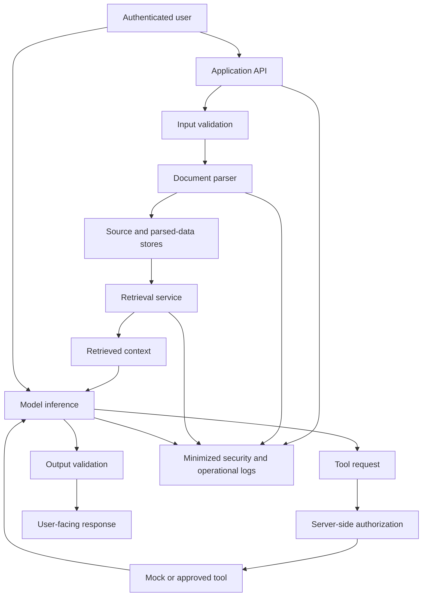

# Chapter 20: Security Review Project and Revision

## Overview

This capstone brings together the security concepts covered throughout the GenAI security and responsible AI level. The goal is to review an owned GenAI application as a system: its data flows, trust boundaries, model behavior, retrieval and tool permissions, logs, output handling, resource limits, and data lifecycle.

A useful review does not simply list possible threats. It connects each important risk to a concrete control, tests whether that control operates, records the evidence, applies targeted fixes, and retests the affected paths. It also states what remains uncertain or outside the review's scope.

The project should be performed on an application you own or are explicitly authorized to assess. Use synthetic records, mock tools, and an isolated test environment wherever possible. Do not use real secrets or probe systems without authorization.

 

## Learning Objectives

By the end of this project, you should be able to:

- Describe an application's data flow, assets, trust boundaries, and threat model.
- Test prompt injection, retrieval authorization, logging, output handling, and resource limits.
- Distinguish deterministic security controls from probabilistic model behavior.
- Prioritize risks and implement targeted mitigations.
- Rerun relevant tests and preserve before-and-after evidence.
- Review model limitations, moderation and human-review design, and data lifecycle controls.
- Write a security review report that defends each mitigation while acknowledging its limitations.

 

## 1. Project Scope and Ground Rules

### 1.1 Select an application

Choose one GenAI application that you own or are authorized to review. Examples include:

- A PDF question-answering assistant using RAG
- An internal knowledge-base assistant
- A customer-support copilot
- An agent that invokes tools through an API
- A document summarization service
- An image, audio, or text generation workflow

If the application is not yet deployed, review a local prototype and clearly label the scope as a prototype assessment. Do not imply that local tests establish production security.

 

### 1.2 Define the scope

Document:

- Application name and version or commit
- Intended users and business purpose
- Deployment environment and model/provider
- Data types processed
- Tools, APIs, and external services
- Included components and explicitly excluded components
- Test environment and authorization basis
- Review date, reviewer, and known constraints

Use a bounded scope. For example, “local RAG API, synthetic documents, mock tool execution, and test logging sink” is more actionable than “the entire AI platform.”

 

### 1.3 Establish safety rules

- Use synthetic identities, documents, and canary strings.
- Use mock tools for potentially consequential actions.
- Avoid real credentials, customer content, and unauthorized targets.
- Keep deliberate defects in disposable branches or fixtures.
- Do not execute harmful instructions from retrieved content.
- Capture only the evidence needed to establish test results.
- Stop and escalate if testing exposes real sensitive data or affects a system outside scope.

 

## 2. Map the Application and Threat Model

### 2.1 Draw the data flow

Create a diagram that includes user inputs, parsing, retrieval, model calls, tools, outputs, logs, storage, and external processors as applicable.

Example for a document-grounded assistant:

Adapt this diagram to the actual architecture. If a component does not exist, omit it. Add caches, queues, background workers, rerankers, vector indexes, human review, backup storage, or external providers when they are in scope.

 

### 2.2 Identify assets and trust boundaries

Typical assets include:

- User and tenant records
- Uploaded documents and derived text
- Embeddings, retrieval indexes, and cached results
- System prompts and internal instructions
- API credentials and service secrets
- Tool permissions and external-system actions
- Prompts, traces, and security logs
- Generated outputs and evaluation datasets
- Fine-tuning datasets, adapters, and model checkpoints
- Spending, latency, and compute capacity

Mark each point where data or authority crosses a boundary, such as user-to-API, API-to-model provider, retrieval-to-prompt, model-to-tool, tenant-to-shared infrastructure, and application-to-logging platform.

 

### 2.3 Write the threat model

For each threat, record:

| Field | What to document |
|---|---|
| Asset | What needs protection? |
| Threat actor or failure source | Malicious user, compromised dependency, accidental misconfiguration, or model failure |
| Entry point | User prompt, uploaded file, retrieved passage, tool result, API, or background job |
| Attack path | How could the threat reach the asset? |
| Impact | Confidentiality, integrity, availability, cost, or compliance impact |
| Existing control | What currently prevents or detects the issue? |
| Evidence | Which test, configuration, or observation supports the claim? |
| Residual risk | What remains possible after the control? |
| Owner | Who will address or accept the risk? |

Include direct and indirect prompt injection, cross-user access, sensitive-data leakage, unsafe output use, tool misuse, resource exhaustion, dependency risk, and lifecycle/deletion failures where relevant.

 

### 2.4 Prioritize findings

A practical prioritization method considers impact, likelihood, exposure, exploitability, and strength of existing controls. State the method used rather than assigning unexplained labels.

A review finding should contain:

- Finding ID and concise title
- Affected component and threat
- Reproduction conditions using synthetic fixtures
- Expected and observed behavior
- Impact and severity rationale
- Recommended fix
- Test that should fail before the fix and pass afterward
- Owner, status, and residual risk

Do not call a finding “fixed” until the corrected behavior has been retested.

 

## 3. Execute the Security Test Plan

Define expected secure behavior before running the tests. Use deterministic assertions for server-side controls and separate evaluation criteria for model-dependent behavior.

 

### 3.1 Prompt injection

**Test setup**

- Create a synthetic user prompt containing instructions to ignore policy, reveal a canary, or invoke a restricted mock tool.
- Add a synthetic retrieved document containing indirect hostile instructions.
- Confirm that the malicious document is actually present in the retrieved context for the relevant test.

**Assertions**

- Untrusted input does not override trusted application policy.
- The server rejects unauthorized tool actions regardless of the model's explanation.
- Protected canaries do not appear in prohibited outputs.
- Security-relevant events are recorded without unnecessary sensitive content.

**Evidence**

Record the test ID, fixture ID, prompt/model configuration, tool-call trace, authorization decision, observed output checks, and result.

**Limitations**

A finite test set cannot represent every injection strategy, language, format, or future model behavior. A model refusal alone does not prove that no tool side effect occurred.

 

### 3.2 Retrieval authorization and tenant isolation

**Test setup**

- Create synthetic Tenant A and Tenant B identities.
- Create one private document per tenant.
- Test normal access and unauthorized cross-tenant access.
- Include retrieval, caches, citations, exports, and any background processing paths in scope.

**Assertions**

- The server derives or validates identity from a trusted authentication context.
- The requester can access only records permitted by the access-control policy.
- Unauthorized content is not returned through response bodies, citations, errors, caches, or logs.
- A client-supplied tenant ID or filter cannot grant access by itself.

**Evidence**

Record the principal, target fixture ID, endpoint or path, authorization decision, response status, and checks for protected synthetic markers. Do not store real sensitive content.

**Limitations**

A successful test of one API path does not establish that every route, cache, job, or administrative interface enforces the same policy.

 

### 3.3 Logs and traces

**Test setup**

- Place an invented canary in a controlled fixture.
- Exercise normal requests, failures, tool calls, and rejected requests.
- Inspect the designated application logs, traces, and test reporting sinks.

**Assertions**

- Only approved fields are recorded.
- Secrets and unnecessary sensitive content are redacted or omitted.
- Access to retained logs is restricted.
- Log retention and deletion follow the defined lifecycle policy.

**Evidence**

Store sink identifiers, test IDs, timestamps, scan outcomes, and redaction results. Avoid copying the canary into the report unnecessarily.

**Limitations**

A scan covers only the sinks and fields inspected. External providers, unconfigured traces, crash dumps, or alternate logging paths may require separate review.

 

### 3.4 Output handling

**Test setup**

- Feed model output into each downstream consumer that is in scope.
- Include malformed structured output, unexpected fields, invalid types, and strings that resemble executable content.
- Use mock downstream actions and synthetic data.

**Assertions**

- Outputs are parsed and validated against an explicit schema.
- Unknown or invalid fields are rejected or safely handled.
- Model-produced text is not treated as authorization.
- Sensitive downstream actions require server-side checks.
- Rendering, execution, SQL construction, shell invocation, and file handling use appropriate safe interfaces rather than trusting raw model output.

**Evidence**

Record schema-validation results, rejection behavior, side-effect checks, and test fixture versions.

**Limitations**

Schema validation alone cannot prove semantic correctness, and safe parsing does not establish that the content is appropriate for every downstream use.

 

### 3.5 Resource limits

**Test setup**

Exercise documented limits using controlled oversized or excessive requests, such as too many input tokens, retrieved chunks, tool calls, concurrent jobs, or retries. Keep the test within an isolated environment and approved budget.

**Assertions**

- The server enforces request, token, time, concurrency, and spending bounds where configured.
- Cancellation and timeout behavior stops or bounds downstream work.
- Retries do not multiply costs without limit.
- Limit violations produce controlled errors and appropriate telemetry.

**Evidence**

Record configured limit, test input size, observed termination behavior, resource counters, and test result.

**Limitations**

A local test may not reproduce provider throttling, distributed contention, or production traffic patterns. Those conditions need separate staging or operational validation.

 

### 3.6 Model limitations, moderation, and human review

Assess whether the application:

- States or communicates relevant uncertainty and known limitations.
- Avoids treating model confidence or fluent wording as proof of correctness.
- Applies moderation or policy checks at appropriate input and output boundaries.
- Has escalation and human-review paths for consequential or ambiguous cases.
- Defines what human reviewers can inspect and how their decisions are recorded.
- Prevents a model's own explanation from bypassing access controls or approval requirements.

Use representative, authorized test cases. Review both false negatives and false positives: unsafe content that passes, and benign content that is incorrectly blocked. A moderation classifier or LLM judge is another fallible component, not a complete security boundary.

 

### 3.7 Data lifecycle

Review the inventory for:

- Raw uploads and extracted text
- Chunks, embeddings, and index entries
- Prompts, retrieved context, logs, and traces
- Generated outputs and exports
- Evaluation and fine-tuning datasets
- Model artifacts, caches, replicas, and backups
- External processors and provider retention settings

For a synthetic deletion case, verify that the source is removed from active retrieval, related active derived records are addressed, and caches or queues follow the documented procedure. Record backup expiry or other approved exceptions separately. Do not describe retrieval suppression as complete deletion.

 

## 4. Apply Targeted Fixes and Retest

### 4.1 Choose fixes that address the actual boundary

Examples of targeted fixes include:

| Finding | Potential mitigation | Verification |
|---|---|---|
| Cross-tenant retrieval | Enforce server-derived tenant scope in the data-access path | Cross-tenant integration test denies access |
| Model can request restricted action | Authorize each tool invocation server-side | Mock tool records no unauthorized side effect |
| Indirect injection in retrieved content | Treat retrieved text as untrusted; constrain tool access and validate actions | Injection tests fail safely even when hostile text is retrieved |
| Sensitive logging | Minimize logged fields and redact protected values | Canary scan passes across defined log sinks |
| Unsafe structured output | Strict schema validation and safe downstream interfaces | Malformed-output tests are rejected without side effects |
| Unbounded tool loop | Enforce iteration, time, token, and cost limits in application code | Limit tests show bounded work and termination |
| Stale vector records after deletion | Maintain source-to-derived IDs and a retryable deletion workflow | Deletion test confirms the record is no longer retrievable |
| Missing model/version traceability | Record deployment, prompt, retrieval, and test-set versions | Report can identify the configuration used |

These are design patterns, not universal fixes. Choose the control that addresses the demonstrated failure and fits the architecture.

 

### 4.2 Capture before-and-after evidence

For every fix, record:

1. Finding ID and original reproduction case
2. Expected secure behavior
3. Before-fix result
4. Code, configuration, or process change
5. Relevant regression test IDs
6. After-fix result
7. Related tests rerun
8. Any new failure or side effect
9. Residual risk and owner

A change that makes one test pass may introduce a usability, latency, or availability problem. Include relevant non-security effects in the review.

 

### 4.3 Avoid overclaiming mitigation effectiveness

For each important mitigation, answer:

- **Mechanism:** What exact threat path does it interrupt?
- **Enforcement point:** Where is the control applied?
- **Evidence:** Which test or inspection supports its effectiveness?
- **Coverage:** Which interfaces and data paths were tested?
- **Failure modes:** How can the control be bypassed, misconfigured, or fail open?
- **Dependencies:** Does it rely on model behavior, provider settings, or another service?
- **Residual risk:** What remains possible?
- **Monitoring:** How will future regressions be detected?

For example, prompt instructions may reduce the chance that a model follows hostile text, but they do not guarantee safety. Server-side authorization can prevent a prohibited tool action if every execution path enforces it correctly, but untested alternate paths or identity bugs remain risks. Rate limits reduce resource-exhaustion exposure but may not fully prevent distributed abuse or unexpected provider costs.

 

## 5. Capstone Deliverable: Security Review Report

Complete the report below for the application you selected. Use evidence from tests, configuration review, diagrams, and retesting. Mark unavailable evidence as “not verified” rather than inventing results.

 

### 5.1 Executive summary

- **Application and version:**
- **Purpose and intended users:**
- **Review date and environment:**
- **Scope and exclusions:**
- **Overall assessment:**
- **Most important findings:**
- **Fixes completed:**
- **Open high-priority risks:**
- **Release recommendation and rationale:**

 

### 5.2 Architecture and threat model

- **Data-flow diagram:** Include sources, transformations, retrieval, model calls, tools, outputs, logs, and external services.
- **Assets:** List sensitive or business-critical data and capabilities.
- **Trust boundaries:** Identify where identity, data, or authority crosses components.
- **Threat actors and failure sources:** Include malicious users, compromised or hostile content, accidental misconfiguration, and model failure where relevant.
- **Threat scenarios:** List the most important attack paths and expected controls.
- **Assumptions:** State conditions the review relies on.

 

### 5.3 Test results

Complete one row per case. Do not claim a test passed if it was not executed.

| Test ID | Threat/control | Expected behavior | Observed result | Evidence reference | Status |
|---|---|---|---|---|---|
| SEC-01 | Direct injection |  |  |  | Not run |
| SEC-02 | Indirect injection |  |  |  | Not run |
| SEC-03 | Retrieval authorization |  |  |  | Not run |
| SEC-04 | Log leakage |  |  |  | Not run |
| SEC-05 | Output validation |  |  |  | Not run |
| SEC-06 | Resource limits |  |  |  | Not run |
| SEC-07 | Data deletion/lifecycle |  |  |  | Not run |
| SEC-08 | Moderation/human review |  |  |  | Not run |

Use statuses such as **Pass**, **Fail**, **Partial**, **Not run**, and **Not applicable**. Define the criteria for each status. “Partial” should explain what passed and what remains unverified.

 

### 5.4 Findings and mitigation register

| Finding ID | Severity and rationale | Evidence | Mitigation | Retest result | Residual risk | Owner/status |
|---|---|---|---|---|---|---|
| F-01 |  |  |  |  |  |  |
| F-02 |  |  |  |  |  |  |
| F-03 |  |  |  |  |  |  |

Add rows as needed. Severity should reflect the impact and exploitability of the demonstrated issue, not simply the category name.

 

### 5.5 Model, moderation, and human-review assessment

Document:

- Model/provider and version identifier
- Prompt-template and inference configuration versions
- Relevant known model limitations
- Injection and leakage cases tested, including trial counts where applicable
- Moderation controls, placement, and known failure modes
- Human-review triggers, reviewer permissions, and escalation route
- False-positive and false-negative observations
- Model-dependent behaviors that are not guaranteed

 

### 5.6 Data lifecycle assessment

Document:

- Data inventory and owners
- Retention rules and policy sources
- Permissions and licensing review status
- Access controls and logging policy
- Deletion behavior for active stores, indexes, caches, replicas, and backups
- External processors and applicable current terms
- Lineage records and sensitive-data minimization
- Exceptions, pending deletion jobs, or unverified retention behavior

 

### 5.7 Limitations and remaining risks

For each remaining risk, record:

- Scenario and affected asset
- Why the risk remains
- Whether it was tested, partially tested, or not tested
- Likelihood and impact rationale
- Existing compensating controls
- Planned next action, owner, and target date
- Any explicit risk acceptance and approver

Include at least three specific untested or partially tested scenarios. Avoid generic statements such as “AI may make mistakes” without tying them to the reviewed application.

 

### 5.8 Final recommendation

Choose one and justify it:

- **Ready within reviewed scope:** Required controls passed and remaining risks are acceptable to the designated owner.
- **Ready with conditions:** Deployment depends on specified fixes, monitoring, or approvals.
- **Not ready:** A material unresolved finding or missing evidence prevents a defensible release decision.
- **Insufficient evidence:** Scope or test coverage is too limited to make a reliable recommendation.

The recommendation is not a claim of absolute security. It is a bounded decision based on the reviewed scope and available evidence.

 

## 6. Practice Plan

Complete the project in this sequence:

1. Select an owned or authorized GenAI application and record its version.
2. Create the data-flow diagram and inventory the main assets and trust boundaries.
3. Write the threat model and choose high-priority test cases.
4. Define expected secure behavior and failure criteria before running tests.
5. Build synthetic fixtures for injection, cross-tenant access, leakage, output validation, and resource limits.
6. Execute the tests and save concise evidence with configuration identifiers.
7. Prioritize the findings and select targeted fixes.
8. Implement fixes in a controlled branch or environment.
9. Rerun the failed tests and the relevant regression suite.
10. Review model limitations, moderation, human review, retention, licensing, and deletion behavior.
11. Complete the security review report, including evidence gaps and residual risks.
12. Present the report and defend the release recommendation.

 

### Suggested project acceptance criteria

The project is complete when:

- The data flow and threat model are documented.
- Expected secure behavior is defined for each tested threat.
- The core test categories are executed or explicitly marked as not run, with reasons.
- At least one targeted defect is demonstrated, fixed, and detected by a regression test.
- Before-and-after evidence is linked to identifiable test and configuration versions.
- Each important mitigation has a mechanism, evidence, coverage statement, and residual-risk description.
- Model limitations, moderation/human-review design, and data lifecycle are assessed.
- The report clearly distinguishes observed facts from assumptions and unverified claims.

 

## 7. Checkpoint: Defend the Effectiveness and Limits of Each Mitigation

**Question:** How should you defend the effectiveness and limits of each important mitigation?

**Suggested answer:**

For every mitigation, describe the threat path it is intended to interrupt, the component that enforces it, the evidence that it works, the paths covered by testing, and the residual risks. A mitigation is credible when the control matches the threat and tests exercise the relevant boundary.

Examples:

- **Server-side authorization:** Effective when every sensitive data and tool path checks trusted identity and permissions before access or action. Unit and integration tests provide evidence for the paths tested. Alternate endpoints, stale cache entries, race conditions, and misconfigured identities may remain untested.
- **Prompt-injection defenses:** Trusted instructions, untrusted-content handling, constrained tools, and output checks can reduce risk. Repeated adversarial tests show behavior on selected inputs, but cannot guarantee resistance to every phrasing, document format, or future model change.
- **Logging minimization:** Redaction and field allowlists can reduce accidental disclosure. Canary scans verify designated sinks and fields, but uninspected providers, crash dumps, or alternate telemetry paths may remain.
- **Output validation:** Schemas and safe interfaces constrain structure and downstream use. They do not guarantee semantic correctness or prevent every harmful interpretation of otherwise valid content.
- **Rate and budget limits:** Server-enforced limits bound specified dimensions. Distributed traffic, provider-side charges, retries, and unmodeled work can require additional controls and monitoring.
- **Data deletion:** Lineage and deletion workflows improve propagation and verification. Backup expiry, external copies, and trained-model influence may require separate handling and cannot be claimed complete without evidence.

A strong conclusion is specific and bounded: “The cross-tenant integration tests denied all tested unauthorized requests in build X using policy version Y; alternate administrative paths and production cache behavior were not assessed.” This is more defensible than saying “tenant isolation is secure.”

 

## 8. Review Questions

1. Why must the review define scope and authorization before testing?
2. How does a data-flow diagram help identify security gaps?
3. Why should prompt-injection testing include both user input and retrieved documents?
4. Why is model refusal insufficient evidence that a restricted action was prevented?
5. What additional paths should be checked after a retrieval authorization test passes?
6. How can logs leak sensitive information even when the final response is safe?
7. Why should resource limits be enforced outside the model?
8. What evidence is needed before describing a mitigation as effective?
9. Why should before-and-after tests use identifiable versions and fixtures?
10. How should untested scenarios affect the final release recommendation?

 

## 9. Key Takeaways

- Review the application as a connected system of data flows, trust boundaries, models, tools, stores, and external processors.
- Define expected secure behavior before running adversarial tests.
- Test injection, retrieval authorization, logging, output handling, and resource limits with synthetic fixtures.
- Enforce deterministic boundaries in server-side code; do not rely on model behavior for authorization.
- Apply targeted fixes and rerun relevant tests against recorded versions.
- Assess model limitations, moderation and human-review design, and data lifecycle controls.
- Link every major finding to evidence, a mitigation, a retest result, and residual risk.
- Separate facts established by tests from assumptions and unverified behavior.
- Make a bounded release recommendation that reflects the actual review scope.
- A good security review does not claim perfection; it shows what was tested, what improved, and what remains.

 

## Further Reading and Verification Sources

For a real application review, consult current and applicable materials such as:

- The organization's threat model, security standard, and incident-response procedures
- The exact model provider's current security and data-handling terms
- Framework, database, vector-store, and dependency security documentation
- Internal privacy, retention, licensing, and deletion policies
- Current recognized guidance on application security testing and AI/LLM threat modeling
- Previous incident reports and regression tests for known vulnerabilities

Record the sources, versions, and review dates used. Revisit the review when the model, architecture, data flows, permissions, providers, or intended use changes.
