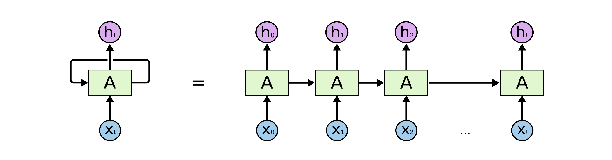
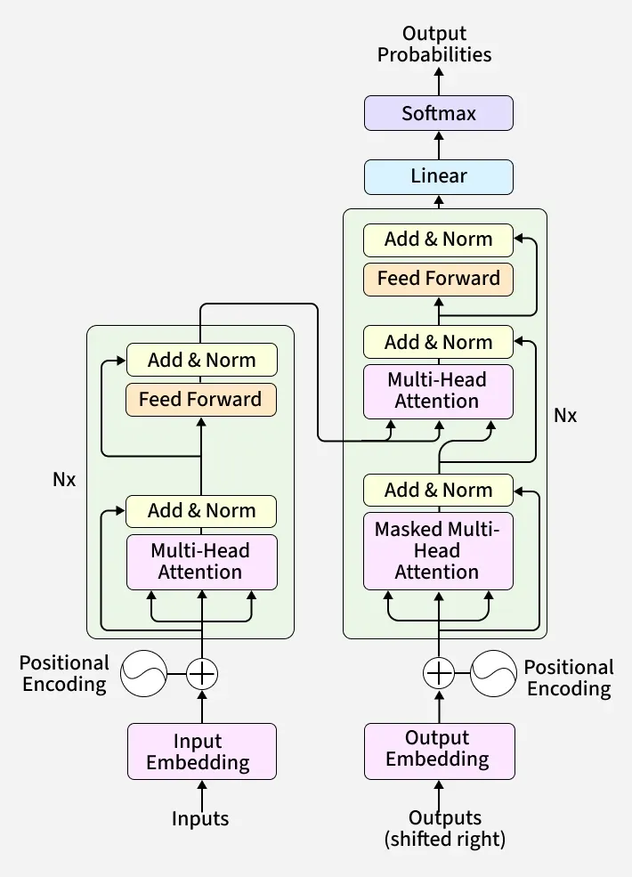
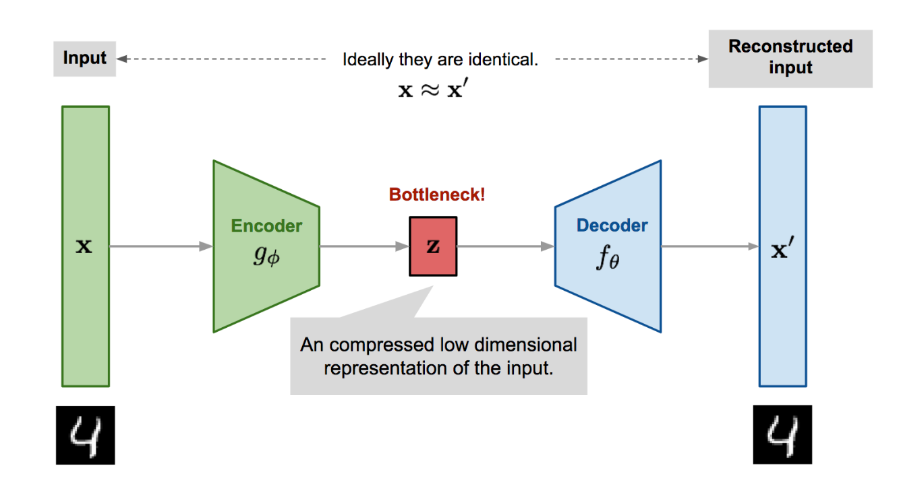
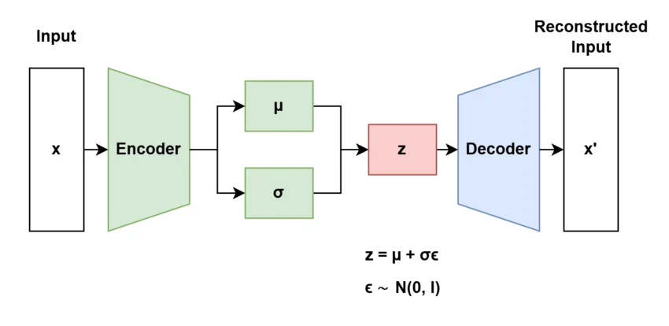
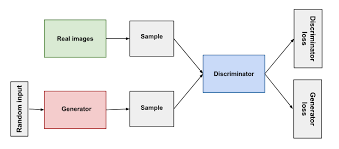
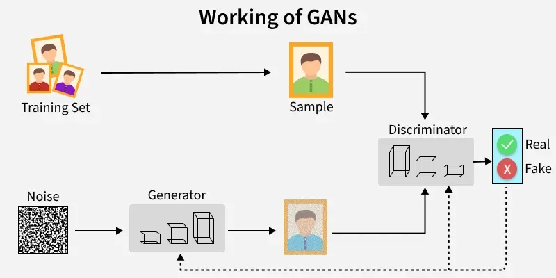
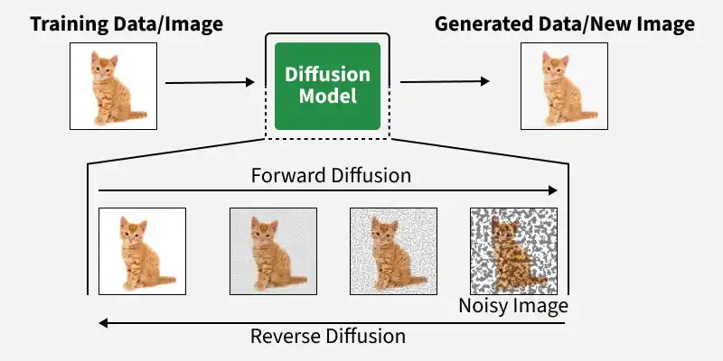

# Generative Architecture Overview

**Level 2: Generative Model Architectures · Chapter 01**

## 1. Learning Objectives

After completing this chapter, you should be able to:

- Distinguish **model architecture**, **learning objective**, and **generation procedure**.
- Explain the basic principles of autoregressive models, transformers, Variational Autoencoders (VAEs), Generative Adversarial Networks (GANs), and diffusion models.
- Identify the inputs, learned components, and outputs involved in training and inference.
- Differentiate conditional generation from unconditional generation.
- Trace a generative model from training data to a generated output.
- Understand the difference between a conceptual architecture diagram and a complete implementation.
- Identify appropriate use cases and recognize the limitations of different generative approaches.

<br/>

## 2. What Is a Generative Model Architecture?

A **generative model** is a machine learning model that learns patterns or a data distribution from examples and uses what it has learned to generate new content.

Depending on the model, the generated content may include text, images, audio, video, or other structured data.

For example, suppose a model is trained on thousands of images of cats. After training, it may generate a new image of a cat that does not exactly reproduce any particular training image.

Similarly, a language model trained on text can generate a sentence by predicting suitable tokens based on the context it receives.

The internal structure and generation process differ across model families. Understanding these differences is the purpose of generative model architectures.

<br/>

### 2.1 General Generative Workflow

Most generative systems can be understood through two broad phases:

```text
PHASE 1: TRAINING

Training data
     |
     v
Learning process
     |
     v
Trained model


PHASE 2: INFERENCE / GENERATION

Prompt, condition, or initial input
     |
     v
Trained model
     |
     v
Generated output
```

**Training** adjusts model parameters to learn patterns from data. **Inference** uses the trained model to produce an output from a supplied input, random noise, or another initial state, depending on the model family.

Training and inference are distinct. A deployed application typically uses an already trained model rather than retraining it for every request.

<br/>

## 3. Three Concepts You Must Distinguish

The terms *architecture*, *learning objective*, and *generation procedure* are related, but they describe different aspects of a generative model.

### 3.1 Model Architecture

**Model architecture** describes the structural organization of a model: its components and how information flows between them.

Examples include:

- **Transformer:** Uses attention-based layers and other neural network components.
- **VAE:** Uses an encoder and decoder, with a probabilistic latent representation.
- **GAN:** Uses a generator and discriminator during adversarial training.
- **U-Net:** A neural network architecture commonly used as a denoiser in diffusion systems.

Architecture answers:

> What components make up the model, and how do they interact?

<br/>

### 3.2 Learning Objective

A **learning objective** defines what the model is trained to achieve. It is commonly expressed through a loss function or optimization criterion.

Examples include:

- **Next-token prediction:** Predict the next token from preceding context.
- **Reconstruction:** Produce an output resembling the original input.
- **Adversarial learning:** Train a generator and discriminator through competing objectives.
- **Denoising:** Learn to predict noise or another target that helps recover cleaner data.

The learning objective guides how model parameters are updated during training.

It answers:

> What behavior is the model being trained to learn?

<br/>

### 3.3 Generation Procedure

The **generation procedure** describes how a trained model produces an output at inference time.

Examples include:

- **Autoregressive generation:** Predict one token at a time and append it to the context.
- **Latent sampling and decoding:** Sample a latent representation and decode it into an output.
- **GAN generation:** Supply noise or a condition to the generator.
- **Diffusion generation:** Start with noise and iteratively apply a learned denoising process.

It answers:

> What steps does the trained model follow to produce new content?

<br/>

### 3.4 Comparison

| Aspect | Main question | Example |
|---|---|---|
| Architecture | How is the model structured? | Transformer |
| Learning objective | What does it learn to do? | Next-token prediction |
| Generation procedure | How is an output produced? | Sequential token generation |

These dimensions are connected but are not interchangeable. A transformer-based language model, for example, can be trained with a next-token prediction objective and generate text autoregressively.

The three descriptions explain different aspects of the same system.

<br/>

## 4. Major Generative Model Families

This course introduces five important concepts or model families: autoregressive generation, transformers, VAEs, GANs, and diffusion models.

An important distinction is that **autoregression describes a generation approach, while a transformer describes a neural network architecture**. VAEs, GANs, and diffusion models describe different generative modeling frameworks and processes. These categories can overlap.

<br/>

### 4.1 Autoregressive Models

An **autoregressive model** generates a sequence by predicting its next element based on the elements already available.

For text generation, the elements are usually tokens. In other applications, an autoregressive model may generate other ordered elements or representations.



Consider the prompt:

> Generative AI can

The model predicts a possible next token, such as `create`. The context then becomes `Generative AI can create`, and the model predicts the next token.

```text
Initial context: "Generative AI can"
                    |
                    v
             Predict "create"
                    |
                    v
Updated context: "Generative AI can create"
                    |
                    v
             Predict "useful"
                    |
                    v
Updated context: "Generative AI can create useful ..."
```

The words above illustrate one possible continuation, not a deterministic output every model must produce.

Conceptually, an autoregressive model represents the probability of a sequence as a product of conditional probabilities:

$$
P(x_1,\ldots,x_n)=\prod_{t=1}^{n}P(x_t\mid x_1,\ldots,x_{t-1})
$$

Here, $x_t$ represents the element at position $t$. Each element is predicted using the preceding elements.

**Training process**

1. Provide training sequences.
2. Use the known preceding elements as context.
3. Predict the next element.
4. Compare the prediction with the actual next element.
5. Calculate the training loss and update model parameters.

**Inference process**

1. Provide an initial context or prompt.
2. Predict a probability distribution over possible next tokens.
3. Select a token according to the decoding strategy.
4. Append the selected token to the context.
5. Repeat until a stopping condition is reached.

**Applications**

- Text completion and conversational language models.
- Code generation.
- Sequential data generation.
- Models that generate ordered visual or other discrete representations.

**Strengths**

- Naturally supports continuation of a sequence.
- Can condition each new element on the previously generated context.
- Works well with large-scale sequence modeling.

**Limitations**

- Generation is sequential, which can increase latency.
- An earlier mistake can influence later predictions.
- Results depend on the context available and the decoding strategy.

**Key takeaway:** Autoregression defines how a sequence is factorized and generated. It does not specify which neural network architecture must be used.

<br/>

### 4.2 Transformer-Based Models

A **transformer** is a neural network architecture that uses attention mechanisms to process relationships between elements in a sequence.

Transformers are important in modern generative AI because they can model contextual relationships across tokens and can be adapted for different tasks.

At a high level, a transformer-based language model processes tokens through several layers that build contextual representations and produce predictions.



A simplified decoder-only transformer generation flow is:

```text
Input text / prompt
        |
        v
Tokenization and embeddings
        |
        v
Transformer layers
(attention and feed-forward processing)
        |
        v
Next-token scores
        |
        v
Token selection
        |
        v
Append token and repeat until stopping
```

This is a conceptual flow for a decoder-only, autoregressive transformer language model. Other transformer configurations follow different processing paths.

**Important transformer configurations**

- **Decoder-only:** Commonly used for autoregressive text generation, including GPT-style language models.
- **Encoder-decoder:** Processes an input with an encoder and generates an output with a decoder. This is useful for tasks such as translation and summarization.
- **Encoder-only:** Builds contextual representations useful for tasks such as classification and semantic understanding. It is not automatically a generative text model.

During training, many transformer language models can process multiple known token positions in parallel, subject to their attention masks and training objective. During autoregressive inference, newly generated tokens are typically produced sequentially.

**Applications**

- Text and code generation.
- Translation and summarization.
- Conversational systems.
- Vision-language and other multimodal systems.
- Denoising components in some diffusion architectures.

**Strengths**

- Models complex contextual relationships.
- Supports multiple task configurations.
- Scales to large datasets and model sizes.

**Limitations**

- Can require substantial compute and memory.
- Autoregressive transformer generation has sequential decoding latency.
- Performance depends on training data, model design, optimization, and inference configuration.

**Key takeaway:** Transformers describe a model architecture. They are frequently used for autoregressive generation, but they can also serve other roles, including denoising in diffusion models.

> **Scope boundary:** Attention mathematics, query/key/value representations, positional information, normalization, and KV caching will be studied in Level 3 rather than derived here.

<br/>

### 4.3 Variational Autoencoders (VAEs)

A **Variational Autoencoder (VAE)** is a generative model that learns a probabilistic latent representation of data and a decoder that can reconstruct or generate data from that representation.



<br/>



A VAE has two primary components:

- **Encoder:** Maps an input into the parameters of a latent probability distribution.
- **Decoder:** Converts a sampled latent representation into a reconstruction or generated output.

Unlike an ordinary autoencoder that may encode each input as a fixed latent vector, a VAE learns a distribution over possible latent representations.

```text
Input data
    |
    v
Encoder
    |
    v
Latent distribution
    |
    v
Sample latent vector z
    |
    v
Decoder
    |
    v
Reconstructed output
```

**Training process**

1. Provide an input example.
2. Encode it into a latent distribution.
3. Sample a latent vector using the learned distribution.
4. Decode the vector into a reconstruction.
5. Evaluate reconstruction quality and regularize the latent distribution.
6. Update the encoder and decoder parameters.

The training objective commonly combines a reconstruction term with a regularization term that encourages the learned latent distribution to remain close to a chosen prior distribution.

**Generation after training**

A VAE can generate new samples without encoding a particular input:

1. Sample a latent vector from the chosen prior distribution.
2. Pass the vector through the trained decoder.
3. Obtain a newly generated output.

This is different from reconstruction, which starts with an existing input and attempts to reproduce it.

**Applications**

- Learning compact representations of data.
- Image and data reconstruction.
- Generating variations of learned examples.
- Anomaly detection and representation-learning pipelines.
- Latent-variable modeling.

**Strengths**

- Provides an explicit probabilistic latent representation.
- Supports sampling and interpolation in latent space.
- Combines representation learning with generation.

**Limitations**

- Reconstructions can be less sharp than those from some alternative generative methods.
- Results depend on the balance between reconstruction quality and latent regularization.
- Some models experience **posterior collapse**, where the learned latent variables carry limited useful information.

**Key takeaway:** A VAE learns how to represent data probabilistically, reconstruct it, and generate new outputs through latent sampling.

<br/>

### 4.4 Generative Adversarial Networks (GANs)

A **Generative Adversarial Network (GAN)** consists of two neural networks trained in competition:

- **Generator:** Produces synthetic samples from noise or a conditioning input.
- **Discriminator:** Learns to distinguish real training examples from generated examples.



<br/>



The generator tries to produce increasingly realistic outputs, while the discriminator learns to detect generated samples.

```text
Real training examples ------------------+
                                         |
                                         v
                                  Discriminator
                                         ^
                                         |
Random noise --> Generator --> Fake samples
```

The generator and discriminator are updated through an adversarial training procedure.

**Training process**

1. Sample real examples from the training dataset.
2. Sample noise and use the generator to produce synthetic examples.
3. Train the discriminator to distinguish real and generated examples.
4. Update the generator so its outputs are more likely to be judged as real.
5. Repeat the adversarial optimization process.

The exact loss functions and update schedules vary across GAN variants.

**Generation after training**

The generator is ordinarily the component used for inference. It receives noise or a conditioning input and produces a synthetic sample. The discriminator is generally not required for routine generation.

**Applications**

- Synthetic image generation.
- Image-to-image translation.
- Image enhancement and restoration.
- Data augmentation in suitable settings.
- Some forms of synthetic data generation.

**Strengths**

- Can produce visually realistic samples.
- Can generate outputs efficiently after training.
- Conditional GANs can support targeted generation and image translation.

**Limitations**

- Training can be unstable.
- The generator may suffer from **mode collapse**, producing limited varieties of outputs.
- Balancing generator and discriminator learning can be difficult.
- High realism in generated samples does not guarantee broad coverage of the target data distribution.

**Key takeaway:** GANs learn through competition between a generator and discriminator; generation typically uses the trained generator alone.

<br/>

### 4.5 Diffusion Models

A **diffusion model** learns a process for generating data by starting from noise and progressively transforming it into a structured output through iterative denoising.



Diffusion models are particularly important in image generation, although diffusion-based approaches can also be applied to other modalities.

The process has two conceptual directions:

- **Forward process:** Gradually adds noise to training data.
- **Reverse generation process:** Uses a learned denoiser to progressively produce a sample from noise.

```text
FORWARD PROCESS (training)
Clean data --> Slightly noisy --> Noisier --> Mostly noise


REVERSE PROCESS (generation)
Initial noise --> Denoising step --> Denoising step --> Generated sample
```

**Training process**

1. Select a training example.
2. Add a known amount of noise according to a noise schedule.
3. Provide the noisy example and timestep to a neural network.
4. Train the network to predict the noise or another defined denoising target.
5. Repeat across examples and noise levels.

**Generation after training**

1. Initialize the sample with random noise.
2. Provide the current sample and timestep to the trained denoiser.
3. Use a sampling procedure to update the sample toward a less noisy state.
4. Repeat over multiple inference steps.
5. Obtain the final generated sample.

The model does not simply replay and reverse a particular noise sequence from training. It learns a denoising behavior that supports the reverse sampling process.

**Applications**

- Text-to-image generation.
- Image editing and inpainting.
- Image-to-image transformation.
- Conditional visual generation.
- Audio and other generative tasks using suitable diffusion formulations.

**Strengths**

- Can generate high-quality and diverse outputs.
- Supports conditioning and a variety of generation and editing tasks.
- Can operate in pixel space or in a learned latent space.

**Limitations**

- Iterative sampling can increase inference time.
- Generation can require substantial compute and memory.
- Quality and prompt adherence depend on the model, conditioning mechanism, sampler, and settings.

**Key takeaway:** Diffusion models learn denoising behavior and use an iterative sampling process to generate structured outputs from noise.

<br/>

## 5. Training Inputs, Learned Components, Inference Inputs, and Outputs

A useful way to understand any generative model is to ask four questions:

1. What data or signals are provided during training?
2. Which components and parameters are learned?
3. What inputs are required during inference?
4. What output does the model generate?

| Approach | Training inputs | Learned components | Inference input | Generated output |
|---|---|---|---|---|
| Autoregressive | Sequences and their target next elements | Parameters for predicting sequence elements | Initial context or prompt | Successive elements or tokens |
| Transformer-based | Task-dependent inputs and training targets | Transformer layers and associated parameters | Prompt, source sequence, or another task-specific input | Task-dependent output; for a decoder-only language model, successive tokens |
| VAE | Training examples | Encoder, latent distribution mapping, and decoder | Sampled latent vector, or an input to reconstruct | Reconstruction or newly generated sample |
| GAN | Real examples and generated examples used in adversarial training | Generator and discriminator | Noise or a conditioning input | Synthetic sample from the generator |
| Diffusion | Training examples with noise added at selected timesteps | Denoiser and associated model parameters | Initial noise, plus conditioning when required | Sample produced through iterative denoising |

The transformer row is intentionally task-dependent: transformer architecture alone does not determine the training objective or inference procedure.

<br/>

### 5.1 What Is Learned During Training?

A neural network contains parameters, commonly weights and biases, that are adjusted during training.

The model's learning objective determines how its predictions or generated outputs are evaluated and how its parameters are optimized.

Examples:

- An autoregressive language model learns parameters that support next-token prediction.
- A VAE learns an encoder and decoder, together with a useful probabilistic latent representation.
- A GAN learns a generator and discriminator through adversarial optimization.
- A diffusion model learns a denoiser that predicts a defined denoising target.

After training, inference generally uses the learned parameters without updating them. Fine-tuning and online-learning systems are separate cases in which parameters may be updated.

<br/>

### 5.2 Why This Distinction Matters in Engineering

These questions help when implementing or selecting a model:

- **Data preparation:** Determines which inputs, targets, labels, or noise transformations are needed.
- **Training design:** Determines which components must be optimized and which losses are appropriate.
- **Inference design:** Determines how requests, prompts, noise, and conditioning information must be supplied.
- **Deployment:** Determines which components are required to generate outputs, as well as the associated compute and latency requirements.

For example, a standard GAN inference service ordinarily needs its trained generator, not the discriminator. A diffusion service needs its trained denoiser and sampling procedure. A language generation service needs the trained model and its tokenization and decoding pipeline.

<br/>

## 6. Conditional Versus Unconditional Generation

Generative models can be classified by whether generation is guided by a specified condition.

### 6.1 Unconditional Generation

**Unconditional generation** produces a sample without a user-specified semantic condition that directs the content.

For example, a model trained on a dataset of faces might generate a face from random input without being asked for a particular person, expression, or appearance.

Conceptually:

$$
z \sim p(z)
$$

$$
x_{\text{generated}} = G(z)
$$

Here, $z$ is a random input or latent variable, and $G$ represents a generator. This is a simplified illustration; the exact formulation depends on the model family.

Examples include:

- Sampling a synthetic image from an unconditional image model.
- Generating a sample from a learned VAE prior.
- Generating a GAN sample from random noise.

<br/>

### 6.2 Conditional Generation

**Conditional generation** produces an output guided by additional information, such as a text prompt, class label, source image, or other input.

For example:

- A text-to-image model generates an image conditioned on "a red bicycle beside a tree."
- A conditional GAN generates an image guided by a class label.
- An encoder-decoder transformer generates a translation conditioned on the source sentence.
- A diffusion model generates an image using a text prompt as conditioning information.

Conceptually:

$$
x_{\text{generated}} = G(z,c)
$$

where $z$ represents a random input or initial state and $c$ represents the condition.

The condition does not necessarily eliminate randomness. Two generations from the same prompt can differ.

<br/>

### 6.3 Comparison

| Aspect | Unconditional | Conditional |
|---|---|---|
| Main input | Random input or initial state | Random input or initial state plus condition |
| Purpose | Generate a sample from a learned distribution | Generate a sample guided by specified information |
| Example | Generate an arbitrary image from a learned image distribution | Generate an image matching a text prompt |
| Main consideration | Diversity and distribution quality | Diversity, condition adherence, and output quality |

Conditional and unconditional generation are not separate model architectures. They describe whether the generation process is guided by a condition. Many model families support one or both forms.

<br/>

## 7. Conceptual Diagrams Versus Full Implementations

Architecture diagrams help explain the flow of information without requiring every implementation detail.

A conceptual diagram might show:

```text
Input --> Encoder --> Latent representation --> Decoder --> Output
```

A production implementation requires substantially more detail, including tensor dimensions, layer definitions, parameter initialization, loss calculations, training loops, optimization settings, checkpoint management, and inference error handling.

<br/>

### 7.1 Example: A Conceptual Autoregressive Model

The following Python example illustrates the *logic* of autoregressive generation. It is a toy demonstration, not a trained neural network.

```python
def generate_sequence(initial_tokens, predict_next, max_steps=10):
    tokens = list(initial_tokens)

    for _ in range(max_steps):
        next_token = predict_next(tokens)

        if next_token is None:  # Stopping condition
            break

        tokens.append(next_token)

    return tokens


def toy_predict_next(tokens):
    # Illustrative rule, not a learned model.
    if not tokens or tokens[-1] != "AI":
        return "AI"
    return None


result = generate_sequence(["Generative"], toy_predict_next)
print(result)
```

Output:

```text
['Generative', 'AI']
```

The example demonstrates the control flow:

1. Start with an initial sequence.
2. Obtain a prediction based on the current sequence.
3. Append the prediction.
4. Stop when the prediction function returns the stopping signal.

In a real autoregressive language model, `predict_next` would use a trained neural network to produce scores or probabilities over the model's vocabulary. A decoding strategy would select the next token.

<br/>

### 7.2 What a Real Implementation Adds

| Toy demonstration | Real generative system |
|---|---|
| Hand-written prediction rule | Trained model parameters |
| Small symbolic sequence | Token IDs, tensors, and model-specific representations |
| Simple stopping condition | End-of-sequence tokens and configured generation limits |
| No training | Dataset preparation, loss computation, optimization, and validation |
| No performance measurement | Quality evaluation, latency measurement, and resource monitoring |

Similar principles apply to the other families: a diagram can show a VAE's encoder and decoder without implementing its probabilistic latent distribution, or show diffusion denoising without implementing a noise schedule and sampling algorithm.

**Practical rule:** Use diagrams to understand system structure and data flow. Use code to test specific behavior. Do not treat a conceptual diagram or toy function as a complete generative model.

<br/>

## 8. Choosing a Generative Approach for a Use Case

The appropriate approach depends on the output modality, generation requirements, available data, quality expectations, compute budget, and availability of pretrained models.

| Use case | Candidate approach | Rationale |
|---|---|---|
| Text completion | Autoregressive transformer | Predicts successive tokens based on preceding context |
| Machine translation | Encoder-decoder transformer | Encodes the source sequence and generates a target sequence |
| Learning compact image representations | VAE | Learns a probabilistic latent representation and reconstruction process |
| Realistic synthetic image generation | GAN | Generator learns to produce realistic samples through adversarial training |
| Text-to-image generation | Conditional diffusion model | Iterative denoising can generate images guided by text |
| Image-to-image translation | Conditional GAN or diffusion model | Can generate outputs guided by an existing image |
| Image reconstruction | VAE or an appropriate reconstruction model | Reconstructs an input from a learned representation |

These are candidate approaches, not universal prescriptions. Modern systems may combine multiple approaches, and an existing pretrained model may be preferable to training a new one.

Before choosing, consider:

- **Output requirements:** Text, images, sequences, or structured data?
- **Conditioning:** Must the output follow a prompt, label, or source input?
- **Quality:** Is realism, factual correctness, reconstruction accuracy, or diversity most important?
- **Latency:** Can the application tolerate sequential token generation or iterative denoising?
- **Resources:** What compute, memory, and inference budget are available?
- **Implementation readiness:** Is a suitable pretrained model available, and can it be used under the required license?

<br/>

## 9. Common Misconceptions

### Misconception 1: Transformers and autoregressive models are competing architectures.

**Correction:** Transformers describe a neural network architecture. Autoregression describes a way of factorizing and generating sequences. A transformer can generate autoregressively.

### Misconception 2: Every transformer generates text.

**Correction:** Encoder-only transformers are often used for representation learning and understanding tasks. Transformer architecture alone does not imply autoregressive text generation.

### Misconception 3: A VAE only reconstructs existing data.

**Correction:** It can reconstruct encoded inputs and generate new samples by sampling from a suitable latent prior and decoding the samples.

### Misconception 4: A GAN requires both networks during generation.

**Correction:** Both networks participate in standard adversarial training, but routine generation ordinarily uses the trained generator.

### Misconception 5: A diffusion model simply reverses the exact noise added to its training image.

**Correction:** It learns a denoising target and uses a sampling procedure to generate outputs from an initial noise sample.

### Misconception 6: One model family is always the best.

**Correction:** Suitability depends on the task, training data, implementation, model capabilities, evaluation criteria, and operational constraints.

<br/>

## 10. Practice and Revision

### Exercise 1 — Identify the Concept

Choose the correct answer for each question.

1. Which term describes the structural organization of neural network components?
   - A. Generation procedure
   - B. Model architecture
   - C. Inference input

2. Which approach generates a sequence by repeatedly predicting its next element?
   - A. Autoregressive generation
   - B. Adversarial training
   - C. Latent interpolation

3. Which model family learns a generator and discriminator through adversarial training?
   - A. VAE
   - B. GAN
   - C. Autoregressive model

4. What is the starting point of the standard diffusion generation process?
   - A. A trained discriminator
   - B. An encoded source image in every case
   - C. An initial noise sample

5. Which statement about transformers is correct?
   - A. All transformers generate text autoregressively.
   - B. Transformers are architectures that can serve different modeling tasks.
   - C. Transformers always require a VAE encoder.

**Answers and explanations**

1. **B — Model architecture.** Architecture describes the model's structure and the relationships between its components.
2. **A — Autoregressive generation.** Each prediction is conditioned on preceding elements.
3. **B — GAN.** A GAN trains a generator and discriminator through competing objectives.
4. **C — An initial noise sample.** Standard diffusion sampling starts from noise and applies a learned denoising process; conditioning may also be supplied.
5. **B — Transformers support different modeling tasks.** They can support autoregressive generation and can also be used for diffusion denoising.

<br/>

### Exercise 2 — Annotate a Training-to-Generation Diagram

Use the following generic flow as a starting point:

```text
TRAINING

Training data
     |
     v
Model + learning objective
     |
     v
Calculate loss and update parameters
     |
     v
Trained model


INFERENCE / GENERATION

Inference input
(prompt, condition, noise, or source input)
     |
     v
Trained model + generation procedure
     |
     v
Generated output
```

Annotate the diagram for each of the following:

- An autoregressive language model.
- A VAE.
- A GAN.
- A diffusion model.

For each, identify the training data, learning objective, learned components, inference input, and output. Pay special attention to the fact that a transformer-based language model can also be described as autoregressive.

<br/>

### Exercise 3 — Explain the Architecture Distinction

Write a short explanation answering these questions:

1. Why are architecture, learning objective, and generation procedure separate descriptions?
2. Why is "transformer versus autoregressive" an incorrect comparison?
3. How does VAE sampling differ from GAN generation?
4. Why does diffusion generation involve multiple denoising steps?
5. Which approach would you investigate for text completion, image synthesis, and latent representation learning, and what evidence would you need before selecting a specific model?

<br/>

## 11. Chapter Summary

The central idea of this chapter is that generative models can be understood through three complementary perspectives:

- **Architecture:** The model's structural components and information flow.
- **Learning objective:** The behavior optimized during training.
- **Generation procedure:** The process used to produce outputs at inference time.

Autoregressive models generate sequences through successive predictions. Transformers provide an architecture used for many generative tasks. VAEs learn probabilistic latent representations, GANs learn through adversarial competition, and diffusion models learn denoising behavior for iterative generation.

These approaches overlap in important ways. A transformer may generate autoregressively or act as a diffusion denoiser, and the presence of a particular architecture does not, by itself, determine the model's capabilities or quality.

**Checkpoint:** You should be able to explain the five approaches at a high level, distinguish their training and generation processes, and defend a candidate approach for a practical use case without claiming that any single family is universally superior.

<br/>

## 12. References and Further Reading

The chapter structure follows the Level 2 course outline. The following original research papers provide useful background for deeper study.

1. Vaswani et al. (2017), *Attention Is All You Need* — https://arxiv.org/abs/1706.03762
2. Kingma and Welling (2013), *Auto-Encoding Variational Bayes* — https://arxiv.org/abs/1312.6114
3. Goodfellow et al. (2014), *Generative Adversarial Nets* — https://arxiv.org/abs/1406.2661
4. Ho, Jain, and Abbeel (2020), *Denoising Diffusion Probabilistic Models* — https://arxiv.org/abs/2006.11239

**Next chapter:** `02_latent_representations_and_spaces.md` — Latent Representations and Latent Spaces.
