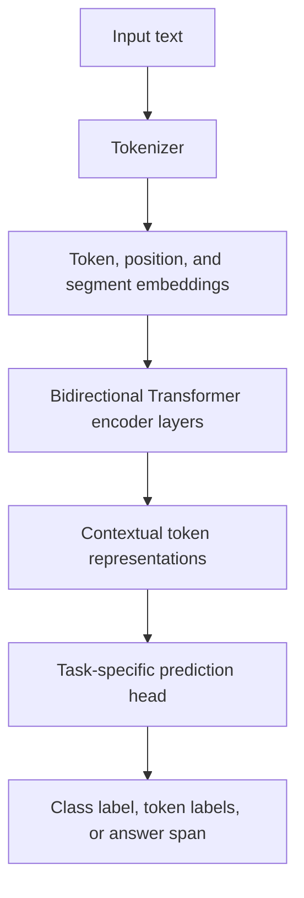
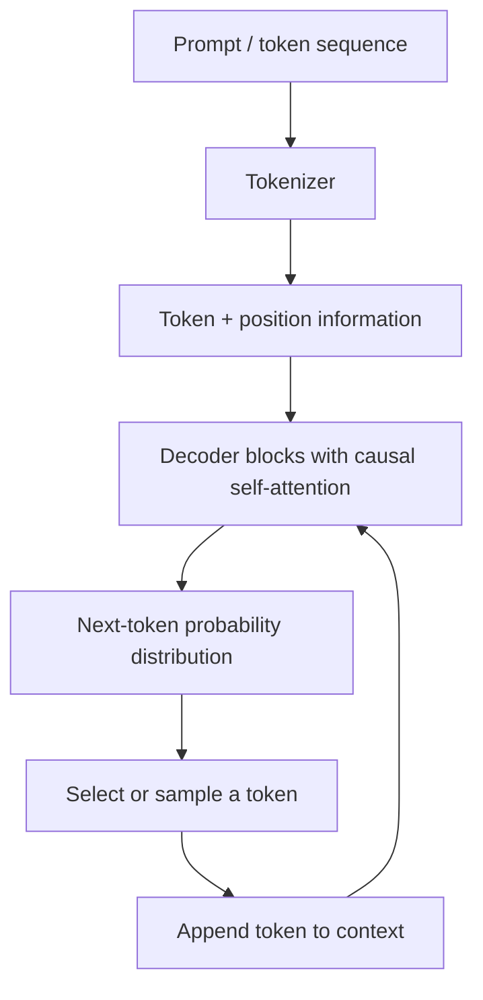
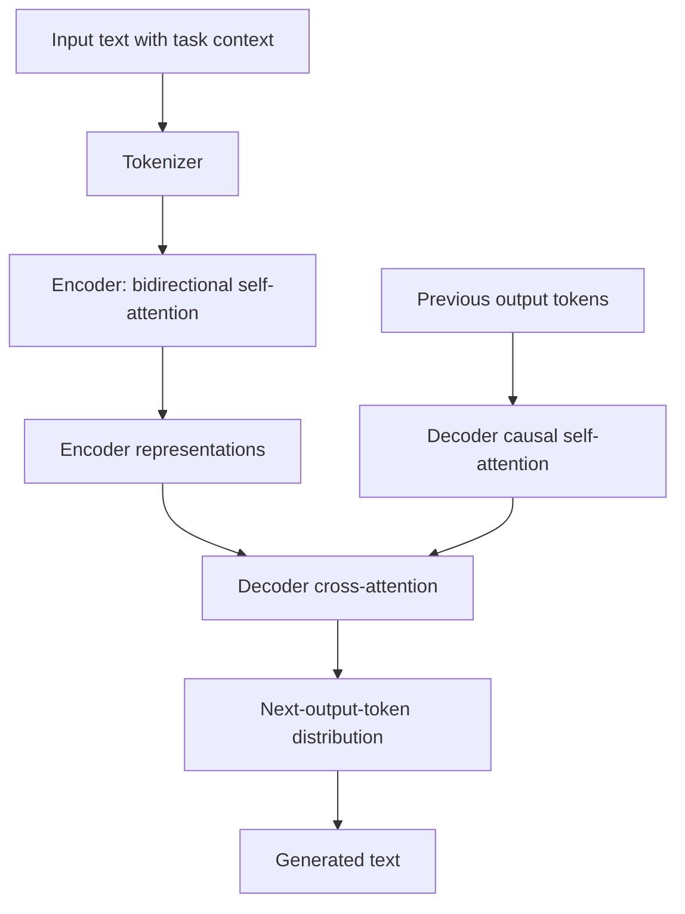
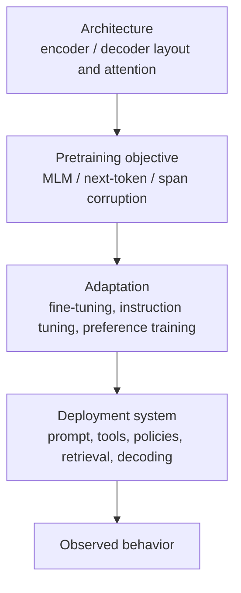

# Chapter 12 — BERT, GPT-Style Models, and T5 as Examples

## Learning Objectives

By the end of this chapter, you should be able to:

- Explain BERT as an encoder-only Transformer trained with masked language modeling.
- Explain GPT-style models as decoder-only Transformers trained primarily through next-token prediction.
- Explain T5 as an encoder-decoder Transformer trained using a text-to-text formulation and span-corruption objective.
- Compare tokenization, attention access, training objectives, and typical applications.
- Separate architecture from pretraining, fine-tuning, and instruction tuning.
- Explain why a model's architecture alone does not guarantee instruction-following behavior.

<br/>

## 1. Three Transformer Families at a Glance

BERT, GPT-style models, and T5 all use Transformer components, but organize them differently and are commonly associated with different training objectives.

| Model family | Architecture | Common pretraining objective | Attention pattern | Typical strengths and uses |
|---|---|---|---|---|
| **BERT** | Encoder-only | Masked language modeling (MLM); original BERT also used next-sentence prediction | Bidirectional: a token can attend to tokens on both its left and right, subject to padding masks | Text classification, token classification, extractive question answering, representations |
| **GPT-style** | Decoder-only | Autoregressive next-token prediction | Causal: each position attends only to permitted earlier positions and itself | Text generation, continuation, dialogue, code generation |
| **T5** | Encoder-decoder | Text-to-text span corruption | Encoder self-attention is bidirectional; decoder self-attention is causal; decoder also cross-attends to encoder outputs | Translation, summarization, question answering, text transformation |

These are family-level descriptions, not claims that every model in a family has identical details. Implementations can differ in tokenizer, training mixture, objective, model size, and later adaptation.

<br/>

## 2. BERT: Encoder-Only and Masked Language Modeling

### 2.1 Architecture

BERT (Bidirectional Encoder Representations from Transformers) stacks Transformer encoder layers. Its encoder builds contextual representations by allowing each token to use information from both sides of the input.



The final task-specific head depends on the downstream task. For example, a classification head may use a pooled representation, while token classification predicts a label for each token.

<br/>

### 2.2 Masked Language Modeling (MLM)

During MLM pretraining, some input tokens are selected and hidden or corrupted. The model predicts the original identities of selected tokens using the surrounding context.

Example:

```text
Original:  The cat sat on the mat.
Corrupted: The cat [MASK] on the mat.
Target:    sat
```

The model can use both preceding and following words. In practice, BERT's original masking procedure used a mixture of masking, random-token replacement, and leaving selected tokens unchanged; `[MASK]` is a conceptual illustration, not the entire corruption procedure.

A simplified loss is:

$$
\mathcal{L}_{\mathrm{MLM}}
= -\sum_{i \in M} \log P(x_i \mid \tilde{x})
$$

where:
- $x_i$ is the original token at position $i$,
- $\tilde{x}$ is the corrupted input,
- $M$ is the set of selected prediction positions.

Only selected positions contribute to this simplified loss.

<br/>

### 2.3 Attention and use cases

BERT's self-attention is bidirectional: position $i$ can attend to valid positions before and after it. It is therefore well suited to tasks that need a contextual understanding of a complete input.

Common uses include:
- Sentiment or topic classification
- Named-entity recognition and other token-labeling tasks
- Extractive question answering, where the system selects an answer span from a supplied passage
- Semantic representations for retrieval or similarity, often with suitable task-specific training

**Important limitation:** standard BERT is not a left-to-right text generator. Its MLM objective and encoder attention pattern are different from the autoregressive generation setup used by GPT-style models.

<br/>

## 3. GPT-Style Models: Decoder-Only and Next-Token Prediction

### 3.1 Architecture

A GPT-style model stacks Transformer decoder blocks, typically using causal self-attention. At each position, the model can use the preceding context to predict the next token.



At inference time, the selected token is appended to the context, and the model predicts again. This autoregressive loop continues until a stopping condition is reached.

<br/>

### 3.2 Causal attention

A causal mask prevents position $i$ from attending to future positions $j > i$. This means each prediction can depend on the preceding tokens without accessing future target tokens.

For a sequence $x_1, x_2, \ldots, x_T$, next-token training maximizes the probability of each token conditioned on earlier tokens:

$$
\mathcal{L}_{\mathrm{next}}
= -\sum_{t=1}^{T} \log P(x_t \mid x_{<t})
$$

Here, $x_{<t}$ denotes all tokens before position $t$. Training is usually parallelized across positions with a causal mask and shifted targets, even though generation proceeds sequentially.

<br/>

### 3.3 Example

Given the prefix:

```text
The capital of France is
```

the model produces a probability distribution over possible next tokens. A decoding method chooses a token such as `Paris`; that token is appended to the context before the next prediction.

Common uses include:
- Open-ended text generation and continuation
- Conversational applications
- Code completion and generation
- Drafting, rewriting, and summarization
- Tool-using or agentic systems when combined with suitable training, prompting, and runtime orchestration

A decoder-only architecture does not itself guarantee factuality, reliable tool use, or instruction following. Those behaviors depend on more than the attention layout.

<br/>

## 4. T5: Encoder-Decoder and Text-to-Text Learning

### 4.1 Architecture

T5 (Text-to-Text Transfer Transformer) treats many NLP tasks as mapping an input text sequence to an output text sequence. It has an encoder, a decoder, and cross-attention between them.



- **Encoder self-attention:** input tokens can use context from both directions.
- **Decoder causal self-attention:** output position $t$ can use earlier output tokens, not future output tokens.
- **Cross-attention:** decoder positions can attend to the encoder's representations of the input.

<br/>

### 4.2 Text-to-text formulation

Different tasks can be represented as text input and text output. Task prefixes are often used in T5-style workflows, though the exact format depends on the model and fine-tuning setup.

Examples:

```text
translate English to German: How are you?
→ Wie geht es dir?

summarize: The report describes...
→ A concise summary of the report...

question: What is the capital of France?
context: France's capital city is Paris.
→ Paris
```

The examples illustrate the format; actual outputs depend on the trained checkpoint and prompt conventions.

<br/>

### 4.3 Span-corruption pretraining

T5's original pretraining objective corrupts spans of input text and trains the model to generate the missing spans. Sentinel tokens mark the boundaries and identify corrupted spans.

Illustrative example:

```text
Original:
The quick brown fox jumps over the lazy dog.

Corrupted encoder input:
The <extra_id_0> fox jumps over the <extra_id_1> dog.

Target text:
<extra_id_0> quick brown <extra_id_1> lazy <extra_id_2>
```

The precise spans and sentinel-token conventions are illustrative. In the training objective, the decoder generates the removed spans in order, using sentinel tokens to delimit them.

This differs from BERT MLM: BERT predicts selected token identities at masked positions within the input representation, whereas T5 learns to generate a target sequence containing corrupted spans.

<br/>

### 4.4 Common uses

T5-style encoder-decoder models are useful for:
- Translation
- Summarization
- Question answering and reading comprehension
- Text normalization and rewriting
- Other input-to-output text transformation tasks

T5's architecture supports conditional generation: the output is generated while attending to the encoded input.

<br/>

## 5. Direct Comparison

| Dimension | BERT | GPT-style | T5 |
|---|---|---|---|
| Transformer layout | Encoder-only | Decoder-only | Encoder + decoder |
| Input attention | Bidirectional encoder self-attention | Causal self-attention | Bidirectional encoder self-attention |
| Output-side attention | No autoregressive decoder in standard BERT | Causal self-attention | Causal decoder self-attention |
| Cross-attention | Not part of standard encoder-only BERT | Not part of a standard decoder-only GPT block | Yes, decoder attends to encoder outputs |
| Typical pretraining target | Selected masked/corrupted input tokens | Next token | Corrupted spans generated as target text |
| Primary modeling style | Contextual representation | Continuation / autoregressive generation | Conditional text-to-text generation |
| Typical downstream adaptation | Classification or token/span prediction heads | Prompting, fine-tuning, instruction tuning, preference optimization, tool-use training | Fine-tuning for text-to-text tasks; additional adaptation may be applied |
| Natural fit | Understand or label supplied text | Generate continuations from a context | Transform an input sequence into an output sequence |

<br/>

### Tokenization: what is shared and what differs?

All three families require a way to convert text into token IDs, but **there is no single tokenizer shared by BERT, GPT-style models, and T5**.

- Original BERT commonly uses WordPiece tokenization.
- GPT-family tokenizers vary by model; many use byte-level or other subword schemes.
- T5 commonly uses a SentencePiece-based vocabulary.

These are typical examples, not universal rules for every checkpoint. Tokenization affects sequence length, vocabulary coverage, special tokens, and the token budget. A model's tokenizer must match the checkpoint; token IDs from one tokenizer cannot safely be treated as equivalent to those from another.

<br/>

## 6. Architecture Is Not the Same as Training or Product Behavior

A useful way to reason about a language model is to separate four layers:



<br/>

### 6.1 Architecture

Architecture describes the computation structure: which blocks are present, how information flows, and which tokens can attend to which other tokens.

<br/>

### 6.2 Pretraining objective and data

The objective determines what the model is optimized to predict during pretraining. Data composition also matters: a model trained on different text, code, languages, or domains may develop different capabilities even if its architecture is similar.

<br/>

### 6.3 Later adaptation

Instruction following is commonly improved through post-training processes such as supervised instruction fine-tuning and preference-based optimization. Exact procedures vary by model. Task-specific fine-tuning can also specialize a model for classification, extraction, or generation.

<br/>

### 6.4 Product and runtime features

A deployed product may add system instructions, retrieval, tool execution, safety layers, structured output constraints, memory, or other orchestration. Those are not automatically properties of the base Transformer architecture.

**Therefore:** “decoder-only” does not mean “instruction-following,” and “encoder-decoder” does not mean “good at every transformation task.” Architecture shapes what computation is natural; data, objectives, adaptation, and runtime design strongly influence actual behavior.

<br/>

## 7. Selecting a Design for a Task

Use the task's input/output pattern as a starting point, then consider latency, available checkpoints, quality, context length, deployment constraints, and evaluation results.

| Task | Reasonable starting point | Why |
|---|---|---|
| Classify a customer review as positive or negative | BERT-style encoder | The task predicts a label from a complete text input |
| Generate a conversational answer or continue a prompt | GPT-style decoder-only model | Autoregressive generation is the core modeling pattern |
| Translate a supplied paragraph into another language | T5-style encoder-decoder | It directly models conditional input-to-output generation |

These are starting points, not hard rules. Decoder-only models can classify text using prompting or fine-tuning; encoder-only models can support many prediction tasks; and other architectures may perform well on translation or summarization. Choose empirically using a representative validation set.

<br/>

## 8. Minimal Conceptual Code Examples

The following examples show the *shape* of common Hugging Face Transformers workflows. Install the library with `pip install transformers torch` in an appropriate environment. Model identifiers, framework versions, and task heads should be checked against the checkpoint being used.

### 8.1 BERT for sequence classification

```python
from transformers import pipeline

classifier = pipeline(
    "text-classification",
    model="distilbert/distilbert-base-uncased-finetuned-sst-2-english",
)

result = classifier("The explanation was clear and useful.")
print(result)
```

This uses a BERT-family encoder model that has already been fine-tuned for sentiment classification. It is not demonstrating raw MLM pretraining.

<br/>

### 8.2 GPT-style text generation

```python
from transformers import pipeline

generator = pipeline(
    "text-generation",
    model="openai-community/gpt2",
)

result = generator(
    "A useful machine learning project should",
    max_new_tokens=40,
    do_sample=False,
)
print(result[0]["generated_text"])
```

This illustrates autoregressive generation. GPT-2 is a base language model, so it should not be assumed to behave like an instruction-tuned assistant.

<br/>

### 8.3 T5 for text-to-text generation

```python
from transformers import pipeline

summarizer = pipeline(
    "summarization",
    model="google-t5/t5-small",
)

result = summarizer(
    "Transformers use attention to build contextual representations "
    "and can be organized as encoder-only, decoder-only, or encoder-decoder models.",
    max_new_tokens=40,
)
print(result)
```

The pipeline applies a summarization task interface to a T5 checkpoint. The quality and behavior depend on the checkpoint and task setup; for a more explicit text-to-text workflow, the input can be prefixed with a task instruction such as `summarize:` and tokenized directly.

**Code note:** these snippets load pretrained checkpoints and run inference. They do not train the models from scratch.

<br/>

## 9. Common Misconceptions

- **“BERT is bidirectional, so it can generate text like GPT.”** Bidirectional encoder attention is not the same as left-to-right autoregressive decoding.
- **“GPT can only complete text and cannot classify.”** GPT-style models can be prompted or fine-tuned for classification, though the interface and trade-offs differ.
- **“T5 is just BERT plus GPT.”** It combines an encoder and decoder with cross-attention, but its training setup and text-to-text formulation are also important.
- **“All models in one family use the same tokenizer.”** Tokenizers and special-token conventions can vary by checkpoint.
- **“Architecture determines instruction following.”** Instruction following depends on training and adaptation, plus the deployed prompt and runtime.
- **“The training objective is the architecture.”** Architecture describes the network structure; the objective describes what the model learns to predict.

<br/>

## 10. Practice and Revision

### Exercise A — Build the comparison table

Without looking at Section 5, fill in the main architecture, attention pattern, pretraining objective, and typical use for BERT, GPT-style models, and T5. Then check your answers against the table.

<br/>

### Exercise B — Choose a suitable starting design

For each task, select a reasonable starting point and justify your choice:

1. Predict whether a support ticket is billing-related, technical, or account-related.
2. Generate a continuation of a partially written software function.
3. Translate an English paragraph into Spanish.

<br/>

### Exercise C — Separate the layers

A decoder-only model produces helpful responses and can call tools in a deployed application. Identify which claims concern:
- Architecture
- Pretraining objective
- Later adaptation
- Deployment/runtime system

Do not infer the training procedure or product capabilities from architecture alone.

<br/>

### Suggested answers

1. **Support-ticket classification:** BERT-style encoder is a reasonable starting point because the output is a label based on the full input. A decoder-only model can also be adapted for this task.
2. **Code continuation:** GPT-style decoder-only model is a natural starting point because it generates a sequence token by token from a prefix.
3. **Translation:** T5-style encoder-decoder is a natural starting point because it encodes the source and generates a target sequence. Other model families may also work well.
4. **Tool calling:** the decoder-only layout is an architectural fact; next-token prediction may describe pretraining; instruction/tool-use training is adaptation; tool execution and permissions belong to the runtime system.

<br/>

## 11. Chapter Summary

- **BERT** is an encoder-only example associated with bidirectional context and masked-language-model pretraining.
- **GPT-style models** are decoder-only examples associated with causal attention and autoregressive next-token prediction.
- **T5** is an encoder-decoder example associated with text-to-text tasks and span-corruption pretraining.
- Their tokenizers may differ, and the checkpoint's tokenizer must be used with that checkpoint.
- Architecture, pretraining objective, adaptation, and deployed product features are distinct layers of the system.
- Architecture alone does not establish instruction-following capability; training data, post-training, prompts, tools, and runtime orchestration also matter.

**Checkpoint:** Explain the BERT/GPT/T5 differences while keeping architecture, pretraining, later adaptation, and deployment behavior separate.
