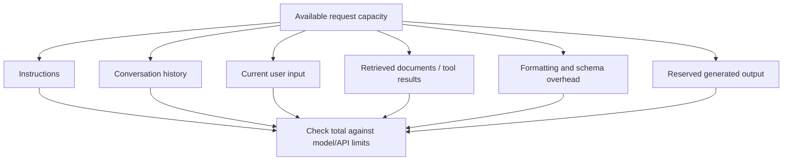
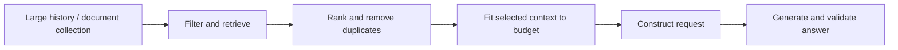
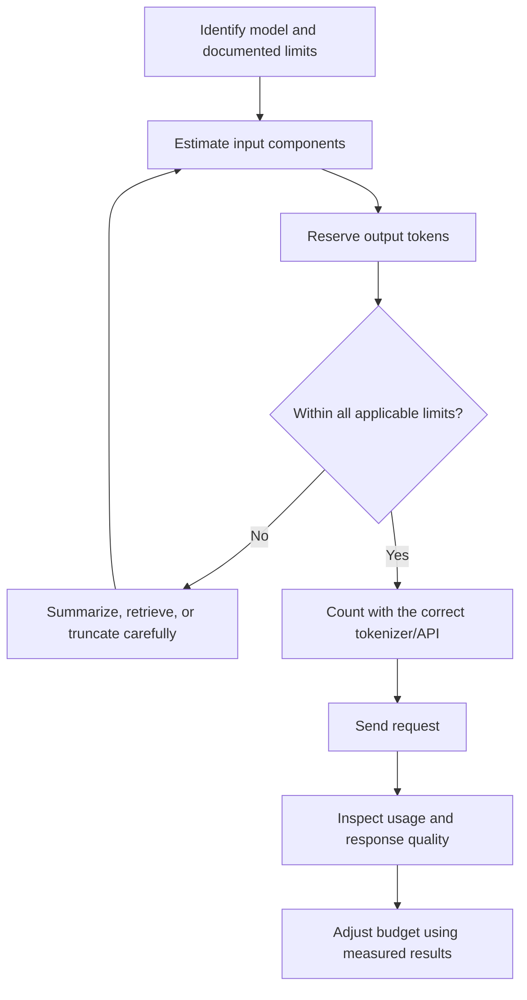

# Chapter 13 — Context Windows and Token Budgets

## Learning Objectives

By the end of this chapter, you should be able to:

- Define context length, input length, and output limits.
- Estimate how tokens are allocated across instructions, conversation history, retrieved content, user input, formatting, and generated output.
- Explain why token limits and token accounting must be checked for each provider and model.
- Distinguish padding, truncation, and relevance-based context selection.
- Describe the memory, latency, and attention-computation implications of longer sequences.
- Explain why a large context window does not guarantee that every supplied detail will be used correctly.
- Estimate usage-based cost only when the model's pricing and token-accounting rules are known.

<br/>

## 1. What Is a Context Window?

A **context window** is the amount of tokenized information a model can take into account for a particular request or generation process, according to that model's documented rules. It is measured in tokens, not characters or words.

The context can include some combination of:
- System and developer instructions
- The user's current message
- Earlier conversation messages
- Retrieved documents or search results
- Tool results
- Formatting instructions and structured-output schemas
- Other model-specific control or metadata tokens

The exact accounting depends on the model and serving interface. Some systems count hidden message-format tokens or tool definitions; some use separate limits for input and output; and some impose additional request-level constraints. Do not assume that the visible text is the complete token count.

<br/>

### 1.1 Context length, input length, and output limit

These terms are related but not interchangeable.

| Term | Meaning | Example |
|---|---|---|
| **Context-window capacity** | The maximum context or sequence capacity documented for a model and interface | A model is documented with a context capacity of 32,000 tokens |
| **Input length** | Tokens supplied as input for a particular request, under that provider's accounting rules | Instructions, history, question, and retrieved passages total 7,500 tokens |
| **Output limit** | The maximum generated output allowed for a request or response | The request allows at most 2,000 output tokens |
| **Actual output length** | Tokens actually generated, which may be less than the allowed maximum | The response uses 800 tokens |

A common simplified planning rule is:

$$
T_{\text{input}} + T_{\text{output}} \leq C
$$

where $C$ is the applicable total context capacity. This is only a planning approximation. Some APIs define separate input and output limits or account for cached input, tool calls, multimodal payloads, and internal tokens differently. Always use the exact model and API documentation.

<br/>

### 1.2 Why token counts differ from word counts

A tokenizer converts text into token IDs. A token may correspond to a word, part of a word, punctuation, whitespace, or another unit. Code, URLs, unusual names, and multilingual text can tokenize differently from ordinary English prose.

Therefore:
- A 1,000-word document is not guaranteed to use a fixed number of tokens.
- Two texts with the same number of characters can have different token counts.
- Token estimates should be replaced by the model's tokenizer or provider's counting method when precision matters.

<br/>

## 2. Building a Token Budget

A token budget is a planned allocation of the request's available capacity. It helps prevent context overflow and leaves room for the answer.

A practical request may contain these components:



The categories are planning buckets. Depending on the system, formatting tokens, tool definitions, and message boundaries may be counted inside one or more categories.

<br/>

### 2.1 Example budget

Assume, for illustration, a model/API configuration with:
- A total request capacity of **16,000 tokens**
- A maximum output allowance of **2,000 tokens**
- Input plus reserved output required to fit within the total capacity
- No additional hidden limit that changes this calculation

A possible allocation is:

| Component | Planned tokens |
|---|---:|
| System/developer instructions | 800 |
| Conversation history | 2,200 |
| Current user input | 1,000 |
| Retrieved passages | 6,000 |
| Formatting, tool descriptions, and message overhead reserve | 500 |
| **Total planned input** | **10,500** |
| Reserved output | 2,000 |
| **Input + output reserve** | **12,500** |
| **Remaining headroom** | **3,500** |

Calculation:

$
16{,}000 - (10{,}500 + 2{,}000) = 3{,}500
$

The headroom is not automatically a requirement to add more text. It can protect against token-count uncertainty, variable tool results, or a longer-than-expected prompt. These numbers are hypothetical and are not a claim about any particular provider's limits.

<br/>

### 2.2 A budget is not just a packing problem

The objective is not to fill the context window. The objective is to supply the information needed to answer well.

Useful questions include:
- Which instructions are essential?
- Does the full chat history matter, or only a concise summary?
- Which retrieved passages directly support the answer?
- Are there duplicate passages or irrelevant sections?
- How much output is actually needed?
- Does the task require preserving exact source text, or can it use a summary?

A smaller, well-selected context can be more useful than a larger context filled with redundant material.

<br/>

## 3. Provider-Specific Limits and Accounting

Limits differ by model, provider, endpoint, and sometimes account tier or request mode. Before deploying a system, verify the relevant documentation for the exact configuration.

Check separately:

1. **Maximum context capacity** — the documented total or sequence limit.
2. **Maximum input tokens** — if the API defines a separate input limit.
3. **Maximum output tokens** — often controlled by a request parameter.
4. **Token accounting** — whether message wrappers, tool definitions, images, audio, cached input, or other payloads are counted separately or differently.
5. **Pricing rules** — input, output, cached tokens, and tool usage may have different rates.
6. **Failure behavior** — an oversized request might be rejected, truncated by a client, or handled according to a provider-specific rule.
7. **Model version** — limits and pricing can change between model versions.

Do not copy a limit or price from one model to another just because both are described as LLMs. When writing production code, make limits and pricing configuration explicit and update them from authoritative provider documentation.

<br/>

## 4. Padding, Truncation, and Context Selection

These techniques address different problems.

### 4.1 Padding

**Padding** adds placeholder tokens so sequences in a batch have a compatible length. It is common when processing multiple examples together.

```text
Sequence A: [The, cat, sat]
Sequence B: [The, dog, ran, today]

After padding:
A: [The, cat, sat, PAD]
B: [The, dog, ran, today]
```

An attention mask typically marks padding positions so the model does not treat them as ordinary content. The exact behavior depends on the model and implementation.

Padding can simplify batch processing, but it may waste computation when sequence lengths vary substantially. Padding does not add useful information and is not a way to make an overlong input fit safely.

<br/>

### 4.2 Truncation

**Truncation** removes tokens when an input exceeds a configured length.

```text
Original:
[Instruction] [History] [Question] [Long document continues ...]

After truncation:
[Instruction] [History] [Question] [Document begins ...]
```

This illustration shows one possible policy, not a universal order. A naive truncation strategy may remove a crucial instruction, the end of a document, or the evidence needed to answer the question.

When truncation is necessary:
- Choose the side or section to truncate based on the task.
- Preserve critical instructions and required metadata.
- Consider truncating old history before the current request.
- Log or expose when content has been dropped.
- Evaluate whether truncation harms answer quality.

<br/>

### 4.3 Selecting relevant context

**Context selection** chooses which information to include before building the final prompt. Methods include:
- Retrieve only passages relevant to the question.
- Remove duplicate or near-duplicate passages.
- Rank passages by relevance and evidence quality.
- Summarize older conversation history.
- Keep source identifiers and enough surrounding text to preserve meaning.
- Reserve capacity for the output and request overhead.

For retrieval-augmented generation (RAG), selecting a few high-value passages is often preferable to inserting every document in the collection.



<br/>

### 4.4 Comparison

| Method | Main purpose | Advantage | Risk or cost |
|---|---|---|---|
| Padding | Align sequence lengths in a batch | Simplifies batching | Wasted computation on padding positions |
| Truncation | Enforce a length limit | Simple and predictable | May discard important information |
| Context selection | Include the most useful information | Can improve relevance and efficiency | Requires selection logic and evaluation |

These methods can be combined. For example, a retrieval system can select relevant passages, truncate a passage that is still too long, and then pad sequences when batching examples.

<br/>

## 5. Long Context: Memory, Latency, and Computation

A larger context can provide more evidence, preserve more conversation history, or support long documents. It also has engineering costs.

### 5.1 Attention computation

For standard dense self-attention over a sequence of length $n$, the attention-score computation and attention matrix scale approximately as $O(n^2)$ with respect to sequence length. Doubling $n$ can therefore make this part of the computation roughly four times as large, all else being equal.

This is not a complete runtime model. Actual performance also depends on hidden dimension, number of layers, attention implementation, hardware, batching, caching, and model architecture. Some systems use optimized or alternative attention methods.

<br/>

### 5.2 Memory

During inference, memory can be used for:
- Input and intermediate activations
- Model weights
- Attention-related workspaces
- Key/value (KV) cache for autoregressive generation
- Retrieved content and application-side buffers

For many decoder-only models, KV-cache memory grows roughly linearly with the number of cached tokens, layers, and key/value dimensions, with details depending on architecture and cache strategy. Longer prompts can increase prefill work and cache use.

<br/>

### 5.3 Latency

Longer inputs can increase **prefill latency** because the model must process the prompt before or while preparing the first output token. Generating more output tokens also takes additional decoding steps in autoregressive models.

Latency is affected by more than sequence length: hardware, batching, network overhead, model size, caching, and serving implementation all matter.

<br/>

### 5.4 Practical trade-offs

| Choice | Potential benefit | Potential cost |
|---|---|---|
| Include more history | More continuity and background | More tokens, latency, and possible distraction |
| Retrieve more passages | More possible evidence | More processing and more irrelevant or conflicting content |
| Reserve a larger output limit | Allows a longer answer | May increase maximum-cost exposure and reduce room for input under shared limits |
| Summarize old context | Saves tokens | May omit nuance or exact details |

The best configuration is usually the smallest context that preserves the information required for the task, with enough headroom for a complete response.

<br/>

## 6. Nominal Capacity vs. Reliable Use

A model may accept a large number of tokens without using every part of the context equally well. **Nominal context capacity** is a technical limit; **effective use** concerns whether the model can find, integrate, and reason over the relevant information reliably.

Possible problems include:
- Relevant details buried in the middle of a long prompt
- Distracting or conflicting passages
- Repeated information that dilutes the signal
- Long-distance dependencies that are hard to combine
- Incorrect retrieval or missing evidence
- Instructions that conflict or become ambiguous
- The model producing a plausible answer without grounding it in the supplied source

A model's effective performance depends on the task, model, prompt structure, evidence distribution, and evaluation criteria. Do not assume that a model reliably handles every task simply because the input fits within its advertised context window.

<br/>

### Ways to improve reliability

1. Put the current task and critical constraints in a clear location.
2. Use headings and source labels to make long material easier to navigate.
3. Retrieve evidence that directly addresses the question.
4. Remove redundant passages and flag conflicts rather than silently merging them.
5. Ask for source-grounded answers when evidence is required.
6. Validate important claims against source passages or an independent process.
7. Evaluate with realistic long-context tests, including questions whose evidence appears at different positions.

<br/>

## 7. Estimating Usage-Based Cost

Cost estimation requires documented pricing and token-accounting rules for the exact model and endpoint. Prices may differ for input tokens, output tokens, cached input, batch processing, tools, and other features.

For a simple hypothetical case with only input and output token charges:

$$
\text{Cost} =
\frac{T_{\text{in}}}{1{,}000{,}000}R_{\text{in}}
+
\frac{T_{\text{out}}}{1{,}000{,}000}R_{\text{out}}
$$

where:
- $T_{\text{in}}$ is the billable input-token count,
- $T_{\text{out}}$ is the billable output-token count,
- $R_{\text{in}}$ is the documented price per million input tokens,
- $R_{\text{out}}$ is the documented price per million output tokens.

This formula is only valid if the provider prices those categories in that way. Apply the provider's actual units, tiers, cache rules, and other charges when relevant.

<br/>

### Hypothetical calculation

Assume, purely for practice:
- 10,000 billable input tokens
- 1,000 billable output tokens
- Input price: $2 per million tokens
- Output price: $8 per million tokens
- No cache discounts, tools, taxes, or other charges

Then:

$$
\text{Input cost} = \frac{10{,}000}{1{,}000{,}000}\times 2 = \$0.02
$$

$$
\text{Output cost} = \frac{1{,}000}{1{,}000{,}000}\times 8 = \$0.008
$$

$$
\text{Total} = \$0.028
$$

These prices are invented for arithmetic practice and are **not current pricing for any provider or model**.

For a reliable estimate:
1. Identify the exact model and endpoint.
2. Check the current official pricing and token-accounting documentation.
3. Estimate or measure input and output token counts.
4. Include cache, tool, batch, multimodal, or other charges where applicable.
5. Compare estimates with actual usage metadata returned by the provider.

<br/>

## 8. Practical Token-Budgeting Workflow



A robust application should:
- Use a model-specific configuration for context and output limits.
- Count tokens with the correct tokenizer or provider API when possible.
- Keep a safety margin for message overhead and dynamic tool results.
- Reserve output capacity before adding retrieved content.
- Handle context-limit errors explicitly.
- Track usage and quality together, not cost alone.

<br/>

## 9. Practice and Revision

### Exercise A — Allocate a hypothetical budget

Assume the API documentation for a fictional model states:
- Total context capacity: **12,000 tokens**
- Maximum output: **1,500 tokens**
- Input plus reserved output must fit within the 12,000-token capacity
- The input count includes instructions, chat history, user input, retrieved content, and formatting overhead

Allocate a budget across the following categories:
- Instructions
- Chat history
- Current user input
- Retrieved content
- Formatting and message overhead
- Reserved output

Your allocation must fit both limits. Explain why you reserved the chosen amount for output and how you would respond if retrieved content grew unexpectedly.

<br/>

### Exercise B — Choose a context strategy

Choose padding, truncation, or relevance-based context selection as the primary strategy for each situation. More than one technique may be used in practice.

1. A batch contains examples with different tokenized lengths.
2. A single pasted document exceeds the endpoint's input limit.
3. A RAG system has thousands of documents but needs evidence for one question.
4. An ongoing chat contains many old turns, most of which are unrelated to the current request.

<br/>

### Exercise C — Explain a failure

A request fits within the advertised context window, but the answer ignores a key fact located in the middle of a long retrieved document. Give at least three plausible reasons and propose a way to test or reduce each risk.

<br/>

### Suggested answers

**Exercise A — One valid allocation**

| Component | Tokens |
|---|---:|
| Instructions | 700 |
| Chat history | 1,300 |
| Current user input | 800 |
| Retrieved content | 6,000 |
| Formatting and message overhead | 500 |
| **Total input** | **9,300** |
| Reserved output | 1,500 |
| **Total planned** | **10,800** |
| **Headroom** | **1,200** |

This fits the assumed 12,000-token total and 1,500-token output maximum. If retrieved content grows, re-rank and remove low-value passages, summarize history, or reduce other nonessential input while preserving the evidence needed for the task.

**Exercise B**
1. Padding is a common batching technique; attention masks should identify padding positions.
2. Context selection and/or careful truncation. Preserve the sections that matter rather than cutting blindly.
3. Relevance-based retrieval and selection.
4. Summarize or select relevant history; truncate only with a task-aware policy if necessary.

**Exercise C**
Possible reasons include poor retrieval ranking, evidence buried in the document, conflicting passages, unclear instructions, or limitations in the model's ability to integrate long-distance information. Test by moving the evidence to different positions, asking a targeted question, checking retrieved passages, reducing distractors, and evaluating answer grounding against the source.

<br/>

## 10. Chapter Summary

- A context window defines a model/interface's documented capacity, while input length and output limits describe different parts of a request.
- Token counts are not equivalent to word counts; use the correct tokenizer or provider accounting method.
- Budget instructions, history, user input, retrieved content, formatting overhead, and output before sending a request.
- Padding aligns sequences for batching; truncation removes content; context selection chooses the most relevant content.
- Longer sequences can increase memory use, prefill latency, and attention computation. Standard dense attention has quadratic sequence-length scaling in its attention-score computation.
- A request fitting within the nominal window does not guarantee that all supplied details will be used correctly.
- Cost estimates require current, documented model pricing and token-accounting rules; hypothetical prices must not be presented as real prices.

<br/>

**Checkpoint:** Explain why context-window capacity is only a constraint, not a guarantee of correct reasoning or faithful use of every supplied detail.
