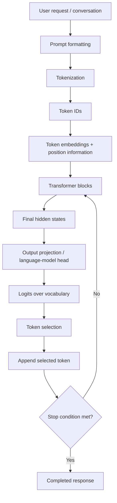
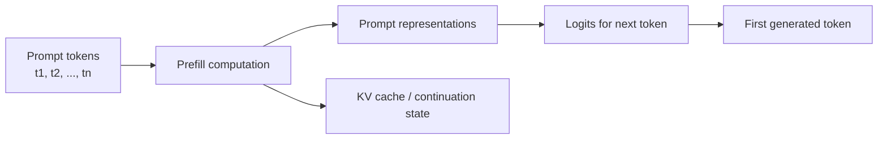
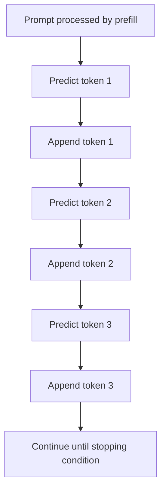
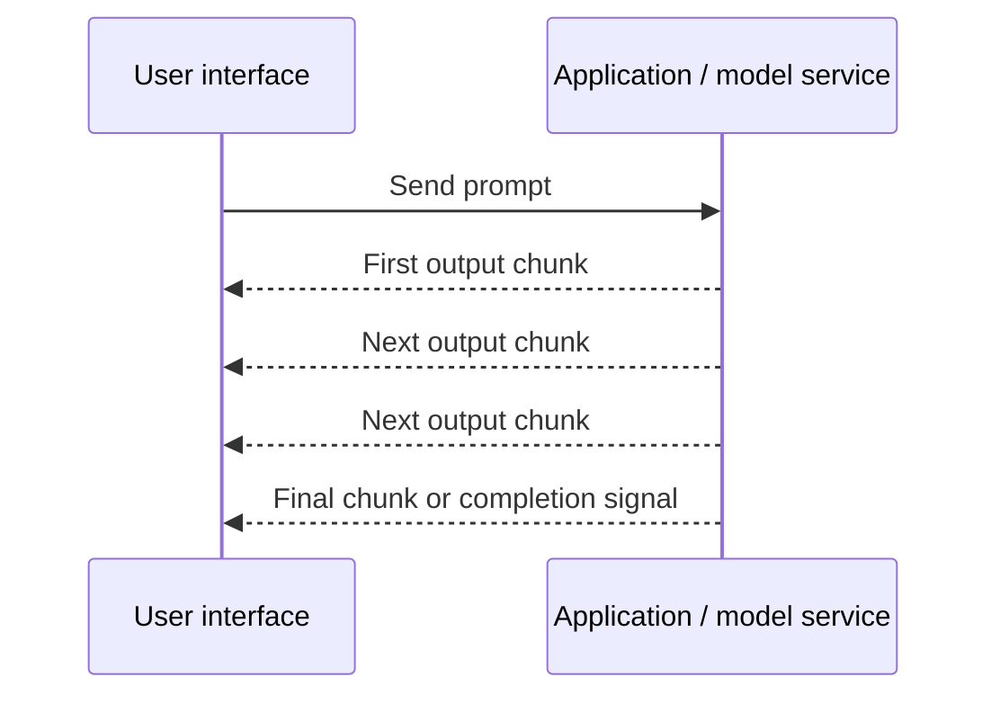

# Chapter 14 — Inference Flow, Prefill, and Autoregressive Decoding

## Learning Objectives

By the end of this chapter, you should be able to:

- Trace a request from prompt formatting through tokenization, embeddings, Transformer blocks, output projection, logits, and token selection.
- Explain **prefill** as processing the supplied prompt and preparing state used for continuation.
- Trace autoregressive decoding as repeatedly predicting, selecting, and appending tokens.
- Distinguish parallel computation across prompt positions from the sequential dependency between generated tokens.
- Define time to first token (TTFT) and time per output token at a high level.
- Explain common stopping conditions and streaming conceptually.
- Contrast decoder-style generation with encoder-only inference.

**Scope boundary:** This chapter introduces the inference flow. Detailed decoding strategies such as temperature, top-k, and top-p belong to Level 4. Provider-specific streaming implementation belongs to Level 6.

<br/>

## 1. What Happens During Inference?

**Inference** is the process of running a trained model to produce a prediction or response. For an autoregressive language model, inference commonly begins with a prompt and generates one token at a time.

A simplified end-to-end path is:



This diagram shows the conceptual path. Implementations may use optimized kernels, caching, batching, or provider-specific message formats, but the core idea remains: the model converts input tokens into contextual representations and uses an output head to score possible next tokens.

<br/>

## 2. From Prompt Formatting to Logits

### 2.1 Prompt formatting

The application first assembles the model input. Depending on the interface, this may include:
- System or developer instructions
- Conversation history
- The current user message
- Tool results or retrieved passages
- Special message-boundary or control tokens

A chat interface does not necessarily pass plain visible text to the model unchanged. It may serialize messages into a model-specific format. The exact format depends on the model and serving interface.

<br/>

### 2.2 Tokenization

A tokenizer converts the formatted input into token IDs.

```text
Formatted prompt
    ↓ tokenizer
[token_id_1, token_id_2, token_id_3, ...]
```

Token IDs are integer references into the model's vocabulary. Tokenization is model-specific: the same text can produce different token sequences for different checkpoints.

<br/>

### 2.3 Embeddings and position information

Each token ID is mapped to a learned embedding vector. The model also incorporates information about token positions or order, using the position mechanism appropriate to its architecture.

The result is a sequence of vectors rather than a sequence of readable words.

<br/>

### 2.4 Transformer blocks

The vectors pass through the model's Transformer blocks. In a decoder-only autoregressive model, these blocks typically use causal self-attention so that a position cannot use future tokens.

Each block updates the token representations using attention and feed-forward computation. After the blocks, the final hidden representation at a position contains information from the permitted context.

<br/>

### 2.5 Output projection and logits

For next-token prediction, a language-model head maps the relevant final hidden state to a score for each token in the vocabulary. These unnormalized scores are called **logits**.

If the vocabulary has $V$ token IDs, the logits for one position can be represented as:

$$
\mathbf{z} = [z_1, z_2, \ldots, z_V]
$$

A larger logit means a token receives a higher raw score relative to tokens with lower logits. Logits are not themselves probabilities. A probability distribution can be formed from them, commonly using softmax:

$$
P(x=i) = \frac{e^{z_i}}{\sum_{j=1}^{V} e^{z_j}}
$$

This equation explains the relationship between logits and probabilities; it does not specify the complete token-selection policy. Selection may be deterministic or use a sampling strategy, depending on the request and implementation.

<br/>

## 3. Prefill: Processing the Supplied Prompt

**Prefill** is the phase in which the model processes the prompt tokens already supplied by the application. In a typical decoder-only serving setup, the model computes contextual representations for prompt positions and may populate a **key/value (KV) cache** that can be reused during generation.



The details of the cache and internal state are implementation-dependent, but the useful conceptual distinction is that prefill processes the existing prompt, while decoding extends it with newly generated tokens.

<br/>

### 3.1 Parallel work during prefill

Although causal attention prevents a prompt position from attending to future prompt positions, the computations for many prompt positions can generally be performed in parallel during prefill. The causal mask controls which positions can exchange information; it does not require the prompt to be processed as a sequence of separate user-visible generation steps.

This is one reason prefill differs from autoregressive decoding. Hardware utilization, sequence length, attention implementation, batching, and model size all affect actual performance.

<br/>

### 3.2 Prefill output

After prefill, the model has processed the supplied prompt and can produce a distribution for the next token. In many implementations, the KV cache stores attention keys and values from the prompt so they do not need to be recomputed from scratch for each subsequent token.

Prefill does not mean that the model has already generated the complete answer. It prepares the computation needed to start continuation.

<br/>

## 4. Autoregressive Decoding: Generating Tokens Iteratively

**Autoregressive decoding** generates a sequence by repeatedly predicting the next token based on the prompt and all previously generated tokens.

For example, suppose the prompt is:

```text
Prompt: The capital of France is
```

A simplified generation trace could be:

| Stage | Sequence available to the model | Action |
|---|---|---|
| Before prefill | `The capital of France is` | Format and tokenize the prompt |
| After prefill | `The capital of France is` | Process prompt and compute next-token scores |
| Decode step 1 | `The capital of France is` | Select ` Paris` |
| Decode step 2 | `The capital of France is Paris` | Select `.` |
| Decode step 3 | `The capital of France is Paris .` | Select an end-of-sequence token, if appropriate |
| Finished | `The capital of France is Paris.` | Stop and return the response |

The table is illustrative; actual tokenization may represent ` Paris` or punctuation differently, and the selected tokens depend on the model and decoding configuration.

<br/>

### 4.1 Why decoding is sequential across generated tokens

The next generated token depends on the previously generated sequence. The model cannot know the actual token for step 2 until step 1 has been selected, because step 1 becomes part of step 2's context.



This dependency is why ordinary autoregressive generation has a sequence of decoding steps. Computation inside each step can still be parallelized across model layers, tensor operations, and other dimensions, but the next generated token depends on the previous selection.

<br/>

### 4.2 Reusing the KV cache

Without caching, a simple implementation could repeatedly process the entire growing sequence. With a KV cache, the model can reuse attention keys and values for previously processed tokens and compute the new token's representations using the cached state plus the new token.

Conceptually:

```text
Prompt ──prefill──> KV cache for prompt
                       │
Token 1 ──decode───────┤ update cache
                       │
Token 2 ──decode───────┤ update cache
                       │
Token 3 ──decode───────┤ update cache
```

KV caching is an efficiency technique, not a change to the fundamental next-token objective. Its exact implementation and memory trade-offs depend on the model and serving system.

<br/>

## 5. Parallelism: Prefill vs. Decoding

| Aspect | Prefill | Autoregressive decoding |
|---|---|---|
| Input available | The supplied prompt | Prompt plus generated tokens so far |
| Main work | Process the prompt sequence | Generate the next token, then repeat |
| Across sequence positions | Prompt-position computations can generally be processed in parallel under causal masking | Successive output-token steps have a dependency on earlier selections |
| KV cache | Typically created or populated for prompt tokens | Typically reused and extended |
| Performance sensitivity | Prompt length, attention implementation, batch size, model size | Output length, per-step model latency, cache behavior, hardware and serving setup |
| User-visible effect | Often contributes to waiting before generation begins | Often determines how quickly additional tokens arrive |

“Parallel” does not mean free or instantaneous. Prefill can be expensive for a long prompt. Similarly, each decoding step may perform many parallel operations, even though the generated tokens are dependent on one another.

<br/>

## 6. Latency Terms: TTFT and Time per Output Token

### 6.1 Time to first token (TTFT)

**Time to first token (TTFT)** is the elapsed time from a defined request start point until the first generated output token becomes available. The precise measurement boundary depends on the system—for example, it may include network and queueing time or be measured only within the model server.

TTFT can be influenced by:
- Prompt length and prefill computation
- Model size and hardware
- Queueing and batching
- Network and request-processing overhead
- Caching and serving optimizations

A long prompt often increases prefill work, which can increase TTFT, although the actual result depends on the serving stack.

<br/>

### 6.2 Time per output token

**Time per output token** describes how long generation takes for each additional output token, often measured as an average or as an inter-token latency. The exact metric definition matters: some systems report an average over the generated response, while others measure the interval between successive tokens.

It can be affected by:
- Model computation per decoding step
- Output length and cache behavior
- Hardware and serving implementation
- Batching and concurrent requests
- Streaming and transport overhead

A useful high-level view is:

```text
Request starts
    │
    ├── prompt formatting / tokenization / queueing / prefill
    │
    ├── first output token available  ← TTFT endpoint (depending on measurement)
    │
    ├── next token
    ├── next token
    ├── next token
    │
    └── response finishes
```

TTFT and time per output token measure different parts of the user experience. A system may have a relatively long initial wait but then produce tokens quickly, or begin quickly and emit the remaining response slowly.

<br/>

## 7. Stopping Conditions

Autoregressive generation continues until a stopping condition is reached. Common high-level conditions include:

- The model emits an end-of-sequence or configured end-of-turn token.
- The request reaches its maximum output-token limit.
- A configured stop sequence is encountered, where supported.
- The application or serving system cancels or interrupts generation.
- A tool handoff or other control-flow event ends the current generation phase in a tool-enabled system.

Exact behavior varies by model and API. A maximum output limit is a cap, not a promise that the model will use every allowed token. A stop sequence may be handled differently by different interfaces, including whether the stop text is included in the returned response.

<br/>

## 8. Streaming at a High Level

With **streaming**, output is delivered incrementally as generation progresses instead of waiting for the entire response to finish. The application may display text as it arrives.



A streamed chunk is not guaranteed to correspond to exactly one model token. An API may group tokens into chunks, split text according to transport behavior, or send separate metadata and completion events.

Streaming can improve perceived responsiveness because users see output before the full response is complete. It does not necessarily reduce the total computation required to generate the response. Provider-specific streaming protocols, event schemas, retries, and implementation details are outside this chapter's scope and belong to Level 6.

<br/>

## 9. Encoder-Only Inference Compared with Generation

Encoder-only models such as BERT are commonly used to produce contextual representations of an input and then predict labels, spans, or other task-specific outputs. They do not normally use the same autoregressive loop as a decoder-only text generator.

| Aspect | Encoder-only inference (e.g., BERT) | Decoder-only autoregressive generation (e.g., GPT-style) |
|---|---|---|
| Main input | A supplied input sequence | Prompt or conversation context |
| Attention pattern | Typically bidirectional self-attention over valid input positions | Causal self-attention over permitted preceding positions |
| Typical output | Class label, token labels, span scores, or representations | Next-token scores followed by generated tokens |
| Repeated token-generation loop | Not the usual inference pattern for standard BERT tasks | Core generation pattern |
| Latency emphasis | Processing the input and task head | Initial prefill/TTFT and repeated decoding latency |

A classification model may process the input and produce its prediction in one model invocation, while a decoder-only generator may require many decoding steps to produce a long response. This is a general pattern rather than a universal runtime guarantee; batching and task implementation affect actual latency.

Encoder-decoder models such as T5 combine an input encoder with an autoregressive decoder. Their input encoding resembles encoder processing, while their output side uses iterative generation.

<br/>

## 10. Practice and Revision

### Exercise A — Trace three generated tokens

Assume the prompt is:

```text
Prompt: A good AI engineer
```

For this exercise, suppose the model selects these three illustrative tokens in order:

```text
must
 understand
 trade-offs
```

Fill in the stages:

1. What happens during prompt formatting and tokenization?
2. What is computed during prefill?
3. What is the sequence context when `must` is selected?
4. What is appended before selecting `understand`?
5. What is appended before selecting `trade-offs`?
6. Which phase is repeated for each newly generated token?

<br/>

### Exercise B — Identify the latency component

For each observation, identify whether it primarily points to prefill/TTFT, decoding time per output token, or could involve both.

1. A very long prompt causes a noticeable delay before any text appears.
2. The first token appears quickly, but a 1,000-token response takes a long time to finish.
3. A request waits in a server queue before model processing begins.
4. A system's streaming UI displays output in chunks.

<br/>

### Exercise C — Contrast inference patterns

Explain why a standard BERT classifier does not normally generate a paragraph using the same repeated next-token loop as a GPT-style model. Mention the role of architecture, attention access, and training objective.

<br/>

### Suggested answers

**Exercise A**

1. The application assembles the prompt and the model-specific tokenizer converts it to token IDs.
2. Prefill processes the supplied prompt tokens, computes contextual representations and next-token scores, and may populate a KV cache.
3. Before selecting `must`, the context is `A good AI engineer`.
4. After `must` is selected, the growing sequence is `A good AI engineer must`; the model then predicts the next token.
5. After `understand` is selected, the context includes both earlier generated tokens: `A good AI engineer must understand`; the next selection is `trade-offs`.
6. Autoregressive decoding repeats: score possible next tokens, select one, append it, update or reuse model state, and check stopping conditions.

<br/>

**Exercise B**

1. Often prefill/TTFT, because a long prompt can require more processing before the first output token. Queueing and other overhead may also contribute.
2. Primarily decoding time per output token and output length, though the total includes initial latency as well.
3. Queueing contributes to end-to-end TTFT if the measurement starts before queueing; it is not necessarily model prefill time.
4. Streaming describes incremental delivery. It can affect perceived responsiveness and transport timing, but chunks are not necessarily one token each.

<br/>

**Exercise C**

Standard BERT uses an encoder-only architecture with bidirectional self-attention and is commonly trained using masked language modeling. Typical task heads predict labels or spans from contextual representations. GPT-style models use causal self-attention and autoregressive next-token prediction, so generating a paragraph naturally proceeds through repeated next-token selections. This contrast describes common designs and objectives, not an absolute limit on every possible adaptation.

<br/>

## 11. Chapter Summary

- Inference commonly moves from prompt formatting to tokenization, embeddings, Transformer blocks, output projection, logits, and token selection.
- **Prefill** processes the supplied prompt and often prepares a KV cache for continuation.
- **Autoregressive decoding** repeatedly selects and appends the next token; later selections depend on earlier generated tokens.
- Prefill computation across prompt positions can generally be parallelized under causal masking, while successive generated-token steps have a sequential dependency.
- **TTFT** measures time until the first output token under a defined measurement boundary; time per output token measures the pace of subsequent generation.
- Generation stops according to model or application conditions such as end tokens, output limits, stop sequences, or cancellation.
- Streaming exposes output incrementally but does not guarantee one chunk per token or eliminate the underlying generation work.
- Encoder-only inference commonly produces task predictions or representations, while decoder-only inference commonly generates a sequence autoregressively.

<br/>

**Checkpoint:** Explain the difference between the initial prompt-processing phase and the repeated token-generation phase, and why a long prompt and a long answer can affect different parts of latency.

<br/>

**Depth boundary:** Temperature, top-k, and top-p decoding strategies are reserved for Level 4. Provider-specific streaming implementation is reserved for Level 6.
