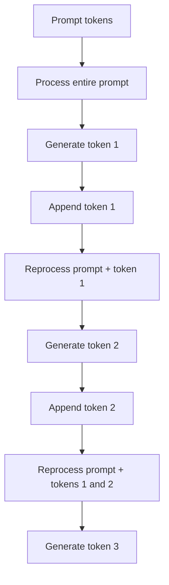
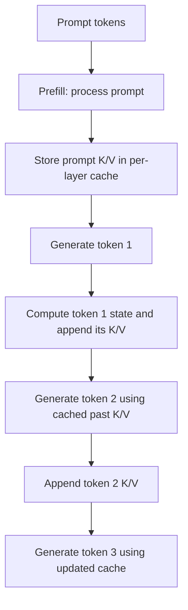

# Chapter 15 — KV Cache Intuition

## Learning Objectives

By the end of this chapter, you should be able to:

- Explain how causal decoding reuses past key and value tensors.
- Describe what is stored in each layer's KV cache and how it grows with sequence length.
- Explain why a new query still needs to attend to earlier keys and values.
- Compare recomputing past representations with storing reusable state.
- Identify the main variables that determine KV-cache memory use.
- Distinguish the KV cache from model weights, persistent conversation memory, and response caching.
- Understand the basic ideas behind cache limits, prefix reuse, and implementation-dependent optimizations.

<br/>

## 1. What Is the KV Cache?

A **key/value (KV) cache** is temporary state used by many autoregressive Transformer implementations to avoid recomputing attention keys and values for tokens that have already been processed.

In causal decoding, a model generates a token, appends it to the sequence, and then predicts the next token. The past tokens do not change. Their previously computed keys and values can therefore be reused when processing later tokens.

The cache usually contains per-layer attention keys and values for the tokens in the current sequence. It is generally associated with an active request or sequence and is not the same thing as long-term conversational memory.

<br/>

## 2. Why Can Past Keys and Values Be Reused?

In self-attention, hidden representations are projected into queries, keys, and values. In simplified notation:

$$
Q = XW_Q,\qquad K = XW_K,\qquad V = XW_V
$$

For a new token, its query is used to compare against the keys for the positions it is allowed to attend to. The resulting attention weights combine the corresponding values.

$$
\operatorname{Attention}(Q,K,V)
= \operatorname{softmax}\left(\frac{QK^\top}{\sqrt{d_k}}\right)V
$$

During causal decoding, a newly generated token can attend to earlier tokens and itself, but not to future tokens. Earlier tokens' representations and their per-layer keys and values do not need to be regenerated merely because a new token has been appended.

The cache stores reusable keys and values, not a precomputed final answer. Each new token still requires model computation.

<br/>

### 2.1 What is stored per layer?

Conceptually, each Transformer layer maintains:
- **Keys:** representations used to calculate how strongly a query should attend to each cached position.
- **Values:** representations combined according to the attention weights.

A simplified view for one layer is:

```text
Layer ℓ KV cache
├── K: keys for previously processed tokens
└── V: values for previously processed tokens
```

A multi-layer model has its own cache tensors for each relevant attention layer. Exact tensor layouts and cache formats vary by implementation.

<br/>

## 3. Cached Decoding vs. Recomputing the Past

### 3.1 Without a KV cache

A straightforward uncached approach can reprocess the full growing sequence for each next-token prediction:



This repeats work for earlier positions. It is a conceptual comparison; real implementations may use other optimizations even when a particular cache is disabled.

<br/>

### 3.2 With a KV cache

With caching, the model processes the prompt, stores the required keys and values, and then adds the new token's cache entries as decoding proceeds:



The main benefit is avoiding repeated computation of the past tokens' attention keys and values. The new token still passes through the model's layers, and attention still has to use the available context.

<br/>

### 3.3 Side-by-side comparison

| Property | Recomputing past state | Reusing a KV cache |
|---|---|---|
| Past-token K/V projections | May be recomputed repeatedly | Reused after they have been stored |
| New-token computation | Required | Required |
| Attention to prior positions | Required | Required |
| Cache memory | Lower if no cache is stored | Higher because K/V tensors occupy memory |
| Repeated work | Generally greater for incremental decoding | Reduced for previously processed tokens |
| Trade-off | More computation, less cache storage | More cache storage, less repeated computation |

The KV cache trades memory for reduced repeated computation. It does not make generation free and does not remove the need to compare new queries with prior keys.

<br/>

## 4. Why Does a New Query Still Attend to Earlier Keys and Values?

The cache contains earlier keys and values, but the model still needs to determine which earlier positions matter for the new token.

For a new token at position $t$, its query $q_t$ is compared with keys from allowed positions $1,\ldots,t$. The resulting weights are used to combine their values:

$$
\alpha_{t,j}
= \operatorname{softmax}_{j}\left(
\frac{q_t k_j^\top}{\sqrt{d_k}}
\right), \qquad j \leq t
$$

$$
o_t = \sum_{j=1}^{t}\alpha_{t,j}v_j
$$

These equations describe one attention head in simplified form. The cache supplies the stored $k_j$ and $v_j$, but the current query and its attention weights still need to be computed.

This distinction is essential:

- **Saved:** repeated calculation of keys and values for past tokens.
- **Still required:** current-token processing, attention-score calculation against available keys, weighted combination of values, subsequent layer computation, and output-token prediction.

For standard dense attention, the amount of attention work for a new token generally grows with the number of cached positions it attends to. Therefore, caching reduces repeated work but does not eliminate all work associated with a long context.

<br/>

## 5. How the Cache Grows

Each newly processed token typically adds key and value entries to each applicable attention layer's cache. As the sequence grows, the cache grows too.

```text
After prefill:  [Prompt token K/V entries]
After token 1:  [Prompt entries] + [Token 1 entries]
After token 2:  [Prompt entries] + [Token 1] + [Token 2]
After token 3:  [Prompt entries] + [Token 1] + [Token 2] + [Token 3]
```

The exact cache shape depends on the model's attention design. A common conceptual shape for one of the key or value tensors is:

$$
[B,\; H_{KV},\; S,\; D_{head}]
$$

where:
- $B$ is batch size,
- $H_{KV}$ is the number of key/value heads,
- $S$ is the number of cached tokens,
- $D_{head}$ is the dimension per key/value head.

Some libraries use a different axis order or a different cache representation. The shape above is a common conceptual convention, not a universal API contract.

<br/>

## 6. What Determines KV-Cache Memory?

KV-cache memory depends on several factors:

- **Sequence length $S$:** more cached tokens require more entries.
- **Batch size $B$:** more simultaneous sequences generally require more cache storage.
- **Number of layers $L$:** each attention layer has its own K/V state.
- **Number of KV heads $H_{KV}$:** more key/value heads require more stored values.
- **Head dimension $D_{head}$:** larger vectors require more storage per token.
- **Precision / bytes per element $b$:** higher-precision representations generally consume more memory per value.
- **Cache strategy:** allocation, paging, quantization, sharing, and other implementation choices affect actual memory use.

A useful estimate for a conventional dense KV cache is:

$$
M_{\mathrm{KV}}
\approx 2 \times L \times B \times S
\times H_{KV} \times D_{head} \times b
$$

The factor of 2 accounts for both keys and values. The result is in bytes when $b$ is bytes per stored element. This estimate assumes the same dimensions and precision for keys and values and excludes metadata, allocation overhead, and implementation-specific effects.

<br/>

### 6.1 Toy calculation

Assume a fictional model configuration:

- Layers $L = 24$
- Batch size $B = 1$
- Cached sequence length $S = 2{,}048$
- KV heads $H_{KV} = 8$
- Head dimension $D_{head} = 128$
- Storage precision uses 2 bytes per element

Then:

$$
\begin{aligned}
M_{\mathrm{KV}}
&\approx 2 \times 24 \times 1 \times 2048 \\
&\quad \times 8 \times 128 \times 2\\
&= 2{,}013{,}265{,}920\ \text{bytes}
\end{aligned}
$$

That is approximately **2.01 GB** using decimal units, or about **1.88 GiB** using binary units. The numbers are a toy example, not specifications for a real model. Real memory use may differ due to cache layout, grouped-query attention, precision, allocator overhead, and other implementation details.

<br/>

### 6.2 How changing a variable affects memory

Under the simple estimate:
- Doubling sequence length doubles cache memory.
- Doubling batch size doubles cache memory.
- Doubling the number of layers doubles cache memory.
- Doubling the number of KV heads doubles cache memory.
- Doubling bytes per element doubles cache memory.

These are linear relationships when all other variables stay fixed.

<br/>

## 7. KV Cache vs. Other Kinds of Storage

The word *cache* is used for different things. They should not be conflated.

| Concept | What it stores | Typical purpose | Is it the same as the KV cache? |
|---|---|---|---|
| **Model weights** | Learned parameters such as projection matrices and feed-forward weights | Define the trained model | No. Weights are reused across requests; KV state is sequence-specific |
| **KV cache** | Per-layer keys and values for tokens already processed in an active sequence | Avoid recomputing past K/V state during decoding | This chapter's focus |
| **Persistent conversation memory** | Application-selected facts, summaries, or prior interactions | Carry selected information across turns or sessions | No. It is application-level memory, not the attention K/V tensors for the active sequence |
| **Response cache** | Previously computed outputs or responses, often indexed by a request or key | Return a reusable result without running the model again for an equivalent request | No. It stores results, not per-layer attention state |

A KV cache is usually tied to the active sequence and model execution. It should not be assumed to persist across sessions or to provide long-term conversational recall. Whether it can be retained or reused is implementation-dependent.

<br/>

## 8. Limits, Prefix Reuse, and Optimizations

### 8.1 Cache limits

The cache consumes memory as sequence length and concurrency increase. A serving system may therefore impose limits on:
- Maximum sequence length
- Number of concurrent requests or active sequences
- Total cache memory
- Batch size
- Cache allocation or eviction behavior

If a request exceeds a supported limit, the system may reject it, require truncation, or handle it according to its specific policy. The KV cache itself does not expand the model's documented context capacity.

<br/>

### 8.2 Prefix reuse

If multiple requests share an identical prompt prefix, some serving systems can reuse cached state for that prefix instead of processing it from scratch. This is often called **prefix caching** or **prefix reuse**.

Conceptual example:

```text
Request A: [Shared system instructions] [Question A]
Request B: [Shared system instructions] [Question B]
                         │
             Shared prefix may be reusable
```

Reuse is conditional. The prefix, model, relevant settings, and cache compatibility must satisfy the serving system's rules. Not every API exposes this feature, and reuse should not be assumed merely because two prompts look similar.

<br/>

### 8.3 Other implementation-dependent optimizations

Systems may use techniques such as:
- **Paged or block-based cache management:** allocate cache in blocks rather than requiring one large contiguous allocation.
- **Grouped-query or multi-query attention:** reduce the number of key/value heads relative to query heads, which can reduce cache size.
- **Cache quantization:** store cache values with fewer bits, potentially reducing memory at a possible quality or performance trade-off.
- **Cache sharing or prefix reuse:** avoid duplicating state when compatible sequences share a prefix.

These are previews only. Their exact behavior and trade-offs depend on the architecture and serving implementation.

<br/>

## 9. Common Misconceptions

- **“The KV cache stores the whole model.”** It stores attention K/V state for processed tokens; model weights are separate.
- **“Caching means the model does not process new tokens.”** New tokens still require model computation.
- **“Cached decoding no longer performs attention over the context.”** The current query still compares with cached keys and combines cached values.
- **“The KV cache is long-term conversation memory.”** It is generally execution state for an active sequence, not a durable store of facts across sessions.
- **“The cache is always small.”** It can consume substantial memory for long sequences, large batches, or deep models.
- **“A KV cache removes context-length limits.”** It improves reuse, but the model and serving system still have context and resource limits.
- **“Similar prompts always share a cache.”** Prefix reuse is conditional on implementation-specific compatibility and availability.

<br/>

## 10. Practice and Revision

### Exercise A — Compare cached and uncached decoding

Draw two diagrams for a prompt followed by three generated tokens.

1. In the uncached diagram, show the full growing sequence being processed again at each step.
2. In the cached diagram, show prefill creating the initial cache and each new token adding its own K/V entries.
3. Mark which work is saved and which work still occurs.

<br/>

### Exercise B — Estimate a toy cache

Use this fictional configuration:

- 12 attention layers
- Batch size 2
- 1,024 cached tokens
- 4 KV heads
- Head dimension 64
- 2 bytes per stored element

Estimate memory with:

$$
M_{\mathrm{KV}}
\approx 2LBSH_{KV}D_{head}b
$$

Show the substitution and report the result in decimal MB and binary MiB.

<br/>

### Exercise C — Explain the distinction

In your own words, explain why a KV cache is not the same as model weights, persistent conversation memory, or a response cache.

### Suggested answers

**Exercise A**
- **Uncached:** process the prompt; generate token 1; process prompt + token 1; generate token 2; process prompt + tokens 1 and 2; generate token 3.
- **Cached:** prefill the prompt and store its K/V tensors; generate token 1 and append its K/V; use cached prior K/V to generate token 2 and append its K/V; repeat for token 3.
- **Saved:** repeated calculation of past tokens' K/V projections and related past-token processing.
- **Still required:** processing the new token through the model, computing its query and attention against allowed cached keys, combining values, and producing next-token scores.

**Exercise B**

$$
\begin{aligned}
M_{\mathrm{KV}}
&\approx 2 \times 12 \times 2 \times 1024\\
&\quad \times 4 \times 64 \times 2\\
&= 402{,}653{,}184\ \text{bytes}
\end{aligned}
$$

This is approximately **402.7 MB** in decimal units, or **384 MiB** in binary units. The estimate excludes implementation overhead and assumes the stated dimensions apply to every layer.

**Exercise C**
- Model weights are learned parameters shared by model executions.
- The KV cache is temporary per-sequence attention state used to continue a computation efficiently.
- Persistent conversation memory is application-managed information retained across turns or sessions.
- A response cache stores completed outputs for potential reuse on later equivalent requests.

<br/>

## 11. Chapter Summary

- The KV cache stores previously computed attention keys and values for tokens in the active sequence.
- During causal decoding, a new query still attends to earlier cached keys and combines the corresponding cached values.
- Caching reduces repeated work for past tokens, but it does not eliminate current-token computation or all attention work over a long context.
- Cache size grows approximately linearly with sequence length, batch size, layer count, KV-head count, and bytes per element under the simple estimate.
- KV-cache state is distinct from model weights, persistent conversation memory, and response caching.
- Cache limits, prefix reuse, quantization, paging, and other optimizations depend on the model and serving implementation.

<br/>

**Checkpoint:** Explain what the KV cache saves, why the current query still needs earlier keys and values, and why cache memory and attention work continue to grow with context length.
