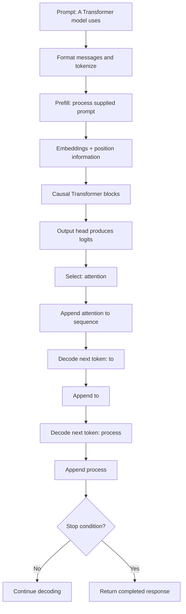
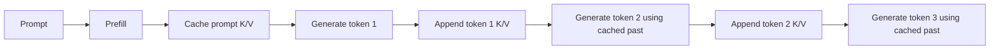
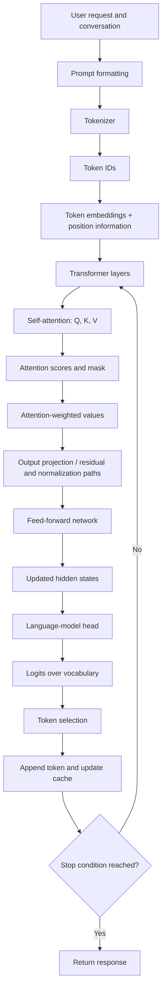

# Chapter 16 — Practice and Revision

## Purpose

This chapter consolidates the Transformer concepts covered in the course:

- Tokenization and token counts
- Embeddings and tensor shapes
- Self-attention and causal masking
- Feed-forward networks
- BERT, GPT-style models, and T5
- Inference, prefill, and autoregressive decoding
- Context-window budgeting
- KV-cache behavior and trade-offs

Use the exercises to test whether you can explain both **what happens** and **why it happens**. Numerical examples use small, hypothetical values to make the calculations manageable.

<br/>

## 1. Inspect Tokenization and Compare Token Counts

A tokenizer converts text into token IDs. A token may represent a whole word, part of a word, punctuation, or another unit. Token counts therefore do not equal word counts, and the same text can tokenize differently under different model tokenizers.

### Exercise 1A — Compare inputs

Consider these inputs:

```text
A. I like AI.
B. I like artificial intelligence.
C. I like AI, and I build Transformer applications.
```

Without running a tokenizer, predict which input is likely to contain the most tokens. Then explain why this is only a prediction, not an exact count.

<br/>

### Exercise 1B — Count with the correct tokenizer

For an actual model, use its matching tokenizer. The following Hugging Face example demonstrates the general workflow; replace the checkpoint with the tokenizer appropriate to the model you are studying.

```python
from transformers import AutoTokenizer

model_id = "google-t5/t5-small"
tokenizer = AutoTokenizer.from_pretrained(model_id)

texts = [
    "I like AI.",
    "I like artificial intelligence.",
    "I like AI, and I build Transformer applications.",
]

for text in texts:
    encoded = tokenizer(text, add_special_tokens=True)
    print({
        "text": text,
        "token_count": len(encoded["input_ids"]),
        "token_ids": encoded["input_ids"],
    })
```

**Important:** the output depends on the chosen tokenizer and whether special tokens are included. Do not copy a token count from one tokenizer and assume it applies to another model.

<br/>

### Review questions

1. Why can two sentences with the same word count have different token counts?
2. Why should an application count tokens before building a large prompt?
3. Why is a tokenizer checkpoint part of the model configuration?

<br/>


## 2. Calculate a Small Attention Example

Self-attention compares query vectors with key vectors, turns the scores into attention weights, and uses those weights to combine value vectors.

For scaled dot-product attention:

$$
\operatorname{Attention}(Q,K,V)
= \operatorname{softmax}\left(\frac{QK^\top}{\sqrt{d_k}} + M\right)V
$$

Here, $d_k$ is the key dimension and $M$ represents an attention mask or an equivalent masking operation. In a causal mask, future positions receive an effectively prohibitive score so they cannot contribute.

<br/>

### Exercise 2A — One query and two keys

Suppose a query and two keys are:

$$
q=[1,0],\quad k_1=[1,0],\quad k_2=[0,1]
$$

The key dimension is $d_k=2$.

1. Calculate the dot products $q\cdot k_1$ and $q\cdot k_2$.
2. Divide each score by $\sqrt{2}$.
3. Apply softmax to obtain two attention weights.
4. Explain why the first key receives a higher weight.

**Hint:** for two scores $s_1,s_2$,

$$
\operatorname{softmax}(s_i)=
\frac{e^{s_i}}{e^{s_1}+e^{s_2}}
$$

<br/>

### Worked answer

The raw scores are:

$$
q\cdot k_1=1,\qquad q\cdot k_2=0
$$

After scaling:

$$
s_1=\frac{1}{\sqrt{2}}\approx0.7071,\qquad s_2=0
$$

The approximate weights are:

$$
\alpha_1=\frac{e^{0.7071}}{e^{0.7071}+e^0}\approx0.67
$$

$$
\alpha_2=\frac{e^0}{e^{0.7071}+e^0}\approx0.33
$$

The query aligns more strongly with $k_1$, so its attention weight is larger. The weights sum to approximately 1.

<br/>

### Exercise 2B — Apply a causal mask

For a sequence of three positions, an unmasked attention-score matrix has shape $3\times3$. Rows correspond to queries; columns correspond to keys.

A causal mask must prevent each position from attending to future positions. Which entries must be masked?

```text
          Key 1  Key 2  Key 3
Query 1     ?      ?      ?
Query 2     ?      ?      ?
Query 3     ?      ?      ?
```

<br/>

### Worked answer

```text
          Key 1  Key 2  Key 3
Query 1   allow  mask   mask
Query 2   allow  allow  mask
Query 3   allow  allow  allow
```

A query at position $i$ can attend to keys at positions $j\leq i$, but not to keys at positions $j>i$. Implementations commonly use a large negative score or another equivalent masking mechanism before softmax. Exact conventions depend on the implementation.


<br/>


## 3. Track Shapes Through a Transformer Block

Tensor shapes help detect mistakes in model code and make the flow through attention easier to understand.

Suppose:
- Batch size $B=2$
- Sequence length $S=5$
- Hidden size $d_{model}=8$
- Number of attention heads $H=2$
- Per-head dimension $d_{head}=4$
- Feed-forward hidden dimension $d_{ff}=16$

For simplicity, assume $d_{model}=H\times d_{head}$.

<br/>

### Exercise 3A — Fill in the shapes

| Stage | Expected shape |
|---|---|
| Token IDs | `?` |
| Token embeddings | `?` |
| Combined hidden representation entering attention | `?` |
| Queries, keys, and values before splitting into heads | `?` |
| Queries, keys, and values after splitting into heads | `?` |
| Attention output after merging heads | `?` |
| First feed-forward linear layer output | `?` |
| Second feed-forward linear layer output | `?` |

<br/>

### Worked answer

| Stage | Expected shape |
|---|---|
| Token IDs | $[2,5]$ |
| Token embeddings | $[2,5,8]$ |
| Hidden representation entering attention | $[2,5,8]$ |
| Queries, keys, and values before splitting into heads | $[2,5,8]$ each |
| Queries, keys, and values after splitting into heads | $[2,2,5,4]$ each, using $[B,H,S,d_{head}]$ |
| Attention output after merging heads | $[2,5,8]$ |
| First feed-forward linear layer output | $[2,5,16]$ |
| Second feed-forward linear layer output | $[2,5,8]$ |

The feed-forward network usually expands the last dimension and then projects it back to the model hidden size. Residual connections require compatible shapes, which is one reason the block's final dimension returns to $d_{model}$.

<br/>

### Exercise 3B — Explain the dimensions

1. Why does the sequence dimension remain $S=5$ through ordinary self-attention?
2. Why is the hidden size split across attention heads?
3. Why does the feed-forward network return to $d_{model}$ in a standard Transformer block?


<br/>


## 4. Compare BERT, GPT-Style Models, and T5

Complete the table from memory, then compare your answer with the review table.

| Dimension | BERT | GPT-style model | T5 |
|---|---|---|---|
| Architecture | ? | ? | ? |
| Typical attention pattern | ? | ? | ? |
| Common pretraining objective | ? | ? | ? |
| Typical task pattern | ? | ? | ? |
| Common example use | ? | ? | ? |

<br/>

### Review table

| Dimension | BERT | GPT-style model | T5 |
|---|---|---|---|
| Architecture | Encoder-only | Decoder-only | Encoder-decoder |
| Typical attention pattern | Bidirectional encoder self-attention | Causal self-attention | Bidirectional encoder attention, causal decoder attention, and cross-attention |
| Common pretraining objective | Masked language modeling | Autoregressive next-token prediction | Text-to-text span corruption in the original T5 setup |
| Typical task pattern | Represent or label supplied text | Generate continuations from a context | Generate output text conditioned on input text |
| Common example use | Classification or token/span prediction | Text or code generation | Translation or summarization |

These are family-level patterns, not universal claims about every checkpoint. Tokenizers, training data, objectives, and later adaptation can vary.

<br/>

### Review questions

1. Why is standard BERT not normally used as a left-to-right generator in the same way as GPT?
2. Why can a GPT-style model still be adapted for classification?
3. Why does architecture alone not guarantee instruction-following behavior?
4. Which parts of a deployed assistant may come from post-training or runtime orchestration rather than the base architecture?


<br/>


## 5. Trace Inference from Prompt to Generated Tokens

Consider this prompt:

```text
A Transformer model uses
```

For this exercise, assume the model generates these illustrative tokens:

```text
attention → to → process
```

Actual token boundaries depend on the tokenizer; the arrows here represent conceptual output steps, not guaranteed tokenization.

<br/>

### Exercise 5A — Fill in the stages

1. What happens during prompt formatting?
2. What does tokenization produce?
3. What is processed during prefill?
4. What does the output projection produce?
5. What happens when `attention` is selected?
6. What is the context when the model selects `to`?
7. What is the context when it selects `process`?
8. What conditions might end generation?

<br/>

### Worked trace



The conceptual sequence grows at each step:

| Step | Context available for the next prediction |
|---|---|
| Before generation | `A Transformer model uses` |
| After selecting token 1 | `A Transformer model uses attention` |
| After selecting token 2 | `A Transformer model uses attention to` |
| After selecting token 3 | `A Transformer model uses attention to process` |

<br/>

### Key distinction

- **Prefill** processes the supplied prompt and may populate the KV cache.
- **Decoding** repeatedly predicts and appends new tokens.
- Prompt-position computations can generally be processed in parallel under causal masking, but successive generated-token selections have a dependency on earlier selections.


<br/>


## 6. Explain Context Budgeting

A context window is a model/interface limit measured in tokens. A practical request may use tokens for instructions, history, current user input, retrieved content, formatting overhead, and generated output.

### Exercise 6A — Allocate a budget

Assume a fictional model has:
- Total request capacity: 10,000 tokens
- Maximum output allowance: 1,200 tokens
- Input plus reserved output must fit within the total capacity
- The input count includes instructions, history, user input, retrieved passages, and formatting overhead

Allocate a token budget and leave some headroom.

<br/>

### One valid allocation

| Component | Planned tokens |
|---|---:|
| Instructions | 600 |
| Chat history | 1,000 |
| Current user input | 700 |
| Retrieved passages | 4,500 |
| Formatting and message overhead reserve | 400 |
| **Total input** | **7,200** |
| Reserved output | 1,200 |
| **Total planned** | **8,400** |
| **Headroom** | **1,600** |

$$
10{,}000-(7{,}200+1{,}200)=1{,}600
$$

These limits are hypothetical. Real provider rules may define separate input and output caps or account for tools, multimodal content, and cached tokens differently.

<br/>

### Exercise 6B — Choose a context strategy

Choose the most appropriate primary technique for each situation:

1. A batch contains sequences of different lengths.
2. A single document exceeds the input limit.
3. A retrieval system has thousands of documents but only a few are relevant to the question.
4. A long conversation contains many old turns unrelated to the current request.

**Review:**
- **Padding** aligns sequences for batch processing.
- **Truncation** removes tokens to enforce a limit, but may discard important information.
- **Context selection** chooses the most relevant content before constructing the prompt.
- **Summarization** can compress old history, but may lose details.

A context that fits is not necessarily a context that will be used reliably. Relevant evidence can be buried, conflicting, or poorly selected.


<br/>


## 7. Explain KV-Cache Trade-Offs

A KV cache stores previously computed attention keys and values for tokens already processed in an active autoregressive sequence. This avoids repeatedly calculating past keys and values, but it consumes memory.

### Exercise 7A — Compare the two approaches

Describe what happens when generating three tokens:

- **Without a cache:** the model may repeatedly process the full growing sequence.
- **With a cache:** prefill stores the prompt's K/V tensors; each generated token adds cache entries that can be reused for subsequent steps.



<br/>

### Exercise 7B — What does caching save?

Mark each statement as **saved/reduced**, **still required**, or **not what the KV cache stores**.

1. Recalculating keys and values for previously processed tokens.
2. Computing the new token's hidden representations.
3. Using the new query to attend to earlier keys.
4. Storing all learned model parameters.
5. Retaining a user's personal facts permanently across sessions.
6. Producing next-token logits.

**Review answers:**
1. Saved/reduced.
2. Still required.
3. Still required.
4. Not what the KV cache stores; these are model weights.
5. Not what the KV cache stores; that would require a separate memory mechanism.
6. Still required.

A simple cache-size estimate for a conventional dense cache is:

$$
M_{\mathrm{KV}}\approx
2 \times L \times B \times S \times H_{KV}
\times D_{head} \times b
$$

where $L$ is layer count, $B$ is batch size, $S$ is cached sequence length, $H_{KV}$ is KV-head count, $D_{head}$ is head dimension, and $b$ is bytes per stored element. The factor of 2 accounts for keys and values. This is an estimate, not a universal implementation formula.


<br/>


## 8. Full Transformer Walkthrough

This section combines the chapter concepts into one end-to-end explanation.

### 8.1 Pipeline diagram



This is a conceptual map rather than a literal implementation graph. A real Transformer block has a particular ordering of normalization, attention, residual connections, and feed-forward layers; variants differ. The output head and generation loop apply to autoregressive language generation, not every encoder-only task.

<br/>

### 8.2 Worked conceptual example

Suppose the user asks:

```text
Explain why attention helps a language model understand context.
```

A decoder-only model's generation path can be described as follows:

1. **Format the prompt.** The application combines the request with applicable instructions and conversation context.
2. **Tokenize the input.** The model-specific tokenizer maps the formatted input to token IDs.
3. **Embed tokens.** Token IDs map to vectors, and the model incorporates position information.
4. **Process Transformer blocks.** Attention lets each position combine information from permitted positions. In a causal decoder, future positions are masked.
5. **Apply feed-forward transformations.** Each block further transforms token representations, with residual and normalization operations according to the model design.
6. **Produce logits.** The language-model head scores candidate next tokens.
7. **Select a token.** A decoding policy selects one candidate according to the model's scores and generation settings.
8. **Append the token.** The selected token becomes part of the context for the next prediction.
9. **Reuse cached state when available.** A KV cache can avoid recalculating K/V tensors for previously processed tokens.
10. **Repeat and stop.** Decoding continues until a stopping condition is reached or an output limit is met.

<br/>

### 8.3 Where the main concepts fit

| Concept | Place in the pipeline | Main question it answers |
|---|---|---|
| Tokenization | Before embeddings | How is text represented as token IDs? |
| Embeddings | Input representation | How are token IDs mapped to vectors? |
| Positional information | Input/attention representation | How is token order represented? |
| Self-attention | Transformer block | Which permitted positions should influence this representation? |
| Causal mask | Attention computation | Which future positions must be inaccessible? |
| Feed-forward network | Transformer block | How are token representations further transformed? |
| Output projection and logits | After final hidden representation | How is each possible next token scored? |
| Prefill | Before iterative generation | How is the supplied prompt processed? |
| Autoregressive decoding | Generation loop | How is the response extended one token at a time? |
| Context budget | Request construction | What information can fit within the applicable limits? |
| KV cache | Incremental decoding | Which past attention state can be reused? |


<br/>


## 9. Final Self-Test

Answer each question without looking at the earlier sections.

1. What is the difference between a token and a word?
2. What do queries, keys, and values contribute to self-attention?
3. Why is scaled dot-product attention divided by \(\sqrt{d_k}\)?
4. What does a causal mask prevent?
5. What are the main stages of a standard Transformer block?
6. How do BERT, GPT-style models, and T5 differ in architecture and common pretraining objective?
7. What is prefill, and why can prompt positions be processed in parallel?
8. Why are successive autoregressive output tokens dependent on earlier selections?
9. What is the difference between TTFT and time per output token?
10. Why does a large context window not guarantee a correct answer?
11. What does the KV cache store, and what computation does it reduce?
12. Why does the KV cache still use memory as context length increases?

<br/>

### Suggested answers

1. A word is a linguistic unit; a token is a unit defined by a particular tokenizer and may be a word, subword, punctuation mark, or other segment.
2. Queries are compared with keys to obtain attention scores; the resulting weights combine values.
3. Scaling controls the magnitude of dot-product scores and helps keep softmax behavior numerically and optimization-wise manageable as key dimension grows.
4. It prevents a position from attending to future positions during causal generation.
5. A common block contains self-attention, a feed-forward network, residual connections, and normalization; exact ordering varies by architecture.
6. BERT is commonly encoder-only with masked-language-model pretraining; GPT-style models are commonly decoder-only with next-token prediction; T5 is encoder-decoder and was pretrained with a text-to-text span-corruption objective.
7. Prefill processes the supplied prompt and may populate a KV cache. Computation for prompt positions can generally be parallelized under a causal mask because all prompt tokens are already supplied, while the mask controls permitted information flow.
8. Each new token becomes part of the context used to predict the following token.
9. TTFT measures the delay until the first generated token under a defined timing boundary; time per output token measures the pace of subsequent generation.
10. The model may fail to retrieve or integrate relevant details, be distracted by irrelevant content, or receive conflicting evidence.
11. It stores past per-layer attention keys and values, reducing repeated calculation of K/V state for prior tokens.
12. More cached positions require more stored K/V entries; the cache grows with sequence length and other model/configuration dimensions.

<br/>

## 10. Chapter Summary

- Tokenization determines the token IDs the model actually processes; exact token counts depend on the tokenizer.
- Self-attention computes query-key compatibility, normalizes scores into weights, and combines value vectors.
- A causal mask prevents access to future positions during autoregressive generation.
- Tensor shapes provide a way to verify how data flows through embeddings, attention heads, and feed-forward layers.
- BERT, GPT-style models, and T5 illustrate different Transformer architectures and commonly associated pretraining objectives.
- Inference moves from prompt formatting and tokenization through Transformer computation to logits and token selection.
- Prefill processes the supplied prompt; autoregressive decoding repeatedly appends new tokens.
- Context budgeting balances input components, output allowance, and provider-specific limits.
- The KV cache reduces repeated computation of past keys and values but consumes memory and does not eliminate all attention work.
- Reliable model behavior depends on more than fitting within a context window: relevant evidence, appropriate architecture and adaptation, and validation all matter.

<br/>

**Final Checkpoint:** Explain the complete Transformer pipeline using both a diagram and a worked example. Your explanation should distinguish tokenization, attention, causal masking, model architecture, prefill, decoding, context budgeting, and KV-cache reuse.
