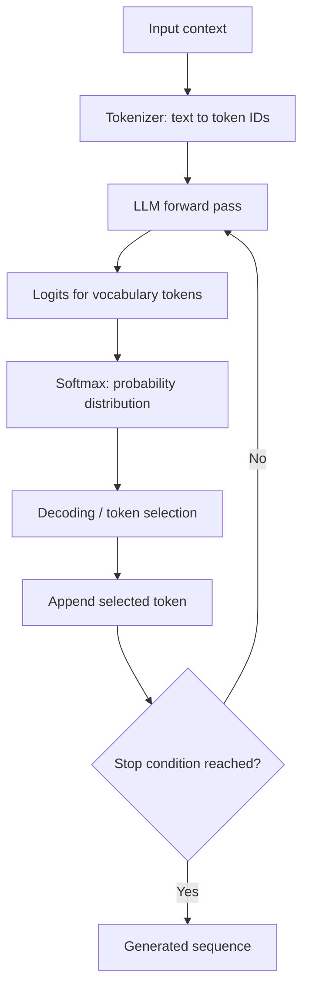
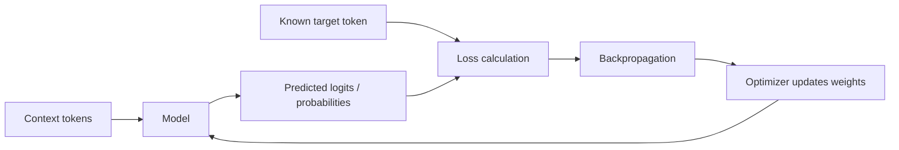

# 01. Next-Token Prediction

## Learning Objectives

By the end of this note, you should be able to:

- Trace a text context through logits, probabilities, and next-token selection.
- Distinguish training-time target prediction from inference-time token generation.
- Explain cross-entropy loss and perplexity at a conceptual level.
- Describe how repeated next-token predictions produce a sequence.
- Explain why lower prediction loss does not guarantee factual correctness or application usefulness.

<br/>

## 1. The Core Idea

Most modern autoregressive large language models (LLMs) generate text by predicting **one token at a time**, conditioned on the tokens that came before it.

A token may be a whole word, part of a word, punctuation, whitespace-related text, or another vocabulary unit. Therefore, next-token prediction does not necessarily mean predicting the next complete word.

For example, given the context:

> The capital of France is

the model might assign a high probability to the token ` Paris`, but it could also assign some probability to alternatives such as ` Lyon` or a punctuation token, depending on the model and context.

The model does not directly look up a guaranteed correct answer. It computes a distribution over its vocabulary and a decoding procedure chooses a token from that distribution.

<br/>

### The central pipeline

1. Convert the input text into token IDs.
2. Process the tokens using the model.
3. Produce a score, called a **logit**, for each possible next token.
4. Convert logits into probabilities, commonly using softmax.
5. Select the next token using a decoding method.
6. Append the selected token to the context and repeat.



<br/>

## 2. From Context to Logits

Suppose the context is:

> The capital of France is

After tokenization, the context becomes a sequence of token IDs. The exact token IDs depend on the tokenizer.

The model processes the sequence and produces a final hidden representation for the position used to predict the next token. A vocabulary projection converts that representation into a score for each token in the model's vocabulary.

These scores are called **logits**.

<br/>

### What logits mean

- A logit is an unnormalized numerical score for a candidate token.
- A larger logit generally means the token will receive a larger probability after softmax.
- Logits are not probabilities: they can be negative, positive, or any real number.
- The difference between logits matters when converting them into probabilities.

A simplified example:

| Candidate next token | Logit |
|---|---:|
| ` Paris` | 4.2 |
| ` Lyon` | 1.8 |
| ` London` | 0.9 |
| ` banana` | -1.5 |

These values are illustrative, not outputs from a real model. The model produces scores for its full vocabulary, not just four candidates.

<br/>

## 3. From Logits to Probabilities

A common way to convert logits $z_i$ into a probability distribution is the **softmax** function:

$$
P(x_i \mid \text{context}) =
\frac{e^{z_i}}{\sum_j e^{z_j}}
$$

Here:

- $z_i$ is the logit for candidate token $i$.
- $e^{z_i}$ converts the score into a positive value.
- The denominator sums the exponentiated scores across the vocabulary.
- The resulting probabilities are between 0 and 1 and sum to 1, subject to numerical precision.

The conditional probability notation $P(x_i \mid \text{context})$ means “the probability assigned to candidate token $x_i$, given the preceding context.”

For illustration, imagine a toy model has only three possible next tokens:

| Token | Logit | Approximate softmax probability |
|---|---:|---:|
| ` Paris` | 2.0 | 0.7054 |
| ` Lyon` | 1.0 | 0.2595 |
| ` banana` | -1.0 | 0.0351 |
| **Total** | — | **1.0000** |

A real LLM has a much larger vocabulary. The small distribution is used only to make the calculation understandable.

<br/>

### Python example: softmax over toy logits

```python
import numpy as np

tokens = [" Paris", " Lyon", " banana"]
logits = np.array([2.0, 1.0, -1.0])

# Subtracting the maximum improves numerical stability.
shifted_logits = logits - np.max(logits)
exp_scores = np.exp(shifted_logits)
probabilities = exp_scores / exp_scores.sum()

for token, probability in zip(tokens, probabilities):
    print(f"{token!r}: {probability:.4f}")

print("Probability sum:", probabilities.sum())
```

Expected output (rounded):

```text
' Paris': 0.7054
' Lyon': 0.2595
' banana': 0.0351
Probability sum: 1.0
```

**Important:** Softmax probabilities express the model's relative predictive distribution. They are not a guarantee that a candidate is factually correct, and they should not automatically be interpreted as calibrated real-world confidence.

<br/>

## 4. Training: Predicting a Known Target Token

During language-model pretraining, the training text supplies the target tokens. The model receives a context and is trained to assign high probability to the actual next token in that text.

Example training sequence:

> The cat sat on the mat.

After tokenization, the sequence can be represented as \(x_1, x_2, \ldots, x_T\). In a causal language model, each position is trained to predict the next token from the preceding context:

| Context available to the model | Target token |
|---|---|
| `The` | ` cat` |
| `The cat` | ` sat` |
| `The cat sat` | ` on` |
| `The cat sat on` | ` the` |
| `The cat sat on the` | ` mat` |
| `The cat sat on the mat` | `.` or an end marker, depending on tokenization and training format |

This table is conceptual. Actual training batches are processed in parallel with causal masking, rather than necessarily running one separate forward pass for every row.

<br/>

### How the model learns

1. The model predicts a distribution for the next token.
2. The training data identifies the target token.
3. The training objective measures how much probability the model assigned to that target.
4. Backpropagation computes gradients.
5. An optimizer updates model parameters to reduce the training objective over many examples.



Training is not the same as asking the model to freely continue a prompt. The target token is known from the training sequence, and the model is optimized against it.

<br/>

## 5. Cross-Entropy Loss

**Cross-entropy loss** measures how much probability the model assigns to the correct target token. For a single target token $y$, the loss is:

$$
\mathcal{L} = -\log P(y \mid \text{context})
$$

If the model assigns high probability to the correct target, the loss is low. If it assigns low probability, the loss is high.

For example:

| Probability assigned to the correct token | Cross-entropy loss (natural logarithm) |
|---:|---:|
| 0.90 | $-\ln(0.90) \approx 0.105$ |
| 0.50 | $-\ln(0.50) \approx 0.693$ |
| 0.10 | $-\ln(0.10) \approx 2.303$ |
| 0.01 | $-\ln(0.01) \approx 4.605$ |

The model is penalized more when it gives the actual target a very small probability.

For a sequence of target tokens, training commonly aggregates token-level losses, often by taking their mean over the relevant positions. Exact details can vary with masking, padding, and the training implementation.

<br/>

### Why cross-entropy is useful

- It provides a differentiable objective for gradient-based learning.
- It rewards assigning more probability to the observed target tokens.
- It can be averaged over a dataset to compare predictive performance under a consistent evaluation setup.

<br/>

### What it does not directly measure

Cross-entropy does not directly measure whether a generated answer is helpful, safe, logically valid, or factually correct for a user's real-world task. It measures predictive fit to the evaluation targets.

<br/>

## 6. Perplexity

**Perplexity (PPL)** is a metric derived from average token-level cross-entropy. If the average cross-entropy is measured using natural logarithms:

$$
\mathrm{PPL} = e^{\mathcal{L}_{\text{average}}}
$$

If cross-entropy uses logarithms base 2, perplexity is $2^{\mathcal{L}_{\text{average}}}$.

Perplexity can be understood intuitively as a measure of how uncertain the model is, on average, when predicting the observed tokens under the evaluated data distribution. Lower perplexity generally indicates better next-token prediction on that evaluation set.

Example:

- Average cross-entropy $= 1.0$ nat gives perplexity $e^1 \approx 2.72$.
- Average cross-entropy $= 2.0$ nats gives perplexity $e^2 \approx 7.39$.

<br/>

### Comparing perplexity responsibly

Perplexity comparisons are meaningful only when the evaluation setup is comparable. Consider:

- The same evaluation dataset and preprocessing.
- Compatible tokenization and token-level accounting.
- The same treatment of context, padding, and special tokens.
- Whether the model is being evaluated on data similar to the intended application.

Perplexity is not a direct measure of answer correctness, reasoning ability, factuality, or user satisfaction. A model with lower perplexity is not automatically the better choice for every application.

<br/>

## 7. Inference: Choosing the Next Token

During inference, the model receives a prompt or current context and calculates logits for the next token. A decoding method then chooses a token using the resulting distribution.

Unlike ordinary supervised training, the next token in an open-ended generation is not supplied as a known target. The system must select a continuation.

For example, a toy distribution might be:

| Candidate | Probability |
|---|---:|
| ` Paris` | 0.70 |
| ` Lyon` | 0.26 |
| ` banana` | 0.04 |

Possible selection behavior:

- **Greedy decoding:** Select the highest-probability candidate, ` Paris`.
- **Sampling:** Randomly draw a candidate according to the distribution; a lower-probability candidate may be selected.
- **Other search or decoding methods:** Consider candidate sequences or modify which candidates are eligible.

The exact decoding method and available controls depend on the model implementation or provider.

<br/>

### Training versus inference

| Aspect | Training | Inference / generation |
|---|---|---|
| Main purpose | Adjust parameters to improve prediction of training targets | Produce output using learned parameters |
| Target token | Known from the training sequence | Not known in advance for open-ended generation |
| Loss | Computed against target tokens for optimization | Usually not used to update model weights during ordinary generation |
| Parameter updates | Yes, during training | Normally no |
| Token selection | Training compares predictions with known targets | Decoding selects a continuation |
| Output | Loss and gradients, among other values | Generated token sequence |

A model may still be evaluated with loss during inference-like evaluation, but ordinary text generation does not update the model's weights.

<br/>

## 8. Repeated Prediction Produces a Sequence

An autoregressive model generates a sequence by repeatedly predicting the next token conditioned on the context so far.

Suppose the initial prompt is:

> The capital of France is

A simplified generation trace could be:

| Step | Context before selection | Selected token | New context |
|---:|---|---|---|
| 1 | `The capital of France is` | ` Paris` | `The capital of France is Paris` |
| 2 | `The capital of France is Paris` | `.` | `The capital of France is Paris.` |
| 3 | `The capital of France is Paris.` | End-of-sequence token | Generation stops |

This is an illustrative trace, not a guaranteed output from every model or configuration.

At each step, the model conditions on the prompt and all previously generated tokens. The next probability distribution can therefore change after every selected token.

The process ends when a stopping condition is met, such as:

- The model emits an end-of-sequence token.
- A configured stop sequence is encountered.
- A maximum output-token limit is reached.
- The calling application stops generation.

These stopping mechanisms are covered in more detail in `09_stop_sequences_and_output_limits.md`.

<br/>

## 9. One Prediction Objective, Many Capabilities

Next-token prediction is a general learning objective. A model trained on diverse text can learn statistical patterns involving language, facts expressed in text, code, formats, and many other structures. Those learned patterns can support different downstream behaviors when the model is prompted or adapted appropriately.

Examples:

| Task | How next-token prediction is involved |
|---|---|
| Text completion | Predict tokens that continue the supplied text |
| Summarization | Generate a concise sequence conditioned on the source and instruction |
| Question answering | Generate a response conditioned on a question and available context |
| Translation | Generate target-language tokens conditioned on source text and instructions |
| Code generation | Generate code tokens conditioned on a request and preceding code |
| Structured output | Generate tokens intended to follow a requested format or schema |

The task is not necessarily represented as a separate built-in capability for every row. The model produces tokens; prompts, training, system design, and constraints help shape those tokens into task-specific outputs.

<br/>

### Why the objective does not guarantee correctness

A model can predict plausible text without verifying that it is true. In particular:

- Training data can contain errors, omissions, outdated information, and conflicting claims.
- A likely continuation in the training distribution may be wrong for a specific question.
- The model may not have relevant information in its parameters or supplied context.
- A fluent answer can contain fabricated details or invalid reasoning.
- A syntactically valid response may still fail the user's actual requirements.

Therefore, lower predictive loss is useful evidence about language-model prediction, but it is not a substitute for task-specific evaluation.

For real applications, add appropriate checks such as retrieval from trusted sources, schema validation, executable tests, deterministic calculations, abstention when evidence is missing, or human review for consequential decisions.

<br/>

## 10. Practice: Trace a Toy Probability Distribution

Consider the following hypothetical distribution for the next token after the context:

> I want to drink

| Candidate token | Probability |
|---|---:|
| ` water` | 0.60 |
| ` tea` | 0.25 |
| ` coffee` | 0.10 |
| ` rocks` | 0.05 |
| **Total** | **1.00** |

These are toy probabilities chosen for learning; they are not measured model outputs.

<br/>

### Exercise A — Select a token

1. Which token would greedy decoding select?
2. Could sampling select ` tea`?
3. Could sampling select ` rocks`?
4. Does the probability distribution guarantee that the selected token is appropriate?

**Answers**

1. Greedy decoding selects ` water`, because it has the highest probability.
2. Yes. Sampling can select ` tea`, which has probability 0.25.
3. Yes. Sampling can select ` rocks`, which has probability 0.05, although it is less likely than the other candidates.
4. No. Probability describes the model's distribution, not a guarantee of suitability or truth.

<br/>

### Exercise B — Calculate target-token loss

Suppose the observed target token in the training text is ` tea`, whose probability is 0.25.

$$
\mathcal{L} = -\ln(0.25) \approx 1.386
$$

If the model had assigned probability 0.80 to ` tea`, the loss would instead be:

$$
\mathcal{L} = -\ln(0.80) \approx 0.223
$$

The second prediction receives lower loss because it assigns more probability to the observed target.

<br/>

### Exercise C — Trace a continuation

Assume greedy decoding is used and the toy model returns these distributions:

| Step | Context | Candidate probabilities | Selected token |
|---:|---|---|---|
| 1 | `I want to drink` | ` water`: 0.60, ` tea`: 0.25, ` coffee`: 0.10, ` rocks`: 0.05 | ` water` |
| 2 | `I want to drink water` | ` now`: 0.50, ` today`: 0.30, ` .`: 0.20 | ` now` |
| 3 | `I want to drink water now` | ` .`: 0.70, ` !`: 0.20, ` ,`: 0.10 | ` .` |

The resulting continuation is:

> I want to drink water now.

Each row is a separate illustrative distribution. In an actual autoregressive model, the distribution at each step is computed from the updated context.

<br/>

### Exercise D — Short written response

Explain why a model trained to predict next tokens can perform summarization, but why next-token prediction alone does not guarantee a faithful summary.

**Suggested answer:** The model can learn patterns that allow it to generate a shorter text conditioned on a source and a summarization instruction. However, it may omit important information, introduce unsupported details, or misrepresent the source. Summary quality must therefore be evaluated against task-specific criteria such as coverage, faithfulness, relevance, and factual accuracy.

<br/>

## 11. Common Misconceptions

- **“The model predicts whole words.”** Not necessarily. It predicts tokens, which may be words, word pieces, punctuation, or other vocabulary units.
- **“Logits are probabilities.”** No. Logits are scores that are commonly converted into probabilities using softmax.
- **“The highest-probability token must be correct.”** No. It is only the model's highest-scoring candidate under the current distribution and configuration.
- **“Training and generation are the same process.”** Both involve next-token predictions, but training compares predictions with known targets and updates parameters; ordinary generation selects tokens without updating weights.
- **“Lower loss means fewer factual errors in every application.”** No. Loss measures prediction against target tokens on a specified dataset; application quality requires separate evaluation.
- **“Perplexity tells us how useful a chatbot is.”** Not directly. It measures predictive performance under a particular tokenization and evaluation setup.
- **“A model generates the entire response in one decision.”** Standard autoregressive generation repeatedly selects tokens, conditioning each step on the growing sequence.

<br/>

## 12. Key Takeaways

1. An autoregressive LLM uses the preceding context to predict a distribution over the next token.
2. The model produces logits; softmax can convert those logits into probabilities.
3. During training, the actual next token is known and the model is optimized to assign it higher probability.
4. Cross-entropy measures the penalty associated with the probability assigned to the observed target token.
5. Perplexity is an exponential transformation of average token-level cross-entropy and is useful for comparable language-model evaluations.
6. During generation, a decoding method selects a token, which is appended to the context before the next prediction.
7. Next-token prediction supports many text-generation tasks, but it does not guarantee truth, safety, reasoning validity, or task success.
8. Application-specific testing and validation are necessary to establish whether a model is suitable for a real use case.

<br/>

## 13. Checkpoint Questions

Try answering these without looking back:

1. What is the difference between a logit and a probability?
2. What does the model know during training that it does not know in advance during open-ended generation?
3. How does cross-entropy respond when the probability assigned to the target token decreases?
4. What does perplexity measure, and what does it not measure?
5. How does an autoregressive model generate a multi-token response?
6. Why can next-token prediction support tasks such as translation and summarization?
7. Why does a lower prediction loss not prove that an answer is factually correct?

<br/>

### Checkpoint answer

Next-token prediction trains a model to assign probability to observed next tokens given preceding context. This general objective can teach patterns useful for many forms of text generation. At inference time, a decoding method repeatedly chooses tokens to form an output. However, the objective rewards prediction of target text rather than directly verifying truth or measuring every application requirement. Correctness and usefulness must be assessed with suitable task-specific tests and evidence.

<br/>

## References and Further Reading

- The course's **Level 3: Transformer Architecture and Tokenization** notes for token IDs, logits, softmax, context windows, and causal attention.
- The course's **Level 4: LLM Fundamentals and Inference** outline for the intended scope of this chapter.
- For implementation-specific behavior, consult the documentation for the selected model, tokenizer, and inference library. Loss, tokenization, and decoding details can vary by implementation.
