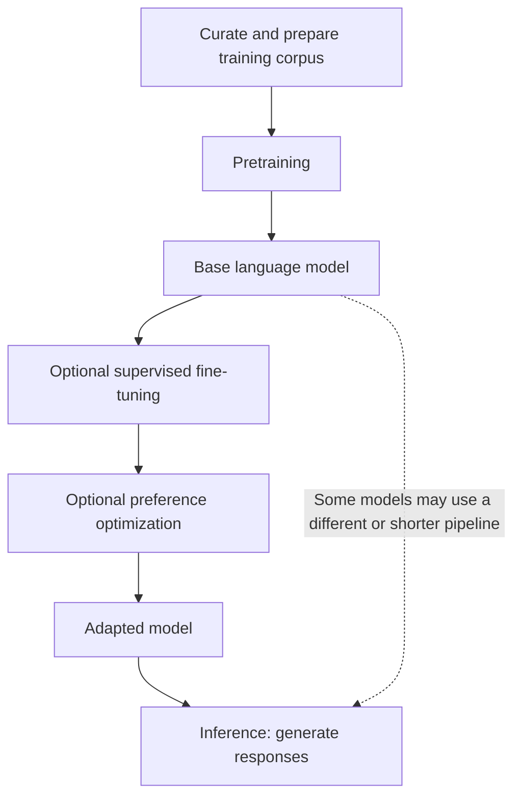
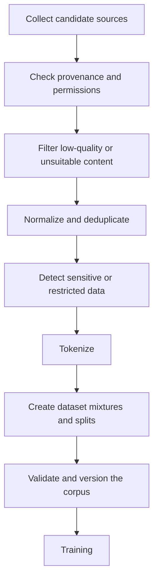
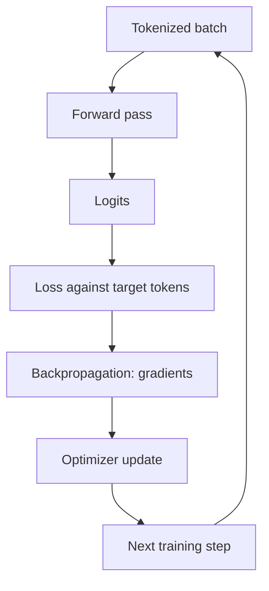

# 02. Pretraining and Training Data

## Learning Objectives

By the end of this note, you should be able to:

- Define pretraining and distinguish it from later model adaptation.
- Describe the major stages of preparing a text corpus for language-model training.
- Identify data-quality, coverage, contamination, licensing, and privacy risks.
- Explain training steps, batches, optimization, and checkpoints conceptually.
- Distinguish a model's knowledge cutoff from memorization and generalization.
- Explain why parameter count and dataset size alone do not determine model capability.

 

## 1. What Is Pretraining?

**Pretraining** is the initial, broad training stage in which a model learns general patterns from a large training corpus. For an autoregressive language model, a common objective is next-token prediction: given preceding tokens, predict the next token.

During pretraining, model parameters are repeatedly adjusted so that the model better predicts the training examples. Across diverse data, it can learn patterns involving language, syntax, style, code, facts expressed in text, and other regularities represented in the corpus.

Pretraining does not mean that the model has a complete, reliable database of every item in its training data. What it learns depends on the training objective, the data, the model architecture, and the optimization process.

 

### Pretraining versus later adaptation

After pretraining, a model may undergo additional training or adaptation to make it more useful for particular interactions or tasks.

| Stage | Main purpose | Typical training signal |
|---|---|---|
| **Pretraining** | Learn broad patterns from a large corpus | Predict observed next tokens for a causal language model |
| **Supervised fine-tuning (SFT) / instruction tuning** | Improve instruction following or desired response formats | Demonstration examples containing prompts and target responses |
| **Preference optimization** | Shift behavior toward preferred responses | Preference comparisons or related optimization signals |
| **Inference** | Use the trained model to produce output | A prompt and runtime generation configuration; normally no weight updates |

The exact training pipeline varies by model. Not every model uses every adaptation stage, and the stages need not be implemented in one universal order.

**Key distinction:** Pretraining updates the model's parameters using training data. Typing extra information into a prompt changes the context for a particular request; it does not, by itself, retrain the model.

 

## 2. From Raw Text to a Training Corpus

A large collection of text is not automatically a suitable training dataset. A preparation pipeline is used to select, clean, transform, and organize data before training.

A conceptual pipeline is:

Real pipelines may reorder, repeat, or combine these operations. The diagram is a conceptual guide, not a universal prescribed sequence.

 

### 2.1 Text collection

Potential sources may include:

- Publicly available web text.
- Books and other publications.
- Documentation and technical material.
- Code repositories.
- Licensed datasets.
- Data created or reviewed by people.

The suitability of a source depends on the intended model, source quality, collection method, legal terms, privacy requirements, and applicable policies.

For every source, record provenance where possible: where it came from, when it was collected, what permissions or restrictions apply, and how it was transformed.

 

### 2.2 Filtering

Filtering removes or limits content that is unsuitable for the intended training objective. Depending on the corpus, checks may target:

- Empty, corrupted, or badly extracted documents.
- Boilerplate, navigation text, and repeated templates.
- Spam, machine-generated junk, or very low-quality content.
- Language or topic coverage that falls outside the intended scope.
- Malware or unsafe code in code-focused corpora, where relevant.
- Sensitive personal information or content that should not be retained.

Filtering is not purely mechanical. Aggressive filters can remove useful dialects, minority-language content, specialized terminology, or legitimate but unusual writing. Filters should be tested for both precision and unintended exclusions.

 

### 2.3 Normalization

Normalization makes representations more consistent. Possible operations include:

- Removing extraction artifacts.
- Standardizing certain whitespace patterns.
- Repairing encoding problems where feasible.
- Preserving document boundaries and meaningful structure.
- Converting source formats into a consistent internal representation.

Normalization should not blindly remove punctuation, code formatting, tables, or other structure that carries meaning.

 

### 2.4 Deduplication

Duplicate and near-duplicate documents can cause overrepresented passages to appear disproportionately often in training. Deduplication attempts to identify repeated content at document or passage level.

Common conceptual approaches include:

- **Exact deduplication:** Identify identical normalized documents or strings.
- **Near-duplicate detection:** Identify documents that are highly similar despite small edits or formatting changes.
- **Passage-level deduplication:** Identify repeated sections inside otherwise different documents.

Deduplication can reduce unnecessary repetition and some memorization risks, but it does not eliminate memorization. It also requires care: legitimate repeated material, such as standard definitions or API documentation, may occur for a reason.

 

### 2.5 Tokenization

After text is prepared, a tokenizer converts it into token IDs from a defined vocabulary. The tokenization scheme affects sequence length, storage and compute requirements, and how text is represented to the model.

The tokenizer used during training must be compatible with the model's vocabulary and embedding/output layers. Tokenization is not just cosmetic preprocessing: it defines the units over which a token-prediction objective operates.

 

### 2.6 Dataset mixtures

A training corpus may combine different data sources, domains, languages, and formats. The relative proportions influence what the model encounters during training.

For example, a hypothetical mixture might include:

| Data category | Illustrative share |
|---|---:|
| General prose | 45% |
| Technical documentation | 20% |
| Code | 15% |
| Books and long-form writing | 10% |
| Multilingual material | 10% |

These percentages are purely illustrative and are not a recommended recipe for a real model.

A dataset mixture is not necessarily the same as the natural proportions of documents found during collection. Training pipelines may sample or weight sources deliberately to improve quality, domain coverage, language representation, or other goals.

Potential trade-offs include:

- More code data may improve exposure to code patterns but reduce the share of other content if the total training budget is fixed.
- More multilingual data may improve language coverage, but its value depends on quality, balance, and the languages represented.
- Repeatedly oversampling a small source can increase its influence and also increase overfitting risks.
- A mixture can inherit biases or omissions from its component sources.

 

## 3. Data Quality, Coverage, and Governance

Training-data quantity matters, but **quality, composition, and suitability matter too**.

### 3.1 Data quality

Low-quality data can teach noise, malformed patterns, contradictions, or undesirable behavior. High-quality data is not simply text that is grammatically polished; it should also be relevant to the desired capabilities and appropriate for the intended use.

Useful checks can include:

- Completeness and extraction quality.
- Language identification and encoding validity.
- Duplicate rates.
- Source reliability and provenance.
- Domain and language coverage.
- Distribution of document lengths and formats.
- Sensitive-data detection.
- Sample-based human review.

Automated checks can scale to large corpora, but they may miss subtle errors. Human review is useful for validating the checks and examining difficult cases.

 

### 3.2 Coverage and representation

A corpus influences which patterns the model can learn well. Gaps in languages, domains, writing styles, time periods, or communities can lead to weaker or uneven performance.

Coverage is not only about counting examples. Consider:

- Whether examples are representative of the target use cases.
- Whether minority or less common categories are overwhelmed by common categories.
- Whether technical content is accurate and up to date.
- Whether the corpus contains conflicting conventions or terminology.
- Whether evaluation data covers the same difficult cases that matter in deployment.

A large corpus can still have important blind spots.

 

### 3.3 Data contamination

**Data contamination** occurs when evaluation or test material, or close variants of it, appear in the training data in a way that makes evaluation results misleading.

For example, if a benchmark's questions and answers were included in the training corpus, a high benchmark score might partly reflect exposure to those examples rather than generalization to new problems.

Contamination checks may involve:

- Comparing evaluation examples against training data.
- Searching for exact and near-duplicate matches.
- Recording dataset collection dates and benchmark publication dates.
- Keeping held-out evaluation data separate where feasible.
- Being cautious when interpreting public benchmark scores.

Contamination is not always easy to detect. A model may have encountered related concepts legitimately, and a text match alone does not establish how the model used that material.

 

### 3.4 Licensing and provenance

Public accessibility does not automatically mean unrestricted permission to use content for model training. Data governance should consider:

- Copyright and license terms.
- Terms of service and collection restrictions.
- Attribution and redistribution requirements where applicable.
- Rights to use, retain, transform, and distribute the data.
- Restrictions attached to source datasets.
- Records that allow the organization to trace a document back to its source.

Legal requirements vary by jurisdiction and context. This note is a technical overview, not legal advice; real projects should obtain appropriate legal and policy review.

 

### 3.5 Sensitive and personal information

Training corpora may contain personal data, credentials, private communications, or other sensitive content. Ingestion controls should reduce the chance of retaining information that should not be used.

Possible safeguards include:

- Source screening and data minimization.
- Detection and removal or handling of sensitive fields.
- Exclusion lists and source-level restrictions.
- Access controls for raw corpora.
- Retention and deletion procedures.
- Auditable processing and incident handling.

Detection is imperfect. Removing sensitive information from a corpus also does not guarantee that a model cannot reproduce information already learned elsewhere. Training-data governance and model-output testing are separate but related controls.

 

## 4. Training Steps, Batches, Optimization, and Checkpoints

Training a large language model involves repeated computations over batches of token sequences.

### 4.1 Example, sequence, and batch

- **Training example:** A sample used to calculate a training objective, such as a token sequence and its target tokens.
- **Sequence length:** The number of tokens processed together for a training example or packed sequence.
- **Batch:** A group of examples or token sequences processed together for one training step.
- **Training step:** A forward pass, loss computation, gradient calculation, and optimizer update in a typical training iteration.

Modern training systems may pack multiple documents into sequences, mask some positions, distribute batches across devices, and accumulate gradients. The exact implementation can be more complex than a simple batch of independent sentences.

 

### 4.2 A conceptual training step

1. Load a batch of tokenized sequences.
2. Run a forward pass to obtain logits.
3. Calculate the loss against the target tokens.
4. Backpropagate to compute gradients.
5. Use an optimizer to update parameters.
6. Repeat for subsequent batches.

 

### 4.3 Parameters and optimization

Model parameters are the learned numerical values adjusted during training. The optimizer uses gradients to update those parameters in a direction intended to reduce the objective.

The loss for an individual batch fluctuates because batches differ. A single lower or higher batch loss does not by itself establish whether training is improving. Trends across training and held-out validation data are more informative.

Training involves many interacting choices, including learning rate, batch size, sequence length, data mixture, optimizer, and training duration. Their effects depend on one another and on the model and dataset.

 

### 4.4 Checkpoints

A **checkpoint** is a saved snapshot of training state or model parameters. Checkpoints can support:

- Resuming training after interruption.
- Evaluating model quality at different stages.
- Comparing candidate versions.
- Preserving a selected model for later adaptation or deployment.

Depending on the training system, a resumable checkpoint may include optimizer state, learning-rate scheduler state, random-number-generator state, and other metadata—not just model weights.

A checkpoint is not automatically a release-ready model. It should be evaluated for quality, safety, compatibility, and operational requirements before use.

 

## 5. Knowledge Cutoffs, Memorization, and Generalization

These concepts are related but distinct.

### 5.1 Knowledge cutoff

A model's stated **knowledge cutoff** is a rough description of how recent information in its training or knowledge sources may be. It is not a precise guarantee that every fact before that date is known or that no later information can be available.

A model may have a cutoff because its training data was collected up to a certain period. However:

- It may not have learned every fact in the corpus.
- Some data may have been collected or processed at different times.
- A deployed system may provide newer information through retrieval or tools.
- The cutoff date does not measure factual reliability.

For an application requiring current information, retrieve or query an appropriate current source rather than assuming the model's parameters are up to date.

 

### 5.2 Memorization

**Memorization** occurs when a model retains or reproduces specific examples or sequences from training data. Its likelihood can depend on factors such as repetition, uniqueness, training exposure, model capacity, and optimization.

Memorization can sometimes help the model reproduce common facts or conventional patterns, but it also creates risks:

- Reproducing copyrighted or private material.
- Revealing sensitive data present in training.
- Producing a familiar benchmark answer without demonstrating robust generalization.

Deduplication and data controls can reduce certain risks but do not guarantee that memorization will not occur.

 

### 5.3 Generalization

**Generalization** is the ability to perform well on examples that differ from the training examples, while remaining within a relevant task or data distribution.

A model that has learned a pattern may apply it to a new sentence or code example rather than merely repeating an exact training sequence. However, generalization can fail when inputs are out of distribution, ambiguous, adversarial, or unlike the data on which the model learned.

Evaluation should therefore include held-out and representative examples, not only training loss or familiar benchmark questions.

| Concept | Main question | Important limitation |
|---|---|---|
| Knowledge cutoff | How recent might the model's learned information be? | Does not guarantee that specific facts are known or correct |
| Memorization | Has the model retained specific training content? | Can create privacy, copyright, and benchmark-contamination risks |
| Generalization | Can the model perform on new examples? | Success depends on how new examples relate to learned patterns |

 

## 6. Why Bigger Models or Datasets Are Not Automatically Better

Parameter count and dataset size are useful descriptors, but neither is a complete measure of capability.

### 6.1 Parameter count

More parameters can provide additional representational capacity, but realized capability depends on how the model is trained and used. Relevant factors include:

- Architecture and attention design.
- Training-data quality and composition.
- Number and quality of training tokens.
- Optimization method and training stability.
- Context length and inference configuration.
- Post-training adaptation.
- Hardware, precision, and serving implementation.

A smaller, well-trained model may outperform a larger model on a narrow task, particularly when it has suitable data or adaptation. A larger model may have advantages on other tasks. The result must be measured rather than assumed.

 

### 6.2 Dataset size

More training data can provide broader coverage, but additional data can also introduce:

- Duplicates and low-quality material.
- Biased or unrepresentative examples.
- Incorrect, conflicting, or outdated content.
- Legal or privacy risks.
- Diminishing returns when data quality or training compute is limiting.

A useful conceptual relationship is:

**Capability depends on the interaction of model design, data, optimization, and inference—not on one size number alone.**

This is a guiding principle, not a quantitative scaling law. Predicting capability requires empirical evaluation and careful attention to the model's training setup.

 

## 7. Practice: Data-Preparation Checklist

### Scenario

Imagine preparing a hypothetical corpus for a language model intended to assist software developers with Python documentation and common programming questions.

Use the checklist below to plan corpus preparation. This is a conceptual exercise, not a recommendation to train a foundation model from scratch.

 

### Checklist

- [ ] **Purpose:** Define target users, intended tasks, languages, and excluded uses.
- [ ] **Source inventory:** List candidate documentation, code, tutorials, and other sources.
- [ ] **Provenance:** Record source URLs or identifiers, collection dates, and transformation history.
- [ ] **Permissions:** Review licenses, usage restrictions, and applicable legal requirements.
- [ ] **Quality filters:** Remove corrupted files, empty records, spam, and unusable extraction artifacts.
- [ ] **Format normalization:** Preserve code blocks, examples, headings, and meaningful structure.
- [ ] **Deduplication:** Identify exact duplicates and assess near-duplicate documentation.
- [ ] **Language and domain coverage:** Check coverage of Python versions, libraries, user skill levels, and relevant languages.
- [ ] **Sensitive-data screening:** Detect credentials, tokens, personal information, and private content.
- [ ] **Unsafe or irrelevant content:** Define how to handle irrelevant, malicious, or low-quality code examples.
- [ ] **Tokenizer compatibility:** Use the intended model tokenizer and validate tokenization.
- [ ] **Mixture design:** Decide how documentation, code, tutorials, and other sources should be sampled.
- [ ] **Contamination controls:** Keep evaluation questions and held-out examples separate where feasible.
- [ ] **Validation review:** Manually inspect samples from each source and each filtering stage.
- [ ] **Versioning:** Version the corpus and record filtering rules and dataset statistics.
- [ ] **Reproducibility:** Document how the corpus can be recreated from approved source material.
- [ ] **Final audit:** Check for major quality, coverage, licensing, privacy, and duplication issues before training.

 

### Example data audit record

| Field | Example value |
|---|---|
| Corpus purpose | Python documentation assistance |
| Source category | Official documentation and licensed tutorials |
| Collection date | Recorded by the project |
| License review | Pending / approved / rejected |
| Documents before filtering | Measured during ingestion |
| Documents after filtering | Measured after quality checks |
| Exact duplicate rate | Calculated from normalized records |
| Languages | Measured and reviewed |
| Sensitive-data scan | Findings and remediation recorded |
| Evaluation contamination check | Method and limitations documented |
| Corpus version | Version identifier and change log |

Do not fill audit fields with guessed values. In a real project, measure them and record unavailable values explicitly.

 

## 8. Checkpoint Questions

1. What is pretraining, and how does it differ from supervised fine-tuning?
2. Why is a raw text collection not automatically a suitable training corpus?
3. What is the difference between exact deduplication and near-duplicate detection?
4. Why can benchmark contamination lead to misleading evaluation results?
5. What happens during a typical training step?
6. What information might be saved in a resumable checkpoint?
7. How do knowledge cutoff, memorization, and generalization differ?
8. Why does increasing parameter count or dataset size not guarantee better task performance?
9. Why does adding text to a prompt not update the model's learned weights?

 

### Checkpoint answer

Pretraining uses a training corpus to adjust model parameters and learn broad patterns, often through next-token prediction. Later adaptation, such as supervised fine-tuning, uses additional training signals to change model behavior for instruction following or other goals. Adding text to a prompt only changes the context available for the current inference request. It does not change the training corpus, run an optimization step, or update the model's weights. To change learned parameters, the model must undergo a training or adaptation procedure; to supply current or private task-specific information without retraining, an application can provide relevant context or use retrieval.

 

## 9. Key Takeaways

- Pretraining teaches broad patterns from a prepared corpus; later adaptation can shape model behavior for specific interactions.
- Corpus preparation includes source collection, provenance checks, filtering, normalization, deduplication, tokenization, and mixture design.
- Data quality, coverage, contamination, licensing, and sensitive information require explicit controls.
- Training repeatedly calculates loss and updates parameters using batches and an optimizer; checkpoints preserve useful training state.
- A knowledge cutoff is not a guarantee of factual knowledge, memorization is not the same as generalization, and evaluation should test performance on held-out examples.
- Model capability depends on architecture, data, optimization, adaptation, and inference—not simply parameter count or dataset size.
- Prompt context affects an individual request; training data and model weights change only through appropriate data and training workflows.

 

## References and Further Reading

- **Level 4 course outline:** `README.md` — the planned scope for pretraining and training data.
- **Chapter 01 — Next-Token Prediction:** `01_next_token_prediction.md` — next-token prediction, logits, probabilities, and cross-entropy.
- For a real training project, consult the selected model's technical report, data documentation, tokenizer documentation, license, and training-framework documentation. Check current terms and capabilities for the specific model and dataset before use.
