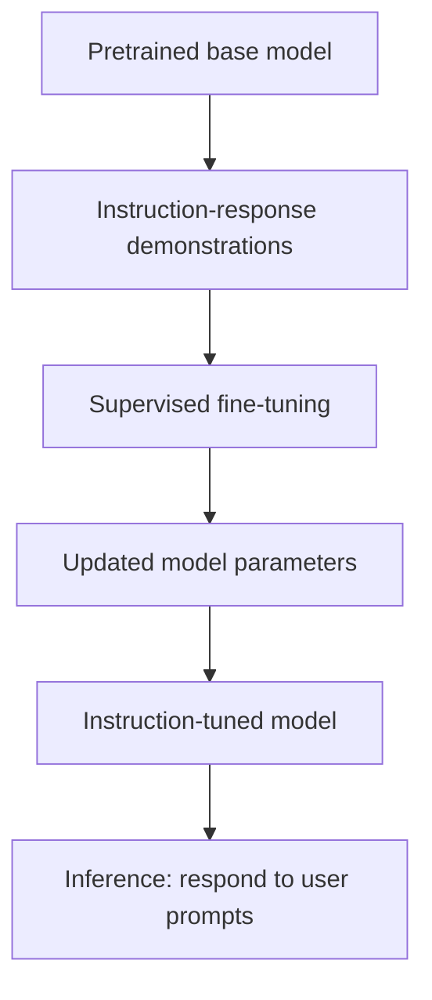
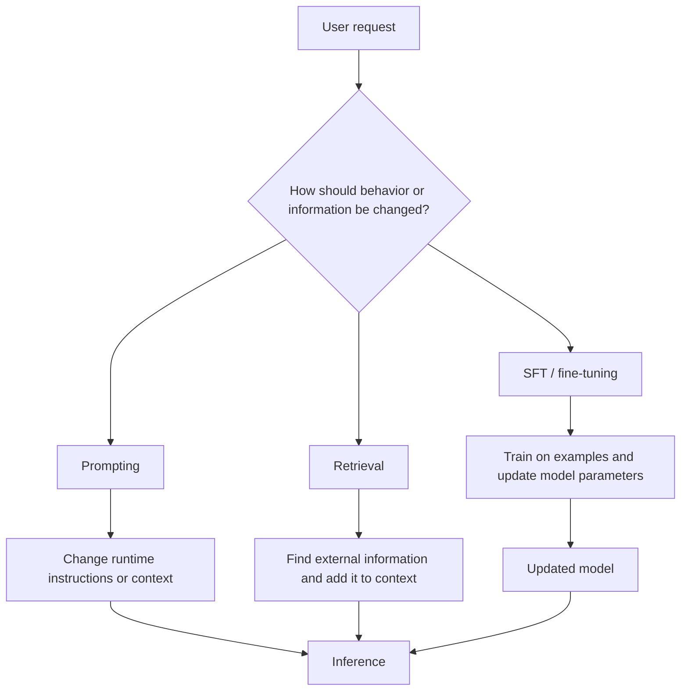

# 03. Instruction Tuning and Supervised Fine-Tuning (SFT)

## Learning Objectives

By the end of this note, you should be able to:

- Compare a base language model with an instruction-tuned model.
- Explain how instruction-response and conversation demonstrations are used in supervised fine-tuning.
- Understand the roles of training examples, chat formatting, and target-response loss masking.
- Identify how demonstration quality and diversity affect model behavior.
- Explain overfitting and possible behavior changes after SFT.
- Distinguish prompting, retrieval, and weight-updating customization.
- Explain why instruction tuning does not guarantee factual accuracy or safe behavior.

> **Scope boundary:** This note explains SFT conceptually. Dataset preparation workflows, LoRA, detailed training configuration, and hands-on fine-tuning belong to **Level 12: Fine-Tuning and Model Customization**.

<br/>

## 1. What Is Instruction Tuning?

**Instruction tuning** is a form of supervised fine-tuning (SFT) that trains a pretrained language model on examples demonstrating how to respond to instructions. The examples typically contain a request or conversation context and a desired response.

The goal is to make the model more likely to follow instructions and produce useful response patterns, such as explanations, summaries, transformations, or structured answers.

SFT is a **training method**: it uses examples, computes a training objective, and updates model parameters. It is not simply a setting changed when a user submits a prompt.

<br/>

### The basic idea

A pretrained model learns broad patterns from large-scale text. Instruction tuning then provides demonstrations of the behavior expected in an assistant-style interaction.



This is a simplified view. Actual model-development pipelines can contain additional stages, and not every model follows the same sequence.

<br/>

## 2. Base Models vs. Instruction-Tuned Models

A **base model** is a model after pretraining, before assistant-oriented instruction tuning. It is generally optimized to continue text according to learned patterns.

An **instruction-tuned model** has undergone additional supervised training on examples that demonstrate desired responses to instructions or conversations.

| Aspect | Base model | Instruction-tuned model |
|---|---|---|
| Primary training emphasis | Broad next-token prediction on pretraining data | Supervised demonstrations of desired instruction-following behavior |
| Typical interaction | May continue text without reliably treating input as a request | More likely to interpret a request and produce an assistant-style answer |
| Output style | Can continue documents, prompts, code, or other text patterns | Often better at explanations, summaries, transformations, and conversational formats |
| Formatting | Depends on learned text patterns and training format | May better follow demonstrated response formats |
| Factual reliability | Not guaranteed | Not guaranteed |
| Safety | Not guaranteed | May improve on behaviors represented in training, but is not guaranteed |
| Best interpretation | General pretrained language model | Model whose behavior has been adapted through demonstrations |

Instruction tuning does not create every capability from nothing. It changes how the pretrained model tends to use its learned representations and produce responses. The effect depends on the demonstrations, model, and training process.

<br/>

## 3. Learning from Demonstrations

An SFT dataset contains examples of the input context and the target response. The training objective encourages the model to assign higher probability to the target response tokens given the preceding context.

### Example: instruction-response pair

**Instruction**

> Explain photosynthesis in two sentences for a beginner.

**Target response**

> Photosynthesis is the process plants use to turn light energy into stored chemical energy. Plants use light, water, and carbon dioxide to produce sugars and release oxygen.

The model is trained on the relationship between the instruction and the desired response. Across many varied examples, it can learn patterns for interpreting requests and producing suitable outputs.

<br/>

### Example: transformation task

**Instruction**

> Convert this sentence to past tense: “She walks to school.”

**Target response**

> She walked to school.

<br/>

### Example: extraction task

**Instruction**

> Extract the city and country from this text: “The conference will take place in Tokyo, Japan.”

**Target response**

```json
{
  "city": "Tokyo",
  "country": "Japan"
}
```

These examples demonstrate desired behavior. A model trained on such examples can still make mistakes on new inputs.

<br/>

## 4. Training Examples and Chat Formatting

Training examples must represent the intended interaction clearly. A conversational example may contain a system message, a user message, and an assistant response. Some datasets also include multiple turns.

A conceptual conversation might look like this:

```text
System: You are a concise programming tutor.
User: What does a Python list store?
Assistant: A Python list stores an ordered collection of items, which can have different types.
```

Real chat models often use a tokenizer-specific chat template with special tokens or markers that distinguish message boundaries and roles. The visible labels above are only a readable illustration; they are not necessarily the literal format used for training.

<br/>

### Why formatting matters

The model must learn which content is instruction or context and which content is the desired assistant response. Inconsistent or malformed formatting can make the training signal ambiguous.

Important concepts include:

- **Message roles:** Identify the source or function of a message, such as system, user, or assistant.
- **Message boundaries:** Mark where messages begin and end.
- **Turn boundaries:** Indicate when an assistant turn is complete or when another interaction follows.
- **Target response:** The text the model is expected to learn to generate.
- **Special tokens:** Model-specific tokens may represent message boundaries, end-of-turn markers, or other control information.

Chat templates vary across models. A template designed for one model should not be assumed to work correctly with another model's tokenizer and training format.

<br/>

## 5. Target-Response Loss Masking

During supervised fine-tuning, the training loss is often calculated on the assistant response tokens rather than every token in the conversation. This is commonly described as **target-response loss masking**.

Consider this simplified example:

```text
User: Translate "Good morning" into French.
Assistant: Bonjour.
```

Conceptually, the user message provides context, while `Bonjour.` is the target response. A training mask can mark which token positions contribute to the loss.

| Segment | Role in the example | Typical loss treatment in response-only SFT |
|---|---|---|
| User instruction | Context | Masked from target loss |
| Assistant response | Desired output | Included in target loss |
| Padding or ignored positions | Batch-formatting support | Usually excluded from loss |

The mask is conceptual and does not prescribe a universal implementation. Some training setups use different masking strategies or train on additional tokens, including selected prompt or conversation tokens.

<br/>

### Why masking can matter

If the goal is to teach the model to generate assistant responses, calculating loss on the intended target response helps focus the supervised signal on that output. Incorrect masks can train the wrong positions or cause the model to learn unintended behavior.

The exact labels, masks, and loss calculation depend on the dataset and training framework. Detailed dataset construction and training implementation are covered in Level 12.

<br/>

## 6. Demonstration Quality and Diversity

SFT can only learn from the signal it receives. Demonstrations should be clear, relevant, internally consistent, and representative of the behavior expected in use.

### 6.1 Quality

Useful demonstrations generally have:

- Correct and well-supported answers.
- Clear instructions and unambiguous target responses.
- Consistent formatting.
- Appropriate depth and tone for the requested task.
- Responses that follow the requested constraints.
- Appropriate handling of uncertainty or missing information.

Poor demonstrations can teach undesirable patterns. For example, if an instruction asks for three bullet points but the response provides a long essay, the example contradicts the intended behavior.

<br/>

### 6.2 Diversity

A dataset should cover meaningful variation in user requests and contexts. Depending on the application, variation may include:

- Different phrasings of the same intent.
- Simple and complex requests.
- Different output formats.
- Relevant languages and writing styles.
- Clear, ambiguous, and underspecified requests.
- Cases where the correct response should state uncertainty or ask for clarification.
- Appropriate refusals or safe redirections for disallowed requests.

A dataset containing only one narrow phrasing may not teach robust behavior across alternative phrasings. Diversity should be relevant to the target use case, not merely a large number of unrelated examples.

<br/>

### 6.3 Consistency

If similar requests receive contradictory target behaviors without a clear reason, the model may learn an unstable pattern. Some variation is legitimate, but differences should be explainable by context, task requirements, or policy.

<br/>

### 6.4 Overfitting

**Overfitting** occurs when a model adapts too closely to its training examples and performs less well on new examples. In SFT, possible symptoms include:

- Reproducing memorized responses rather than adapting them to the request.
- Performing well on familiar examples but poorly on varied phrasings.
- Repeating a narrow style even when the task calls for another format.
- Losing some previously useful behaviors after adaptation.

The right assessment is not whether the model can repeat the training examples. It is whether it performs well on separate, representative evaluation cases.

<br/>

## 7. How SFT Can Change Model Behavior

Instruction tuning can shift the model toward behaviors represented in its demonstrations. For example, it may become more likely to:

- Treat user messages as requests rather than as text to continue.
- Follow specified output formats.
- Provide concise explanations when asked.
- Ask for missing information when examples demonstrate that behavior.
- Use a consistent assistant tone.
- Refuse or redirect certain requests when appropriate examples are present.

These are tendencies, not guarantees. The model may still ignore instructions, over-refuse, follow unsafe requests, provide unsupported claims, or fail on unfamiliar tasks.

SFT can also create regressions. A model adapted heavily to one task or style may become less effective on other tasks. This is one reason to evaluate both improvements and regressions using held-out examples.

<br/>

## 8. Prompting, Retrieval, and Weight-Updating Customization

These approaches solve different problems.

| Approach | What changes? | Best suited for | Main limitation |
|---|---|---|---|
| **Prompting** | The instructions and context supplied at inference time | Changing task, style, constraints, or providing information for a single request | Does not update model weights; context is limited by the model's input capacity |
| **Retrieval** | The information selected from an external source and added to the model's context | Supplying relevant documents or newer, domain-specific information | Retrieval can miss, misrank, or return irrelevant or unauthorized information |
| **SFT / fine-tuning** | Model parameters are updated using training examples | Teaching recurring response patterns, instruction-following behavior, or a desired format | Requires training data and a training workflow; does not guarantee factuality or eliminate failures |

<br/>

### Conceptual comparison



Use prompting when the model already has the required capability and the task can be expressed clearly. Use retrieval when the application needs specific external evidence or information that may change. Consider SFT when consistent behavior across many requests is needed and suitable demonstrations are available.

These methods can be combined. For example, an instruction-tuned model can use a carefully designed prompt and retrieved documents at inference time.

<br/>

## 9. Why Instruction Tuning Does Not Guarantee Accuracy or Safety

SFT optimizes behavior against examples; it does not independently verify every claim or enforce every application policy.

### Factual accuracy limitations

- Demonstrations may contain errors or outdated information.
- The model can generalize incorrectly to unfamiliar questions.
- A polished response can include fabricated details.
- The model may lack access to current or task-specific evidence.

<br/>

### Safety limitations

- The training set may not cover every unsafe or adversarial request.
- Similar-looking requests can require different responses depending on context.
- The model can follow malicious instructions or mishandle untrusted content.
- Safety behavior may be inconsistent across languages, formats, or unusual inputs.

<br/>

### Application-level safeguards

Depending on the use case, reliable applications may need:

- Retrieval from trusted sources and verification of supporting evidence.
- Schema and output validation.
- Deterministic checks for calculations or business rules.
- Access controls and least-privilege tool permissions.
- Input and output safety checks.
- Abstention or clarification when information is insufficient.
- Human review for high-impact decisions.
- Evaluation on adversarial, representative, and out-of-distribution examples.

Model adaptation and application controls serve different purposes. A model's learned preference to behave safely is not the same as a hard application-level enforcement mechanism.

<br/>

## 10. Practice: Draft Instruction-Response Demonstrations

The following examples illustrate how to create a small, consistent set of demonstrations for a beginner-friendly programming assistant. They are conceptual examples, not a fine-tuning dataset ready for production.

### Example A — Clear explanation

**Instruction**

> Explain what a Python dictionary is in two sentences for a beginner.

**Good target response**

> A Python dictionary stores information as key-value pairs. You can use a key to look up its associated value, such as finding a person's age from their name.

**Why it is useful:** It answers the request, matches the audience, and follows the two-sentence constraint.

**Poor alternative**

> Dictionaries are hash tables, and here are twelve advanced details about implementation, collision handling, and memory layout...

**Why it is poor:** It ignores the requested audience and length.

<br/>

### Example B — Constrained output

**Instruction**

> Classify this message as `bug`, `feature_request`, or `other`. Return only the label: “The application crashes when I upload a CSV.”

**Good target response**

```text
bug
```

**Why it is useful:** It uses one of the allowed labels and follows the output constraint.

**Poor alternative**

```text
This sounds like a bug because the application crashes during CSV upload.
Category: bug
```

**Why it is poor:** The explanation may be reasonable, but the output violates the instruction to return only the label.

<br/>

### Example C — Acknowledge missing information

**Instruction**

> What is the result of `x + 5`?

**Good target response**

> What value should `x` have? Once you provide it, I can calculate the result.

**Why it is useful:** The value of `x` is missing, so the response asks for the information needed to answer.

**Poor alternative**

> The answer is 12.

**Why it is poor:** It invents a value for `x` and presents an unsupported result.

<br/>

### Example D — Summarize supplied text

**Instruction**

> Summarize this text in one sentence: “The service was unavailable for 20 minutes on Tuesday. The team restored it after rolling back a faulty deployment.”

**Good target response**

> The service experienced a 20-minute outage on Tuesday and was restored by rolling back a faulty deployment.

**Why it is useful:** It preserves the key facts without adding a cause that was not stated.

**Poor alternative**

> A cyberattack caused a major outage, and the team rebuilt the service.

**Why it is poor:** It invents a cyberattack and changes the described remediation.

<br/>

### Example E — Consistent style across variations

**Instruction 1**

> Explain a Python list in one sentence for a beginner.

**Target response 1**

> A Python list is an ordered collection that can hold multiple items.

**Instruction 2**

> Explain a Python tuple in one sentence for a beginner.

**Target response 2**

> A Python tuple is an ordered collection of items that cannot be reassigned item by item after creation.

**Why the pair is useful:** Both examples follow the same audience and length constraints while preserving the distinction between the concepts.

**Potential issue to avoid:** Copying the same generic definition for both examples would teach a superficial response pattern and could obscure important differences.

<br/>

### Review questions for your demonstrations

For each example, ask:

- Does the response directly satisfy the instruction?
- Is every factual claim supported by the supplied context or reliable knowledge?
- Does the output obey format, length, and style constraints?
- Does the response handle missing information appropriately?
- Is the behavior consistent with similar examples?
- Does the set include enough meaningful variation for the intended use case?

A small set of examples can illustrate a behavior, but it cannot establish that a model will learn that behavior reliably. Evaluation on separate examples is necessary.

<br/>

## 11. Common Misconceptions

- **“Instruction tuning is just a better prompt.”** No. SFT uses training examples and updates model parameters; prompting changes the context supplied at inference time.
- **“A base model cannot follow any instruction.”** Not necessarily. A base model may follow some instructions, but it has not necessarily been adapted specifically for assistant-style behavior.
- **“More demonstrations always improve the model.”** Not if the additional examples are incorrect, inconsistent, low-quality, or poorly matched to the task.
- **“If training loss decreases, behavior must improve.”** Lower training loss alone does not establish generalization or application-level improvement.
- **“Instruction tuning guarantees factual answers.”** No. It shapes response behavior but does not independently verify claims.
- **“Instruction tuning makes a model safe in every situation.”** No. Coverage gaps, conflicting examples, adversarial inputs, and other failure modes remain.
- **“SFT and retrieval are interchangeable.”** No. SFT changes parameters; retrieval supplies external information at runtime.
- **“A chat template is universal.”** No. Message formatting and special tokens can be model-specific.

<br/>

## 12. Key Takeaways

1. Instruction tuning is a form of supervised fine-tuning that teaches response patterns through instruction-response or conversation demonstrations.
2. A base model is broadly pretrained; an instruction-tuned model has undergone additional training intended to improve instruction-following behavior.
3. Chat formatting helps represent roles, message boundaries, and target responses. The exact format depends on the model.
4. Target-response loss masking can focus training loss on assistant output tokens, although implementations vary.
5. Demonstration quality, consistency, and relevant diversity influence learned behavior.
6. Overfitting and regressions are possible, so improvements must be checked on held-out examples.
7. Prompting changes runtime context, retrieval adds external information to that context, and SFT updates model parameters.
8. Instruction tuning does not guarantee factual accuracy, safe behavior, or success on every task.
9. Detailed dataset preparation, LoRA, training configuration, and hands-on fine-tuning are reserved for Level 12.

<br/>

## 13. Checkpoint Questions

1. How does a base model differ from an instruction-tuned model?
2. What information does an instruction-response demonstration provide during SFT?
3. Why does chat formatting matter?
4. What is target-response loss masking, conceptually?
5. How can poor-quality or inconsistent demonstrations affect behavior?
6. What is overfitting in the context of SFT?
7. When might prompting be preferable to SFT? When might retrieval be preferable?
8. Why can an instruction-tuned model still hallucinate or behave unsafely?
9. Why is SFT a training method rather than an inference setting?

<br/>

### Checkpoint answer

Supervised fine-tuning is a training method because it uses labeled demonstrations to calculate a training loss and update model parameters. In contrast, an inference setting—such as a decoding temperature—changes how a response is generated from the current model, without ordinarily updating its weights. A prompt changes the instructions or context for a request, and retrieval supplies external information to that context. None of these runtime actions is, by itself, supervised fine-tuning.

<br/>

## References and Further Reading

- **Level 4 course outline:** `README.md` — intended scope for instruction tuning and SFT.
- **Chapter 01 — Next-Token Prediction:** `01_next_token_prediction.md` — the prediction objective and token-level loss.
- **Chapter 02 — Pretraining and Training Data:** `02_pretraining_and_training_data.md` — corpus preparation and pretraining.
- **Level 12 — Fine-Tuning and Model Customization:** for dataset preparation, LoRA, training configuration, and hands-on fine-tuning.
- Consult the documentation for the selected model and tokenizer for the exact chat template, special tokens, and training conventions.
