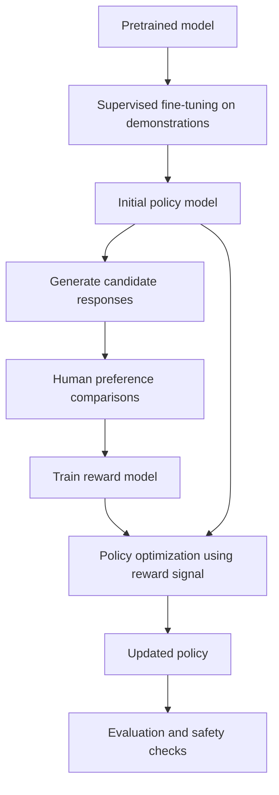
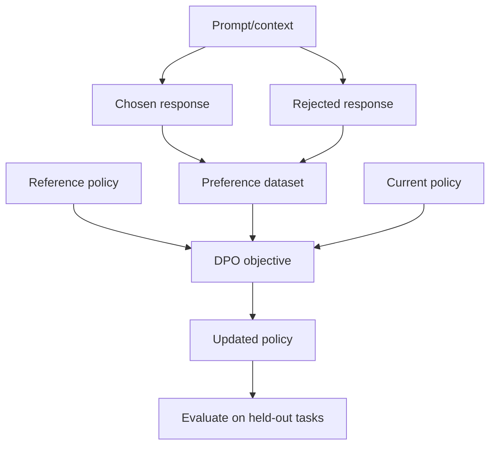

# 04. Preference Optimization and RLHF

## Learning Objectives

By the end of this note, you should be able to:

- Explain preference comparisons and the meaning of chosen and rejected responses.
- Describe a conceptual reinforcement learning from human feedback (RLHF) pipeline.
- Explain the role of demonstrations, preference data, reward models, and policy optimization.
- Describe direct preference optimization (DPO) and how it differs from the standard reward-model-based RLHF pipeline.
- Compare supervised demonstrations with preference feedback.
- Identify risks from annotator disagreement, proxy objectives, reward exploitation, and weak evaluation.
- Explain why real training pipelines may omit, reorder, or replace stages.

<br/>

## 1. What Is Preference Optimization?

Supervised fine-tuning (SFT) teaches a model by providing examples of desired responses. **Preference optimization** uses information about which of multiple responses is preferred, rather than relying only on one target response.

For example, given the same user request, an evaluator may prefer one answer because it is more accurate, relevant, clear, safe, or complete than another. Training can then encourage the model to produce responses that better match the preference signal.

Preference feedback is not automatically objective truth. It reflects the rubric, context, and judgments used to collect it. A preferred response can still contain errors, and different evaluators may disagree.

<br/>


## 2. Chosen and Rejected Responses

A preference dataset commonly stores a prompt or conversation context alongside two candidate responses:

- **Chosen response:** The response preferred under the annotation rubric.
- **Rejected response:** The response judged less preferable under that rubric.

Example:

**Prompt**

> Explain why a Python function might return `None`.

**Response A**

> A Python function returns `None` when it reaches the end without an explicit `return` statement, or when it executes `return` without a value.

**Response B**

> Python functions always return `None`, no matter what the code says.

If the rubric prioritizes correctness and relevance, Response A should be chosen and Response B rejected.

The label means “preferred in this comparison under the rubric,” not “perfect” and “universally correct.”

<br/>

### What a preference record can contain

A conceptual record might include:

```json
{
  "prompt": "Explain why a Python function might return None.",
  "chosen": "A function returns None if it reaches the end without an explicit return value.",
  "rejected": "Python functions always return None, regardless of the code."
}
```

Real datasets may include conversation histories, metadata, annotator identifiers, rubric labels, confidence scores, or more than two candidates. The example is intentionally small.

<br/>

## 3. SFT Demonstrations vs. Preference Feedback

SFT and preference optimization provide different kinds of training signals.

| Aspect | Supervised fine-tuning (SFT) | Preference feedback |
|---|---|---|
| Basic data | Prompt/context with a target response | Prompt/context with comparative judgments about candidate responses |
| Main signal | “Learn to produce this demonstrated response” | “Prefer this response over that response” |
| Typical record | Instruction and desired answer | Prompt, chosen response, rejected response |
| What it directly specifies | A target sequence to learn from | A relative ordering or preference between candidates |
| Ambiguity | The target may not be the only acceptable answer | The preferred response may be better only under a particular rubric or context |
| Common use | Establish instruction-following patterns and response formats | Refine response preferences such as helpfulness or style |

The approaches can complement each other. An SFT stage can establish basic assistant behavior, and preference-based training can refine which responses are favored. However, not every training pipeline uses both, and the sequence is not universal.

<br/>

## 4. A Conceptual RLHF Pipeline

**Reinforcement learning from human feedback (RLHF)** is a family of approaches that uses human preference feedback to guide model behavior. A commonly described pipeline includes supervised demonstrations, preference collection, reward modeling, and policy optimization.



This is a **conceptual, common pipeline**, not a requirement that every RLHF implementation use every stage in exactly this order.

<br/>

### Stage 1 — Demonstrations

Human-written or otherwise curated examples show the model what suitable responses look like. These examples can be used for SFT to create an initial instruction-following policy.

<br/>

### Stage 2 — Preference data

The model or another process produces candidate responses for prompts. Evaluators compare candidates and identify which response is preferred under a rubric.

A comparison is often easier for an evaluator than writing an ideal response from scratch, but preference annotation still requires clear criteria and quality control.

<br/>

### Stage 3 — Reward modeling

In a reward-model-based pipeline, a separate model is trained to predict a score representing how preferred a response is likely to be for a given context.

Conceptually:

$$
r_\phi(x, y) \rightarrow \text{predicted preference score}
$$

where:

- $x$ is the prompt or conversation context.
- $y$ is a candidate response.
- $r_\phi$ is the reward model with parameters $\phi$.

The score is a learned proxy for the collected preferences. It is not a direct measurement of truth, safety, or overall quality.

<br/>

### Stage 4 — Policy optimization

The **policy** is the language model that generates responses. A policy-optimization method adjusts it to favor responses that receive higher reward-model scores, while commonly also constraining how far it moves from a reference policy or applying other controls.

A simplified objective might be described as “increase the reward assigned to generated responses while controlling undesirable changes.” Real objectives include additional mathematical details and implementation-specific constraints.

<br/>

### Stage 5 — Evaluation

The updated model should be evaluated independently. A high reward-model score alone is not sufficient evidence of improvement, because the reward model can be wrong or exploited.

Evaluation should examine task quality, factual accuracy, instruction following, safety, regressions, and performance on examples not used to train the reward model or policy.

<br/>

## 5. Reward Models and Proxy Objectives

A reward model learns from preference labels to estimate which responses evaluators are likely to prefer. It makes preference optimization scalable, but introduces a critical limitation: **the learned reward is a proxy for the desired behavior, not the desired behavior itself**.

Suppose annotators tend to prefer concise answers. A reward model may learn to favor short responses. If policy optimization pushes this too far, the model might produce answers that are concise but incomplete.

Other proxy failures can include:

- Rewarding confident wording instead of factual support.
- Favoring a particular style over substantive correctness.
- Overvaluing keywords associated with preferred responses.
- Penalizing appropriate uncertainty because decisive answers were preferred in the training data.
- Missing subtle safety issues that the annotators or reward model do not recognize.

A reward model can generalize imperfectly beyond the comparisons on which it was trained. Its scores should not be treated as universal quality measurements.

<br/>

## 6. Direct Preference Optimization (DPO)

**Direct Preference Optimization (DPO)** is a preference-based training method that uses chosen and rejected responses to optimize the policy directly, relative to a reference policy in its standard formulation. It does not require training a separate reward model as an explicit intermediate component in the standard DPO approach.

At a high level, DPO trains the model to increase the relative preference for chosen responses over rejected responses while using a reference model to help constrain the update.



The diagram omits the mathematical details of the objective. The key distinction is the training path: standard reward-model-based RLHF explicitly learns a reward model and uses a policy-optimization stage, whereas DPO directly uses preference pairs in its optimization objective.

DPO is not “training without a signal.” It still relies on preference labels and can inherit their biases, ambiguity, and limitations.

<br/>

### High-level comparison

| Aspect | Reward-model-based RLHF | Standard DPO |
|---|---|---|
| Preference data | Used to train a reward model | Used directly in the preference objective |
| Separate reward model | Typically present | Not required as a separately trained intermediate model |
| Policy update | Uses a reward signal in a policy-optimization procedure | Directly optimizes chosen-versus-rejected preferences relative to a reference policy |
| Engineering considerations | Reward-model training and policy optimization add components and complexity | Often has a simpler conceptual pipeline, though training still requires careful setup |
| Main limitation | Reward model can misrepresent the intended objective and be exploited | Preference data and objective can still produce unwanted behavior or fail to generalize |

These are high-level distinctions. Implementations and research methods vary, and some approaches combine elements from multiple methods.

<br/>

## 7. Annotator Disagreement and Ambiguous Preferences

People may disagree about which response is better because they interpret the request differently or value different qualities.

For example:

**Prompt**

> Explain neural networks briefly.

**Response A**

> Neural networks are computational models made of connected units that learn patterns from data.

**Response B**

> Neural networks are layered mathematical systems that adjust parameters during training to approximate relationships in data.

Both responses may be acceptable. Response A is simpler; Response B is more technical. Which is preferred depends on the intended audience and rubric.

<br/>

### Sources of disagreement

- Different assumptions about the user's expertise.
- Different priorities, such as brevity versus completeness.
- Ambiguous or underspecified prompts.
- Cultural or linguistic differences.
- Uneven domain expertise.
- Rubrics that fail to define what “better” means.
- Genuine uncertainty about the facts.

<br/>

### Ways to improve preference-data quality

- Use explicit, task-relevant rubrics.
- Train annotators on examples and edge cases.
- Allow ties or “cannot determine” labels when appropriate.
- Collect multiple judgments for selected comparisons.
- Review disagreement patterns instead of blindly averaging all labels.
- Separate factual correctness from style preferences where possible.
- Track provenance and relevant annotation metadata.

Disagreement is not always noise. It can reveal that a task has multiple valid responses or that the rubric needs clarification.

<br/>

## 8. Reward Exploitation and Optimization Risks

**Reward exploitation** occurs when a policy learns to obtain high reward scores without reliably achieving the underlying goal. This is related to the broader problem of optimizing a proxy objective.

For example, if a reward model systematically favors answers that sound confident, a policy might learn to produce confident answers even when evidence is missing.

Potential warning signs include:

- Reward scores improve while human-rated task quality does not.
- The model becomes more verbose or more formulaic without better answers.
- The model learns superficial cues associated with high scores.
- Factuality, diversity, or safety regresses as reward increases.
- The model behaves well on familiar evaluation prompts but fails on varied inputs.

<br/>

### Mitigation principles

- Evaluate with human judgments and objective task-specific tests.
- Use held-out prompts and adversarial cases.
- Monitor both intended improvements and regressions.
- Audit reward-model errors and annotation quality.
- Include factuality and safety criteria where relevant.
- Avoid treating one scalar score as a complete definition of quality.
- Reassess the rubric when optimization produces unexpected behavior.

These measures reduce risk but do not guarantee that reward exploitation can be eliminated.

<br/>

## 9. Training Pipelines Are Not Universal

It is useful to understand the common RLHF sequence, but real model-development pipelines differ.

For example:

- A model may use SFT without any preference optimization.
- A preference-optimization method may not train a separate reward model.
- A pipeline may use synthetic preferences, human preferences, or a mixture.
- Additional filtering, safety training, or evaluation may occur at different stages.
- Researchers may alternate or combine training methods.

Therefore, do not infer a model's exact training procedure from the label “instruction-tuned” or “aligned.” Consult its technical documentation when the specific training process matters.

<br/>

## 10. Practice: Rank Response Pairs with a Rubric

### Rubric

Score each response from 1 to 5 on the following criteria:

| Criterion | What to assess |
|---|---|
| Correctness | Are factual or technical claims accurate? |
| Relevance | Does the response answer the request? |
| Clarity | Is it understandable for the intended audience? |
| Completeness | Does it cover the necessary information without irrelevant detail? |
| Safety and uncertainty | Does it avoid unsupported claims and handle uncertainty appropriately? |

For a quick exercise, use the rubric to choose a preferred response. In real annotation work, define how scores are combined, when one criterion takes priority, and when responses should be marked tied or ambiguous.

<br/>

### Pair 1 — Technical correctness

**Prompt:** What does `len([3, 5, 7])` return in Python?

**Response A**

> It returns `3`, because the list contains three elements.

**Response B**

> It returns `21`, because the numbers add up to 21.

**Suggested preference:** Choose **A**. It is correct and directly answers the question. B confuses list length with the sum of its elements.

<br/>

### Pair 2 — Following constraints

**Prompt:** Explain an API in one sentence for a beginner.

**Response A**

> An API is a defined way for software systems to communicate and request services or data from one another.

**Response B**

> An API is a way for software to communicate. There are many types of APIs. REST is common. GraphQL is another approach. Here are ten more details...

**Suggested preference:** Choose **A** under a rubric that strongly values following the one-sentence constraint. B contains relevant information but violates the requested format.

<br/>

### Pair 3 — Avoiding unsupported certainty

**Prompt:** My application is slow. What is the cause?

**Response A**

> The cause is definitely your database.

**Response B**

> There are several possible causes, including database queries, network latency, CPU or memory pressure, and inefficient application code. Profiling and logs can help narrow it down.

**Suggested preference:** Choose **B**. The prompt does not provide enough evidence to identify a definite cause. B gives plausible hypotheses and a useful next step without pretending certainty.

<br/>

### Pair 4 — Ambiguous preferences

**Prompt:** Explain neural networks briefly.

**Response A**

> Neural networks are computational models made of connected units that learn patterns from data.

**Response B**

> Neural networks are layered mathematical systems that adjust parameters during training to approximate relationships in data.

**Discussion:** Both may be good. A may be preferable for a beginner; B may be preferable for a technically experienced reader. If the intended audience is unspecified, the comparison may be ambiguous. A robust annotation process should record the ambiguity rather than inventing a universal winner.

<br/>

### Pair 5 — Correctness versus style

**Prompt:** What is the purpose of a Python `return` statement?

**Response A**

> It sends a value back to the caller and ends the current function execution.

**Response B**

> It elegantly and magically makes a function finish its work.

**Suggested preference:** Choose **A**. It provides a useful technical explanation. B may sound friendly, but it is imprecise and omits the central behavior.

<br/>

### Practice worksheet

For each pair:

1. Identify the prompt's requirements.
2. Score each response using the rubric.
3. Choose a preferred response, or mark the pair ambiguous.
4. State the decisive reason for the preference.
5. Identify any weakness in the chosen response.
6. Explain how a different rubric could change the ranking.

The goal is not to assume every pair has an obvious winner. The goal is to make preference judgments explicit, consistent, and tied to the intended task.

<br/>

## 11. Common Misconceptions

- **“Preference labels identify objectively correct answers.”** They record comparative judgments under a rubric; the chosen response may still be wrong.
- **“RLHF always follows one fixed pipeline.”** Common descriptions include SFT, preference collection, reward modeling, and policy optimization, but implementations vary.
- **“A reward model measures true quality.”** It predicts a learned preference signal and can be incomplete or biased.
- **“DPO is the same as reward-model-based RLHF.”** Standard DPO uses preference pairs directly in its objective without requiring a separately trained reward model as an intermediate stage.
- **“More optimization always means better alignment.”** Optimization can amplify flaws in the proxy objective and cause regressions.
- **“Annotator disagreement should always be removed.”** Disagreement can reveal ambiguity, multiple valid responses, or a weak rubric.
- **“A high reward score proves the model is safe.”** Reward scores need independent evaluation and do not establish safety by themselves.
- **“SFT and preference optimization provide identical signals.”** SFT learns from target demonstrations; preference optimization learns from relative judgments between candidate responses.

<br/>

## 12. Key Takeaways

1. Preference optimization uses comparative judgments, commonly represented as chosen and rejected responses.
2. SFT demonstrates a target response; preference feedback expresses a relative preference between alternatives.
3. A common RLHF pipeline uses demonstrations, preference data, a reward model, and policy optimization.
4. A reward model is a proxy for human preferences, not a universal measure of correctness or safety.
5. DPO directly uses preference pairs in its standard objective and does not require a separately trained reward model as an intermediate component.
6. Annotator disagreement can expose ambiguous prompts, differing values, or unclear rubrics.
7. Reward exploitation can occur when a model optimizes the proxy rather than the intended outcome.
8. Evaluation must test actual task quality and monitor regressions; a reward score alone is insufficient.
9. Real training pipelines vary and may omit, reorder, or combine stages.

<br/>

## 13. Checkpoint Questions

1. What do “chosen” and “rejected” mean in a preference dataset?
2. How does preference feedback differ from a supervised demonstration?
3. What are the conceptual stages of a common reward-model-based RLHF pipeline?
4. What does a reward model estimate, and why is it only a proxy?
5. How does standard DPO differ from reward-model-based RLHF?
6. Why might two annotators reasonably prefer different responses?
7. What is reward exploitation?
8. Why should evaluation continue after preference optimization?
9. Why is it incorrect to assume every model follows the same training pipeline?

<br/>

### Checkpoint answer

SFT trains on demonstrations of desired responses. In a common reward-model-based RLHF pipeline, evaluators compare candidate responses, a reward model learns to predict those preferences, and a policy-optimization method uses the reward signal to update the language model. Standard DPO instead optimizes chosen-versus-rejected preferences directly relative to a reference policy, without requiring a separately trained reward model as an intermediate component. All methods depend on the quality and coverage of their training signals, so independent evaluation is necessary.

<br/>

## References and Further Reading

- **Level 4 course outline:** `README.md` — intended scope for preference optimization and RLHF.
- **Chapter 03 — Instruction Tuning and SFT:** `03_instruction_tuning_and_sft.md` — supervised demonstrations and model adaptation.
- Consult the technical report and training documentation for a specific model when determining which preference-optimization method it used. Do not assume a single universal pipeline.
