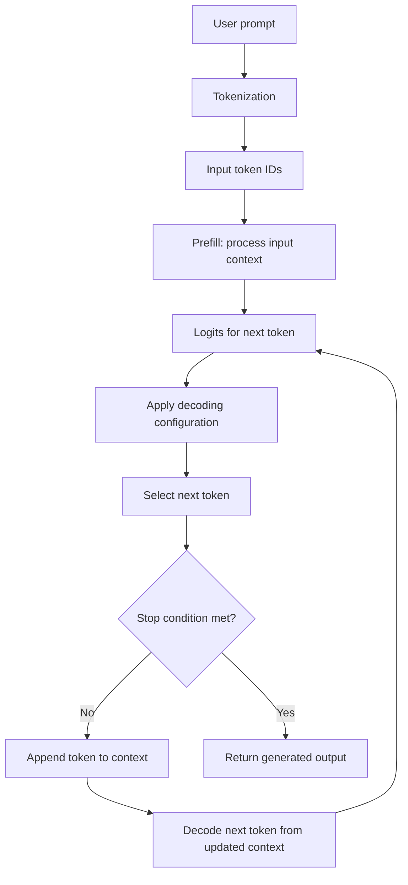
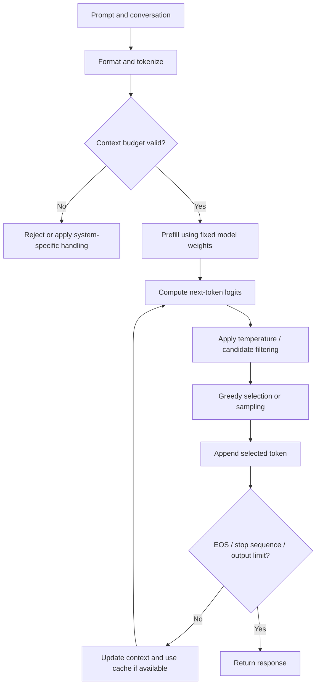

# 06. Inference and Decoding Overview

## Learning Objectives

By the end of this chapter, you should be able to:

- Trace a text-generation request from tokenization through repeated token generation.
- Distinguish a model's learned weights from request-time generation settings.
- Explain logits, token probabilities, and the role of decoding algorithms.
- Separate context-window limits, output-token limits, and stopping conditions.
- Identify why reproducibility depends on both explicit configuration and implementation details.
- Annotate an inference pipeline and explain why changing sampling settings does not retrain a model.

 

## 1. What Is Inference?

**Inference** is the process of using an already-trained model to produce an output for a particular input. For an autoregressive language model, the input prompt is converted into tokens, the model processes the available context, and a decoding strategy selects the next token. The selected token is added to the context, and generation repeats until a stopping condition is reached.

Inference does not update the model's learned weights during ordinary generation. It uses those weights to compute predictions for the current request.

 

### Training, inference, and decoding

| Concept | Meaning | What changes? |
|---|---|---|
| Training | Optimizes model parameters from training examples | Model weights are updated |
| Inference | Uses trained parameters to process a request | Usually no weight updates |
| Decoding | Converts the model's next-token scores into a token choice | The selection procedure/configuration may vary |

Decoding is part of the inference process. It determines how the model's predicted next-token distribution is turned into the next generated token.

 

## 2. The End-to-End Inference Flow

A simplified autoregressive generation pipeline is:

The flow is simplified: production systems may add request validation, chat-template formatting, batching, caching, streaming, safety checks, and post-processing.

 

### Stage 1 — Prepare and tokenize the request

The system may format a conversation into the model's expected message structure and then tokenize it. Tokenization converts text into token IDs. A token may be a whole word, part of a word, punctuation, whitespace, or another text unit.

The model processes token IDs rather than raw human-readable text. Tokenization affects the number of tokens used by the prompt and therefore matters for context budgeting.

 

### Stage 2 — Prefill the prompt

**Prefill** is the phase in which the model processes the input prompt/context. It computes internal representations for the prompt and produces the scores needed to predict the next token. Implementations commonly also populate a key-value (KV) cache so that later generation steps can reuse prior attention computations.

Prefill work depends substantially on prompt length. A long prompt can make the first generated token take longer to arrive.

 

### Stage 3 — Produce logits

The model produces a vector of **logits** for the next-token vocabulary. A logit is an unnormalized score, not a probability. Higher logits generally indicate tokens that the model scores more strongly before decoding transformations.

For logits $z_i$, a common conversion to probabilities is softmax:

$$
P(x_i) = \frac{e^{z_i}}{\sum_j e^{z_j}}
$$

For example, if three candidate tokens have logits \([2.0, 1.0, 0.0]\), their softmax probabilities are approximately \([0.665, 0.245, 0.090]\). These are illustrative values, not a prediction for any specific model.

 

### Stage 4 — Apply decoding settings and select a token

The decoding procedure takes the model's scores and chooses a next token. Depending on the algorithm and settings, it may:

- Select the highest-scoring token (greedy decoding).
- Sample from the probability distribution.
- Restrict candidates using top-k or nucleus (top-p) sampling.
- Adjust the distribution with a temperature parameter.
- Use other implementation-specific rules.

These settings influence **how the next token is selected**. They do not, by themselves, change the model's learned weights.

 

### Stage 5 — Append the token and repeat

The selected token is appended to the sequence. The model then predicts another token conditioned on the updated context. This autoregressive loop continues until generation ends.

For many decoder-only models, the next step can use cached key/value states rather than recomputing all prior tokens from scratch. Exact cache behavior depends on the model and inference implementation.

 

### Stage 6 — Stop and return the output

Generation can stop because:

- The model emits an end-of-sequence (EOS) token.
- A configured stop sequence is encountered.
- The output-token budget is reached.
- The serving system cancels or otherwise terminates the request.
- Another implementation-specific stopping condition is triggered.

The exact precedence among stopping conditions can vary by API or runtime. Do not assume that all systems handle every condition identically.

 

## 3. Model Weights vs Request-Time Configuration

These are distinct categories.

| Model weights | Request-time generation configuration |
|---|---|
| Learned parameters produced by training or fine-tuning | Settings supplied when generating a response |
| Encode learned statistical patterns and representations | Control token selection and generation limits |
| Change when the model is trained or fine-tuned | Can often change from one request to another |
| Shared by requests using the same model version, unless different versions/adapters are selected | May include temperature, top-p, top-k, maximum output tokens, stop sequences, and seed where supported |

For example, a model may be served with temperature `0.2` for one request and `0.9` for another. This changes the decoding behavior, not the training history or stored parameters.

**Important distinction:** A serving system can also select a different model version, adapter, quantized artifact, or system prompt. Those are not equivalent to changing temperature. The term “configuration” is broad, so identify exactly which setting is being changed.

 

## 4. Output-Token Probabilities and Decoding Algorithms

The model's logits define scores over the vocabulary. A probability distribution can be derived from these scores, but the distribution alone does not specify the final output: the decoding algorithm determines how a token is selected.

### Common decoding approaches

- **Greedy decoding:** Selects the token with the highest current score/probability. It is straightforward and often deterministic for fixed inputs and implementation, but can produce repetitive or locally optimal continuations.
- **Sampling:** Randomly draws a token according to a probability distribution. It can produce varied outputs; results may differ across runs.
- **Temperature:** Rescales logits before converting them to probabilities. Lower temperature sharpens the distribution; higher temperature generally flattens it. Exact supported ranges and behavior depend on the runtime.
- **Top-k sampling:** Restricts selection to the \(k\) highest-ranked candidate tokens before sampling.
- **Top-p (nucleus) sampling:** Restricts selection to a smallest high-probability candidate set whose cumulative probability reaches the configured threshold, subject to implementation details.
- **Beam search:** Maintains multiple candidate sequences and expands them according to a scoring rule. It is useful in some sequence-generation tasks but is not the default choice for every conversational LLM.

These methods are not interchangeable. The appropriate choice depends on the task, quality criteria, latency budget, and serving implementation. More randomness does not automatically mean better quality, and greedy decoding is not guaranteed to be best.

 

## 5. Context Limits, Generation Limits, and Stopping Behavior

Three controls are often confused:

### Context-window limit

The **context window** is the maximum amount of token context a model/runtime can handle for a request. Depending on the system, input tokens and generated tokens may both count toward the applicable context budget.

If the prompt is too long, the application may reject it, truncate it, summarize it, or use another strategy. The behavior is implementation-dependent.

 

### Maximum output-token limit

The **maximum output-token limit** caps how many new tokens the model may generate for the request. It is a generation budget, not a promise that the model will use all of those tokens.

A response can finish before reaching this limit because the model emits EOS or a stop sequence is detected.

 

### Stop sequences and end-of-sequence tokens

An **EOS token** is a special token the model may emit to signal the end of generation. A **stop sequence** is a configured text/token pattern that tells the serving system to stop when the pattern is matched. They are related stopping mechanisms, but they are not necessarily the same thing.

 

### Quick comparison

| Control | Main question it answers | Example of its effect |
|---|---|---|
| Context window | How much context can be processed? | A long conversation may exceed the allowed context |
| Output-token limit | How much new text may be generated? | A response may be cut off at the budget |
| EOS / stop sequence | When should generation end? | A response ends as soon as a recognized stop condition occurs |

A context window is not the same as an output limit. Likewise, a maximum output-token value does not force the model to generate that many tokens.

 

## 6. Configuration and Reproducibility

Reproducibility means being able to obtain or explain consistent results under a specified setup. It requires more than recording a model name.

Useful information to record includes:

- Exact model identifier and version/revision.
- Prompt and conversation formatting, including system instructions and chat template where applicable.
- Tokenizer/version when separately versioned.
- Decoding algorithm and supported parameters, such as temperature, top-p, and top-k.
- Maximum output-token limit and stop sequences.
- Random seed, if the runtime supports one.
- Runtime/provider and relevant implementation version.
- Any quantization, adapter, or other model artifact selection.
- Whether generation was batched or served through a configuration that could affect execution.

Even with the same seed and nominal parameters, outputs may not be perfectly reproducible across different providers, hardware, kernels, software versions, or batching arrangements. Some services may ignore, transform, or not expose certain parameters. Defaults can differ, and defaults can change over time.

**Practical rule:** Explicitly set the parameters that matter, record the environment, and test repeatability in the actual serving stack. Do not assume that the same parameter name has identical behavior everywhere.

 

## 7. Annotated Inference Flow: Where Settings Apply

The diagram below identifies the main configuration points. The model's learned weights are used throughout inference; decoding settings are applied after the model produces next-token scores and before the next token is selected. Token and stop limits govern how long the loop continues.

 

### Where each setting belongs

- **Tokenizer and prompt format:** Before model computation.
- **Context budget:** Validated or enforced around input preparation and throughout generation as the context grows.
- **Model weights:** Used for prefill and every next-token prediction.
- **Temperature, top-k, top-p, and selection algorithm:** Applied at the decoding stage after logits are produced, according to the runtime's implementation.
- **Maximum output tokens and stop sequences:** Enforced across the generation loop.
- **Seed:** If supported, influences the random choices made by sampling; it does not retrain the model.

 

## 8. Worked Example

Suppose a model assigns these illustrative logits to three possible next tokens:

| Token | Logit | Approximate softmax probability |
|---|---:|---:|
| `A` | 2.0 | 0.665 |
| `B` | 1.0 | 0.245 |
| `C` | 0.0 | 0.090 |

With greedy decoding, token `A` is selected because it has the highest score. With sampling, `A` is the most likely choice, but `B` or `C` can still be selected. Temperature or candidate filtering may change the distribution or the set of eligible tokens before selection.

After selecting a token, the model processes the updated sequence to produce a new set of logits. The probabilities in the table apply only to this illustrative next-token decision; they do not describe the probability of an entire completed response.

 

## 9. Practical Checklist

Before comparing two inference runs, check:

1. Are the model identifier and revision the same?
2. Are the prompt, chat template, and tokenizer behavior the same?
3. Are the decoding algorithm and its parameters explicitly specified?
4. Are output-token limits and stop conditions the same?
5. Are seed support and runtime defaults documented?
6. Are provider, runtime, model artifact, and quantization details comparable?
7. Is the comparison based on multiple runs when sampling introduces variability?

If outputs differ, investigate these variables before concluding that the model's learned capabilities have changed.

 

## 10. Common Misconceptions

- **“Increasing temperature trains the model to be more creative.”** No. It changes the probability distribution used during token selection; it does not update the model weights.
- **“The model always picks the highest-probability token.”** No. Sampling and other decoding methods may choose a different candidate.
- **“Maximum output tokens means the response will contain exactly that many tokens.”** No. It is usually a cap.
- **“Context window and output-token limit mean the same thing.”** No. One concerns available context; the other caps newly generated tokens.
- **“The same parameter values guarantee identical output everywhere.”** No. Runtime defaults, implementations, model versions, and random-number handling can differ.
- **“A stop sequence is necessarily an EOS token.”** No. A stop sequence may be a serving-layer rule, while EOS is a model token.

 

## 11. Practice

### Exercise 1 — Annotate the pipeline

For each item, identify where it acts: before model computation, during model computation, after logits/before token selection, or as a stopping/budget rule.

- Tokenization
- Model weights
- Temperature
- Top-p
- Maximum output tokens
- Stop sequence
- Context-window limit

 

### Exercise 2 — Explain the difference

A request uses the same model version and prompt but changes temperature from `0.2` to `0.8`. What changed, and what did not?

 

### Exercise 3 — Diagnose a mismatch

Two teams use the same model name and temperature but obtain different outputs. List at least four other settings or implementation details they should compare.

 

### Exercise 4 — Identify the limit

A generation stops after 80 new tokens even though the output limit is 300. Give two plausible reasons.

 

### Exercise 5 — Short-answer checkpoint

Why does changing sampling settings not retrain the model?

 

## 12. Answers and Checkpoint Review

### Exercise 1 — Suggested annotation

| Item | Where it acts |
|---|---|
| Tokenization | Before model computation |
| Model weights | During prefill and next-token prediction |
| Temperature | After logits, before token selection |
| Top-p | After logits, before token selection |
| Maximum output tokens | Stopping/budget rule across generation |
| Stop sequence | Stopping rule across generation |
| Context-window limit | Input validation and context-budget enforcement |

 

### Exercise 2 — Suggested answer

The temperature setting changed, so the distribution used for token selection may become flatter at `0.8` than at `0.2`, generally allowing lower-ranked tokens more influence. The learned model weights and training history did not change. Exact effects depend on the runtime's implementation.

 

### Exercise 3 — Suggested answer

Compare the exact model revision, prompt and chat template, tokenizer, top-p/top-k settings, output-token limit, stop sequences, random seed behavior, provider/runtime version, quantization or adapter, and batching behavior.

 

### Exercise 4 — Suggested answer

The model may have emitted EOS, or the serving system may have matched a configured stop sequence. Other implementation-specific cancellation or stopping conditions are also possible.

 

### Exercise 5 — Checkpoint answer

Sampling settings are request-time controls applied to the model's output scores during decoding. They alter how a next token is selected from the model's predictions, but do not perform gradient updates or modify the stored learned weights. Retraining or fine-tuning requires an optimization process that updates model parameters.

 

## Summary

Inference uses a trained model to generate a response through tokenization, prefill, logits, decoding, token selection, and repeated generation. Model weights represent learned parameters; decoding settings govern how the next token is selected at request time. Context limits, output budgets, and stop conditions have different roles. Reproducible comparisons require recording the model, prompt, decoding parameters, limits, and implementation environment. Changing sampling settings changes generation behavior—not the model's training.
