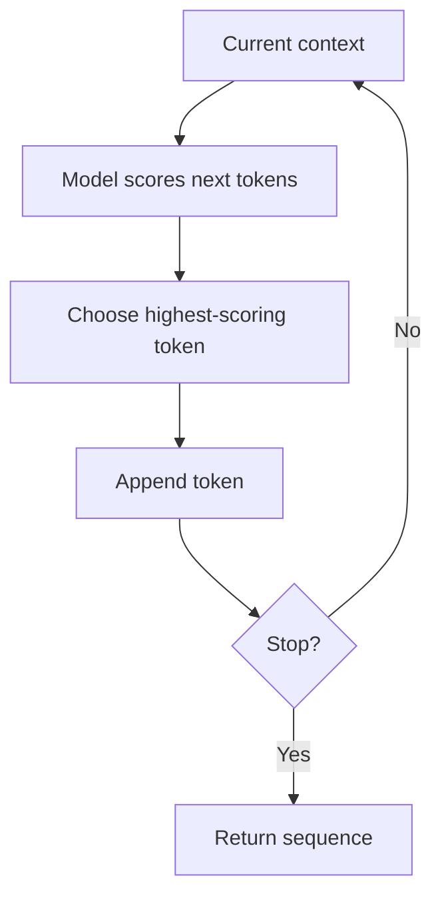
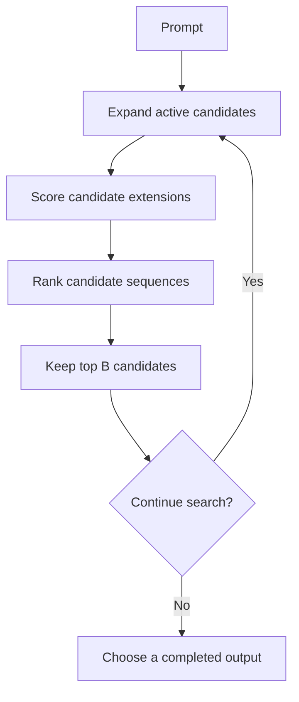
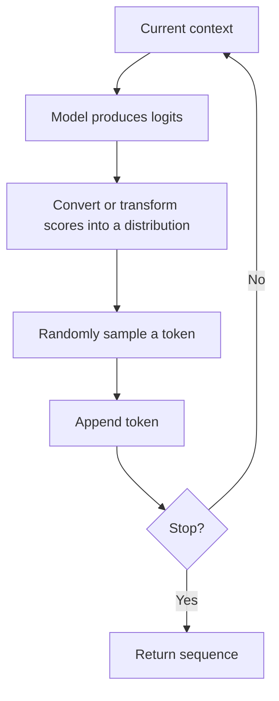
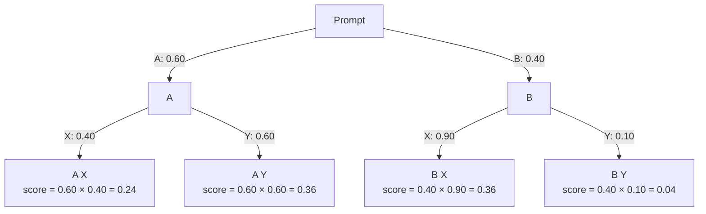

# 07. Greedy Decoding, Beam Search, and Sampling

## Learning Objectives

By the end of this chapter, you should be able to:

- Explain greedy decoding as selecting the highest-probability next token at each step.
- Trace beam search as keeping multiple candidate sequences alive during generation.
- Understand sequence scoring, length effects, and the computational cost of broader search.
- Explain sampling from a next-token probability distribution.
- Compare the methods in terms of determinism, diversity, repetition, runtime, and task suitability.
- Explain why beam search is not universally available or preferable for conversational LLM generation.
- Distinguish a local next-token decision from search over multiple candidate sequences.

 

## 1. The Core Difference

Autoregressive language models generate a sequence one token at a time. At each step, the model provides scores for possible next tokens. A decoding algorithm determines which token or candidate continuation to keep.

The central distinction is the scope of the decision:

- **Greedy decoding** makes the best-scoring local choice at the current step and commits to it.
- **Beam search** keeps several promising partial sequences and expands them over multiple steps.
- **Sampling** randomly selects a token from a probability distribution, allowing different continuations to be generated.

These algorithms use the model's predictions; they do not retrain the model or change its learned weights.

 

## 2. Greedy Decoding

**Greedy decoding** chooses the highest-probability (equivalently, highest-logit when no score transformations change the ranking) next token at every generation step.

$$
x_t = \arg\max_x P(x \mid x_1,\ldots,x_{t-1}, \text{prompt})
$$

The chosen token is appended to the context, and the model predicts the next token.

 

### Example

Suppose the model gives the following probabilities for the next token:

| Candidate token | Probability |
|---|---:|
| `the` | 0.50 |
| `a` | 0.30 |
| `one` | 0.20 |

Greedy decoding selects `the`. It does not consider whether choosing `a` might lead to a better overall sequence later. Once `the` is selected, the next decision is made using the updated context.

 

### Strengths

- Simple and generally computationally efficient.
- Predictable for a fixed model, prompt, configuration, and deterministic implementation.
- Useful when a stable, high-probability continuation is desirable.

 

### Limitations

- It optimizes the next-token choice locally, not necessarily the quality or probability of the complete sequence.
- An early choice can rule out a continuation that would have scored better overall.
- It can produce repetitive, bland, or overly predictable text.
- Determinism is not guaranteed across all serving implementations; tie-breaking, numerical differences, and system-level details can matter.

Greedy decoding is not the same as selecting the globally most probable complete sequence.

 

## 3. Beam Search

**Beam search** retains a fixed number of promising partial sequences—called the **beam width**—rather than committing to just one sequence at every step.

At each expansion step, the algorithm conceptually:

1. Takes each active candidate sequence.
2. Scores possible next-token extensions.
3. Combines the extensions into a pool of candidates.
4. Ranks candidates using a sequence-scoring rule.
5. Keeps the best `B` candidates, where `B` is the beam width.
6. Repeats until candidates finish or a stopping condition is met.

A beam width of `1` resembles greedy search under a compatible scoring setup. A larger beam width allows the algorithm to preserve alternatives that may become more competitive after additional tokens.

 

### A small conceptual example

Assume the prompt is `We should`. The first-step candidate probabilities are:

| Next token | Probability |
|---|---:|
| `leave` | 0.55 |
| `wait` | 0.35 |
| `go` | 0.10 |

With greedy decoding, the algorithm selects `leave` and discards the other first-token options.

With beam width \(B=2\), the algorithm initially retains `leave` and `wait`. It then expands both candidates using the model's next-token predictions and compares the resulting partial sequences.

For example, `leave now` might have a strong combined score, while `wait here` might remain competitive. Beam search preserves both paths long enough to compare their accumulated sequence scores. The example is conceptual: the actual ranking depends on the conditional probabilities and scoring rule at each step.

 

## 4. Sequence Scoring and Length Effects

For an autoregressive model, the probability of a sequence can be expressed as a product of conditional next-token probabilities:

$$
P(x_{1:T}\mid \text{prompt}) =
\prod_{t=1}^{T} P(x_t \mid x_{<t}, \text{prompt})
$$

Taking logarithms converts the product into a sum:

$$
\log P(x_{1:T}\mid \text{prompt}) =
\sum_{t=1}^{T} \log P(x_t \mid x_{<t}, \text{prompt})
$$

Because each token probability is at most one, its log probability is non-positive. Longer sequences accumulate more log-probability terms, so raw sequence log probability often favors shorter sequences when comparing candidates of different lengths. This is one reason some beam-search implementations use a **length penalty** or another length-normalization rule.

Important details:

- The exact scoring formula is implementation-dependent.
- Length normalization can change which candidate ranks first.
- A length penalty does not guarantee a semantically better or more complete answer.
- Search optimizes the configured score, which is only a proxy for task quality.

Beam search therefore does not guarantee the best human-rated answer or the globally best sequence under every possible scoring definition.

 

## 5. Search Costs and Runtime

Beam search generally costs more than greedy decoding because it maintains and expands multiple candidates. Increasing beam width can increase computation and memory requirements, although the exact cost depends on batching, caching, implementation, and stopping behavior.

| Method | Search behavior | Typical computational implication |
|---|---|---|
| Greedy | One active continuation | Usually lower search overhead |
| Beam search | Multiple active continuations | More candidate scoring and state to maintain as beam width grows |
| Sampling | Usually one sampled continuation per output sequence | Similar autoregressive loop to greedy, with additional selection work; generating multiple samples multiplies work |

All three methods still rely on autoregressive generation in the common setup. The model must produce next-token predictions repeatedly; beam search adds the work of managing alternative paths.

A wider beam is not automatically better. It can improve search under a scoring objective, but it may also increase latency and favor repetitive or unnatural outputs in some tasks.

 

## 6. Sampling

**Sampling** selects a token randomly according to a probability distribution over possible next tokens. A token with higher probability is more likely to be selected, but a lower-probability token may also be chosen.

 

### Example

Suppose the distribution is:

| Token | Probability |
|---|---:|
| `bright` | 0.60 |
| `clear` | 0.25 |
| `warm` | 0.15 |

A sampling run may select `bright`, but it can select `clear` or `warm` as well. The probabilities describe relative chances for the current next-token decision, not guarantees about a full response.

Sampling can create diverse outputs from the same prompt. The exact amount of diversity depends on the distribution, any temperature or candidate-filtering settings, and the random-number implementation.

 

### Strengths

- Supports variation and multiple plausible continuations.
- Useful for open-ended generation, brainstorming, and creative tasks where diversity can be valuable.
- Can avoid always taking the same locally highest-probability path.

 

### Limitations

- Repeated runs may produce different outputs.
- A sampled token can be less suitable or less coherent than the highest-probability alternative.
- Excessive randomness can reduce consistency or factual reliability.
- A seed may improve repeatability when supported, but does not guarantee identical results across different runtimes or versions.

Sampling is not synonymous with “uncontrolled randomness”: it samples from a model-defined distribution, often after decoding transformations.

 

## 7. Comparison of the Three Methods

| Dimension | Greedy decoding | Beam search | Sampling |
|---|---|---|---|
| Basic decision | Highest-scoring next token | Keep and expand several candidate sequences | Random draw from a next-token distribution |
| Decision scope | Local, one step at a time | Multi-step candidate search | Local token draw repeated across steps |
| Diversity | Usually low for fixed setup | Often limited; focuses on high-scoring candidates | Can be high, depending on settings |
| Determinism | Usually deterministic in a fixed deterministic setup | Usually deterministic under fixed scoring and implementation, subject to runtime details | Generally stochastic; seed may help when supported |
| Search overhead | Usually low | Increases with beam width | No beam of alternatives in ordinary single-sample generation |
| Common risk | Locally optimal but poor continuation; repetitive output | Extra cost; score or length bias; repetitive candidates | Unstable or low-quality choices at higher randomness |
| Potential fit | Predictable short outputs and simple constrained continuations | Some structured sequence tasks where search improves the task objective | Open-ended generation where varied responses are useful |

These are general tendencies, not guarantees. Actual quality and speed depend on the model, task, configuration, and inference implementation.

 

## 8. Why Beam Search Is Not Always Best for Chat

Beam search is useful in some sequence-generation settings, but it is not universally available or preferable for conversational LLMs.

Reasons include:

- **Objective mismatch:** Ranking candidate sequences by model likelihood does not necessarily rank them by helpfulness, correctness, or user preference.
- **Length bias:** Raw sequence scores can favor short candidates; length normalization introduces its own trade-offs.
- **Repetition:** High-scoring candidates can still repeat phrases or produce unnatural text.
- **Latency and compute:** Maintaining several candidate paths can increase cost.
- **Serving support:** Some hosted APIs expose only selected decoding controls and may not offer beam search.
- **Task dependence:** Translation, constrained output, and open-ended dialogue have different quality criteria.

For conversational generation, sampling-based decoding or greedy decoding is common in many systems. The right choice should be evaluated against the application's requirements rather than chosen from a universal ranking.

 

## 9. Worked Toy Sequence Tree

The tree below uses illustrative conditional probabilities. Each edge label is the probability of the next token given the path so far. For simplicity, imagine generating two tokens after the prompt.

 

### Greedy decoding

1. At the first step, compare `A` (0.60) and `B` (0.40): choose `A`.
2. Given `A`, compare `X` (0.40) and `Y` (0.60): choose `Y`.
3. The resulting sequence is `A Y`, with illustrative joint probability $0.60 \times 0.60 = 0.36$.

 

### Beam search with width 2

1. Keep both first-step candidates, `A` and `B`.
2. Expand both: `A X` has score $0.24$, `A Y` has $0.36$, `B X` has $0.36$, and `B Y` has $0.04$.
3. If the beam ranks these complete two-token candidates by the product of the displayed conditional probabilities, the top two are `A Y` and `B X`, tied at $0.36$.
4. A tie-breaking rule determines ordering if only one final candidate is returned.

This example demonstrates why beam search can preserve a path (`B`) that greedy decoding discards. Here, the top complete sequences happen to tie; other probability trees can yield different results. In real generation, probabilities at later steps are conditioned on the exact preceding tokens.

 

### Sampling

At the first step, sampling draws `A` with probability 0.60 and `B` with probability 0.40. If it draws `B`, the next step uses the distribution conditioned on `B`; in this toy example it draws `X` with probability 0.90 and `Y` with probability 0.10. A different random draw can produce a different sequence.

The probability of a path is the product of its conditional probabilities, but sampling does not search all paths and then choose the highest-scoring one.

 

## 10. Choosing a Method

Use the task's requirements to guide the choice:

- Choose **greedy decoding** when stable, low-overhead generation is important and diversity is not a priority.
- Consider **beam search** when the task benefits from comparing multiple candidate sequences under a meaningful scoring objective and the runtime supports it.
- Choose **sampling** when multiple plausible continuations are useful, such as brainstorming or creative writing; tune randomness to the application's tolerance for variation.

For high-stakes or constrained applications, decoding choice is only one part of quality control. Validate outputs and use task-specific evaluation rather than assuming one algorithm guarantees correctness.

 

## 11. Practice

### Exercise 1 — Local vs sequence-level decisions

A model assigns `red = 0.52` and `blue = 0.48` as the next-token probabilities. Greedy decoding chooses `red`. Explain how beam search can still keep `blue` as a candidate.

 

### Exercise 2 — Trace a beam

A prompt has two first-token choices: `A = 0.7` and `B = 0.3`. At the next step:

- Given `A`: `X = 0.2`, `Y = 0.8`
- Given `B`: `X = 0.9`, `Y = 0.1`

Calculate the joint scores for `A X`, `A Y`, `B X`, and `B Y`. Which two rank highest under raw product scoring?

 

### Exercise 3 — Pick a method

Choose a likely starting point and justify it:
1. Generate five varied slogan ideas.
2. Produce a short, predictable label from a fixed set of possible continuations.
3. Explore multiple candidates for a sequence task where the evaluation objective rewards a well-scored complete sequence and the runtime supports beam search.

 

### Exercise 4 — Length effect

Why can raw sequence log probability favor a shorter candidate over a longer one? What is one way an implementation may address this, and what trade-off remains?

 

### Exercise 5 — Reproducibility

A sampling-based response changes across two runs with the same prompt. Name three things to check before treating this as a model regression.

 

## 12. Answers and Checkpoint Review

### Exercise 1 — Suggested answer

Greedy commits to the locally highest-probability token, `red`. Beam search can keep both `red` and `blue` as active partial sequences and expand them. Later conditional probabilities may make a continuation beginning with `blue` score better under the chosen sequence-scoring rule.

 

### Exercise 2 — Suggested answer

- `A X`: $0.7 \times 0.2 = 0.14$
- `A Y`: $0.7 \times 0.8 = 0.56$
- `B X`: $0.3 \times 0.9 = 0.27$
- `B Y`: $0.3 \times 0.1 = 0.03$

The two highest are `A Y` (0.56) and `B X` (0.27).

 

### Exercise 3 — Suggested answer

1. Sampling, because varied alternatives are requested.
2. Greedy decoding, because predictable, low-overhead output is the goal.
3. Beam search, provided the runtime supports it and the scoring objective matches the task.

These are starting points, not universal guarantees.

 

### Exercise 4 — Suggested answer

Each token contributes a non-positive log probability, so adding more tokens typically lowers the raw sum. Length normalization or a length penalty may reduce this bias, but can also change the ranking in ways that do not align perfectly with human judgments or task quality.

 

### Exercise 5 — Suggested answer

Check whether a seed is supported and held constant, whether the model version and prompt/template are identical, and whether all decoding settings and runtime/provider versions match. Also consider whether the serving stack guarantees deterministic behavior; many do not guarantee identical outputs across runs.

 

### Checkpoint

**Local token choice vs. multi-sequence search:** Greedy decoding chooses the highest-scoring next token at each step and discards alternatives. Beam search preserves multiple partial sequences, expands them, and ranks candidates using a sequence-level score. Sampling draws a token from a probability distribution rather than exhaustively comparing candidate sequences.

 

## Summary

Greedy decoding is a local, highest-probability next-token strategy. Beam search keeps multiple candidate sequences and compares their accumulated scores, at additional computational cost and with possible length/scoring biases. Sampling draws tokens from a probability distribution to support varied continuations. No method is best for every task: choose based on the task objective, need for diversity, latency budget, and runtime support. Beam search is not universally available or preferable for conversational generation.
