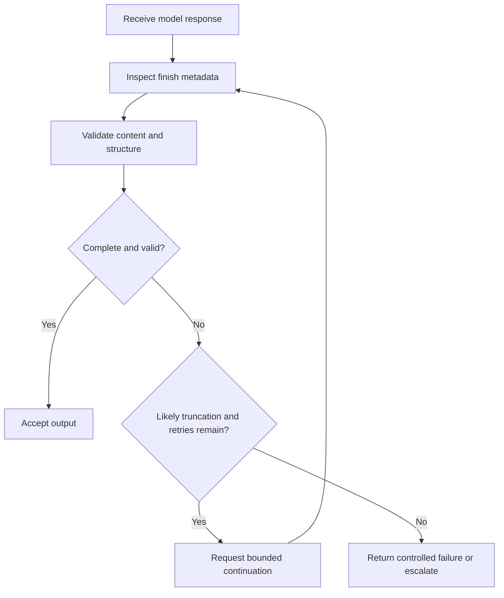

# 09. Stop Sequences and Output Limits

## Learning Objectives

By the end of this chapter, you should be able to:

- Distinguish an end-of-sequence (EOS) token, a configured stop string, and a maximum generated-token limit.
- Interpret termination metadata and identify signs of incomplete output.
- Recognize accidental stopping, truncation, and malformed structured output.
- Plan output budgets using the context window and the model/provider's token-accounting rules.
- Explain how internal reasoning tokens can affect limits when a provider documents them.
- Design bounded continuation and validation logic instead of relying on unlimited retries.

<br/>

## 1. Why Termination Behavior Matters

A generation request needs a rule for deciding when to stop. If it stops too early, the answer may be incomplete. If it continues too long, it may waste tokens, latency, and cost. If the application treats every stop as a successful completion, it can accidentally accept a truncated answer or invalid JSON.

Three mechanisms are especially important:

1. **End-of-sequence token (EOS):** A special token emitted by the model to signal the end of generation.
2. **Configured stop string/sequence:** A pattern configured by the application or serving API that causes generation to stop when matched.
3. **Maximum generated-token limit:** A cap on how many new tokens the system may generate for a request.

These mechanisms can all terminate generation, but they do not mean the same thing. The application should inspect the termination reason when the API exposes it and validate the output for the task.

<br/>

## 2. EOS, Stop Strings, and Token Limits

### End-of-sequence token

An EOS token is a special token in the model's token vocabulary or message format. When the model emits the relevant end marker, the serving runtime may treat the response as complete. Chat models can have additional message-ending markers with provider- or model-specific meanings, so do not assume every special ending token means exactly the same thing.

<br/>

### Configured stop string

A stop string is a configured text or token pattern that tells the serving system to stop generation when it is detected. It is often used to prevent the model from continuing into another section or to stop at a known delimiter.

For example, an application might configure `END_RECORD` as a stop string. If the generated text reaches that pattern, the service may stop and may omit the matched stop string from the returned text. Whether the matched text is included, how matching is performed, and how multi-token or partial matches are handled depend on the API.

A stop string can be risky if it also appears in ordinary content. For example, using `###` as a stop string could accidentally stop generation if the model needs to write a Markdown heading beginning with `###`.

<br/>

### Maximum generated-token limit

A maximum output-token limit caps the number of newly generated tokens. It does not tell the model to produce exactly that number. Generation may end earlier due to EOS or a stop string. If the cap is reached first, the result may be cut off before the answer or structured object is complete.

<br/>

### Quick comparison

| Mechanism | What triggers it? | What it usually indicates |
|---|---|---|
| EOS / message-ending marker | The model emits a recognized special token | The model or message format signaled an end |
| Configured stop string | The serving layer detects a configured pattern | The application-defined stopping condition was met |
| Maximum generated-token limit | The generation budget is exhausted | The system could not generate beyond the configured cap |

Exact semantics vary by model and provider. Consult the relevant API documentation instead of assuming all services expose identical termination behavior.

<br/>

## 3. Termination Metadata and Completion Status

Some APIs return metadata such as a **finish reason**, **stop reason**, or **termination reason**. The names and possible values vary, but the metadata may distinguish a normal stop from a token limit or another ending condition.

Conceptual examples include:

- `stop` or `end_turn`: the response reached a normal ending condition.
- `length` or `max_tokens`: the generation budget was reached.
- `stop_sequence`: a configured stop pattern triggered termination.
- Other provider-specific reasons, such as cancellation or a safety-related stop.

These are illustrative labels, not a universal enumeration. A provider may use different names, combine multiple conditions, or expose no detailed finish metadata.

<br/>

### Do not infer success from text alone

An answer that ends with a period might still be truncated. Conversely, a response that does not end with punctuation may be complete if the task expects a fragment, code block, or structured field.

A robust application should combine:

1. Termination metadata, if available.
2. Task-specific output validation.
3. Expected structure or completeness checks.
4. A clear policy for continuing, rejecting, or asking for a new response.

<br/>

## 4. Detecting Incomplete or Truncated Output

**Truncation** occurs when generation stops before the intended content is complete. A maximum-token limit is a common cause, but application cancellation or other runtime conditions may also interrupt output.

Useful warning signs include:

- Finish reason indicates the token limit was reached.
- A JSON object, XML element, code block, or other structure is unclosed.
- A required field is missing.
- A list stops abruptly or a sentence ends mid-thought.
- The output does not satisfy the requested schema or required sections.
- The output ends at an unexpected boundary.

No single sign is conclusive in every task. For example, a short answer can be complete even if it is much shorter than the maximum budget. Validate against the actual output contract.

<br/>

### Structured output example

Expected JSON:

```json
{
  "status": "complete",
  "items": ["alpha", "beta"]
}
```

Potentially truncated output:

```json
{
  "status": "complete",
  "items": ["alpha",
```

The second output is invalid JSON. The application should not pass it downstream as if it were a successful structured response. It should report the validation failure and apply a bounded recovery policy.

<br/>

## 5. Context-Dependent Output Budgets

An output-token limit should be chosen in relation to the full request and the model's context budget.

A simplified budgeting relationship is:

$$
\text{input tokens} + \text{generated tokens} \leq \text{usable context budget}
$$

This is a planning approximation, not a universal accounting rule. The exact context accounting may include system instructions, chat-template tokens, tool definitions, multimodal content, hidden formatting tokens, or other provider-specific overhead. Some systems distinguish the model's context window from separate output-token caps.

<br/>

### Practical budgeting steps

1. Estimate or measure the tokenized input, including system instructions and conversation history.
2. Identify the model's context window and the API's output-token cap.
3. Reserve space for the expected response length.
4. Leave headroom for message formatting and provider-specific overhead.
5. Set a limit large enough for the task but not unnecessarily large.
6. Validate whether the response actually meets the requested output requirements.

A large context window does not necessarily imply an equally large output allowance. The model, endpoint, account, and provider may impose different limits.

<br/>

## 6. Model-Specific Token Accounting and Internal Reasoning Tokens

Token accounting is not identical across all models and APIs. Some providers document separate categories for visible output tokens and internal reasoning or thinking tokens. Where such tokens count toward a request's generation budget, they can reduce the budget available for user-visible text. Other APIs may expose different accounting or metadata.

Do not assume hidden reasoning tokens exist, are exposed, or are counted in a particular way unless the provider documents that behavior for the specific model and endpoint.

When the documentation distinguishes token categories, check:

- Which categories count toward the context window.
- Which categories count toward the maximum output budget.
- Whether the API reports visible output tokens separately from reasoning tokens.
- Whether reasoning tokens are returned, hidden, or represented only in usage metadata.
- Whether the output cap applies to all generated tokens or only a documented category.

For a long answer, a request can reach its output budget before the visible response reaches the desired length if the model uses part of the budget for additional internal generation. The exact behavior is model- and provider-dependent.

<br/>

## 7. Accidental Stops and Broken Output

A stop string should be selected carefully. A stop pattern that overlaps with normal content can terminate the response prematurely. This is particularly important for Markdown, code, XML, CSV, and JSON-like formats.

Examples of possible problems:

- `###` is configured as a stop string, but the response needs a Markdown heading.
- A delimiter used in ordinary data accidentally matches a stop pattern.
- A stop pattern is matched across token boundaries in a provider-specific way.
- The application expects a complete JSON object but the output budget is too small.
- A code response is cut off before a closing brace or code fence.
- The runtime stops at a message-ending marker that the application incorrectly treats as final completion of the overall task.

Mitigations include:

- Use stop sequences that are specific and unlikely to appear in legitimate content.
- Understand whether the provider includes or removes the matched stop text.
- Prefer schema-constrained output modes where supported, while still validating the result.
- Set a realistic output budget based on task complexity.
- Inspect finish metadata and validate the returned content before using it.

<br/>

## 8. Bounded Continuation and Validation

When output is incomplete, an application may ask the model to continue. However, unlimited retries are not a robust recovery strategy: they can increase cost and latency, duplicate content, or create conflicting partial outputs.

A safer recovery policy is bounded:

1. Inspect the finish reason and output.
2. Validate the output against the expected format or schema.
3. If the output appears truncated and continuation is supported, request a continuation with enough context to preserve coherence.
4. Set a maximum number of continuation attempts.
5. Validate the combined result after continuation.
6. If validation still fails, return a clear error or route the case for handling rather than retrying indefinitely.

<br/>

### Conceptual recovery flow



Continuation is not always appropriate. If the response ended because of an intentional stop string, a safety rule, or a task-level refusal, blindly asking the model to continue may be incorrect. The recovery action should match the reason for termination.

<br/>

## 9. Practical Validation Example

The following Python example illustrates the pattern. The `response` object is a placeholder: actual field names and finish-reason values depend on the provider's SDK.

```python
import json

def validate_json_response(text: str) -> tuple[bool, str | None]:
    try:
        json.loads(text)
        return True, None
    except json.JSONDecodeError as exc:
        return False, str(exc)


def assess_response(response) -> dict:
    # Replace these illustrative attributes with the fields
    # exposed by the specific provider's SDK.
    text = response.text
    finish_reason = response.finish_reason

    is_valid_json, validation_error = validate_json_response(text)

    return {
        "finish_reason": finish_reason,
        "valid_json": is_valid_json,
        "validation_error": validation_error,
        "needs_review": (
            finish_reason in {"length", "max_tokens"}
            or not is_valid_json
        ),
    }
```

This is an illustrative integration pattern, not a drop-in adapter for every provider. Map the actual SDK fields and documented finish-reason values. In production, the application should distinguish an expected non-JSON response from a task that explicitly requires JSON, and should handle missing metadata safely.

<br/>

## 10. Practice

### Exercise 1 — Identify the termination mechanism

For each case, identify the most likely mechanism and what the application should check.

1. The model emits its normal end-of-sequence marker.
2. The response ends immediately after the configured string `END_RECORD`.
3. The API reports that the maximum generated-token budget was reached.
4. The output is valid text but the required JSON object is incomplete.

<br/>

### Exercise 2 — Detect truncation

A request asks for an object with five required fields. The response includes only three fields and the finish reason indicates a length limit. What should the application do before using the result?

<br/>

### Exercise 3 — Plan a budget

A request includes a long system prompt, conversation history, and a request for a detailed report. List at least four factors to consider when setting the output-token limit.

<br/>

### Exercise 4 — Stop-string risk

An application uses `###` as a stop string. Explain why this could be unsafe for a Markdown-generation task and suggest a mitigation.

<br/>

### Exercise 5 — Continuation policy

Why is an unlimited “continue until complete” loop risky? Describe a bounded alternative.

<br/>

## 11. Answers and Checkpoint Review

### Exercise 1 — Suggested answers

1. **EOS:** Treat it as a model-signaled ending, but still validate the content against the task.
2. **Configured stop string:** Check whether the stop was intentional and whether the provider includes or removes the matched string.
3. **Maximum output-token limit:** Treat the result as potentially truncated; inspect metadata and validate completeness.
4. **Invalid/incomplete structured output:** Parse and validate it; do not pass it downstream as a valid object. Use a bounded recovery policy if appropriate.

<br/>

### Exercise 2 — Suggested answer

Do not accept the object as complete. Check the finish reason and schema validation, then use a bounded continuation or regeneration strategy if the endpoint and task support it. Validate the final combined result and stop after a configured retry budget.

<br/>

### Exercise 3 — Suggested answer

Consider the model's context window, actual input token count, expected report length, output-token cap, formatting overhead, conversation history, provider-specific token accounting, and whether internal reasoning tokens count toward the output budget.

<br/>

### Exercise 4 — Suggested answer

Markdown headings commonly begin with `###`, so the stop string may terminate generation at the start of a legitimate heading. Use a more specific delimiter that is unlikely to occur in ordinary content, or avoid stop strings when the format does not require them. Verify the provider's matching semantics.

<br/>

### Exercise 5 — Suggested answer

Unlimited retries can create unbounded cost and latency, duplicate sections, or fail to converge. Use a maximum continuation count, check termination metadata, validate after each attempt, and return a controlled failure if the output remains incomplete.

<br/>

## Summary

EOS markers, configured stop strings, and maximum generated-token limits are different termination mechanisms. Finish metadata can help explain why generation ended, but output validation is still necessary—especially for structured formats. Output budgets should account for the input, context window, provider-specific token rules, and documented reasoning-token accounting. When output is incomplete, use bounded continuation and final validation rather than unlimited retries.
