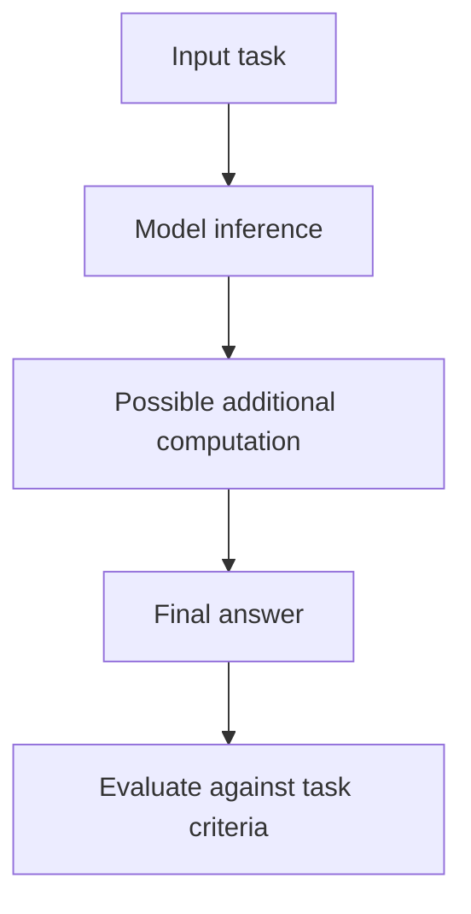
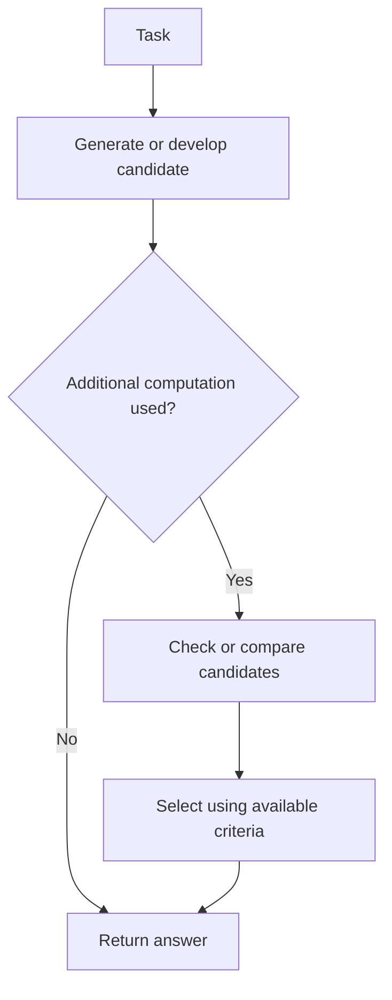

# 10. Reasoning-Capable Models and Inference-Time Computation

## Learning Objectives

By the end of this chapter, you should be able to:

- Describe models and inference methods designed to spend additional computation on a response.
- Explain, conceptually, internal reasoning behavior, candidate generation, checking, and selection.
- Distinguish model-native reasoning behavior from application-controlled multi-call methods.
- Analyze possible quality improvements against latency and cost.
- Identify task suitability, unsupported settings, and provider-specific budget controls.
- Explain why a visible rationale does not prove that reasoning is correct or faithfully describe internal computation.
- Evaluate final answers against known outcomes rather than explanation length.
- Keep inference-time reasoning concepts separate from autonomous agent loops and orchestration.

 

## 1. What Is Inference-Time Computation?

**Inference-time computation** is the computation used while a model responds to a request, after its parameters have already been trained. Some systems are designed to spend additional computation on difficult problems instead of always producing the answer in one quick pass.

A basic generation setup may produce an answer with a single autoregressive pass through the generation loop. A reasoning-oriented model or inference method may use additional computation—such as a larger reasoning-token budget, additional candidate generation, checking, or selection—to improve performance on tasks that benefit from more deliberation.

The key distinction is that **more computation at inference time is not the same as retraining the model**. The learned weights need not change for the system to spend more computation on a particular request.

 

### A conceptual view

The exact implementation differs by model and provider. Some reasoning behavior is native to a model; other methods are implemented by the application around a model.

 

## 2. Why Spend More Computation?

Some tasks are difficult because they require several dependent steps, careful constraint tracking, calculation, or comparison among possible answers. Additional inference computation may help by allowing the system to explore or check intermediate possibilities before returning a final answer.

Potential uses include:

- Multi-step arithmetic and symbolic problems.
- Logic and constraint-satisfaction tasks.
- Code generation where tests or checks can reveal mistakes.
- Planning or analysis tasks with multiple requirements.
- Problems where comparing candidate solutions can improve selection.

This is not a guarantee. More computation can fail to improve an answer, reinforce an incorrect approach, or produce an answer that is more expensive without being more accurate.

 

## 3. Reasoning Behavior at a Conceptual Level

A reasoning-oriented system may use one or more of the following ideas. These are conceptual patterns, not a claim that every model uses all of them or follows the same internal sequence.

### Internal reasoning

The model may be configured or trained to use additional internal computation before producing the user-facing answer. Some providers expose a reasoning or thinking budget; others use model-specific behavior that is not directly controlled through a public parameter.

Internal computation should not be equated with a fully reliable, human-like proof process. It can still produce errors.

 

### Candidate generation

A system can generate more than one candidate answer or solution. Candidate generation may expose different possible approaches, but it also uses more computation and does not guarantee that a correct candidate will be generated.

 

### Checking and verification

A candidate may be checked against constraints, calculations, tests, or known properties. Checking is most useful when the check itself is reliable and relevant to the task. A model-generated explanation that merely asserts “I checked this” is not equivalent to an independent verification step.

 

### Selection

If several candidates are available, a system may select one using a scoring rule, verifier, test result, or other criterion. The quality of selection depends on the criterion: a weak or misaligned score can select a fluent but incorrect answer.

This diagram illustrates a general pattern. It does not specify or reveal any particular model's private internal process.

 

## 4. Model-Native Reasoning vs Application-Controlled Multi-Call Methods

It is important to distinguish computation performed within a model's own inference behavior from additional calls that an application explicitly orchestrates.

| Aspect | Model-native reasoning behavior | Application-controlled multi-call method |
|---|---|---|
| Where additional work occurs | Within the model's supported inference behavior | In application logic that makes and manages multiple model calls |
| Control surface | Model/provider-specific settings, if exposed | Application-defined prompts, calls, checks, and stopping rules |
| Typical examples | A reasoning-oriented model or documented reasoning budget | Generate a candidate, run a separate checker, compare alternatives, or request a revision |
| Main trade-off | May have higher per-request token use or latency | May add multiple round trips, coordination complexity, and cost |
| Key limitation | Internal details and controls may not be exposed | More calls do not guarantee better results; checks can also be wrong |

A multi-call application method is not automatically an autonomous agent. A fixed, bounded sequence such as “generate once, validate once, revise once if invalid” is an application-controlled inference workflow. Autonomous agent loops and orchestration are outside this chapter and belong to the separate Agentic AI course.

 

## 5. Quality, Latency, and Cost Trade-Offs

Additional inference computation may improve answer quality on some tasks, but it generally consumes resources. Depending on the model and provider, the added work can increase generated tokens, wall-clock latency, or billed usage.

### Potential benefits

- More opportunity to work through dependent steps.
- More candidate solutions to compare.
- Additional checks against explicit constraints.
- Better performance on tasks where the extra computation is relevant and the model can use it effectively.

 

### Potential costs and risks

- Higher latency, particularly when additional model calls are involved.
- Higher token usage or cost.
- Diminishing returns as more computation is added.
- More opportunities to generate or reinforce an incorrect answer.
- A more elaborate response without a better final result.

The correct question is not “Does the reasoning option produce a longer explanation?” It is “Does the extra computation improve measured task performance enough to justify its cost and latency?”

 

### Conceptual comparison

| Dimension | Fast baseline | Reasoning-oriented option |
|---|---|---|
| Response time | Often lower | May be higher |
| Computation budget | Often smaller | May be larger or more flexible |
| Performance on simple tasks | Can be sufficient | May add little value |
| Performance on difficult multi-step tasks | May struggle on some cases | May improve on some cases |
| Cost | Often lower | May be higher |
| Guarantee of correctness | None | None |

These are tendencies, not guarantees. Compare the actual model and endpoint on the intended workload.

 

## 6. Task Suitability

Use the simplest configuration that meets the quality requirement.

A fast baseline may be appropriate for:

- Straightforward classification or extraction with a clear schema.
- Simple transformations and short factual formatting tasks.
- High-volume applications where latency and cost dominate and the baseline meets quality targets.

A reasoning-oriented option may be worth testing for:

- Multi-step calculations with verifiable answers.
- Logic puzzles or constraint-heavy problems.
- Code tasks where execution or tests can evaluate the result.
- Tasks that require reconciling several explicit conditions.

A task should not be assigned to a reasoning-oriented model merely because it sounds complex. First define the success criteria, create representative test cases, and measure whether additional computation helps.

For factual questions, a reasoning-oriented model still needs appropriate evidence. Additional internal computation cannot guarantee that the model has current or correct information.

 

## 7. Provider-Specific Settings and Budget Controls

Providers expose different controls for reasoning-capable models. Depending on the model and API, there may be a reasoning-effort setting, a thinking-token budget, an overall output-token limit, or no user-facing control over the internal computation.

Before using a setting, verify the documentation for the exact model and endpoint:

- Is the setting supported for this model?
- What values or modes are accepted?
- Does it control reasoning effort, a token budget, or something else?
- Do reasoning tokens count toward the output limit, usage total, or both?
- Can the application see reasoning-token usage in response metadata?
- Are some sampling parameters unsupported or ignored for this model?
- What are the default behavior and any model-specific constraints?

Do not assume that a setting name has the same meaning across providers. Do not assume that every model exposes internal reasoning or lets the caller set its budget. If a parameter is unsupported, use the documented interface rather than silently assuming it took effect.

 

## 8. Visible Rationales Are Not Proof

A model may return a visible explanation, a concise rationale, intermediate steps, or a summary of its approach. That text can help a user understand the answer, but it is not proof that the answer is correct.

Three distinctions matter:

1. **Plausibility is not correctness.** An explanation can sound coherent while containing an invalid step.
2. **Explanation length is not reasoning quality.** A long rationale can still lead to a wrong result; a short answer can be correct.
3. **A visible rationale is not necessarily a faithful account of internal computation.** User-facing explanations may be summaries or generated descriptions and should not be treated as a complete trace of what occurred internally.

Use external checks where possible: calculate the result independently, execute code, validate constraints, compare against a trusted answer key, or use an appropriate domain-specific verifier. A model's statement that an answer has been verified is not itself verification.

 

## 9. Designing a Fair Evaluation

To determine whether additional inference computation helps, compare a fast baseline with a reasoning-oriented option on a fixed set of representative tasks.

### Experimental design

1. **Define the task set.** Include easy and difficult examples representative of real usage.
2. **Establish known outcomes.** Use answer keys, deterministic calculations, unit tests, or a trusted rubric where possible.
3. **Fix the inputs.** Keep prompts, task instructions, and evaluation criteria consistent.
4. **Record the configurations.** Capture model version, endpoint, reasoning controls, token limits, and other supported settings.
5. **Run both options.** Use the same examples and a documented run policy. Repeat runs when the setup is stochastic.
6. **Score final answers.** Measure exact-match accuracy, numerical error, constraint satisfaction, test pass rate, or another task-appropriate metric.
7. **Measure operational cost.** Record latency, token usage, and cost where available.
8. **Compare quality against cost.** Decide whether any quality improvement justifies the extra resources.

Avoid changing the prompt, model, reasoning budget, and decoding settings simultaneously. If several variables change at once, it becomes difficult to identify what caused the difference.

 

### Example evaluation table

| Case | Known expected outcome | Fast baseline result | Reasoning-oriented result | Correctness/quality score | Latency | Token usage/cost |
|---|---|---|---|---|---|---|
| 1 | Answer key or test | Record result | Record result | Score both | Record both | Record both |
| 2 | Answer key or test | Record result | Record result | Score both | Record both | Record both |
| 3 | Answer key or test | Record result | Record result | Score both | Record both | Record both |

 

### Useful metrics

Choose metrics that fit the task:

- **Accuracy / exact match:** Suitable when a known answer exists and exactness matters.
- **Numerical error:** Useful for calculations and quantitative prediction.
- **Constraint satisfaction:** Checks whether all required conditions are met.
- **Unit-test pass rate:** Useful for code tasks with executable tests.
- **Task-specific rubric:** Useful for outputs that allow multiple valid answers, provided the rubric is applied consistently.
- **Latency and cost per successful task:** Help quantify the operational trade-off.

A model should not receive a higher score merely for producing more words or a more detailed rationale.

 

## 10. Practical Example: Verifiable Arithmetic

Suppose the task is: “A box contains 24 items. They are divided equally among 6 people. How many items does each person receive?”

The expected answer is \(24 \div 6 = 4\).

A fair comparison might run this and a larger set of arithmetic problems through both a fast baseline and a reasoning-oriented model. Evaluate the final numeric answer against the answer key. Record latency and usage. If both options are consistently correct, the slower option may not be worth using for this simple task.

For more challenging problems, include cases with multiple operations, units, or constraints. Use independently computed answers or a trusted evaluator. Do not use the length of the model's explanation as the score.

 

## 11. Practice

### Exercise 1 — Identify the additional computation

For each method, classify it as model-native behavior or application-controlled multi-call behavior:

1. A provider-supported reasoning-oriented model handles one request with a documented reasoning setting.
2. An application asks one model call for a candidate, sends it to a separate validator, and requests one revision if validation fails.
3. An application generates three candidates in separate calls and selects one based on a fixed external test.

 

### Exercise 2 — Evaluate a trade-off

A reasoning-oriented option improves a task's test pass rate but doubles average latency and increases token usage. What additional information would you need before deciding whether to use it in production?

 

### Exercise 3 — Choose a task

Give one example where a fast baseline is likely sufficient and one where a reasoning-oriented option is worth evaluating. Explain how you would verify the results.

 

### Exercise 4 — Challenge a rationale

A model gives a long explanation and claims it checked every step, but the final answer is wrong. What does this show about visible rationales and verification?

 

### Exercise 5 — Design a comparison

Outline an experiment comparing a fast baseline and a reasoning-oriented option. Include the test set, success metric, repeated-run policy, and operational measurements.

 

## 12. Answers and Checkpoint Review

### Exercise 1 — Suggested answers

1. **Model-native reasoning behavior:** The model/provider handles the request using its documented inference behavior.
2. **Application-controlled multi-call method:** The application explicitly runs a candidate, validator, and bounded revision.
3. **Application-controlled multi-call method:** The application orchestrates candidate generation and external selection.

The latter two are bounded inference workflows; they are not automatically autonomous agents.

 

### Exercise 2 — Suggested answer

Check the absolute pass rate and the value of the improvement, the severity of failures avoided, the latency service-level objective, the cost budget, workload volume, and whether the test set represents production. Also examine variability and failure cases. The trade-off depends on business requirements, not just relative improvement.

 

### Exercise 3 — Suggested answer

A simple label extraction task with a clear schema may be suitable for a fast baseline if it meets the required accuracy; validate with labeled examples and schema checks. A multi-step code task may justify testing a reasoning-oriented option; evaluate it with executable tests and record latency and token usage.

 

### Exercise 4 — Suggested answer

A fluent explanation and a claim of checking do not prove correctness. The explanation can contain invalid reasoning or fail to faithfully represent internal computation. Use an independent check, such as an answer key, calculation, unit test, or formal constraint validator.

 

### Exercise 5 — Suggested answer

Build a representative fixed test set with known outcomes. Keep prompts and evaluation criteria consistent, record exact model versions and supported settings, run both options and repeat where stochastic behavior matters. Score final answers using an appropriate metric, then compare correctness, latency, and token usage/cost.

 

### Checkpoint

**When might additional inference computation help, and how should its value be measured?** It may help on difficult multi-step tasks where extra computation enables useful exploration or checking. Evaluate it against known outcomes using task-appropriate metrics, and compare any quality improvement with latency and cost. Explanation length alone is not evidence of better reasoning.

 

## Scope Boundary

This chapter covers model inference behavior and bounded application-controlled inference methods. Autonomous agent loops, tool orchestration, long-running planning, and multi-step agent control belong to the separate **Agentic AI** course.

 

## Summary

Reasoning-capable models and inference-time methods can spend additional computation on a response through model-native behavior or application-controlled candidate generation and checking. This may improve performance on some difficult tasks, but it can also increase latency and cost without improving correctness. Provider controls and token accounting vary. Evaluate final answers against known outcomes and task-specific checks rather than judging explanation length, and keep autonomous agent orchestration outside this chapter's scope.
