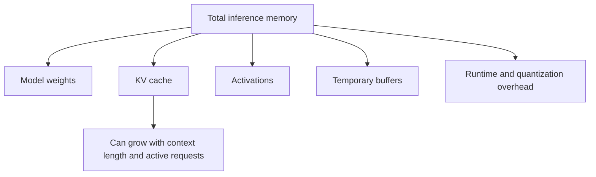

# 11. Quantization Concepts

## Learning Objectives

By the end of this chapter, you should be able to:

- Compare floating-point precision with lower-bit numerical representations.
- Distinguish weight, activation, and KV-cache quantization.
- Explain scales, rounding, and quantization error with a toy example.
- Estimate weight storage for a given parameter count and bit width.
- Distinguish model-weight storage from total runtime memory.
- Discuss hardware support, compatibility, quality changes, and possible speed trade-offs.
- Explain post-training quantization (PTQ) and quantization-aware training (QAT) at a high level.
- Explain why lower precision does not automatically mean faster inference.

 

## 1. What Is Quantization?

**Quantization** represents numerical values using a more compact numerical format or a smaller set of representable values. In machine learning, quantization is commonly used to reduce the precision used to store or process model parameters and, in some approaches, activations or cache values.

For example, a model may store weights using 16-bit floating-point values rather than 32-bit floating-point values, or use a lower-bit representation such as 8-bit integers. Lower-bit representations can reduce storage and memory traffic, but they also introduce approximation error and may require specialized kernels or hardware support.

Quantization does not necessarily change the number of model parameters. It changes how some values are represented or processed.

 

## 2. Floating-Point Precision and Lower-Bit Representations

A numerical format determines how values are encoded and which values can be represented. Common formats in deep learning include FP32, FP16, BF16, and integer-based formats such as INT8. Lower-bit weight formats may also be used in specialized inference systems.

| Representation | Conceptual property | Potential trade-off |
|---|---|---|
| FP32 | 32-bit floating-point representation | More storage per value; broad numerical range and precision |
| FP16 | 16-bit floating-point representation | Lower storage; numerical range/precision differs from FP32 |
| BF16 | 16-bit floating-point representation with a wider exponent range than FP16 | Lower storage than FP32; fewer fraction bits than FP16 |
| INT8 | 8-bit integer representation, often paired with scale/zero-point metadata | Compact values; requires quantization/dequantization or compatible arithmetic |
| Lower-bit formats (for example, 4-bit weights) | Fewer bits per stored weight | More compression, but greater sensitivity to quantization error and implementation choices |

These formats are not interchangeable. FP16 and BF16 are floating-point formats; INT8 and many low-bit weight formats use quantized representations. Actual memory use may include scales, zero points, alignment, packing, and metadata.

The nominal bit width is useful for estimating storage, but it is not a complete description of numerical behavior or runtime cost.

 

## 3. Three Quantization Targets

Quantization can target different parts of an inference system.

### Weight quantization

**Weights** are learned model parameters. Quantizing weights reduces the storage required for those parameters and may reduce memory traffic when the runtime can use the compact representation efficiently.

Weight quantization is a common way to fit a large model into limited memory. However, the model may still require memory for activations, caches, temporary buffers, and runtime overhead.

 

### Activation quantization

**Activations** are intermediate values computed while the model runs. Quantizing activations can reduce activation memory and may accelerate computation when the hardware and kernels support the selected format. Activation ranges can vary across layers and inputs, so calibration and quantization strategy matter.

 

### KV-cache quantization

Autoregressive transformer inference may keep a **key-value (KV) cache** of attention-related values from earlier tokens so that those values can be reused during generation. Quantizing the cache can reduce its memory footprint, especially for long contexts or concurrent requests.

The KV cache is not the same as model weights. It grows with the active sequence/context and depends on factors such as sequence length, number of layers, batch/concurrency, number of attention heads, and the cache representation.

 

### Comparison

| Target | Values being represented | Potential benefit | Important consideration |
|---|---|---|---|
| Weights | Learned parameters | Smaller model-weight storage and potentially less weight-memory traffic | Quality changes and kernel support |
| Activations | Intermediate computation values | Lower activation memory and potentially faster operations | Dynamic ranges, calibration, and operator compatibility |
| KV cache | Cached attention keys and values | Lower memory use for active contexts | Cache precision can affect output quality and throughput |

A system may quantize one target but not the others. Saying “the model is 4-bit” often refers to a particular weight representation, not necessarily every tensor used at runtime.

 

## 4. Scales, Rounding, and Quantization Error

A quantizer maps values from a higher-precision representation into a smaller set of representable values. A simple uniform quantization scheme uses a **scale** to map floating-point values to integer levels.

For a simplified symmetric quantizer, one possible approximation is:

$$
q = \operatorname{round}(x/s)
$$

$$
\hat{x} = q \cdot s
$$

where:

- \$x\$ is the original value,
- \$s\$ is the scale,
- \$q\$ is the quantized integer value,
- \$\hat{x}\$ is the reconstructed approximation.

Real implementations may use zero points, per-channel or per-group scales, clipping, non-uniform codebooks, or other schemes. The formulas above are only a toy illustration.

 

### Toy example

Suppose the scale is \$s = 0.1\$ and the original value is \$x = 0.37\$.

1. Divide by the scale: \$0.37 / 0.1 = 3.7\$.
2. Round to the nearest integer: \$q = 4\$.
3. Reconstruct: \$\hat{x} = 4 \times 0.1 = 0.4\$.
4. Absolute quantization error: \$|0.37 - 0.4| = 0.03\$.

The reconstructed value differs from the original. The error may be small for one value, but model behavior depends on many values and operations interacting across layers.

 

### Clipping and scale selection

If a value lies outside the range representable by the quantizer, it may be clipped to the nearest available level. A scale that is too coarse can create large rounding errors; a scale chosen poorly for the value distribution can waste available levels or clip outliers.

Scale selection may be performed per tensor, per channel, per group, or using another strategy. More granular scales can improve fidelity but require additional metadata and computation.

 

## 5. Estimate Weight Storage

A basic theoretical estimate for model-weight storage is:

$$
\text{weight bytes} \approx
\frac{\text{parameter count} \times \text{bits per parameter}}{8}
$$

This estimate assumes every parameter uses the stated bit width and excludes scales, metadata, alignment, temporary buffers, caches, activations, and all other runtime overhead.

 

### Worked example: 7 billion parameters

For a hypothetical model with 7 billion parameters:

| Nominal representation | Theoretical weight storage |
|---|---:|
| 32 bits per parameter | $7 \times 10^9 \times 32 / 8 = 28$ GB |
| 16 bits per parameter | $7 \times 10^9 \times 16 / 8 = 14$ GB |
| 8 bits per parameter | $7 \times 10^9 \times 8 / 8 = 7$ GB |
| 4 bits per parameter | $7 \times 10^9 \times 4 / 8 = 3.5$ GB |

These are decimal GB estimates for the parameter values only. They are not exact download sizes or minimum device-memory requirements. Real low-bit checkpoints may need extra storage for scales, zero points, packing, unquantized layers, and other metadata. The terms GB and GiB also differ: $1\text{ GiB} = 2^{30}$ bytes, while decimal $1\text{ GB} = 10^9$ bytes.

 

### Exercise-ready formula

For a hypothetical parameter count $P$ and bit width $b$:

$$
\text{theoretical bytes} = \frac{P b}{8}
$$

Use this as a first-order estimate, and label the excluded components explicitly.

 

## 6. Model-Weight Storage vs Total Runtime Memory

A model's weight-file size is only one component of inference memory.

A simplified memory budget is:

$$
\text{runtime memory} \approx
\text{weights} + \text{KV cache} + \text{activations} +
\text{temporary buffers} + \text{runtime overhead}
$$

This is a conceptual accounting model; exact allocation and sharing depend on the runtime.

 

### Important components

- **Weights:** Stored parameters loaded by the inference runtime.
- **KV cache:** Cached attention state for active sequences. Its size can grow as context length and concurrency increase.
- **Activations:** Intermediate tensors used during computation.
- **Temporary/workspace buffers:** Memory used by matrix multiplication, attention kernels, quantization/dequantization, and other operations.
- **Runtime overhead:** Framework allocations, memory fragmentation, CUDA or other device context, communication buffers, and implementation-specific state.
- **Quantization metadata:** Scales, zero points, lookup tables, and packed-format metadata, depending on the method.

Consequently, a model with theoretical 4-bit weight storage of 3.5 GB may require substantially more than 3.5 GB of device memory to serve requests. The actual amount depends on the architecture, runtime, context length, batch size, concurrency, and quantization method.

 

## 7. Hardware Support, Compatibility, and Speed

Lower precision can reduce the amount of data that must be stored or moved. That can help when inference is limited by memory capacity or memory bandwidth. It does not guarantee faster inference.

Reasons include:

- The hardware may not accelerate the chosen format.
- The runtime may lack an efficient kernel for the quantization scheme.
- Values may need to be dequantized or transformed before computation.
- Additional quantization metadata or packing can introduce overhead.
- The workload may be compute-bound rather than memory-bound.
- Small batches or short sequences may not benefit from the same optimizations as large workloads.
- A different kernel or runtime may change latency and throughput.

 

### Compatibility questions

Before deploying a quantized model, check:

1. Does the device support the required data type and operations?
2. Does the inference framework support this exact quantization format?
3. Are kernels available for the model architecture and target hardware?
4. Does the checkpoint format match the runtime loader?
5. Are any layers kept in higher precision?
6. What are the quality, latency, throughput, and memory results on representative requests?

A smaller file is a useful storage property, not a complete performance benchmark.

 

## 8. Quality Regressions and Evaluation

Quantization approximates numerical values, so it can change model outputs. The impact depends on the model, quantization method, calibration data, precision, architecture, and workload.

Possible effects include:

- Little measurable quality loss for a suitable configuration.
- More errors on tasks sensitive to small numerical changes.
- Larger degradation when important values are poorly represented or clipped.
- Changes in generation behavior that may appear only on longer or more difficult tasks.

Do not assume that every 4-bit model is equivalent to every other 4-bit model. Two quantization methods with the same nominal bit width can differ in scaling, grouping, outlier handling, and supported kernels.

Evaluate the quantized model against a higher-precision baseline using a representative test set. Measure task quality as well as memory, latency, and throughput.

 

## 9. Post-Training Quantization vs Quantization-Aware Training

These are two high-level approaches to preparing a model for quantized execution.

### Post-training quantization (PTQ)

**Post-training quantization** applies quantization to an already-trained model. Depending on the method, it may use calibration data to estimate ranges or choose quantization parameters. It often avoids retraining the full model, which can make it easier to apply.

The trade-off is that the model was not necessarily trained to compensate for the quantization effects, so quality can degrade depending on the method and task.

 

### Quantization-aware training (QAT)

**Quantization-aware training** incorporates simulated or modeled quantization effects during training or fine-tuning so that model parameters can adapt to the expected lower-precision representation. The exact training procedure varies.

QAT requires a training workflow and additional resources. It may preserve quality better for some deployments, but it is not guaranteed to outperform every PTQ method in every setting.

| Aspect | PTQ | QAT |
|---|---|---|
| When quantization is considered | After ordinary training | During a training/fine-tuning process |
| Need for training updates | Often not required for basic PTQ | Yes, model parameters are optimized |
| Operational effort | Often lower | Usually higher |
| Quality behavior | Depends on method and calibration | Can adapt to quantization effects; quality still requires evaluation |

The distinction is conceptual; particular toolchains offer many variants.

 

## 10. Practical Quantization Evaluation Plan

A responsible comparison should measure more than file size.

1. Choose a representative test set and define task-specific quality metrics.
2. Record the full-precision or higher-precision baseline.
3. Select a quantized checkpoint and document its format and method.
4. Verify that the target runtime and hardware support the checkpoint.
5. Measure actual model-weight memory and peak runtime memory separately where possible.
6. Measure latency and throughput under realistic context lengths and concurrency.
7. Compare quality metrics and inspect important failure cases.
8. Record software versions, hardware, quantization settings, and test conditions.

Keep the prompt set and evaluation method fixed when comparing precision options. If possible, repeat performance measurements and report the measurement method rather than relying on one timing result.

 

## 11. Common Misconceptions

- **“A 4-bit model always uses exactly one-eighth the memory of an FP32 model.”** The theoretical parameter storage is one-eighth under those nominal bit widths, but real checkpoints and runtime memory include additional components.
- **“A 4-bit weight model has every tensor stored in 4-bit form.”** Not necessarily. Some tensors or layers may use different precision, and metadata is required by many formats.
- **“Smaller weight files always mean faster generation.”** No. Hardware, kernels, memory bandwidth, compute bottlenecks, and conversion overhead all matter.
- **“Weight quantization also quantizes the KV cache.”** Not necessarily. They are separate quantization targets.
- **“Quantization cannot affect quality.”** It introduces approximation and can change model outputs.
- **“PTQ and QAT are the same.”** PTQ is applied after training; QAT accounts for quantization effects during training or fine-tuning.
- **“Weight-file size tells me how much VRAM I need.”** No. Runtime memory also includes caches, activations, buffers, metadata, and overhead.

 

## 12. Practice

### Exercise 1 — Estimate weight storage

Estimate theoretical parameter storage for a model with 3 billion parameters at 16-bit, 8-bit, and 4-bit precision. Report decimal GB and explicitly list what is excluded.

 

### Exercise 2 — Toy quantization

Using the simplified formula $q=\operatorname{round}(x/s)$ and $\hat{x}=qs$, let $x=0.62$ and $s=0.2$.

1. Calculate $q$.
2. Calculate $\hat{x}$.
3. Calculate the absolute quantization error.

Assume ordinary rounding to the nearest integer and no clipping.

 

### Exercise 3 — Identify the target

Which quantization target is most directly associated with each goal?

1. Reduce storage for learned parameters.
2. Reduce memory used by intermediate tensors.
3. Reduce memory used by cached attention values for long active sequences.

 

### Exercise 4 — Diagnose a speed regression

A quantized checkpoint is smaller but runs slower on the target device. Give at least four plausible causes.

 

### Exercise 5 — Design a comparison

Outline an evaluation comparing a higher-precision checkpoint with a quantized checkpoint. Include quality, peak runtime memory, latency/throughput, and hardware/runtime compatibility.

 

## 13. Answers and Checkpoint Review

### Exercise 1 — Suggested answer

For $P=3 \times 10^9$:

- 16-bit: $3 \times 10^9 \times 16 / 8 = 6$ GB.
- 8-bit: $3 \times 10^9 \times 8 / 8 = 3$ GB.
- 4-bit: $3 \times 10^9 \times 4 / 8 = 1.5$ GB.

These are theoretical decimal-GB estimates for parameter values only. They exclude scales, zero points, packing, other metadata, KV cache, activations, temporary buffers, runtime overhead, and any layers/tensors that use a different precision.

 

### Exercise 2 — Suggested answer

1. $q=\operatorname{round}(0.62/0.2)=\operatorname{round}(3.1)=3$.
2. $\hat{x}=3 \times 0.2=0.6$.
3. Absolute error: $|0.62-0.6|=0.02$.

 

### Exercise 3 — Suggested answers

1. Weight quantization.
2. Activation quantization.
3. KV-cache quantization.

 

### Exercise 4 — Suggested answer

The hardware may lack efficient support for the format; kernels may be inefficient or unavailable; dequantization or conversion may add overhead; the workload may be compute-bound; metadata/packing may add work; or the runtime may use a less optimized execution path.

 

### Exercise 5 — Suggested answer

Use the same model/task set and evaluation criteria, document the exact checkpoint format, hardware, and runtime, and measure task quality against the same test examples. Separately measure peak runtime memory, latency, and throughput at representative context lengths and concurrency. Inspect quality regressions and report the setup so results can be reproduced.

 

### Checkpoint

**Why is a model's weight-file size not its full inference memory requirement?** The weight file represents only the stored parameters. Runtime inference also needs memory for KV caches, activations, temporary buffers, quantization metadata, framework/runtime allocations, and other overhead. Cache usage can grow with context length and concurrent requests, so actual memory requirements depend on the serving workload and implementation.

 

## Summary

Quantization uses lower-precision representations to reduce storage and potentially improve memory efficiency. Weight, activation, and KV-cache quantization target different parts of inference. Scales and rounding introduce approximation error, and lower precision can affect quality. Theoretical weight storage is parameter count multiplied by bits per parameter and divided by eight, but total runtime memory is larger because of caches, activations, buffers, metadata, and overhead. Hardware and kernel support determine whether quantization improves speed. PTQ applies quantization after training; QAT accounts for quantization effects during training. Always evaluate quality, memory, latency, and throughput on the actual deployment stack.
