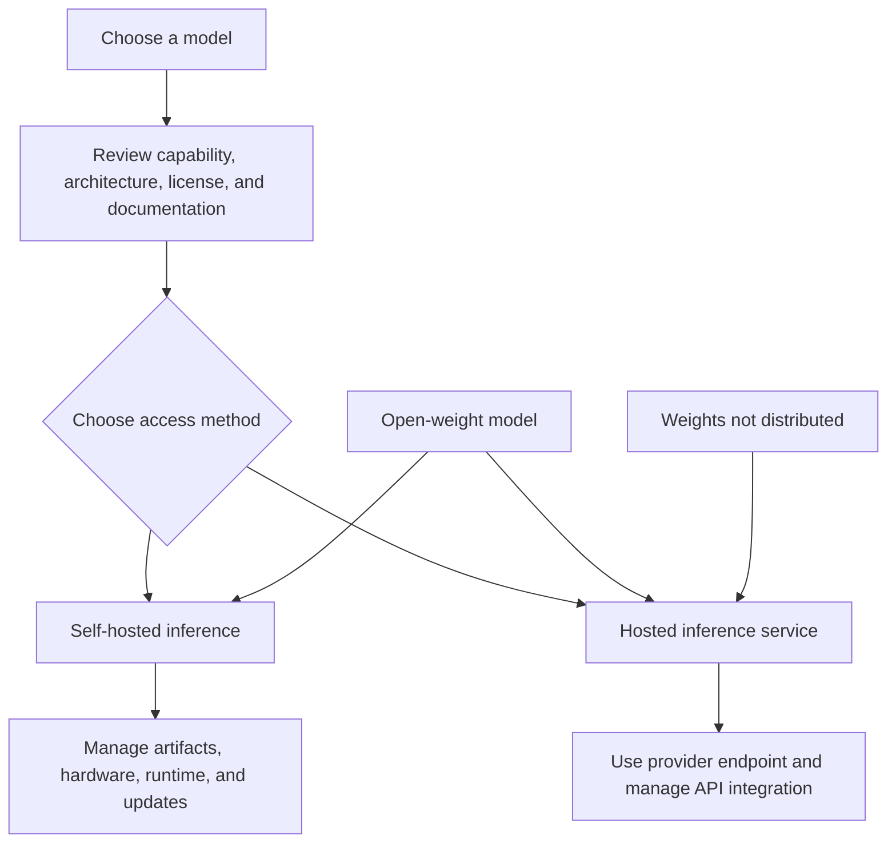

# 12. Open-Weight and Hosted Inference

## Learning Objectives

By the end of this chapter, you should be able to:

- Distinguish downloading or managing model weights from accessing a hosted inference service.
- Explain why an open-weight model can also be available through a hosted provider.
- Evaluate licensing, model documentation, chat templates, and tokenizer compatibility.
- Load a tokenizer and a small pretrained model, place the model on an available device, and generate text.
- Compare setup effort, control, privacy, hardware needs, maintenance, and service reliability.
- Apply basic security practices when downloading model artifacts and installing dependencies.
- Choose an access approach independently of the model's license and architecture.

<br/>

## 1. Two Different Decisions: Model and Access

When using a language model, separate two decisions:

1. **Which model should be used?** This concerns model capability, architecture, parameter count, training, licensing, tokenizer, and intended use.
2. **How should it be accessed?** This concerns running the model locally or on infrastructure you manage, or sending requests to a hosted inference service.

These decisions are related but not identical. A model with publicly available weights may be run locally, deployed on a cloud instance, or offered through a hosted provider. Conversely, a model whose weights are not distributed to users may still be accessible through an API.

<br/>

### Key terms

- **Open-weight model:** A model for which trained weight files are made available under stated terms. “Open-weight” does not automatically mean the model is fully open source, unrestricted, or free of use conditions.
- **Hosted inference:** A service runs the model and accepts requests through an API or another interface. The user typically does not manage the model's underlying hardware directly.
- **Self-hosted inference:** You run the model on hardware or infrastructure you control, whether on a local machine, private server, or cloud instance.
- **Model architecture:** The design of the neural network, such as a decoder-only transformer. Architecture is not the same as access method or license.



The diagram is conceptual: actual availability depends on the model, license, provider, and deployment options.

<br/>

## 2. Open Weights Do Not Determine Hosting

An open-weight model may be offered by a hosted provider. The provider downloads or otherwise obtains the permitted model artifact, deploys it, and exposes an inference interface. Users can then access the model without personally running the weights.

Likewise, having access to an API does not imply that the user can download the weights or run the same model locally.

| Question | Model/access concept |
|---|---|
| Can I download the trained weights? | Weight availability and license |
| Can I call the model through an API? | Hosted-service availability and terms |
| Can I run it on my laptop? | Hardware, runtime compatibility, and model size |
| Can I modify or redistribute it? | License and associated terms |
| Can I use it commercially? | License, acceptable-use terms, and any additional conditions |

**Important:** Model licensing and service terms are separate checks. Read the actual license and provider terms rather than inferring rights from labels such as “open,” “free,” or “hosted.”

<br/>

## 3. Licensing and Model Documentation

Before downloading or deploying a model, review its official model card and license. These can describe intended uses, limitations, training-data information, supported languages, evaluation results, safety considerations, and usage restrictions. Documentation quality varies, and a model card is not a substitute for independent evaluation.

Check at least:

- **License:** Is the intended use permitted? Are there attribution, redistribution, commercial-use, or other conditions?
- **Acceptable-use policy:** Does the provider or model owner restrict certain applications?
- **Model card:** What tasks, languages, limitations, and evaluation settings are documented?
- **Architecture and parameter count:** What runtime and memory demands should be expected?
- **Tokenizer:** Which tokenizer files and version are intended for this checkpoint?
- **Chat template:** How should system, user, and assistant messages be formatted?
- **Revision/version:** Which exact checkpoint or revision is being used?
- **Security and provenance:** Where did the files come from, and are they the expected artifacts?

Do not assume two checkpoints with similar names are interchangeable. Their tokenizer, chat template, architecture, configuration, or license may differ.

<br/>

## 4. Tokenizer and Chat-Template Compatibility

A tokenizer converts text into token IDs and converts generated token IDs back into text. The tokenizer is part of the model's input/output contract: using an incompatible tokenizer can change the token sequence the model receives and the text it produces.

Chat models may also expect a **chat template** that encodes message roles and boundaries in a model-specific format. A template may add special tokens or control markers. A plain concatenation of message text is not necessarily equivalent to the expected formatted conversation.

Practical rules:

- Load the tokenizer associated with the exact model checkpoint.
- Use the model's documented chat template when one is provided.
- Do not assume that every instruct/chat checkpoint uses the same role markers.
- Check whether the model expects a generation prompt to be appended.
- Validate a short test prompt before integrating the model into an application.

For a simple text-completion checkpoint, chat formatting may not be relevant. Follow the model's documentation rather than adding a template by default.

<br/>

## 5. Local Inference: A Small Example

The following example uses the Hugging Face Transformers interface to load a small pretrained text-generation model and its tokenizer, move the model to an available device, and generate a continuation.

Before running it, select a model whose license and documentation permit your intended use. Model availability, memory needs, and supported device types vary. The first run may download model files and therefore requires network access. A GPU is not mandatory for every small model, but CPU inference can be slower.

<br/>

### Installation

```bash
pip install torch transformers
```

For a reproducible environment, pin tested package versions in your project's dependency file after verifying compatibility with your Python version and hardware.

### Load and generate

```python
import time
import torch
from transformers import AutoModelForCausalLM, AutoTokenizer

# Example only: verify the model card, license, and hardware needs
# before selecting a checkpoint for your use case.
model_id = "distilgpt2"

device = torch.device("cuda" if torch.cuda.is_available() else "cpu")

tokenizer = AutoTokenizer.from_pretrained(model_id)
model = AutoModelForCausalLM.from_pretrained(model_id)
model.to(device)
model.eval()

prompt = "Generative AI inference is"
inputs = tokenizer(prompt, return_tensors="pt").to(device)

start = time.perf_counter()
with torch.no_grad():
    output_ids = model.generate(
        **inputs,
        max_new_tokens=40,
        do_sample=False,
    )
elapsed_seconds = time.perf_counter() - start

generated_text = tokenizer.decode(
    output_ids[0],
    skip_special_tokens=True,
)

print(generated_text)
print(f"Device: {device}")
print(f"Generation time: {elapsed_seconds:.3f} seconds")
```

This is a minimal causal-language-model example. `distilgpt2` is a small text-completion model and is not an instruction-tuned assistant; its output behavior should not be treated as representative of every chat model. For a chat/instruct checkpoint, follow that model's documented chat template and generation guidance.

The timing above is a simple wall-clock measurement, not a rigorous benchmark. On accelerators, asynchronous execution and first-run overhead can affect timing. For meaningful benchmarking, warm up the model, synchronize the device where applicable, run multiple trials, and report the measurement method.

<br/>

### Optional: estimate parameter storage

A rough lower-bound estimate for parameter storage is:

$$
\text{weight bytes} \approx
\frac{\text{parameter count} \times \text{bits per parameter}}{8}
$$

This excludes tokenizer files, quantization metadata, activations, KV cache, temporary buffers, framework overhead, and other runtime allocations. Use actual runtime measurements to determine whether a checkpoint fits on the target device.

<br/>

## 6. Record Runtime and Memory

For the practice exercise, record enough detail for another person to understand the result:

| Item | What to record |
|---|---|
| Model | Exact model ID and revision/checkpoint |
| License | Relevant license name and intended-use constraints |
| Software | Python, PyTorch, Transformers, and driver/runtime versions as applicable |
| Device | CPU/GPU model and available memory |
| Precision | Actual loading precision or quantization format |
| Input | Prompt and input token count |
| Generation | Maximum new tokens and decoding settings |
| Timing | Warm-up policy, number of trials, and latency measurements |
| Memory | Peak device memory where measurable; distinguish it from file size |
| Output | Generated text and any task-specific quality observations |

A single timing result is not enough to compare two environments. Keep the prompt, output-token budget, model revision, and generation settings constant when comparing devices or access methods.

<br/>

## 7. Hosted Inference: Conceptual Example

A hosted service generally handles model deployment and generation on provider-managed infrastructure. The application sends a request and receives the response. The precise client library and request schema depend on the provider.

A generic API interaction looks like this:

```python
# Pseudocode: replace the client and fields with the
# official SDK for your selected provider.
client = ProviderClient(api_key=load_secret_securely())

response = client.generate(
    model="provider-model-id",
    prompt="Generative AI inference is",
    max_output_tokens=40,
)

print(response.text)
```

This is intentionally pseudocode, not a runnable provider-specific example. Do not put API keys directly into source code or commit them to version control. Use environment variables, a secret manager, or the provider's recommended credential mechanism.

Hosted inference can simplify setup, but it introduces dependencies on the provider's API, availability, rate limits, pricing, terms, and data-handling policies.

<br/>

## 8. Compare Access Approaches

| Dimension | Self-hosted inference | Hosted inference |
|---|---|---|
| Setup effort | Install runtime, acquire artifacts, configure hardware, and troubleshoot dependencies | Usually less model infrastructure to manage; API integration still required |
| Control | Greater control over artifacts, runtime, and deployment configuration | Control is limited to the provider's exposed options |
| Privacy and data handling | Can keep requests within controlled infrastructure if configured correctly | Requests are sent to the provider; review retention, processing, and contractual terms |
| Hardware | You must provide or rent compatible hardware | Provider supplies the serving hardware |
| Maintenance | You manage updates, security, scaling, and runtime compatibility | Provider manages much of the model-serving infrastructure; client integration remains your responsibility |
| Reliability | Depends on your infrastructure, operations, and capacity | Depends on provider availability, rate limits, network, and service terms |
| Cost profile | Hardware, storage, engineering, power, and operations | Usage charges or service plans, plus integration and network costs |
| Scaling | Requires capacity planning and infrastructure work | May be easier to scale within provider limits and pricing |
| Model choice | Limited by available artifacts, license, and hardware | Limited by provider catalog and access terms |

Neither approach is universally superior. The appropriate choice depends on workload, privacy requirements, latency, operational capability, budget, and model availability.

<br/>

## 9. Privacy and Security Considerations

### Hosted requests

Before sending prompts to a hosted provider, review its current documentation and contract for:

- Data retention and deletion.
- Whether requests may be used for service improvement or training.
- Processing location and subprocessors where relevant.
- Access controls, encryption, and audit features.
- Compliance requirements for the intended application.
- Logging of prompts and responses in your own application.

Do not assume that an API is private merely because it is authenticated. Minimize sensitive data and apply the organization's data-handling rules.

<br/>

### Local or self-hosted artifacts

Local inference can give an organization more control over where prompts and model artifacts reside, but it does not automatically make the system secure. The machine, logs, dependencies, downloaded artifacts, and network access still need protection.

Use reputable artifact sources and verify the model identity and revision. Where available, verify checksums or signatures against a trusted source. Pin dependencies, monitor security advisories, and avoid loading untrusted model or serialization files with unsafe deserialization behavior.

For example, prefer documented loading methods and safe formats supported by the framework. Do not assume every file named `model` or every third-party repository is trustworthy. Model files and custom code can pose supply-chain risks; inspect repository code and only enable custom remote code when it is necessary and trusted.

<br/>

## 10. Dependency and Artifact Provenance

**Provenance** is the record of where an artifact or dependency came from and how it entered the environment. It matters because a model checkpoint, tokenizer, custom modeling code, or Python package can affect security and reproducibility.

A practical checklist:

1. Download from the official model owner or a trusted distribution channel.
2. Record the exact repository and revision/commit.
3. Review the license and model card before use.
4. Pin dependencies and document the environment.
5. Verify checksums/signatures when trustworthy values are published.
6. Inspect custom model code before enabling it.
7. Avoid unsafe deserialization of untrusted artifacts.
8. Keep credentials out of source control and restrict filesystem/network permissions.
9. Re-evaluate artifacts and dependencies before upgrading versions.

This checklist reduces avoidable risk; it does not guarantee that an artifact is safe.

<br/>

## 11. Choosing an Access Approach Independently

A useful decision process is:

1. **Check licensing and intended use.** Is the model permitted for the application?
2. **Check access availability.** Are weights downloadable, and is a hosted endpoint available?
3. **Estimate hardware requirements.** Does the target environment have enough memory and compatible compute?
4. **Evaluate privacy requirements.** Can request data be sent to the provider under the applicable policies?
5. **Compare operational costs.** Include infrastructure and engineering for self-hosting, not only hardware rental; include usage and service constraints for hosted inference.
6. **Benchmark the actual workload.** Measure quality, latency, throughput, and memory with representative prompts.
7. **Choose the deployment method.** The same model may support more than one access method, subject to license and provider availability.

Do not infer that a model must be self-hosted because it has open weights, or that a hosted service uses closed weights. Those are separate questions.

<br/>

## 12. Practice

### Exercise 1 — Separate model and access decisions

A model has downloadable weights and is also available through a hosted API. Explain two different ways to use it and name one trade-off for each.

<br/>

### Exercise 2 — Inspect a model card

Choose a small model suitable for experimentation. Record its license, intended use, architecture, tokenizer, chat-template guidance (if applicable), and any documented limitations. Do not assume these properties from the model name.

<br/>

### Exercise 3 — Run a local baseline

Run the local example on available hardware. Record the model revision, device, package versions, input tokens, generated tokens, latency, and peak memory if measurable. Note whether the output is coherent for the model's intended task.

<br/>

### Exercise 4 — If hardware is insufficient

If the model does not fit or local inference is too slow, document a hosted alternative. Record the provider's model ID, data-handling terms, pricing basis, rate limits, supported settings, and any differences from the local checkpoint. Do not assume the hosted version is identical without evidence.

<br/>

### Exercise 5 — Artifact security

List four checks you would perform before using a third-party model repository or custom loading code in a production environment.

<br/>

## 13. Answers and Checkpoint Review

### Exercise 1 — Suggested answer

The model can be run locally or on infrastructure you control, which offers more runtime control but requires compatible hardware and maintenance. Alternatively, it can be accessed through a hosted API, which reduces serving setup but introduces provider dependencies, pricing, and data-handling considerations.

<br/>

### Exercise 2 — Suggested answer

Use the official model card and license as the basis. Record the exact revision, architecture, tokenizer, chat-template instructions, intended use, and known limitations. If documentation does not specify a property, mark it as unspecified rather than guessing.

<br/>

### Exercise 3 — Suggested answer

Keep the prompt and generation settings fixed, record the environment and model revision, and measure multiple runs if comparing performance. Report the timing method and memory measurement method so results are interpretable.

<br/>

### Exercise 4 — Suggested answer

Choose a hosted endpoint only after checking availability, provider terms, data handling, pricing, limits, and supported controls. Compare it using the same prompt and output budget where possible, and document that a hosted model with a similar name may not be the identical checkpoint or revision.

<br/>

### Exercise 5 — Suggested answer

Verify the source and exact revision, review the license and repository code, pin dependencies, check checksums or signatures when available, use safe serialization/loading methods, and avoid enabling untrusted custom code.

<br/>

### Checkpoint

**How should the access approach be chosen independently of licensing and architecture?** First determine whether the model's license permits the intended use and whether the required access path is available. Then choose between self-hosting and a hosted service based on hardware, privacy, control, cost, maintenance, reliability, and measured performance. Open weights do not require self-hosting, and model architecture alone does not determine the access method.

<br/>

## Summary

Open-weight availability, hosted-service access, licensing, and architecture are separate concepts. A model with downloadable weights may also be available through a hosted provider. Local inference offers greater infrastructure control but requires hardware, dependency management, artifact security, and maintenance. Hosted inference reduces serving responsibilities but depends on provider terms, availability, pricing, and data handling. Use the model's exact documentation, tokenizer, chat template, and revision; verify artifact provenance; and compare approaches using measured quality, latency, memory, and cost.
