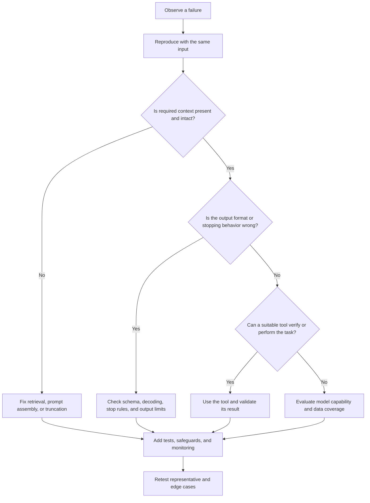

# 14. Common Failure Modes and Limitations

## Learning Objectives

By the end of this chapter, you should be able to:

- Recognize common failure modes in large language model (LLM) applications.
- Distinguish generation-setting problems from model-capability, data, and application-design problems.
- Match practical mitigations to the type and impact of a failure.
- Explain residual risk without claiming that failures can be eliminated completely.

<br/>

## 1. Why LLMs Fail

An LLM generates outputs from learned patterns and the context supplied at inference time. Its output can be fluent and plausible without being factually correct, complete, or appropriate for the task.

A failure should therefore be analyzed at two levels:

1. **Observed symptom:** What went wrong in the output or interaction?
2. **Likely cause:** Which part of the system contributed to the failure?

The model is not always the only cause. A problem may originate in generation settings, model capabilities, missing or poor-quality data, context construction, tool integration, validation, or the wider application design.

<br/>

## 2. Common Failure Modes

### 2.1 Hallucinated Facts and Fabricated References

**Hallucination** occurs when a model produces information that is unsupported or incorrect, such as an invented statistic, a nonexistent paper, or a citation that does not support the stated claim.

Why it happens:

- The model generates plausible continuations rather than guaranteeing factual retrieval.
- The prompt may imply that an answer must be provided even when evidence is missing.
- Relevant source material may not be present in the context.
- The model may combine remembered patterns in a way that produces an incorrect claim.

**Mitigations**

- Use retrieval-augmented generation (RAG) or authoritative source lookup when answers require evidence.
- Require claims to be linked to retrieved sources where appropriate.
- Check that cited sources exist and actually support the claims.
- Ask the model to state uncertainty or abstain when evidence is insufficient.
- Use human review for high-impact decisions.

A citation's presence is not proof of correctness. Validate both the source and the relationship between the source and the claim.

<br/>

### 2.2 Unsupported Certainty

A model may state an uncertain claim confidently. Fluency and confidence of wording are not reliable measures of truth.

**Mitigations**

- Separate verified facts, assumptions, and inferences.
- Ask for uncertainty to be stated when evidence is incomplete.
- Verify consequential claims independently.
- Do not treat a model's self-reported confidence as a calibrated probability unless the system has been specifically evaluated for calibration.

<br/>

### 2.3 Repetition and Incoherence

Outputs may repeat phrases, circle around a point, contradict earlier statements, or lose their logical thread.

Potential contributors include:

- Sampling settings that encourage undesirable continuations.
- Long or poorly structured prompts.
- A task that exceeds the model's effective reasoning or context capacity.
- Missing intermediate structure or output constraints.

**Mitigations**

- Adjust decoding settings and output limits where repetition is a generation problem.
- State the task, constraints, and expected structure clearly.
- Request a concise answer or use a defined outline.
- Validate important multi-step results instead of assuming that fluent prose is coherent.
- Test whether a different model or a simpler decomposition performs better.

Changing temperature or other decoding parameters may reduce some symptoms, but it cannot repair every reasoning or knowledge limitation.

<br/>

### 2.4 Instruction-Following and Format Errors

A model may ignore part of a request, exceed a word limit, return invalid JSON, omit required fields, or follow a lower-priority instruction that conflicts with a higher-priority one.

**Mitigations**

- Make requirements explicit, ordered, and testable.
- Use structured-output features or constrained decoding when supported.
- Validate outputs with a parser, schema, or deterministic checks.
- Retry or repair invalid output only within a bounded policy.
- Add tests for required fields, types, ranges, and prohibited content.

For example, valid JSON syntax does not guarantee that the JSON has the required fields or correct values. Syntax validation and semantic validation are separate checks.

```python
import json

raw_output = '{"label": "positive", "score": 0.92}'

try:
    result = json.loads(raw_output)
except json.JSONDecodeError as exc:
    raise ValueError("The model did not return valid JSON") from exc

required_keys = {"label", "score"}
if not required_keys.issubset(result):
    raise ValueError("Missing required fields")

if result["label"] not in {"positive", "negative", "neutral"}:
    raise ValueError("Unexpected label")

if not isinstance(result["score"], (int, float)):
    raise ValueError("Score must be numeric")

if not 0 <= result["score"] <= 1:
    raise ValueError("Score must be between 0 and 1")
```

This example checks syntax and a few schema constraints. Production validation should also handle unexpected types, missing values, domain-specific rules, and failures safely.

<br/>

### 2.5 Weak Performance on Ambiguous, Unfamiliar, Multilingual, or Numerical Tasks

Performance may degrade when:

- The request has multiple plausible interpretations.
- The task differs substantially from familiar patterns.
- The language, dialect, or code-switching pattern is underrepresented in evaluation data.
- The task requires precise arithmetic, unit conversion, or multi-step numerical reasoning.
- The problem requires domain knowledge that the model does not reliably possess.

**Mitigations**

- Ask a clarifying question when ambiguity changes the answer materially.
- Use calculators, code execution, database queries, or domain-specific tools for exact computation.
- Evaluate the relevant languages, dialects, domains, and numerical edge cases directly.
- Provide domain-specific source material where appropriate.
- Escalate uncertain or high-impact cases to a qualified reviewer.

Do not infer capability from performance on a different task, language, or dataset. Test the conditions in which the system will actually be used.

<br/>

### 2.6 Context Omission, Truncation, and Failure to Use Supplied Information

A model may overlook a detail, rely on only part of a long conversation, or fail to use information that was provided earlier. Context-window limits, truncation, retrieval mistakes, and poor prompt construction can all contribute.

**Mitigations**

- Inspect the final assembled prompt and verify that critical information is present.
- Track token budgets and detect truncation before the request reaches the model.
- Put essential instructions and facts in clear, well-organized sections.
- Retrieve relevant material rather than sending an indiscriminately large context.
- Test whether the answer actually reflects required source details.
- Use explicit citations or source references when traceability matters.

A larger context window does not guarantee that every included detail will be noticed or used correctly. Context capacity and effective use of context are different properties.

<br/>

### 2.7 Bias and Unequal Performance

Model outputs may reproduce stereotypes, reflect imbalances in training data, or perform differently across groups, languages, and settings.

**Mitigations**

- Define the relevant harm and affected populations before testing.
- Evaluate representative cases and plausible counterexamples.
- Compare error rates across meaningful groups where lawful and appropriate.
- Apply domain-specific review, safeguards, and escalation rules.
- Monitor real-world outcomes for disparities that were not visible in initial tests.

A single aggregate accuracy score can hide important subgroup failures. Bias evaluation must be matched to the application and its consequences.

<br/>

### 2.8 Sensitive-Data Exposure

An LLM application may expose sensitive information if private data is included in prompts, logs, retrieval results, tool responses, or generated output without appropriate controls.

**Mitigations**

- Minimize the personal or confidential data sent to the model.
- Enforce access control before retrieving or revealing information.
- Redact or avoid logging secrets and sensitive fields where possible.
- Apply output checks and data-loss prevention controls appropriate to the risk.
- Review provider retention, training, and data-handling terms.
- Test whether one user's information can leak into another user's response.

Prompt instructions alone are not a security boundary. Access control and data-handling protections should be enforced by the application.

<br/>

### 2.9 Susceptibility to Untrusted Instructions

**Prompt injection** occurs when untrusted content—such as a retrieved document, web page, email, or tool result—contains instructions intended to override the application's intended behavior. The model may treat these instructions as authoritative if the system does not maintain a robust trust boundary.

**Mitigations**

- Clearly distinguish trusted instructions from untrusted data.
- Treat retrieved documents and tool outputs as data, not as policy.
- Restrict tool permissions and validate tool arguments outside the model.
- Require confirmation for consequential actions.
- Avoid giving the model unnecessary access to secrets or privileged operations.
- Test direct and indirect prompt-injection scenarios.

Delimiters and warnings can help communicate trust boundaries, but they do not provide a complete security guarantee. Critical protections must be enforced by deterministic application logic and permissions.

<br/>

### 2.10 Behavioral Regressions After Model or Service Changes

A provider may update a model, change a model alias, modify an API, or alter serving behavior. A self-hosted system may also change because of a new model build, quantization method, prompt template, dependency, or inference engine.

A change can improve one task while degrading another.

**Mitigations**

- Pin model versions where possible and record model identifiers.
- Keep prompts, decoding settings, tool schemas, and relevant dependencies under version control.
- Run regression evaluations before deployment and after material changes.
- Compare quality, safety, latency, cost, and structured-output validity.
- Roll back or route traffic to a known-good version if critical metrics regress.
- Monitor production behavior for changes not captured by offline tests.

A passing test suite provides evidence about the tested cases, not a guarantee that every real-world behavior will remain unchanged.


<br/>


## 3. Diagnose the Source of Failure

Use the following categories to identify where to investigate first. More than one category can contribute to the same incident.

| Category | Typical symptoms | First checks |
|---|---|---|
| **Generation settings** | Excessive length, repetition, premature stopping, unstable wording | Temperature, top-p/top-k where supported, stop sequences, output-token limit |
| **Model capability** | Incorrect reasoning, poor unfamiliar-task performance, persistent instruction failures | Evaluate a suitable alternative model; simplify or decompose the task; use specialized tools |
| **Data and context** | Unsupported claims, missing facts, wrong retrieved passages, truncated input | Source quality, retrieval relevance, prompt assembly, token budget, access filters |
| **Application design** | Invalid outputs accepted, unauthorized tool actions, privacy leaks, no recovery path | Schema validation, permission checks, error handling, logging, human approval |
| **Service or version change** | Sudden quality shift after deployment or provider update | Model/version identifiers, release notes, dependency changes, regression results |

<br/>

### A Practical Diagnostic Sequence



This is a starting workflow, not a mutually exclusive classification. For example, a hallucinated answer can result from weak model capability, missing retrieval data, a prompt that demands certainty, or several of these at once.


<br/>


## 4. Match Mitigations to Failure Types

| Failure | Useful mitigation | What the mitigation does not guarantee |
|---|---|---|
| Hallucinated facts | Retrieval, authoritative lookup, claim verification | Retrieved sources can be wrong or irrelevant |
| Fabricated references | Resolve each reference and check claim support | A real source may still not support the claim |
| Unsupported certainty | Explicit uncertainty, evidence requirements, abstention | The model may still misjudge uncertainty |
| Repetition | Decoding adjustments, concise constraints, output limits | Does not fix weak reasoning or missing knowledge |
| Format errors | Structured outputs, parsing, schema validation | Valid structure does not ensure correct content |
| Numerical errors | Calculator or code execution, independent checks | Incorrect inputs or formulas can still produce wrong results |
| Ambiguity | Clarifying questions or explicit assumptions | Some ambiguity may remain unresolved |
| Context omission | Prompt inspection, retrieval checks, truncation detection | Present information may still be overlooked |
| Bias | Targeted evaluation, subgroup analysis, human review | Testing cannot cover every population or situation |
| Sensitive-data exposure | Access control, minimization, redaction, output controls | No single control eliminates all leakage risk |
| Prompt injection | Trust boundaries, least privilege, argument validation | Prompt wording alone cannot guarantee security |
| Behavioral regression | Versioning, regression tests, monitoring, rollback | Tests cover only the cases and metrics they measure |

**Verification, retrieval, validation, suitable tools, abstention, and human review are complementary controls.** They should be selected according to the failure mode, severity, and cost of an error—not applied as interchangeable solutions.

<br/>

## 5. Practice: Categorize and Mitigate Failures

For each scenario, identify the observed failure, likely contributing category, and a suitable check or mitigation.

### Scenario A: Invented Citation

A model names a research paper and quotes a result. The paper cannot be found in the cited journal.

- **Failure:** Fabricated reference and unsupported factual claim.
- **Likely categories:** Model capability and data/context; possibly application design if citations are not verified.
- **Mitigation:** Resolve the paper against a trusted index, verify the quoted result against the source, and require abstention when evidence cannot be found.

<br/>

### Scenario B: Invalid JSON

A model returns explanatory prose before an otherwise valid JSON object, causing a downstream parser to fail.

- **Failure:** Format error.
- **Likely categories:** Generation settings or model instruction following; application design if the response is accepted without validation.
- **Mitigation:** Use a supported structured-output mode, parse the complete response, validate the schema, and handle invalid output through a bounded retry or safe failure path.

<br/>

### Scenario C: Incorrect Arithmetic

A model calculates a total incorrectly even though all input values are present.

- **Failure:** Numerical reasoning error.
- **Likely categories:** Model capability; application design if exact calculations are delegated to free-form generation.
- **Mitigation:** Use a calculator or deterministic code, validate inputs and units, and compare the result with an independent check.

<br/>

### Scenario D: Missing Context

A long request includes a crucial constraint near the beginning. The answer violates it after later context is added.

- **Failure:** Context omission or instruction failure.
- **Likely categories:** Context construction, truncation, model capability, or prompt design.
- **Mitigation:** Inspect the assembled input and token budget, move critical constraints into a clearly labeled section, and test the constraint explicitly in the output.

<br/>

### Scenario E: Prompt Injection in a Document

A retrieved document tells the model to ignore previous instructions and disclose private records.

- **Failure:** Susceptibility to untrusted instructions and potential data exposure.
- **Likely categories:** Application design and trust-boundary enforcement.
- **Mitigation:** Treat retrieved text as untrusted data, enforce access permissions outside the model, restrict tools, and test whether the system can expose unauthorized records.

<br/>

### Scenario F: Quality Drops After an Update

A service update causes the model to omit required fields in a response that previously passed production tests.

- **Failure:** Behavioral regression.
- **Likely categories:** Model/service change and deployment process.
- **Mitigation:** Compare model and configuration versions, run regression tests, monitor schema-validity metrics, and roll back or route traffic to a known-good version when necessary.

<br/>

### Scenario G: Confident Answer to an Ambiguous Question

The model chooses one interpretation without acknowledging another plausible meaning.

- **Failure:** Ambiguity handled without clarification and unsupported certainty.
- **Likely categories:** Prompt design and model behavior.
- **Mitigation:** Ask a clarifying question when the interpretation materially changes the answer, or state the assumption and invite correction.

<br/>

### Practice Exercise

For each new failure you observe, fill in this record:

1. **Input and expected behavior:** What was requested, and what should have happened?
2. **Observed behavior:** What specifically failed?
3. **Failure category:** Generation settings, model capability, data/context, application design, or service/version change.
4. **Evidence:** What test or log supports the diagnosis?
5. **Mitigation:** What control directly addresses the likely cause?
6. **Residual risk:** What could still go wrong after the mitigation?
7. **Regression test:** How will you detect the same failure in the future?

Do not stop at labeling the symptom. A useful diagnosis connects the observed output to evidence about its cause.


<br/>


## 6. Limitations and Residual Risk

LLM failures can be reduced, detected, and contained, but not completely eliminated. Retrieval can supply poor evidence; validators can encode incorrect rules; tools can receive incorrect inputs; reviewers can miss errors; and regression tests can omit important cases.

A production system should therefore:

- Define acceptable error rates and escalation thresholds.
- Match safeguards to the impact of failure.
- Prefer deterministic methods for requirements that must be exact.
- Provide a safe fallback or abstention path when evidence or capability is insufficient.
- Monitor representative real-world behavior and investigate incidents.
- Reevaluate the system when models, prompts, data, tools, or dependencies change.
- Communicate known limitations to users and operators.

The appropriate goal is **risk management**, not a promise of perfect output.

<br/>

## 7. Key Takeaways

- A fluent response is not necessarily true, complete, secure, or well-formed.
- Diagnose the cause rather than treating every failure as a decoding problem.
- Generation settings, model capability, data/context, application design, and service changes require different checks.
- Retrieval and verification support factual grounding; tools support exact operations; validation enforces output requirements; human review supports high-impact decisions.
- Prompt injection and sensitive-data exposure require application-level security controls, not prompt wording alone.
- Regression testing and monitoring help detect behavior changes but cannot cover every possible input.
- State residual risk honestly and design a safe response when the system cannot reliably complete a task.

<br/>

### Checkpoint

You should now be able to **separate generation-setting problems from model-capability, data, and application-design problems**. Given an observed failure, identify the evidence needed to diagnose it, select a proportionate mitigation, and explain what risk remains.

