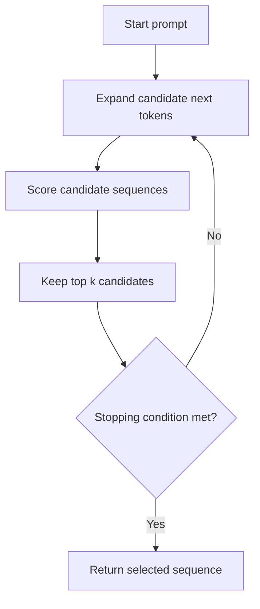

# 15. Practice and Revision

## Learning Objectives

By the end of this chapter, you should be able to:

- Explain how major LLM training stages affect model behavior.
- Trace greedy decoding, beam search, and sampling with small examples.
- Compare generation settings using fixed prompts and a controlled evaluation process.
- Identify stopping, output-limit, and truncation failures.
- Estimate model weight storage and record inference resource requirements.
- Compare candidate models using quality, latency, cost, and limitations.
- Defend a model and configuration recommendation, including when to reconsider it.

 

## 1. Review: Training Stages and Their Effects

Different training stages influence different aspects of model behavior. Exact training recipes vary by model, so treat the table below as a conceptual guide rather than a universal pipeline.

| Stage | Main purpose | Typical effect on behavior | What it does not guarantee |
|---|---|---|---|
| **Pretraining** | Learn statistical structure from large-scale data, commonly through next-token prediction | General language patterns, representations, and broad learned knowledge | Reliable instruction following or factual correctness on every task |
| **Supervised fine-tuning (SFT)** | Learn from curated examples of desired responses | Better response formats and instruction following for represented tasks | Perfect adherence to every instruction or broad generalization |
| **Preference optimization / RLHF-style training** | Favor outputs preferred under a chosen feedback or reward process | May improve helpfulness, style, and alignment with stated preferences | That every preference is correct or that harmful and false outputs disappear |
| **Inference-time configuration** | Control how the trained model generates a response | Changes output length, randomness, stopping behavior, and other generation properties | New knowledge or a fundamental repair of missing model capability |

A model's behavior reflects its training, data, architecture, inference configuration, and surrounding application. Do not attribute every observed change to a single training stage.

 

### Revision Questions

1. Which stage usually teaches broad language patterns from large-scale data?
2. Which stage uses examples of desired responses?
3. Why does preference optimization not guarantee factual correctness?
4. Can a decoding parameter teach a model new domain knowledge?

**Suggested answers**

1. Pretraining.
2. Supervised fine-tuning.
3. The feedback or reward signal may not directly measure truth, and the model can still make mistakes.
4. No. Decoding settings influence how the model selects outputs; they do not add missing knowledge to its learned parameters.

 

## 2. Trace Decoding Strategies with Toy Examples

Assume a model assigns the following next-token probabilities after a prompt:

| Candidate token | Probability |
|---|---:|
| `A` | 0.50 |
| `B` | 0.30 |
| `C` | 0.20 |

These probabilities are illustrative and are not from a real model.

 

### 2.1 Greedy Decoding

Greedy decoding selects the highest-probability next token at every step.

For the probabilities above, it selects `A`.

**Strengths**
- Simple and computationally efficient.
- Reproducible for a fixed model and input when other sources of nondeterminism are controlled.

**Limitations**
- A locally highest-probability choice may not produce the best overall sequence.
- Can produce repetitive or generic continuations.
- Does not explore alternative continuations.

 

### 2.2 Beam Search

Beam search keeps several candidate sequences instead of only the current best token. At each step, it expands candidates and retains a limited number of high-scoring sequences according to its scoring procedure.

Here, \(k\) is the beam width. With a beam width of 1, the search resembles greedy decoding under a comparable scoring setup. Larger beams increase search work and do not guarantee a better answer for every task.

 

### 2.3 Sampling

Sampling draws the next token from a probability distribution rather than always selecting the maximum.

For the toy distribution:

- `A` has probability 0.50.
- `B` has probability 0.30.
- `C` has probability 0.20.

Across repeated draws, `A` is expected to appear about half the time, `B` about 30% of the time, and `C` about 20%, assuming the distribution remains fixed. One sample can still select any of the three.

Sampling can create diverse outputs, but it also introduces variability. The final sequence distribution changes as each generated token changes the model's next-token distribution.

 

### Compare the Strategies

| Strategy | Basic selection rule | Main advantage | Main limitation |
|---|---|---|---|
| Greedy | Choose the most likely next token | Fast and simple | Local decisions may be suboptimal |
| Beam search | Keep and expand several high-scoring sequences | Searches multiple candidate sequences | More computation; not universally best for open-ended generation |
| Sampling | Draw from a probability distribution | Diversity and variation | Results vary and may be less predictable |

**Task matters:** Beam search is commonly associated with structured sequence-generation settings, while sampling is common for open-ended text generation. Choose based on evaluation rather than assuming one strategy is always superior.

 

## 3. Compare Generation Settings on Fixed Prompts

Generation parameters should be evaluated under controlled conditions. Change one setting at a time where practical, preserve the prompt and model version, and record the output and relevant metrics.

Common settings include:

- **Temperature:** Rescales logits before sampling. Lower values make the distribution more concentrated; higher values flatten it. Its effect depends on the original logits and the decoding method.
- **Top-k:** Restricts sampling to the \(k\) highest-ranked candidate tokens.
- **Top-p (nucleus sampling):** Restricts sampling to the smallest candidate set whose cumulative probability reaches the configured threshold, according to the implementation.
- **Maximum output tokens:** Limits how many tokens may be generated.
- **Stop sequences:** End generation when a configured sequence is encountered, when supported by the serving interface.

Some APIs support only a subset of these settings, and parameter names or interactions can differ. Record the actual configuration accepted by the provider or inference engine.

 

### Controlled Comparison Procedure

1. Select representative prompts, including ordinary, difficult, ambiguous, and unanswerable cases.
2. Keep the model version, system instructions, user prompts, and tool availability fixed.
3. Change one generation setting at a time, unless the experiment explicitly compares complete configurations.
4. Record the exact settings and any unsupported or ignored parameters.
5. Evaluate correctness, instruction adherence, format validity, repetition, and appropriate abstention.
6. Repeat sampling-based runs when variability matters.
7. Compare latency, output length, and cost as well as answer quality.

A prompt that works well under one configuration is not enough evidence to choose a production setting.

 

### Experiment Log Template

| Run | Model/version | Prompt ID | Settings | Output quality | Tokens | Latency | Notes |
|---|---|---|---|---|---:|---:|---|
| 1 | Candidate A | P01 | Baseline | — | — | — | Reference run |
| 2 | Candidate A | P01 | Lower temperature | — | — | — | Change one variable |
| 3 | Candidate A | P01 | Different top-p | — | — | — | Check provider support |
| 4 | Candidate A | P01 | Lower output limit | — | — | — | Inspect truncation |

Fill the results with measurements from your own evaluation; do not infer production performance from the template.

 

## 4. Detect Stopping and Truncation Failures

Generation may end for different reasons. Distinguish a legitimate completion from an output that was cut off.

### Common End Conditions

- **Natural completion / end-of-turn:** The model indicates that its response is finished.
- **Stop sequence:** A configured stopping string or token is encountered.
- **Output-token limit:** The generation reaches the maximum allowed output length.
- **External interruption or service error:** The request stops because of a timeout, cancellation, or serving failure.

The exact finish-reason names depend on the API or inference engine. Inspect the metadata exposed by the actual service rather than assuming all providers use the same labels.

 

### Symptoms of Truncation

- A sentence or code block ends abruptly.
- JSON or another structured format is incomplete.
- A required section is missing.
- The response stops at a configured limit.
- A stop sequence matches text earlier than intended.
- The application silently treats a partial answer as complete.

 

### Checks and Mitigations

- Record finish reason, generated-token count, and any stop-sequence metadata.
- Validate structured output after generation.
- Set an output budget appropriate to the task.
- Test stop sequences against representative content, including cases where the sequence may appear naturally.
- Detect incomplete outputs and use a bounded recovery path, such as a targeted continuation or a safe error.
- Avoid automatically concatenating retries when that could create duplicated or contradictory content.

A longer output limit may prevent some length-related truncation, but it does not fix early stop matches, service interruptions, or an answer that is complete in form but wrong in content.

 

### Practice

A model is configured to produce JSON and stops after emitting `{"status": "ok", "items": [`.

- **Diagnosis:** The output is incomplete; it may have reached an output limit or been interrupted.
- **Checks:** Inspect the finish reason and token count, then parse the response.
- **Mitigation:** Adjust the output budget if needed, handle interruption explicitly, and reject the incomplete JSON rather than passing it downstream as valid data.

 

## 5. Estimate Weight Storage and Inference Resources

A first-order estimate of raw model weight storage is:

$$
\text{Weight storage in bytes} \approx
\text{parameter count} \times \text{bytes per parameter}
$$

Approximate storage for weights only:

| Weight precision | Approximate bytes per parameter | 7B parameters | 70B parameters |
|---|---:|---:|---:|
| FP32 | 4 | 28 GB | 280 GB |
| FP16 / BF16 | 2 | 14 GB | 140 GB |
| 8-bit | 1 | 7 GB | 70 GB |
| 4-bit | 0.5 | 3.5 GB | 35 GB |

These are decimal GB estimates for raw weights. Actual checkpoint and runtime memory use can be higher because of quantization metadata, scales, unquantized layers, temporary buffers, allocator overhead, and implementation details. The table does not guarantee that a model will fit on a device of the corresponding memory capacity.

 

### KV Cache and Other Runtime Memory

During autoregressive generation, a transformer commonly stores key and value tensors for previously processed tokens. This **KV cache** grows with context length and, during generation, with the number of tokens already produced. Its size depends on architecture, number of layers, attention heads, key/value head design, cache precision, and batch size.

A practical inference-memory estimate should consider:

- Model weights and quantization overhead.
- KV-cache memory at expected prompt and output lengths.
- Batch size and concurrent requests.
- Temporary activation and kernel workspace memory.
- Framework, runtime, and operating-system overhead.
- Available accelerator memory and multi-device placement.

 

### Resource Estimation Exercise

A model has approximately 7 billion parameters and uses 16-bit weights.

$$
7 \times 10^9 \times 2
= 14 \times 10^9 \text{ bytes}
$$

So the raw weight estimate is about **14 GB** (decimal), before runtime overhead and KV cache. In binary units, this is about 13.0 GiB.

**Interpretation:** A device with 14 GB of advertised memory should not automatically be assumed sufficient. The weights alone consume nearly that amount, leaving little or no room for the cache and runtime.

 

### Resource Planning Record

| Requirement | Record for each candidate |
|---|---|
| Weight format | FP32, FP16/BF16, 8-bit, 4-bit, or other supported format |
| Weight memory | Estimated or measured |
| KV cache | Measured at target context and batch sizes |
| Maximum context | Tested prompt plus expected output length |
| Throughput | Tokens per second under representative load |
| Latency | Time to first token and total response time |
| Concurrency | Number of simultaneous requests tested |
| Hardware | Accelerator type, memory, and device count |
| Runtime overhead | Framework, cache, and serving overhead |
| Failure behavior | Out-of-memory handling, queueing, timeouts, and fallback |

Measure resource usage on the intended runtime and workload whenever possible. Parameter count and precision alone are not sufficient for capacity planning.

 

## 6. Compare Model Quality, Latency, Cost, and Limitations

Model selection is a multi-objective decision. A candidate that produces the strongest answers may be too slow or expensive; a fast, low-cost candidate may fail the quality threshold for important cases.

### Core Metrics

- **Quality:** Correctness, instruction adherence, factual grounding, structured-output validity, safety, and task-specific success.
- **Latency:** Time to first token (TTFT), time to complete a response, and tail latency under load.
- **Throughput:** Requests or generated tokens handled per unit of time.
- **Cost:** API usage or infrastructure, storage, operations, monitoring, and engineering effort.
- **Limitations:** Weak task areas, language coverage, context constraints, tool compatibility, privacy requirements, version stability, and failure behavior.

Use the same evaluation set and success criteria for every candidate. Benchmark scores from unrelated tasks may help with initial screening but cannot replace application-specific testing.

 

### Example Comparison Matrix

The following is a blank decision framework; it does not claim measured results for any real model.

| Criterion | Weight / requirement | Candidate A | Candidate B |
|---|---|---|---|
| Task quality | Must meet minimum score | Measure | Measure |
| Factual grounding | Must meet minimum score | Measure | Measure |
| Format validity | Must meet required rate | Measure | Measure |
| Time to first token | Maximum target | Measure | Measure |
| Total latency | Maximum target | Measure | Measure |
| Cost per successful task | Budget target | Calculate | Calculate |
| Context and output limits | Must fit workload | Verify | Verify |
| Privacy / deployment | Hard constraint if applicable | Verify | Verify |
| Operational complexity | Acceptable support burden | Assess | Assess |
| Known limitations | Must be documented | Record | Record |

First eliminate candidates that violate hard constraints. Then compare those that remain on quality, latency, cost, and operational fit.

 

### Cost per Successful Task

Raw cost per request can be misleading when candidates have different failure rates.

$$
\text{Cost per successful task}
=
\frac{\text{Total evaluation cost}}
{\text{Number of successful tasks}}
$$

For example, if a test run costs \$20 and produces 80 successful tasks, the measured cost is \$0.25 per successful task. If another run costs \$15 but produces only 40 successful tasks, its measured cost is \$0.375 per successful task. These are illustrative figures, not market prices.

Define “successful” before testing. A task should not count as successful merely because the model returned a response.

 

## 7. Inference Comparison Report

Complete this report to defend a model and configuration recommendation.

### A. Use Case and Constraints

- **Task:** What must the model do?
- **Users and operating environment:** Who uses it, and under what conditions?
- **Quality threshold:** What constitutes a successful answer?
- **Hard constraints:** Privacy, deployment location, context length, latency, cost, or supported tools.
- **Failure impact:** What happens when the answer is wrong, incomplete, or unsafe?

 

### B. Candidates and Configuration

Record for each candidate:

- Model name and exact version or identifier.
- Hosted or self-managed deployment.
- Weight precision and hardware, where applicable.
- Supported decoding controls and exact values used.
- Prompt template, context construction, and tool access.
- Output-token limit and stop conditions.

 

### C. Evaluation Results

Use a representative, fixed test set. Include ordinary requests, edge cases, ambiguous requests, unanswerable questions, multilingual or numerical cases when relevant, and expected failure scenarios.

| Metric | Candidate A | Candidate B | Required threshold |
|---|---:|---:|---:|
| Successful-task rate | — | — | — |
| Factual-grounding rate | — | — | — |
| Format-validity rate | — | — | — |
| Median / p95 latency | — | — | — |
| Cost per successful task | — | — | — |
| Peak memory / resource use | — | — | — |
| Critical safety failures | — | — | — |

Use actual measurements. Report sample size and important test conditions, and avoid treating small differences as meaningful without considering uncertainty.

 

### D. Recommendation

Write a concise decision that covers:

1. **Selected candidate and configuration.**
2. **Evidence:** Which measured results satisfy the requirements?
3. **Trade-offs:** What quality, cost, latency, or capability compromises are accepted?
4. **Mitigations:** Which tools, retrieval, validators, fallbacks, or human-review steps are required?
5. **Residual risks:** Which failures remain possible?
6. **Reconsideration triggers:** What change would justify testing or switching candidates?

 

### E. Example Recommendation (Illustrative)

> Select Candidate A for the initial deployment because it meets the task-quality and structured-output thresholds while remaining within the latency and cost limits measured on the representative evaluation set. Use deterministic validation for required fields and a trusted retrieval source for factual answers. Route unresolved or high-impact cases to human review. Reconsider the choice if production quality falls below the agreed threshold, p95 latency exceeds the service target, cost per successful task rises materially, the workload changes, or a new candidate demonstrates better results on the same evaluation suite.

This example illustrates the structure of a defensible recommendation. It does not endorse a specific real-world model.

 

## 8. Final Revision Checklist

Before finalizing an inference setup, confirm that you can answer each question:

- [ ] Can I explain the behavior each training stage is intended to influence?
- [ ] Can I trace greedy decoding, beam search, and sampling using a toy distribution?
- [ ] Have I compared only settings supported by the actual model-serving interface?
- [ ] Can I distinguish natural completion, stop-sequence termination, token-limit truncation, and service interruption?
- [ ] Have I estimated weight storage and measured runtime memory, including KV cache?
- [ ] Have I evaluated quality, latency, throughput, cost, and limitations on the same representative test set?
- [ ] Have I defined success and documented sample size and test conditions?
- [ ] Have I recorded the exact model version, prompt, settings, and environment?
- [ ] Have I specified safeguards, fallback behavior, and residual risks?
- [ ] Have I identified the conditions that would trigger a review of the recommendation?

 

## Key Takeaways

- Training stages shape model behavior, but none guarantees correctness on every task.
- Greedy decoding, beam search, and sampling make different trade-offs between simplicity, search, and diversity.
- Generation settings must be tested under controlled, repeatable conditions.
- Stop conditions and output limits can create incomplete responses; inspect finish metadata and validate outputs.
- Raw weight storage is only one part of inference memory. KV cache, concurrency, and runtime overhead also matter.
- Choose a model and configuration using application-specific measurements rather than a single benchmark or parameter count.
- A strong recommendation states its evidence, trade-offs, mitigations, residual risks, and reconsideration triggers.

 

### Checkpoint

You should be able to **defend a model/configuration recommendation and state when you would reconsider it**. Your decision should connect measured quality, latency, cost, resource requirements, and known limitations to the application's requirements. It should also name the conditions—such as a workload change, regression, budget shift, or stronger evaluated alternative—that would trigger a new comparison.
