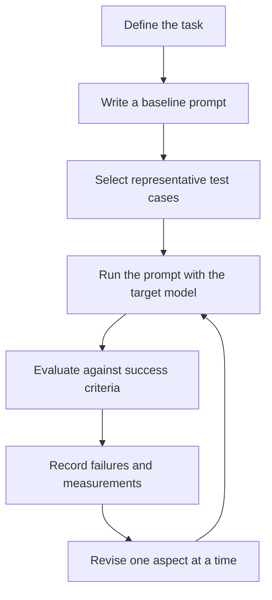

# 01. Prompt Engineering Overview

## Learning Objectives

By the end of this chapter, you should be able to:

- Define prompt engineering and distinguish it from model training.
- Identify the main components of a prompt.
- Separate task quality from fluent wording and correct formatting.
- Create a baseline prompt and define measurable success criteria.
- Explain why prompts must be tested with the intended model and task.
- Inspect a prompt for ambiguity, missing information, and unclear requirements.

<br/>

## 1. What Is Prompt Engineering?

**Prompting** is the process of specifying a task for a model at inference time through instructions, input data, context, examples, constraints, and output requirements.

**Prompt engineering** is the systematic design, testing, and refinement of those prompts to improve the reliability and usefulness of model outputs.

The key distinction is that prompting changes the **input provided to the model**, not the model's learned weights. During ordinary prompting, the model uses its existing parameters to generate a response. Fine-tuning, by contrast, updates some or all model weights through an additional training process.

<br/>

### Prompting versus fine-tuning

| Aspect | Prompting | Fine-tuning |
|---|---|---|
| What changes? | The input instructions and supplied information | Model weights are updated through training |
| When does it happen? | At inference time | During a training or adaptation stage |
| Requires a training dataset? | Not necessarily | Usually requires suitable training examples |
| Typical iteration | Edit the prompt and test again | Prepare data, train or adapt, then evaluate |
| Useful when | Instructions, context, examples, or output requirements can guide behavior | Repeated behavior needs to be learned or adapted and prompting alone is insufficient |

Prompting does not guarantee a correct answer. A well-written prompt can reduce ambiguity, but the model can still misunderstand instructions, omit details, or produce unsupported claims.

<br/>

## 2. Why Prompt Engineering Matters

A language model does not automatically know the exact task boundaries, audience, evidence requirements, or output format intended by an application developer. These expectations must be communicated.

For example, the request **“Summarize this report”** leaves several questions unanswered:

- Who is the summary for?
- How long should it be?
- Which facts must be retained?
- Should risks and limitations be included?
- Should the model use only the supplied report?
- What format should the answer follow?

A more explicit prompt reduces the number of decisions the model must infer.

Prompt engineering is especially useful when an application needs outputs that are consistent, testable, and suitable for downstream processing. It is not a substitute for validation, retrieval, authorization, or independent verification.

<br/>

## 3. The Main Components of a Prompt

A prompt can contain several components. Not every task requires all of them, but each component should serve a clear purpose.

| Component | Purpose | Example |
|---|---|---|
| **Instruction** | States what the model should do | “Summarize the support message.” |
| **Input data** | Supplies the material to process | A customer support message |
| **Context** | Provides relevant background needed to perform the task | “This summary is for the support team.” |
| **Examples** | Demonstrates the expected input-output pattern | One example message and its summary |
| **Constraints** | Defines boundaries or rules | “Use only the supplied message; do not infer missing facts.” |
| **Output requirements** | Specifies the expected shape of the answer | “Return three bullet points: issue, impact, and requested action.” |

<br/>

### A reusable prompt structure

```text
Task:
[What should the model do?]

Context:
[What background information is relevant?]

Input:
[The data to process]

Constraints:
[What must or must not happen?]

Output requirements:
[Format, fields, length, labels, or other acceptance conditions]
```

This is a planning template, not a required syntax. The components can be arranged differently depending on the model API, task, and application.

<br/>

### Example: vague versus explicit

**Vague prompt**

```text
Summarize this:
"The delivery arrived three days late. The package was damaged,
and one item was missing. I would like a replacement."
```

**More explicit prompt**

```text
Task:
Summarize the customer's complaint for a support agent.

Input:
"The delivery arrived three days late. The package was damaged,
and one item was missing. I would like a replacement."

Constraints:
- Use only facts stated in the message.
- Do not invent an explanation for the delay or damage.
- Preserve the requested resolution.

Output requirements:
Return exactly three bullet points:
- Delivery problem
- Package or item problem
- Requested resolution
```

**Illustrative expected output**

```text
- Delivery problem: The delivery arrived three days late.
- Package or item problem: The package was damaged and one item was missing.
- Requested resolution: The customer wants a replacement.
```

The revised prompt clarifies the task, evidence boundary, and required coverage. However, the output still needs to be checked against the source.

<br/>

## 4. Task Quality Is Not the Same as Fluency or Formatting

A response can sound confident, read smoothly, and follow the requested format while still being wrong.

Evaluate at least three separate dimensions:

1. **Task quality:** Does the answer correctly complete the intended task?
2. **Factual fidelity:** Are claims supported by the input or allowed evidence?
3. **Format compliance:** Does the answer follow the requested structure and constraints?

For some applications, additional dimensions matter, such as completeness, relevance, consistency, safety, latency, and cost.

<br/>

### Example

Suppose the source says that a package arrived late and one item was missing.

| Output | Fluency | Format | Task quality |
|---|---|---|---|
| “The package arrived late, one item was missing, and the customer requested a replacement.” | Good | Could be valid | Good |
| “The courier lost the package because of poor handling.” | Fluent | Could be valid | Poor: invents a cause |
| A valid JSON object that says the customer requested a refund | Good | Valid JSON | Poor: changes the requested resolution |

**Important:** Syntactically valid JSON is not necessarily factually correct. Likewise, a polished answer is not evidence that the task was completed accurately.

A useful evaluation principle is to score formatting and task correctness separately. If an application requires both, success requires both.

<br/>

## 5. Establish a Baseline Prompt

A **baseline prompt** is the initial version used as a reference point before making improvements. It should be simple enough to understand and explicit enough to test.

Avoid changing many prompt elements at once. If the prompt, model, examples, and generation settings all change together, it becomes difficult to identify what caused an observed improvement or regression.

### Example baseline

```text
Extract the customer's issue and requested resolution from the message.

Message:
"The delivery arrived three days late. The package was damaged,
and one item was missing. I would like a replacement."

Return:
Issue: ...
Resolution: ...
```

This baseline defines the core task and a basic output format. It does not yet state how to handle unsupported causes, missing information, or multiple issues.

<br/>

### Baseline workflow



The baseline is not necessarily the best prompt. Its purpose is to establish a comparison point.

<br/>

## 6. Define Measurable Success Criteria Before Revising

Before editing a prompt, define what a successful output must do. Otherwise, prompt iteration can become subjective: a response may appear better simply because it sounds more polished.

Success criteria should be observable and appropriate to the task.

For the customer-message extraction example, criteria might include:

- Identifies the delivery delay.
- Identifies the damage and missing item.
- Preserves “replacement” as the requested resolution.
- Does not invent causes, dates, or other facts.
- Uses the required output fields.
- Marks genuinely missing information as unknown rather than guessing.

These criteria can be turned into a simple rubric.

| Criterion | Pass condition | Measurement |
|---|---|---|
| Issue coverage | All stated issues are captured | Manual or rule-based checklist |
| Resolution fidelity | “Replacement” is preserved | Exact or semantic comparison |
| Unsupported claims | No invented cause is included | Evidence review |
| Format compliance | Both required fields are present | Parser or validator |
| Missing-data handling | Unknown facts are not guessed | Edge-case test |

For a small learning exercise, a pass/fail checklist may be enough. Larger applications may require task-specific metrics, human review, or a more formal evaluation suite.

<br/>

### A simple success-rate calculation

If a prompt passes the defined criteria on 18 out of 20 test cases:

$$
\text{Pass rate} = \frac{18}{20}\times 100 = 90\%
$$

This result is meaningful only if the test cases represent the intended task and the pass criteria are applied consistently. A 90% pass rate on a small or unrepresentative set does not prove that the prompt will perform equally well in production.

<br/>

## 7. Test with the Selected Model and Task

Prompt performance depends on the interaction between the prompt, model, task, input distribution, and generation configuration. A prompt that works well for one model or task may fail on another.

Reasons include:

- **Model differences:** Models may interpret instructions and examples differently.
- **Task differences:** Extraction, classification, summarization, and open-ended generation have different success conditions.
- **Input variation:** Long, incomplete, contradictory, or unusual inputs can expose weaknesses.
- **Configuration differences:** Supported decoding settings can affect variability and output length.
- **Context limits:** Long prompts may exceed a model's context window or leave insufficient space for the response.
- **Provider capabilities:** Message roles and structured-output features can differ across APIs and models.

<br/>

### Build a representative test set

Include more than easy, typical inputs. A small initial test set should contain:

- **Typical cases:** Common inputs the application expects.
- **Edge cases:** Unusually long, short, or complicated inputs.
- **Missing-information cases:** Required facts are absent.
- **Ambiguous cases:** The input supports more than one interpretation.
- **Conflicting cases:** Different parts of the source disagree.
- **Adversarial cases:** Inputs deliberately attempt to derail the task, when relevant to the application.

Keep the test cases fixed when comparing prompt versions. If you change the test set at the same time as the prompt, the comparison becomes less reliable.

<br/>

### Controlled prompt iteration

1. Run the baseline on a fixed set of cases.
2. Record failures and categorize them.
3. Form a specific hypothesis about the cause.
4. Change one prompt element where practical.
5. Re-run the same cases.
6. Compare task quality, format compliance, and other relevant measurements.
7. Check for regressions before accepting the revision.

Do not treat a single successful example as proof of improvement.

<br/>

## 8. Common Failure Patterns

| Failure pattern | Example | Possible response |
|---|---|---|
| Ambiguous task | “Analyze this message.” | Specify the action and expected result. |
| Missing context | “Write an appropriate reply.” | Define the audience, purpose, and relevant circumstances. |
| Conflicting requirements | “Be exhaustive in one sentence.” | Resolve the conflict or state which requirement has priority. |
| Unsupported inference | Model invents why a delivery was late | Restrict allowed evidence and test unsupported-claim behavior. |
| Format-only success | Output is valid JSON but contains the wrong resolution | Evaluate semantics separately from syntax. |
| Overly narrow testing | Prompt succeeds only on familiar examples | Add representative edge and missing-data cases. |
| Unstable behavior | Repeated runs differ on an important field | Repeat selected tests and use validation or controlled settings where appropriate. |

No prompt pattern eliminates every failure. The correct mitigation depends on the failure mechanism and the consequences of an incorrect result.

<br/>

## 9. Practice: Annotate a Prompt

Consider this prompt:

```text
Read the following customer message and write a short summary.

Message:
"I ordered a blue backpack on 4 May. It arrived on 10 May,
although the estimated delivery date was 7 May. The front pocket
zipper is broken. I want to exchange it for the same product."
```

<br/>

### Step 1: Identify the components

- **Instruction:** Read the message and write a short summary.
- **Input data:** The quoted customer message.
- **Context:** A customer-support setting is implied, but not explicitly stated.
- **Examples:** None.
- **Constraints:** “Short” is vague; no explicit evidence boundary is provided.
- **Output requirements:** A summary is requested, but its length, format, and required facts are unspecified.

<br/>

### Step 2: Identify ambiguities and missing requirements

1. What does “short” mean: one sentence, two bullets, or a word limit?
2. Must the summary preserve the order date and actual delivery date?
3. Must it include the estimated delivery date and delay?
4. Must the broken zipper be included?
5. Must the requested exchange be distinguished from a refund or repair?
6. Should the model include only facts stated in the message?

These are potential requirements to clarify, not facts to invent.

<br/>

### Step 3: Improve the prompt

```text
Task:
Summarize the customer's message for a customer-support agent.

Input:
"I ordered a blue backpack on 4 May. It arrived on 10 May,
although the estimated delivery date was 7 May. The front pocket
zipper is broken. I want to exchange it for the same product."

Constraints:
- Use only information stated in the message.
- Preserve the delivery dates and the requested resolution.
- Do not infer a cause for the delay or damage.

Output requirements:
Return exactly three bullet points:
- Order and delivery
- Product issue
- Requested resolution
```

<br/>

### Step 4: Define success before testing

A successful output should:

- State that the blue backpack arrived on 10 May, three days after the estimated date of 7 May.
- State that the front pocket zipper is broken.
- State that the customer wants to exchange it for the same product.
- Avoid inventing a cause or changing the requested resolution.
- Follow the three-bullet format.

An example output can then be checked against these criteria. It should not be accepted merely because it sounds professional.

<br/>

## 10. Revision Questions

### Q1. Does prompting update the model's weights?

**Answer:** No. Ordinary prompting supplies task instructions and information at inference time. Fine-tuning updates model weights through an additional training process.

### Q2. What are six common prompt components?

**Answer:** Instructions, input data, context, examples, constraints, and output requirements.

### Q3. Why is a fluent response not necessarily a good response?

**Answer:** Fluency concerns presentation. The answer may still omit required information, contradict the source, invent facts, or fail the task.

### Q4. What is a baseline prompt?

**Answer:** An initial prompt used as a reference point for controlled comparison with later revisions.

### Q5. Why define success criteria before revising a prompt?

**Answer:** Criteria make improvement observable and reduce reliance on subjective impressions.

### Q6. Why must a prompt be tested with the intended model and task?

**Answer:** Model capabilities, task requirements, inputs, configuration, and context limits can affect behavior. Performance on one setup does not establish performance on another.

### Q7. If a model returns valid JSON with an incorrect value, has it succeeded?

**Answer:** It has satisfied a formatting requirement but failed the relevant semantic requirement. These dimensions must be evaluated separately.

<br/>

## 11. Chapter Checkpoint

Before changing a prompt, write down:

1. **Task:** What action must the model perform?
2. **Input:** What data will it receive?
3. **Context:** What background information is necessary?
4. **Constraints:** What must it avoid or preserve?
5. **Output contract:** What shape and content are required?
6. **Success criteria:** How will correctness and completeness be judged?
7. **Test set:** Which representative cases will be used?
8. **Failure handling:** What should happen when information is missing, ambiguous, or conflicting?

**Checkpoint answer:** A successful output is one that meets the task-specific acceptance criteria, preserves the required facts, respects the stated constraints, and follows the output requirements. Define these conditions before revising the prompt, then compare prompt versions on the same representative test cases.


<br/>


## Key Takeaways

- Prompt engineering specifies and tests model behavior through inference-time inputs; it does not itself update model weights.
- A useful prompt makes the task, relevant context, constraints, and expected output explicit.
- Fluency, format compliance, and task correctness are separate dimensions.
- A baseline prompt provides a comparison point for improvement.
- Success criteria should be observable and defined before iteration.
- Test prompts with the intended model, task, and representative inputs.
- Prompting can reduce ambiguity but cannot guarantee factual correctness or eliminate all failures.

<br/>

## References and Further Reading

- [Level 5 course outline](README.md) — chapter scope, practice tasks, and checkpoints.
- [OpenAI Prompt Engineering Guide](https://platform.openai.com/docs/guides/prompt-engineering) — practical guidance on writing and testing prompts.
- [Pydantic Documentation](https://docs.pydantic.dev/) — useful when later chapters introduce data validation.

