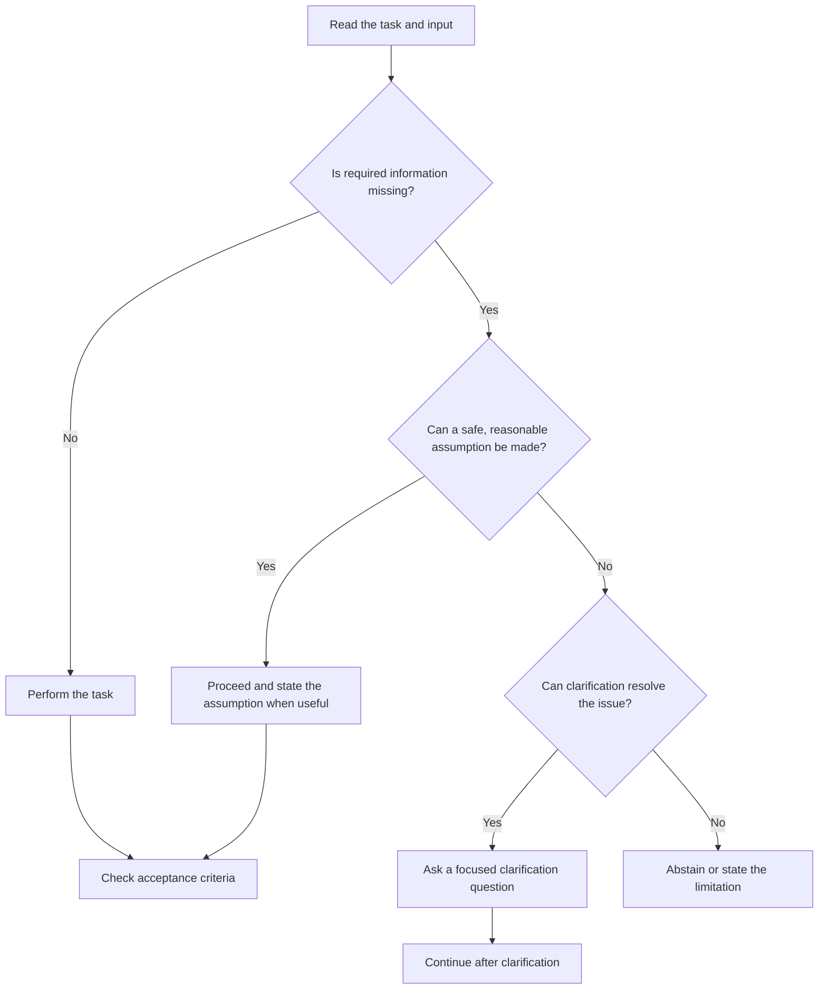

# 03. Clear Tasks and Relevant Context

## Learning Objectives

By the end of this chapter, you should be able to:

- Specify the action, intended audience, input, output, and acceptance criteria for a model task.
- Remove vague, contradictory, and unnecessary instructions.
- Select relevant context and manage it within a token budget.
- Identify missing information and decide when to clarify, proceed with explicit assumptions, or abstain.
- Use consistent delimiters to distinguish source material and examples from instructions.
- Explain why delimiters improve clarity but do not provide a security boundary.

<br/>

## 1. Why Task Clarity Matters

A language model can only respond to the request and information available to it. If the task is underspecified, the model must infer what the user means. Different interpretations can produce different outputs, even when each output sounds reasonable.

Consider this prompt:

```text
Analyze this document and give me the important points.
```

It does not specify the purpose of the analysis, the intended reader, what counts as important, how long the response should be, or what format to use.

A clear prompt reduces unnecessary interpretation by defining the requested behavior and the conditions for success. It cannot eliminate all uncertainty, but it makes the task easier to evaluate.

<br/>

## 2. Specify the Task as a Testable Contract

A useful task specification describes five core elements:

| Element | Question to answer | Example |
|---|---|---|
| **Action** | What should the model do? | Extract the risks stated in a report. |
| **Intended user** | Who will use the result? | A project manager preparing a status update. |
| **Input** | What material should be processed? | The supplied project report. |
| **Output** | What should the response contain and look like? | A list of risks with supporting evidence. |
| **Acceptance criteria** | What makes the result successful? | Every listed risk must be supported by the report; do not invent risks. |

These elements form a task contract. They clarify the expected behavior before the prompt is tested.

<br/>

### Reusable task specification

```text
Action:
[Specific operation the model must perform]

Intended user:
[Who will use the result and for what purpose]

Input:
[Source data and relevant assumptions]

Output:
[Required content, format, length, and level of detail]

Acceptance criteria:
[Observable conditions that define a successful result]
```

Not every prompt needs a separate heading for each element. The template is a design aid: include the details that materially affect the task.

<br/>

## 3. Remove Vague, Contradictory, and Unnecessary Instructions

### 3.1 Vague instructions

Words such as *good*, *appropriate*, *detailed*, *short*, *professional*, and *important* may be interpreted differently by different readers or models.

Replace vague wording with observable requirements where possible.

| Vague wording | More testable wording |
|---|---|
| “Write a short summary.” | “Summarize the report in 3–5 bullet points.” |
| “Explain in detail.” | “Explain the cause, impact, and one example for each concept.” |
| “Make it professional.” | “Use a neutral business tone, clear headings, and no slang.” |
| “List the important risks.” | “List risks explicitly mentioned in the report and include a supporting sentence for each.” |
| “Give a good answer.” | “Answer the question using the supplied evidence and state when the evidence is insufficient.” |

Exact limits are not always necessary. The goal is to remove ambiguity that affects the result.

<br/>

### 3.2 Contradictory instructions

Instructions conflict when they cannot all be satisfied at the same time.

Example:

```text
Explain every step in depth.
Keep the answer to exactly one sentence.
```

Possible remedies:

- Decide which requirement has priority.
- Narrow the scope so both requirements can be met.
- Ask the user which requirement matters more.
- Define a fallback, such as a concise summary followed by optional details.

Do not leave important conflicts for the model to resolve by guesswork.

<br/>

### 3.3 Unnecessary instructions

Long prompts are not automatically better. Repeating the same requirement in multiple ways can consume context and introduce inconsistencies.

Remove instructions that are:
- Repetitions without a distinct purpose.
- Unrelated to the requested task.
- Irrelevant to the input.
- Too general to affect observable behavior.

Retain requirements that protect correctness, safety, or a necessary output constraint. Concision should not remove essential context.

<br/>

## 4. Select Relevant Context

**Context** is information supplied to help the model perform the task. It may include definitions, background, source documents, examples, constraints, prior conversation details, or evidence.

Relevant context helps resolve a question or meet an acceptance criterion. Irrelevant context increases prompt length and can distract from the task.

For example, if the task is to extract a customer's requested resolution from a support message, the customer's product issue and requested resolution are relevant. A long company history is probably unnecessary unless the task explicitly depends on it.

<br/>

### Context-selection questions

Before including information, ask:

1. Does this information change how the task should be performed?
2. Is it needed to support a required answer?
3. Is it reliable and current enough for the task?
4. Does it conflict with other supplied information?
5. Can it be summarized without losing necessary meaning?
6. Is the application permitted to send this information to the model?

The last question matters when context contains personal, confidential, or access-controlled data. Relevance alone does not establish permission to use or disclose it.

<br/>

## 5. Manage a Token Budget

A **token** is a unit used by a model's tokenizer to represent text or other supported content. Tokens are not the same as words or characters. The token count depends on the tokenizer, language, formatting, and content.

A model's context window limits how much input and generated content can be handled in a request. The precise limit and accounting rules vary by model and provider.

A practical context budget may need to reserve space for:

- System or application instructions.
- User request and task-specific constraints.
- Source documents and other context.
- Examples, if included.
- The model's output.
- Any additional tokens required by the provider's interface or response format.

Conceptually:

```text
Available context capacity
├── Application instructions
├── User request
├── Relevant context and source material
├── Examples and formatting requirements
└── Space reserved for generated output
```

The available capacity is not necessarily allocated in equal portions. The budget should reflect the task and the model's documented limits.

<br/>

### Context-selection strategy

When the input is too large:

1. Identify the question or task that must be answered.
2. Keep the sections directly relevant to that task.
3. Preserve definitions, qualifications, dates, and evidence needed for accuracy.
4. Remove unrelated or duplicated material.
5. If necessary, process the source in bounded sections and combine verified intermediate results.
6. Check whether important details were lost during selection or compression.

Do not summarize away a qualification that changes the meaning of a claim. A shorter context is useful only if it retains the information required for the task.

<br/>

## 6. Missing Information: Clarify, Proceed, or Abstain

Not every missing detail requires a follow-up question. The right response depends on how important the missing information is and whether a reasonable, low-risk assumption is available.

### Three response options

**Ask for clarification** when the missing detail materially changes the answer and cannot be safely inferred.

Example: “Book a meeting next week” without a date, time, duration, or participants may require clarification before an action can be taken.

**Proceed with a stated assumption** when the ambiguity is minor, the task is low risk, and the assumption is reasonable.

Example: For a general explanation, the model may use a beginner-friendly level if no audience is specified, while making that choice clear when useful.

**Abstain or state the limitation** when required evidence is absent, the answer cannot be responsibly determined, or the task requires unsupported facts.

Example: If a supplied report contains no project completion date, the model should not invent one. It can report that the date is not specified.

<br/>

### Decision flow



For consequential tasks, use a stricter threshold for assumptions. A prompt should define missing-data behavior explicitly when guessing could cause harm or materially mislead the user.

<br/>

## 7. Use Consistent Delimiters for Source Material

**Delimiters** are markers used to identify the beginning and end of a block of text. They help distinguish task instructions from the material being processed.

For example:

```text
Task:
Extract the customer's requested resolution.

Source text:
<<<SOURCE
The item arrived damaged. Please send a replacement.
<<<END_SOURCE

Output:
Return one field named requested_resolution.
```

The markers make the source boundary visually clear. Other options include XML-like tags, Markdown block quotes, code fences, or structured fields in a provider's message format.

<br/>

### Delimiters for examples

When a prompt contains demonstrations, label them separately from the current input:

```text
Example:
Input: "The charger does not work."
Output: "Issue: faulty charger"

Current input:
<<<SOURCE
The screen is cracked. I would like a replacement.
<<<END_SOURCE
```

Consistent boundaries reduce accidental confusion between an example and the current data.

<br/>

### Delimiters are not a security barrier

A malicious or misleading instruction can still appear inside a delimited source block. The model may fail to treat it as data, and the delimiters do not enforce authorization or prevent information disclosure.

Use delimiters as a clarity technique, alongside appropriate application controls. Do not rely on punctuation or tags as the sole defense against prompt injection.

<br/>

## 8. Worked Example: Rewrite an Ambiguous Prompt

### Original prompt

```text
Look at this project update and tell me what matters. Make it detailed but brief.
```

<br/>

### Problems

- **Action:** “Look at” does not define the operation.
- **Intended user:** The reader and purpose are unspecified.
- **Input:** The project update is not clearly identified.
- **Output:** “What matters” has no defined categories or format.
- **Contradiction:** “Detailed but brief” may be possible, but the intended balance is unclear.
- **Acceptance criteria:** No way to judge completeness or evidence fidelity.
- **Missing-data behavior:** No instruction for absent or conflicting facts.

<br/>

### Revised task specification

```text
Action:
Summarize the supplied project update for a project manager.

Intended user:
A project manager preparing for a weekly status meeting.

Input:
The project update included below.

Output:
Return four sections:
1. Progress: completed work explicitly reported.
2. Blockers: issues currently preventing progress.
3. Risks: potential future problems stated in the update.
4. Next steps: actions and owners explicitly identified in the update.

Constraints:
- Use only information supported by the update.
- Do not infer owners, deadlines, or causes.
- If a section has no supporting information, write "Not specified."
- Keep each section to no more than three bullet points.

Acceptance criteria:
- Every claim is supported by the source.
- Progress, blockers, risks, and next steps are kept distinct.
- Missing information is identified rather than invented.
- The required four-section format is followed.

Source update:
<<<SOURCE
[Insert project update here]
<<<END_SOURCE
```

The revised version makes the requested behavior testable. It also specifies how to handle missing information and distinguishes the source data from the instructions.

<br/>

## 9. Practice: Annotate and Improve a Prompt

Consider this prompt:

```text
Read this feedback and give me a useful report. Be comprehensive,
but don't make it too long. Include anything important.

Feedback:
"The new dashboard is easy to navigate, but reports load slowly.
The export button sometimes fails. The team wants a CSV export option."
```

<br/>

### Step 1: Annotate the prompt

- **Action:** Produce a report, but the operation is vague.
- **Intended user:** Not specified.
- **Input:** User feedback is provided.
- **Context:** No product or decision-making context is supplied.
- **Output:** “Useful report” does not define sections or format.
- **Constraints:** “Comprehensive” and “not too long” are not measurable.
- **Acceptance criteria:** “Anything important” is subjective.
- **Missing-data behavior:** Not specified.

<br/>

### Step 2: Write a testable version

One reasonable revision is:

```text
Action:
Organize the supplied feedback into a concise product-feedback report.

Intended user:
A product manager reviewing dashboard improvements.

Input:
The feedback text below.

Output:
Return three sections:
1. Positive feedback
2. Reported problems
3. Requested improvement

Constraints:
- Use only facts stated in the feedback.
- Do not invent causes, frequency estimates, or implementation plans.
- Use one to three bullets per section.
- If a section has no supporting information, write "Not specified."

Acceptance criteria:
- The navigation feedback is captured as positive feedback.
- Slow report loading and intermittent export failure are reported as problems.
- CSV export is captured as the requested improvement.
- No unsupported claims are added.
```

<br/>

### Step 3: Check the revised task

A suitable result should capture all three feedback themes and preserve the distinction between an existing problem and a requested feature. It should not invent technical causes or promise a delivery date.

The acceptance criteria provide a basis for reviewing the result, but the prompt still needs testing with representative feedback samples before it can be considered reliable.

<br/>

## 10. Common Mistakes

| Mistake | Why it matters | Better practice |
|---|---|---|
| Using vague adjectives without defining them | Different outputs may satisfy different interpretations | Define observable requirements |
| Adding every available document to the prompt | Irrelevant context consumes tokens and may distract the model | Select context based on task needs |
| Ignoring output-token space | Input can crowd out the desired response | Reserve capacity for the expected output |
| Guessing missing facts | Produces unsupported claims | Define clarification, unknown, or abstention behavior |
| Giving contradictory requirements | Leaves priorities unclear | Resolve conflicts explicitly |
| Using inconsistent source markers | Makes examples and source text harder to distinguish | Use a stable format |
| Treating delimiters as a security control | Delimited content can still contain injection attempts | Enforce security in application logic |
| Judging success by tone alone | A polished response can be incomplete or false | Check the acceptance criteria |


<br/>


## 11. Revision Questions

### Q1. What five elements make a task specification testable?

**Answer:** Action, intended user, input, output, and acceptance criteria.

### Q2. Why should vague words be replaced with observable requirements?

**Answer:** Observable requirements make the expected behavior clearer and allow outputs to be evaluated more consistently.

### Q3. How should context be selected?

**Answer:** Include information that materially helps perform the task or supports required claims. Remove irrelevant or duplicated material while preserving important qualifications and evidence.

### Q4. What is a token budget?

**Answer:** A practical allocation of the model's available context capacity across instructions, input, context, examples, and generated output. Exact token accounting depends on the model and provider.

### Q5. When should a model ask for clarification?

**Answer:** When a missing detail materially affects the answer and cannot be safely inferred, especially when acting on an assumption could mislead or cause harm.

### Q6. When is abstention appropriate?

**Answer:** When required evidence is missing or the answer cannot responsibly be determined. The model should state the limitation rather than invent information.

### Q7. Do delimiters prevent prompt injection?

**Answer:** No. They improve clarity by marking source boundaries, but they do not enforce trust or permissions and are not a security barrier.

### Q8. Why distinguish the requested behavior from the data being processed?

**Answer:** The instructions define what the model should do; the source data is the material on which it should operate. Mixing them can cause the model to mistake quoted or retrieved text for task instructions.


<br/>


## 12. Chapter Checkpoint

**Question:** How can you separate the requested behavior from the data being processed?

**Answer:** State the task and its constraints outside the source-data block, then mark the input clearly using consistent delimiters or structured message fields. Define the required output and acceptance criteria separately. Treat instructions appearing inside the source as content to process unless the application explicitly and safely defines another interpretation. Remember that delimiters improve clarity but do not replace application-level security controls.


<br/>


## Key Takeaways

- Define the action, intended user, input, output, and acceptance criteria before writing a complex prompt.
- Replace vague or conflicting instructions with observable requirements.
- Include relevant context, preserve important evidence, and plan for output tokens.
- Define how to handle missing, ambiguous, or conflicting information.
- Use consistent delimiters to distinguish instructions, examples, and source data.
- Delimiters are a clarity aid, not a security boundary.
- Test the revised task specification on representative inputs.

<br/>

## References and Further Reading

- [OpenAI Prompt Engineering Guide](https://platform.openai.com/docs/guides/prompt-engineering) — practical guidance for clear instructions and prompt design.
- [OpenAI Tokenizer](https://platform.openai.com/tokenizer) — inspect how text is tokenized for supported models.
- [Hugging Face Chat Templates](https://huggingface.co/docs/transformers/main/en/chat_templating) — learn how structured messages are represented for different models.
- [OWASP Top 10 for LLM Applications](https://genai.owasp.org/llm-top-10/) — security risks relevant to processing untrusted input.
- [Level 5 course outline](README.md) — chapter scope, practice, and checkpoint.
