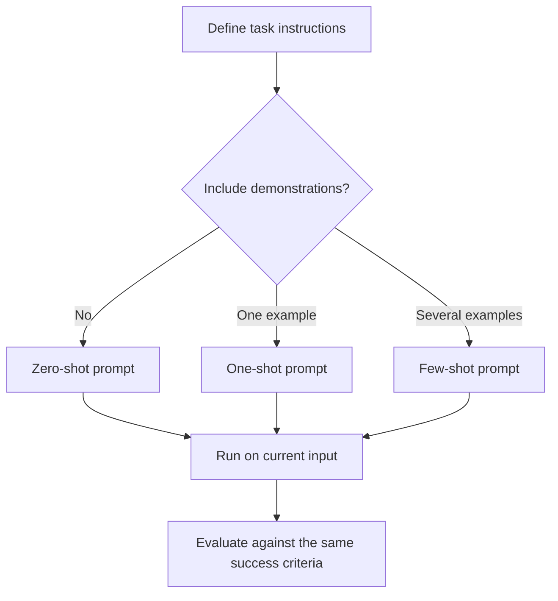

# 04. Zero-Shot, One-Shot, and Few-Shot Prompting

## Learning Objectives

By the end of this chapter, you should be able to:

- Explain zero-shot, one-shot, and few-shot prompting.
- Choose demonstrations that show the expected format, labels, and handling of difficult cases.
- Keep examples consistent with the task instructions and output schema.
- Evaluate the effects of example order, diversity, token cost, and narrow demonstrations.
- Keep prompt demonstrations separate from held-out evaluation examples.
- Compare prompting strategies on the same test cases and identify when examples help or mislead.

---

## 1. What Is Example-Based Prompting?

A prompt can describe a task using instructions alone, or it can also include examples of the desired input-output behavior. These examples are called **demonstrations**. They show the model a pattern it can use when responding to a new input.

Three common approaches are:

- **Zero-shot prompting:** Provide instructions but no task demonstrations.
- **One-shot prompting:** Provide one demonstration.
- **Few-shot prompting:** Provide several demonstrations.

These terms describe the number of demonstrations included in the prompt. They do not refer to the number of training examples used to update the model's weights. In ordinary in-context prompting, the demonstrations are part of the input at inference time; they do not themselves fine-tune the model.

## 2. Compare Zero-Shot, One-Shot, and Few-Shot Prompting

| Approach | Prompt contents | Main advantage | Main limitation |
|---|---|---|---|
| **Zero-shot** | Instructions and current input | Short, simple, and low in demonstration-token cost | The model must infer the intended pattern from the instructions |
| **One-shot** | Instructions, one example, and current input | Shows a concrete example of the desired behavior | One example may not cover important variations |
| **Few-shot** | Instructions, several examples, and current input | Can demonstrate labels, formats, and different cases | Uses more context and may introduce bias if examples are narrow or inconsistent |

There is no universal winner. The best approach depends on the task, the model, the quality of the instructions, the examples, and the available context budget.

### Conceptual comparison



## 3. Worked Example: Customer Feedback Classification

Suppose the task is to classify customer feedback into one of three labels:

- `positive`: The message mainly expresses satisfaction or praise.
- `negative`: The message mainly reports dissatisfaction or a problem.
- `request`: The message primarily asks for a feature or change.

The input to classify is:

> The dashboard is easy to use, but I would like an option to export reports as CSV.

The label definitions should be stated before comparing the prompting approaches. Otherwise, the model may interpret the categories differently.

### 3.1 Zero-shot prompt

```text
Task:
Classify the customer feedback using exactly one label:
positive, negative, or request.

Label definitions:
- positive: Mainly expresses satisfaction or praise.
- negative: Mainly reports dissatisfaction or a problem.
- request: Primarily asks for a feature or change.

Input:
"The dashboard is easy to use, but I would like an option
to export reports as CSV."

Output:
Return only the label.
```

The model must infer the expected classification behavior from the instructions and label definitions. A plausible result is `request`, because the main actionable intent is a feature request. That result is illustrative, not a measured model output.

### 3.2 One-shot prompt

```text
Task:
Classify the customer feedback using exactly one label:
positive, negative, or request.

Label definitions:
- positive: Mainly expresses satisfaction or praise.
- negative: Mainly reports dissatisfaction or a problem.
- request: Primarily asks for a feature or change.

Example:
Input: "Please add a dark mode to the settings page."
Output: request

Current input:
"The dashboard is easy to use, but I would like an option
to export reports as CSV."

Output:
Return only the label.
```

The example demonstrates how a direct feature request maps to the `request` label.

### 3.3 Few-shot prompt

```text
Task:
Classify the customer feedback using exactly one label:
positive, negative, or request.

Label definitions:
- positive: Mainly expresses satisfaction or praise.
- negative: Mainly reports dissatisfaction or a problem.
- request: Primarily asks for a feature or change.

Examples:
Input: "The new dashboard is clear and easy to navigate."
Output: positive

Input: "The export button crashes whenever I click it."
Output: negative

Input: "Please let me download reports as CSV files."
Output: request

Current input:
"The dashboard is easy to use, but I would like an option
to export reports as CSV."

Output:
Return only the label.
```

The examples demonstrate all three labels. This can clarify the distinction between praise, a reported problem, and a feature request.

**Important:** These prompts illustrate prompt design. Their actual accuracy must be measured using the selected model and representative test cases.

## 4. How to Choose Useful Demonstrations

Examples should teach the model the pattern that matters for the task. More examples are not automatically better.

### 4.1 Represent expected formats

If the model must return a specific structure, examples should follow that structure exactly.

For example, if the output contract is:

```json
{
  "label": "request"
}
```

Do not show examples that sometimes return plain text, sometimes return JSON, and sometimes add unrequested commentary. Inconsistent examples can teach an inconsistent pattern.

### 4.2 Represent the label set

For classification tasks, provide examples that distinguish the permitted labels. If the task has three labels but every demonstration uses only `positive`, the examples provide little guidance about when to use `negative` or `request`.

The labels and their definitions must be consistent across the instructions, examples, schema, and evaluation rubric.

### 4.3 Include meaningful difficult cases

Useful demonstrations may include:

- Mixed sentiment, such as praise followed by a complaint.
- Short or incomplete messages.
- Ambiguous inputs that require a defined fallback.
- Inputs containing multiple entities or requests.
- Missing information that should remain unknown.
- Boundary cases where two labels appear plausible.

Do not include difficult examples merely to make the prompt longer. Select cases that expose a real distinction the model must learn to apply.

### 4.4 Keep demonstrations accurate

A wrong example can teach the wrong behavior. Before including a demonstration, verify:

- The input actually matches the assigned output.
- The example follows the task instructions.
- The output satisfies the schema or format contract.
- Any edge-case behavior agrees with the stated rules.

Examples should clarify the intended task, not silently introduce exceptions that contradict it.

## 5. Example Order and Diversity

The order of demonstrations can affect model output. A model may be sensitive to the examples presented near the current input, repeated patterns, or the sequence of labels. The effect varies by model and task, so do not assume a particular order is always best.

Practical considerations:

- **Consistency:** Every example should follow the same output contract.
- **Coverage:** Include the meaningful categories and input patterns.
- **Diversity:** Avoid examples that differ only in superficial wording when broader variation matters.
- **Balance:** Do not accidentally overrepresent one label unless the task and sampling plan justify it.
- **Order:** Test alternative orders when the task is sensitive to example order.
- **Relevance:** Prefer demonstrations that resemble the task's expected inputs without simply copying evaluation cases.

A few carefully selected examples can be more useful than a large collection of repetitive examples.

## 6. Token Cost and Context Budget

Each demonstration consumes tokens. With many examples, the prompt can become longer, increase inference cost, leave less room for the current input or output, or exceed the model's context limit.

A simplified token budget is:

\[
T_{\text{total}} =
T_{\text{instructions}} +
T_{\text{examples}} +
T_{\text{current input}} +
T_{\text{reserved output}}
\]

The exact accounting depends on the tokenizer and provider interface. The equation is a planning model, not a universal billing formula.

When choosing demonstrations, consider the trade-off:

- More examples may clarify labels and edge cases.
- More examples also increase prompt length and can introduce contradictory patterns.
- Shorter examples reduce token cost but must retain the distinctions needed for the task.

Start with the smallest useful set. Add examples only when testing identifies a failure that those examples are intended to address.

## 7. Overfitting to Narrow Demonstrations

In this context, **overfitting to demonstrations** means the prompt examples are so narrow or repetitive that the model imitates their superficial patterns instead of applying the intended rule to new inputs.

For example, if every `negative` example contains the word “broken,” the model may struggle with a complaint such as “The application freezes every time I open the report.” It may have learned a narrow wording pattern rather than the broader concept of a reported problem.

Reduce this risk by:

- Varying vocabulary and sentence structure.
- Including representative cases from the expected input distribution.
- Demonstrating important boundary cases.
- Keeping label definitions explicit.
- Evaluating on unseen examples.
- Avoiding repeated revisions based only on the same small collection of cases.

Prompt examples should support generalization to the task, not encourage memorization of a few phrases.

## 8. Keep Demonstrations Separate from Evaluation Examples

Examples placed inside a prompt are **demonstrations**. Evaluation examples are used to measure how well the prompt performs.

For a meaningful comparison, keep a set of held-out test cases that are not included in the prompt demonstrations or used repeatedly to tune the prompt.

A simple split is:

```text
Available task examples
├── Demonstration examples
│   └── Included in the prompt
└── Held-out evaluation examples
    └── Used to compare prompt performance
```

The sets should be separated by purpose. If the same cases appear in both demonstrations and evaluation, the score may overstate how well the prompt generalizes to unseen inputs.

For small learning exercises, a simple fixed split is often sufficient. More formal evaluation may require careful sampling, multiple runs, and statistical analysis; those topics are covered in the dedicated evaluation level.

## 9. Practice: Compare All Three Approaches on the Same Held-Out Cases

### Task

Classify customer feedback using these labels:

- `positive`
- `negative`
- `request`

Use the same label definitions and the same evaluation inputs for zero-shot, one-shot, and few-shot prompts. The prompts should differ only in the demonstration examples being tested.

### Example held-out test set

These inputs are for evaluation and should **not** be copied into the prompt demonstrations used for this comparison.

| ID | Feedback | Expected label |
|---|---|---|
| E1 | “The dashboard is intuitive and the charts are clear.” | `positive` |
| E2 | “The app freezes whenever I open the reports page.” | `negative` |
| E3 | “Please add an option to schedule weekly exports.” | `request` |
| E4 | “I like the layout, but the search results take too long to load.” | `negative` under a rule that labels the main actionable issue |
| E5 | “Could you add a compact view for smaller screens?” | `request` |
| E6 | “The latest update fixed the login problem. Thanks!” | `positive` |

For E4, the expected label depends on the stated annotation policy. Here, the rule is to choose the main actionable issue when a message mixes praise with a complaint. State such rules explicitly before testing.

### Comparison procedure

1. Write and save the zero-shot prompt.
2. Create a one-shot variant by adding one verified demonstration.
3. Create a few-shot variant by adding several verified demonstrations.
4. Keep the label definitions, current inputs, model, and generation settings constant where possible.
5. Run every prompt variant on all six held-out cases.
6. Record each output without silently correcting it.
7. Compare predicted labels with the expected labels.
8. Inspect individual errors as well as the aggregate score.

### Accuracy calculation

For single-label classification:

\[
\text{Accuracy} =
\frac{\text{Number of correct predictions}}
{\text{Total predictions}}
\]

For example, if a prompt correctly classifies 5 of 6 cases:

\[
\text{Accuracy} = \frac{5}{6}\times100 \approx 83.3\%
\]

This is an illustrative calculation, not a result from an actual model run. Six cases are useful for practice but too few to establish reliable production performance.

### Results table to complete

| Prompt variant | Correct / total | Accuracy | Notable errors | Token cost |
|---|---:|---:|---|---|
| Zero-shot | — / 6 | — | Record observed errors | Record if available |
| One-shot | — / 6 | — | Record observed errors | Record if available |
| Few-shot | — / 6 | — | Record observed errors | Record if available |

Do not fill the table with guessed model performance. Use actual outputs from the selected model, or label manually prepared outputs as illustrative.

## 10. Common Mistakes

| Mistake | Why it is a problem | Better practice |
|---|---|---|
| Assuming few-shot always beats zero-shot | Examples may be irrelevant, misleading, or redundant | Compare approaches on the same held-out cases |
| Using inconsistent examples | The model receives conflicting patterns | Align examples with instructions and schemas |
| Demonstrating only one label | Other labels remain poorly illustrated | Cover the meaningful label set |
| Using examples that are too similar | The prompt may encourage narrow pattern matching | Include representative diversity |
| Putting evaluation cases into the prompt | Evaluation may become misleading | Keep held-out cases separate |
| Adding examples without a failure hypothesis | Token cost rises without clear benefit | Add examples to address observed weaknesses |
| Ignoring example order | Some tasks may be order-sensitive | Test ordering if results suggest sensitivity |
| Treating illustrative outputs as measured results | Performance claims become unsupported | Record actual model runs and settings |

---

## 11. Revision Questions

### Q1. What is zero-shot prompting?

**Answer:** Giving task instructions and the current input without task demonstrations.

### Q2. What distinguishes one-shot from few-shot prompting?

**Answer:** One-shot includes one demonstration; few-shot includes several demonstrations.

### Q3. Do demonstrations update model weights during ordinary prompting?

**Answer:** No. They are included in the inference-time context. Fine-tuning is a separate training process.

### Q4. What makes a demonstration useful?

**Answer:** It is accurate, representative, consistent with the task instructions and output contract, and illustrates a behavior the model needs to reproduce.

### Q5. Why include difficult cases in demonstrations?

**Answer:** They can clarify important boundaries, ambiguity handling, and distinctions between similar labels or outputs.

### Q6. Why can too many examples be harmful?

**Answer:** They increase token cost and may introduce redundant, inconsistent, or narrow patterns that distract from the intended rule.

### Q7. Why should evaluation cases be held out?

**Answer:** Held-out cases provide a less biased estimate of performance on inputs not shown in the prompt demonstrations.

### Q8. How can you tell whether few-shot prompting actually helped?

**Answer:** Compare it with the zero-shot and one-shot variants on the same held-out cases using the same success criteria, then inspect errors and relevant cost measurements.

---

## 12. Chapter Checkpoint

**Question:** When do examples improve performance, and when can they introduce misleading patterns?

**Answer:** Examples can improve performance when they clarify the expected format, label boundaries, task behavior, or handling of difficult cases that instructions alone do not communicate clearly. They can mislead when they are incorrect, inconsistent with the instructions or schema, too repetitive, unrepresentative, or biased toward a narrow set of patterns. They also consume tokens. Their value should be measured by comparing prompt variants on the same held-out evaluation cases.

---

## Key Takeaways

- Zero-shot uses instructions without demonstrations; one-shot uses one demonstration; few-shot uses several.
- Examples should clarify the intended behavior, not contradict the task instructions.
- Select examples that cover formats, labels, and meaningful edge cases.
- Example order and diversity can matter and should be tested when relevant.
- Demonstrations consume context tokens and can encourage narrow pattern matching.
- Keep prompt demonstrations separate from held-out evaluation cases.
- Measure whether examples help instead of assuming that more examples are better.

## References and Further Reading

- [OpenAI Prompt Engineering Guide](https://platform.openai.com/docs/guides/prompt-engineering) — practical prompt-design guidance.
- [Language Models are Few-Shot Learners](https://arxiv.org/abs/2005.14165) — research introducing and studying few-shot behavior in large language models.
- [OpenAI Tokenizer](https://platform.openai.com/tokenizer) — inspect tokenization and estimate prompt length.
- [Level 5 course outline](README.md) — chapter scope, practice, and checkpoint.
