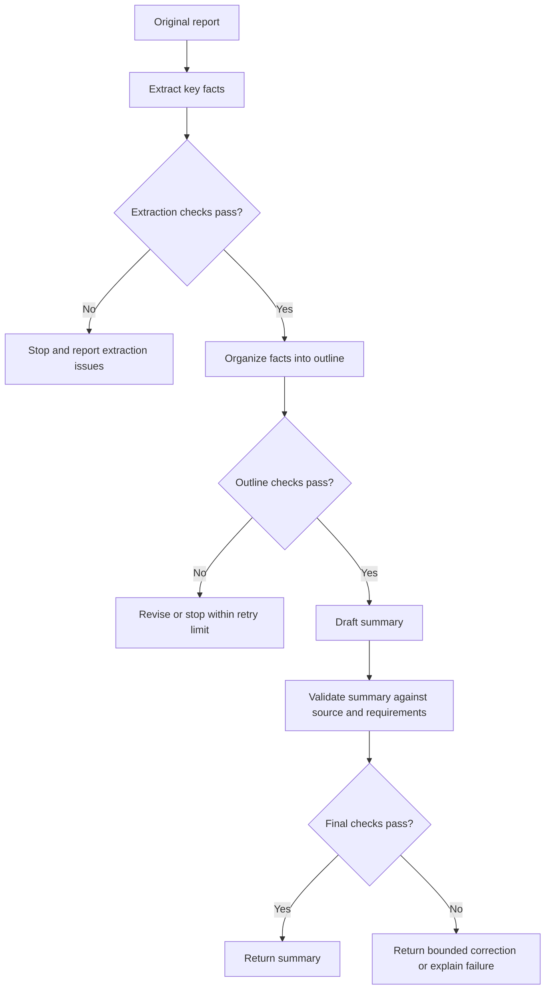
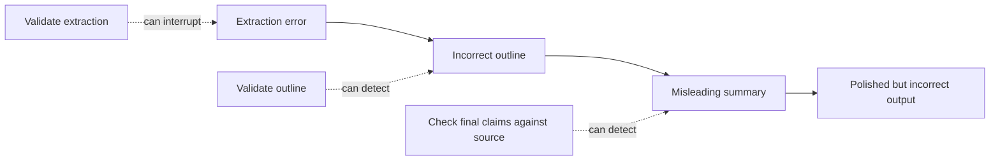

# 06. Decomposition of Complex Requests

## 1. Why Task Decomposition Matters

A complex request often contains several different operations. Asking a model to perform all of them in one response can make it difficult to identify where an error occurred, verify intermediate results, or enforce a consistent output format.

**Task decomposition** is the practice of dividing a larger task into smaller, explicit subtasks. Each subtask has a defined purpose, input, output, and validation rule.

For example, turning a long report into a concise summary may involve:

1. Extracting the facts and claims that matter.
2. Organizing those facts by topic.
3. Producing a summary that follows the requested length and format.
4. Checking the summary against the source and the output requirements.

The objective is not to add steps for their own sake. Decomposition is useful when the stages are meaningfully different, their outputs can be inspected, or a failure in one stage would otherwise be difficult to diagnose.

<br/>

### Benefits

- **Inspectability:** intermediate results can be checked before the next stage uses them.
- **Error localization:** a failed result can be traced to a particular stage.
- **Constraint enforcement:** each stage can have its own requirements.
- **Reuse:** an extraction stage may support several downstream outputs.
- **Predictability:** fixed steps make behavior easier to test and maintain.

<br/>

### Costs and trade-offs

- More model calls or processing stages can increase latency and cost.
- Intermediate outputs consume tokens and may introduce additional failure points.
- A rigid sequence may be unnecessary for a simple request.
- A flawed intermediate result can contaminate every downstream stage unless it is validated.

**Rule of thumb:** decompose when the task has distinct operations or needs verifiable intermediate outputs. Keep a single structured request when the task is simple enough to complete reliably in one pass.


<br/>


## 2. Define Each Subtask Explicitly

A useful subtask specification contains five elements:

| Element | Question it answers |
|---|---|
| Objective | What operation must this stage perform? |
| Input | What information is this stage allowed to use? |
| Output | What artifact must it produce? |
| Constraints | What must it include or avoid? |
| Validation | How will the result be checked? |

A subtask should produce an output that the next stage can consume without guessing what it means.

<br/>

### Example: document-to-summary task

Suppose the input is a long project report and the requested output is a 150-word summary for a project manager.

| Stage | Input | Output | Validation |
|---|---|---|---|
| 1. Extract | Original report | Structured list of key facts, decisions, risks, dates, and metrics | Each item is supported by the source; important fields are not silently invented |
| 2. Organize | Validated extracted items | Outline grouped into purpose, findings, risks, and next steps | Every section has relevant evidence; duplicates and contradictions are flagged |
| 3. Draft | Approved outline and output requirements | Summary of about 150 words | Word limit, audience, coverage, and format are checked |
| 4. Verify | Draft plus original report and requirements | Final summary or a list of issues to fix | Claims match the source; unsupported details and omitted critical points are identified |

The verification stage can be a separate application-controlled step, or it can be implemented as explicit checks after drafting. The design should match the risk and complexity of the task.


<br/>


## 3. One Structured Request vs. a Fixed Sequence of Steps

There are two common ways to prompt for a multi-part task.

### Approach A: one structured request

The model receives all requirements and is asked to return the final result in one response.

```text
Read the report and write a summary for a project manager.

Requirements:
- Include the purpose, main findings, risks, and next steps.
- Use only information supported by the report.
- Keep the summary at or below 150 words.
- If a critical fact is missing or unclear, state that limitation.
- Return the summary followed by a short list of unresolved issues.
```

**Advantages**
- Lower orchestration complexity.
- Usually fewer calls and less latency.
- Suitable for short or low-risk tasks.

**Limitations**
- Intermediate work is not independently available for inspection.
- It may be difficult to identify whether an error came from extraction, organization, or drafting.
- Detailed instructions may compete for attention in a long or complicated task.

<br/>

### Approach B: fixed sequence of application-controlled steps

The application calls the model or processing functions in a predefined order. Each stage receives the prior stage's output and produces a specified artifact.



**Advantages**
- Intermediate outputs can be reviewed, logged, or tested.
- Validation can stop a bad result before it propagates.
- Each stage can use a narrowly scoped prompt and output schema.

**Limitations**
- More components must be implemented and maintained.
- More stages may increase cost and latency.
- Passing information between stages can lose context or introduce formatting errors.

This is **fixed task decomposition**, not autonomous planning. The application defines the stages and their order in advance. The model does not independently decide to create an open-ended plan, launch arbitrary subtasks, or repeat an agent loop.

<br/>

### Choosing between the approaches

| Consideration | One structured request | Fixed sequence |
|---|---|---|
| Simple, short task | Usually sufficient | May be excessive |
| Need to inspect extracted data | Limited | Strong fit |
| High consequence of unsupported claims | Requires careful final validation | Allows validation between stages |
| Strict structured intermediate outputs | Harder to isolate | Easier to enforce |
| Latency and cost budget | Often lower | Often higher |
| Debugging a failed stage | Less precise | More precise |

A multi-stage workflow is not automatically better. Choose it when the additional control is worth its cost.


<br/>


## 4. Intermediate Artifacts

An **intermediate artifact** is a result created for use or inspection before the final answer is produced. It should be explicit enough to validate.

Useful artifacts include:

- **Extracted fields:** dates, names, figures, decisions, risks, and source references.
- **An outline:** section headings and the facts assigned to each section.
- **A checklist:** requirements that the final output must satisfy.
- **A validation report:** passed checks, failed checks, and unresolved uncertainties.
- **A structured record:** data represented with defined fields instead of loosely formatted prose.

<br/>

### Example: extraction schema

A simple schema can make missing information visible. Here is an illustrative Python representation of the desired output:

```python
from typing import Optional
from pydantic import BaseModel, Field


class ReportExtraction(BaseModel):
    purpose: Optional[str] = None
    key_findings: list[str] = Field(default_factory=list)
    risks: list[str] = Field(default_factory=list)
    decisions: list[str] = Field(default_factory=list)
    next_steps: list[str] = Field(default_factory=list)
    uncertainties: list[str] = Field(default_factory=list)
```

This model describes the expected shape of the extraction result. It does **not** itself extract facts from a report or prove that extracted claims are true. The application must still populate the structure and validate its contents against the source.

When a value is absent, use an explicit representation such as `None` or an empty list instead of inventing a plausible value. Keep “not present in the source” distinct from “not yet checked” if that distinction matters to the application.

<br/>

### Keep artifacts fit for purpose

Do not preserve every intermediate token by default. Store the information needed to validate the next stage. A compact list of source-supported facts may be more useful than a long narrative of how the model arrived at them.


<br/>

## 5. Validate Intermediate Results

Validation should be designed for the kind of output a stage produces.

### Types of validation

1. **Structural validation**
   - Are required fields present?
   - Does the output parse as valid JSON or match the expected schema?
   - Are lists, strings, and numbers of the expected types?

2. **Completeness validation**
   - Were required categories considered?
   - Are any required sections or fields missing?
   - Are there empty values that should have been supplied or explicitly marked unknown?

3. **Source-grounding validation**
   - Can each extracted fact be traced to the document?
   - Do numbers, dates, names, and quotations match the source?
   - Has the model added information that the source does not support?

4. **Consistency validation**
   - Do two extracted fields conflict?
   - Does the outline preserve the meaning of the extracted facts?
   - Does the final summary contradict the source or omit a critical qualification?

5. **Requirement validation**
   - Is the final output within the word limit?
   - Does it use the requested format and audience level?
   - Does it contain every required topic?

Some checks can be deterministic—for example, parsing JSON, checking required keys, or counting words. Other checks, such as whether a summary preserves the meaning of a nuanced paragraph, may require comparison with the source or a carefully designed evaluator. A successful schema check is not proof of factual correctness.

<br/>

### Example: deterministic checks in Python

```python
import json


REQUIRED_KEYS = {
    "purpose",
    "key_findings",
    "risks",
    "decisions",
    "next_steps",
    "uncertainties",
}


def validate_extraction(raw_output: str) -> tuple[bool, list[str]]:
    errors = []

    try:
        data = json.loads(raw_output)
    except json.JSONDecodeError as exc:
        return False, [f"Invalid JSON: {exc.msg}"]

    if not isinstance(data, dict):
        return False, ["Output must be a JSON object."]

    missing = REQUIRED_KEYS - data.keys()
    if missing:
        errors.append(f"Missing keys: {', '.join(sorted(missing))}")

    for key in ("key_findings", "risks", "decisions", "next_steps", "uncertainties"):
        if key in data and not isinstance(data[key], list):
            errors.append(f"'{key}' must be a list.")

    if "purpose" in data and data["purpose"] is not None and not isinstance(data["purpose"], str):
        errors.append("'purpose' must be a string or null.")

    return not errors, errors
```

This function checks JSON shape and types only. It does not verify that the extracted statements are accurate or complete relative to the original document.


<br/>


## 6. Error Propagation and Stop Conditions

In a sequence of dependent stages, an early error can become harder to detect as it is transformed by later stages.

For example:

1. Extraction misreads a date.
2. The outline treats that date as correct.
3. The summary states it confidently.
4. The final formatting checks pass because the output is well formed.

The final answer can therefore be structurally valid but factually wrong.



The most effective place to prevent propagation is often the earliest stage where the error can be detected reliably.

<br/>

### Define stop conditions

A stage should not always continue after a failed check. Define what happens when a result is invalid:

- **Stop:** a critical field is missing or a high-risk claim cannot be verified.
- **Retry once or a small fixed number of times:** a correctable format error occurs.
- **Return partial results with limitations:** some sections are reliable but others cannot be verified.
- **Request clarification:** the source or user instruction is genuinely ambiguous.
- **Escalate for human review:** the consequence of a wrong answer is high and automated validation is insufficient.

Do not silently replace missing facts with guesses. Do not allow a failed stage to pass an invalid artifact downstream simply because the next stage expects an input.

<br/>

### Example: bounded retry policy

```python
MAX_ATTEMPTS = 2  # initial attempt plus at most one retry

def run_with_bounded_attempts(step, validate, make_input):
    last_result = None
    last_errors = []

    for attempt in range(MAX_ATTEMPTS):
        result = step(make_input(last_result, last_errors))
        is_valid, errors = validate(result)

        if is_valid:
            return {
                "status": "success",
                "result": result,
                "attempts": attempt + 1,
            }

        last_result = result
        last_errors = errors

    return {
        "status": "failed_validation",
        "result": last_result,
        "errors": last_errors,
        "attempts": MAX_ATTEMPTS,
    }
```

This is a generic orchestration example, not a complete production implementation. The `step`, `validate`, and `make_input` functions must be supplied by the application. A production workflow should also define timeouts, exception handling, logging, and safe handling of partial outputs.


<br/>


## 7. Ask for Evidence, Not Unnecessary Long Explanations

When a result needs to be auditable, request **concise, verifiable support** for important claims. A long explanation of the model's reasoning is not a substitute for evidence.

Useful evidence can include:

- A short quotation from the source.
- A page, section, or paragraph reference.
- The input field used to produce a conclusion.
- A calculation with the values and formula shown.
- A list of assumptions and unresolved uncertainties.

<br/>

### Example prompt for source-grounded extraction

```text
Extract the three most important risks from the report.

For each risk, return:
- risk: a concise description
- evidence: a short quotation or faithful excerpt from the report
- source_location: page or section, if available
- uncertainty: any ambiguity that affects interpretation

Do not invent a source location. If no supporting passage can be identified, mark the risk as unverified.
Return only the requested structured data.
```

The requested evidence can be checked against the original document. It makes verification easier, but does not guarantee correctness: a quotation can be irrelevant, a location can be wrong, and a claim can overstate what the cited text says.

Avoid asking for extensive private-style reasoning text when a short evidence trail or explicit calculation is enough. Evaluate the correctness of the result and the quality of its support, not the length of the explanation.


<br/>


## 8. Bound Steps, Retries, Latency, and Token Use

A fixed workflow should have operational limits. Without them, a small task can become slow or expensive.

Set budgets for:

- **Number of stages:** use only the stages needed to improve reliability.
- **Attempts per stage:** specify a maximum retry count.
- **Input size:** limit document length or split large inputs using an explicit policy.
- **Output size:** request compact intermediate artifacts and enforce final word limits.
- **Latency:** use timeouts and define behavior when a stage exceeds them.
- **Cost or token usage:** monitor model calls and input/output volume where available.
- **Failure handling:** specify whether to stop, return partial output, ask for clarification, or escalate.

<br/>

### Simple cost model

For a fixed workflow, estimated model cost can be represented as:

$$
C_{\text{total}} = \sum_{i=1}^{n} \left(T_{\text{in},i}R_{\text{in},i} + T_{\text{out},i}R_{\text{out},i}\right)
$$

Where:

- $n$ is the number of model calls.
- $T_{\text{in},i}$ and $T_{\text{out},i}$ are input and output token counts for call $i$.
- $R_{\text{in},i}$ and $R_{\text{out},i}$ are the corresponding per-token rates.

Use the provider's actual pricing units when estimating cost; rates and billing conventions vary. Retries and validation calls must be included in the estimate.

A useful design principle is to make intermediate artifacts **compact but sufficient**. More detail is not always more reliable; unnecessary output consumes budget and may introduce extra claims that need validation.


<br/>


## 9. Practice: Decompose a Document-to-Summary Task

### Scenario

You receive a project report and must produce a summary for a manager. The summary must cover the report's purpose, major findings, risks, and next steps, remain within 150 words, and avoid unsupported claims.

### Task A: Specify the stages

Complete this table before writing prompts.

| Stage | Input | Output artifact | Validation rule | Failure action |
|---|---|---|---|---|
| Extraction | Original report | Key facts and source references | Claims trace to source; missing fields are marked | Stop or request review for critical gaps |
| Organization | Validated extracted facts | Outline grouped by required topics | Every required topic is covered; contradictions are flagged | Revise within a bounded attempt or stop |
| Final output | Approved outline and original requirements | Summary under 150 words | Word count, coverage, and source support pass | Correct once or return the issue |
| Final verification | Draft, source, and checklist | Approved summary or validation issues | No unsupported claims; key qualifications preserved | Do not label as verified if checks fail |

<br/>

### Task B: Write one prompt per stage

Each prompt should state:
- The stage's single main objective.
- The permitted input.
- The expected output format.
- Relevant constraints.
- What to do when information is missing or contradictory.

<br/>

### Task C: Identify testable checks

Mark which checks can be performed deterministically and which need semantic review.

- Output parses as JSON.
- All required fields exist.
- Every key claim is supported by the report.
- Summary contains no more than 150 words.
- The summary preserves the significance of the report's findings.
- The risks and next steps are not confused.

<br/>

### Task D: Test a failure case

Imagine extraction identifies a risk but cannot find a supporting passage. Decide whether the workflow should:
1. Pass it to the outline as a confirmed fact.
2. Mark it as unverified and prevent it from being stated as confirmed.
3. Retry extraction within the defined limit.
4. Stop or escalate if the risk is critical.

A sound workflow makes this decision explicit rather than leaving it to an implicit guess in the final drafting stage.


<br/>


## 10. Revision Questions

1. What makes a subtask explicit and inspectable?
2. When is a single structured request preferable to a fixed sequence?
3. What is an intermediate artifact? Give three examples.
4. Why does schema validation not establish factual correctness?
5. How can an extraction error propagate into a polished but incorrect summary?
6. What stop conditions should be defined for a failed validation?
7. What is the difference between asking for evidence and asking for a long explanation?
8. How can retries increase cost and latency?
9. Which checks in a document-to-summary workflow can be automated deterministically?
10. Why should fixed task decomposition not be confused with autonomous agent planning?

---

## 11. Checkpoint: Verify Intermediate Results and Stop on Failure

**Checkpoint:** Explain which intermediate results can be verified and where failure should stop the workflow.

A strong answer should include the following points:

- **Extraction:** verify field types, required categories, and whether each important claim is supported by the source. Missing or ambiguous facts should be marked, not invented.
- **Organization:** check that the outline covers all required topics, preserves the meaning of extracted facts, and flags contradictions.
- **Final summary:** check word count and formatting deterministically; compare claims against the source to assess factual support, coverage, and preservation of important qualifications.
- **Stop condition:** stop or escalate when a critical claim cannot be verified, required input is missing, or validation still fails after the allowed attempts. A bounded correction is reasonable for a recoverable formatting issue.
- **Evidence:** request short excerpts, source locations, or calculations that can be inspected. Do not treat a lengthy explanation as proof.
- **Operational limits:** define stage count, retry count, input/output size, timeouts, and cost budget.

**Model checkpoint answer:**

> I would validate the extracted fields against the original report before allowing them into the outline. I would then check that the outline covers the required categories and preserves the meaning of the evidence. The final summary would be checked for word count and format using deterministic rules, and for factual support by comparing its claims with the source. If a critical fact is missing or unsupported, I would stop the affected stage, allow only a bounded retry when appropriate, and otherwise return the limitation or request human review. I would keep evidence concise and verifiable, and set explicit limits on calls, retries, latency, and tokens.


<br/>


## 12. Scope Boundary

This chapter covers **fixed task decomposition**: the application defines the stages, inputs, outputs, order, validation rules, and failure behavior in advance.

It does not cover autonomous planning, open-ended agent loops, tool-using agent architectures, or orchestration frameworks. Those topics belong to the separate Agentic AI course.


<br/>


## Key Takeaways

- Decompose a complex task when distinct stages or inspectable outputs improve reliability.
- Define each stage's objective, input, output, constraints, and validation.
- Intermediate artifacts make errors easier to locate but must themselves be validated.
- Prevent unsupported or invalid intermediate results from propagating downstream.
- Prefer concise, checkable evidence over long explanations as a basis for verification.
- Bound retries, calls, token usage, latency, and failure behavior.
- Keep the workflow fixed and application-controlled within this chapter's scope.
