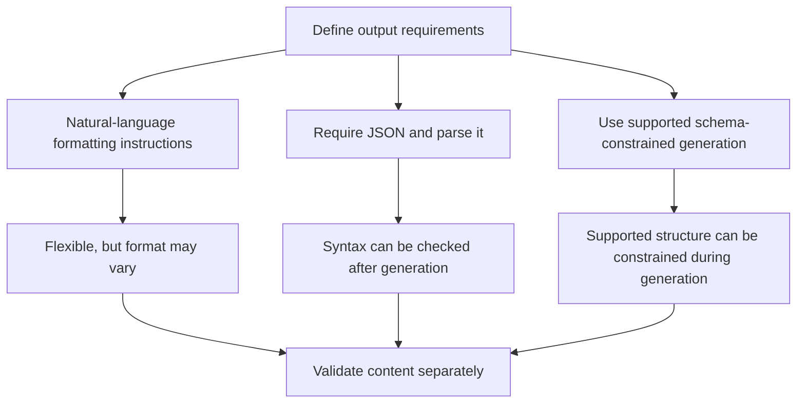
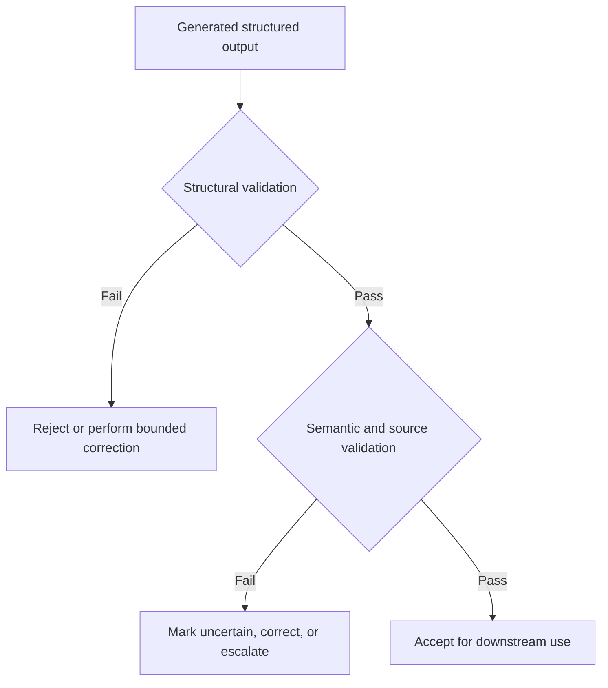

# 07. Structured Outputs and Schema-Constrained Generation

## 1. Why Define an Output Contract?

A model response is easier to use in an application when its structure is predictable. Free-form prose may be readable to a person but difficult for software to parse reliably.

An **output contract** defines the shape and constraints of the response before generation. It specifies what fields must be returned, the types of their values, which values are allowed, and how missing or uncertain information should be represented.

For example, an event-extraction application might need a consistent record containing an event name, date, location, and source evidence. Without a contract, one response might say `Date: unknown`, another might omit the date, and another might invent a date based on context. A contract makes the expected behavior explicit.

A useful output contract describes:

- **Fields:** the information to return.
- **Types:** string, number, Boolean, list, object, or another supported type.
- **Requiredness:** which fields must appear.
- **Allowed values:** labels or enumerations permitted for a field.
- **Constraints:** length limits, numeric bounds, and other restrictions.
- **Missing-data behavior:** how to represent unknown, absent, or inapplicable values.
- **Failure behavior:** what to do when the model cannot provide a compliant answer.

The contract should be designed from the application's downstream needs, not merely from the format that is easiest for the model to produce.

<br/>

## 2. Three Levels of Output Control

Formatting instructions, JSON syntax constraints, and schema-constrained generation are related, but they provide different levels of control.

### Level 1: formatting instructions

A prompt may say:

```text
Return the event name, date, and location.
Use one field per line. If a value is unknown, write "unknown".
Do not include an introduction or conclusion.
```

This communicates the desired format in natural language. It is easy to write and flexible, but the model may still omit a field, rename it, add commentary, or vary the representation.

<br/>

### Level 2: JSON syntax constraints

The prompt can require JSON:

```text
Return only a valid JSON object with the keys "event_name", "date",
and "location". Use null when a value is unknown.
```

Example of the desired shape:

```json
{
  "event_name": "Community Science Fair",
  "date": null,
  "location": "Kolkata"
}
```

JSON has explicit syntax for objects, arrays, strings, numbers, Booleans, and `null`. However, merely requesting JSON does not guarantee that the result will parse or that every required key will exist. A parser can check syntax, but syntax alone does not enforce all application rules.

<br/>

### Level 3: schema-constrained generation

A supported structured-output feature can constrain generation to a declared schema. Depending on the model and provider, this may enforce required fields, value types, enumerations, and parts of a JSON Schema definition during generation.

A schema provides a machine-readable contract rather than relying only on prose instructions. The exact guarantees depend on the API, model, and supported subset of the schema specification.



**Important:** these levels are not interchangeable. A request for JSON is not necessarily schema-constrained generation, and a schema-constrained response is not necessarily factually correct.


<br/>


## 3. Designing a Schema

A schema should encode the information that the application needs while making invalid or ambiguous values difficult to represent.

### 3.1 Fields and types

Common JSON types include:

| Type | Example | Typical use |
|---|---|---|
| String | `"Kolkata"` | Names, descriptions, dates represented as text |
| Number | `42` | Counts, measurements, numeric values |
| Integer | `3` | Whole-number quantities |
| Boolean | `true` | Yes/no state |
| Array | `["talk", "workshop"]` | A list of items |
| Object | `{"city": "Kolkata"}` | A group of related fields |
| Null | `null` | An explicitly unknown or absent value when permitted |

Choose types according to the meaning of the data. For example, a date can be represented as a string in a specified format or as a dedicated date type in a validation library. JSON itself has no built-in date type.

<br/>

### 3.2 Required and optional fields

A **required field** must be present in the output. An **optional field** may be omitted under the applicable schema rules.

Requiredness is not the same as whether a value is known. An application may require the `date` key to appear while allowing its value to be `null` when the date is unknown.

For instance:

```json
{
  "event_name": "Community Science Fair",
  "date": null,
  "location": null
}
```

This representation communicates that the keys were considered but their values are unavailable. If the application needs to distinguish “not mentioned in the source” from “not checked yet” or “not applicable,” a single `null` may be insufficient. Use an explicit status field or a documented set of states when that distinction matters.

<br/>

### 3.3 Enumerations and allowed labels

If a field must use one of a known set of labels, define the permitted values.

Example:

```json
{
  "event_type": "workshop"
}
```

Allowed labels might be `conference`, `workshop`, `exhibition`, and `other`. A value such as `seminar-like event` would fall outside that vocabulary unless the schema explicitly allows it.

Enumerations improve consistency, but the model can still select the wrong allowed label. Membership in an allowed set is a structural check, not proof of correct classification.

<br/>

### 3.4 Nested objects and lists

Nested objects group related fields. Arrays represent repeated items.

For example, an event may contain multiple speakers:

```json
{
  "event_name": "Applied AI Day",
  "speakers": [
    {
      "name": "Riya Sen",
      "affiliation": "Example Research Group"
    },
    {
      "name": "Arun Das",
      "affiliation": null
    }
  ]
}
```

Each speaker follows the same object structure. The schema can define which fields every speaker object must contain and how unknown affiliations are represented.

<br/>

### 3.5 Bounded values

Constraints can limit values—for example, a confidence score from 0 to 1, a title length, or the number of items in a list. Apply bounds only when they reflect the application's real requirements.

A numeric bound does not make a number meaningful. A generated score of `0.92` can satisfy the range `0`–`1` without being calibrated or justified. Avoid adding confidence fields unless their meaning and validation approach are defined.


<br/>


## 4. Practice Example: Event Details Schema

### Requirements

Extract these fields from a source document:

- `event_name`: required string.
- `date`: required key; use `null` when the source does not provide a date.
- `location`: required key; use `null` when the source does not provide a location.
- `event_type`: required label from a fixed set, or `null` if the type cannot be established.
- `evidence`: list of short source excerpts supporting the extracted fields.
- `uncertainties`: list of unresolved ambiguities.

The contract should not permit the model to invent a date or location just to fill a field.

<br/>

### Illustrative JSON Schema

The following is a conceptual JSON Schema example. Actual structured-output APIs may support only a subset of JSON Schema, so check the target provider's current documentation before using it directly.

```json
{
  "type": "object",
  "properties": {
    "event_name": {
      "type": "string",
      "minLength": 1
    },
    "date": {
      "type": ["string", "null"],
      "description": "Use YYYY-MM-DD when a complete date is explicitly supported by the source; otherwise null."
    },
    "location": {
      "type": ["string", "null"],
      "description": "Venue or location supported by the source; otherwise null."
    },
    "event_type": {
      "type": ["string", "null"],
      "enum": ["conference", "workshop", "exhibition", "other", null]
    },
    "evidence": {
      "type": "array",
      "items": {
        "type": "string"
      }
    },
    "uncertainties": {
      "type": "array",
      "items": {
        "type": "string"
      }
    }
  },
  "required": [
    "event_name",
    "date",
    "location",
    "event_type",
    "evidence",
    "uncertainties"
  ],
  "additionalProperties": false
}
```

This schema makes every listed key required, while allowing `null` for fields where the requirements explicitly permit unknown values. The `date` description asks for a date format, but descriptions are not necessarily enforced as patterns. For strict date validation, add an appropriate supported constraint or validate the date in application code.

Also note that some structured-output APIs restrict combinations such as union types, nullable fields, or particular keywords. Adapt the schema to the provider's supported subset and add application-side checks where necessary.

<br/>

### Example output when date and location are unknown

```json
{
  "event_name": "Community Science Fair",
  "date": null,
  "location": null,
  "event_type": "exhibition",
  "evidence": [
    "Community Science Fair",
    "The program will feature science demonstrations and public exhibits."
  ],
  "uncertainties": [
    "The source does not specify the event date.",
    "The source does not identify a venue or location."
  ]
}
```

This output illustrates the intended contract; it is not a claim about a real event. In a real application, each evidence excerpt must be checked against the actual source. If even the event name is uncertain, the contract needs a defined alternative—such as allowing a null name, returning a refusal/error object, or routing the case for review.


<br/>


## 5. Validate the Schema and the Data Separately

A robust implementation performs at least two distinct kinds of checks.

### Structural validation

Checks whether the response follows the expected shape:

- Does it parse?
- Are required keys present?
- Are values of the permitted types?
- Are enum values allowed?
- Are extra fields prohibited when the contract requires that?
- Do applicable length and numeric constraints pass?

<br/>

### Semantic validation

Checks whether the values make sense and are supported:

- Is the event name actually stated in the source?
- Does the date correspond to the event, rather than a publication date?
- Does the location refer to the venue rather than an organizer's headquarters?
- Is the selected event type justified by the source?
- Do evidence excerpts support the associated fields?
- Are uncertainty notes appropriate and complete?



A valid JSON object may contain a false date, a misidentified location, an unsupported event type, or fabricated evidence. A schema constrains representation; it does not independently establish truth.

<br/>

### Example: application-side validation with Pydantic

The following Python example validates a subset of the event contract. It checks types and allowed event labels. It does not prove that the values are supported by a source document.

```python
from datetime import date
from typing import Literal
from pydantic import BaseModel, ConfigDict, field_validator


class EventDetails(BaseModel):
    model_config = ConfigDict(extra="forbid")

    event_name: str
    date: date | None
    location: str | None
    event_type: Literal[
        "conference", "workshop", "exhibition", "other"
    ] | None
    evidence: list[str]
    uncertainties: list[str]

    @field_validator("event_name")
    @classmethod
    def event_name_must_not_be_blank(cls, value: str) -> str:
        if not value.strip():
            raise ValueError("event_name must not be blank")
        return value.strip()


raw_data = {
    "event_name": "Community Science Fair",
    "date": None,
    "location": None,
    "event_type": "exhibition",
    "evidence": ["Community Science Fair"],
    "uncertainties": [
        "The source does not specify the event date.",
        "The source does not identify a location."
    ]
}

event = EventDetails.model_validate(raw_data)
print(event.model_dump(mode="json"))
```

This example uses Pydantic v2 APIs. Install a compatible version of Pydantic before running it. In a real system, the `date` field accepts valid date values or `None`; the application should still verify that a non-null date is present in the source and refers to the event.


<br/>


## 6. Provider and Model Differences

Structured-output capabilities are not identical across providers, models, and API versions.

Differences may include:

- Whether constrained generation is supported at all.
- Which JSON Schema keywords are accepted.
- How optional or nullable fields must be expressed.
- Whether all object properties must be required.
- Whether nested objects, unions, or complex arrays are supported.
- How refusals, truncation, or incomplete output are represented.
- Whether schema constraints are enforced during generation or only checked afterward.

Do not assume that a schema accepted by one provider will work unchanged with another. Before adopting a provider-specific feature:

1. Consult the provider's current API documentation.
2. Use the documented schema subset and response format.
3. Test representative valid and invalid cases.
4. Check behavior for missing information, refusal, and incomplete generation.
5. Keep application-side validation even when constrained generation is enabled.

Treat schema support as a capability to verify, not as a universal guarantee.


<br/>


## 7. Refusals, Incomplete Generation, and Unsupported Capabilities

A production application must define behavior for outputs that do not satisfy the expected contract.

### Refusals

A model may refuse to fulfill a request. Depending on the API, the refusal may be represented by a specific response marker or another documented mechanism rather than a normal data object. Do not assume a refusal will always appear as a field inside the requested schema.

<br/>

### Incomplete or truncated output

Generation may stop before the object is complete because of output limits, interruption, or another API-level condition. A partial JSON string is not a valid completed record. Check the response's completion status when the provider exposes it, then parse and validate the content.

<br/>

### Unsupported schema features

A provider may reject a schema containing unsupported keywords or combinations. Handle schema configuration errors separately from errors in generated data. Simplifying the schema may be appropriate, but do not remove essential validation rules silently.

<br/>

### A safe handling pattern

1. Inspect the provider response status and completion metadata, when available.
2. Detect documented refusal behavior.
3. Confirm that generation completed.
4. Parse the output.
5. Validate the structure.
6. Validate facts against the source.
7. Accept, correct within a fixed limit, return an explicit failure, or request review.

Do not convert a refusal or incomplete response into a normal-looking record filled with guessed values. Do not label a result as validated if only its JSON syntax was checked.


<br/>


## 8. Practice Exercise

### Task

Design a schema for extracting event details from a short announcement. The source may omit the event date or location.

Your schema must define:

- A non-empty event name.
- A date field that distinguishes a known date from an unknown date.
- A location field that can explicitly represent an unknown location.
- An event type constrained to a fixed set of labels.
- A list of source evidence.
- A list of uncertainties.
- A policy for extra fields.

<br/>

### Test cases

Use the following cases to test the design:

1. The announcement gives a complete date and venue.
2. The announcement gives a venue but no date.
3. The announcement gives a date but no venue.
4. The announcement gives neither date nor venue.
5. The announcement uses an ambiguous phrase such as “next Friday” without a publication date.
6. The announcement does not make the event type clear.
7. The model returns a date that is not mentioned in the source.
8. The model returns valid JSON but includes an unsupported location.

For each case, determine:
- Whether the output can satisfy the structural schema.
- Whether it should pass semantic validation.
- Whether the application should accept, flag, correct, or reject the result.

**Expected principle:** cases 7 and 8 can be structurally valid and still fail semantic validation.


<br/>


## 9. Revision Questions

1. What is an output contract, and why should it be designed before generation?
2. How do formatting instructions, JSON syntax constraints, and schema-constrained generation differ?
3. What is the difference between a required field and a known value?
4. When is `null` appropriate, and when might a richer missing-data status be needed?
5. Why are enumerations useful, and what can they not guarantee?
6. Why might a schema supported by one provider fail with another?
7. What is the difference between structural and semantic validation?
8. How should an application handle a refusal or truncated response?
9. Why should evidence excerpts be checked against the source?
10. Why can valid structured output still contain incorrect facts?


<br/>


## 10. Checkpoint: Valid Structure Is Not the Same as Truth

**Checkpoint:** Explain why valid structured output can still contain incorrect facts.

A strong answer should distinguish three layers:

1. **Syntax:** the output can be parsed as JSON.
2. **Schema compliance:** the fields, types, required values, and allowed labels satisfy the contract.
3. **Semantic correctness:** the values accurately represent the source and the task.

The first two layers do not guarantee the third. For example, `{"date": "2026-10-11"}` can be valid JSON and satisfy a date-string schema even if the source announcement contains no such date. Likewise, an allowed `event_type` label can still be the wrong classification.

**Model checkpoint answer:**

> Structured output constrains how information is represented, not whether the information is true. A response can contain all required keys, use the correct data types, and satisfy every allowed-value rule while still misreading the source or inventing a fact. I would therefore validate syntax and schema compliance first, then check important fields and evidence against the original source. Unknown dates and locations should follow an explicit missing-data policy, and refusals or incomplete responses should not be converted into apparently valid records. A result should be accepted only after the checks required by the application have passed.


<br/>


## Key Takeaways

- Define the output contract before generating data.
- Distinguish formatting instructions, valid JSON, and schema-constrained generation.
- Specify fields, types, requiredness, allowed values, bounds, and missing-data behavior.
- Use nested objects and arrays when they represent the domain clearly.
- Verify the schema subset and refusal/completion behavior for the target provider and model.
- Separate structural validation from source-grounded semantic validation.
- Treat refusals, truncation, and unsupported schema features as explicit outcomes—not as ordinary data.
- Never confuse machine-readable output with factual correctness.
