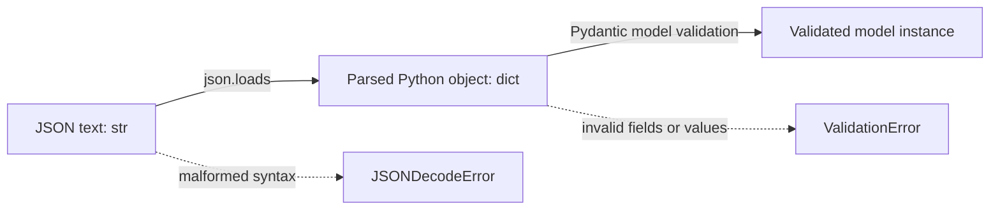

# 08. JSON Output and Validation with Pydantic

## 1. Why Parse and Validate Generated JSON?

When an application receives JSON-formatted text from a model, it should not immediately assume that the result is usable data. Three separate questions must be answered:

1. **Can the text be parsed as JSON?**
2. **Does the parsed object satisfy the expected data model?**
3. **Does the validated data make sense for the application's actual task?**

These checks address different failure modes. A string can contain malformed JSON. Valid JSON can have missing fields or values of the wrong type. A Pydantic model can validate successfully while still containing a false date, an unsupported claim, or a value that violates a business rule not encoded in the model.

Pydantic helps define and validate data models in Python. It does not establish that a model-generated fact is true; that requires application-specific checks and, where relevant, comparison with the original source.

<br/>

## 2. Three Representations: JSON Text, Python Object, Pydantic Model

Consider this JSON text:

```python
raw_json = '''
{
    "event_name": "Community Science Fair",
    "event_type": "exhibition",
    "date": null
}
'''
```

It is initially a **Python string** containing JSON syntax. After parsing, it becomes ordinary Python data. After Pydantic validation, it becomes an instance of a defined model.



<br/>

### 2.1 JSON string

A JSON string is serialized text. It may be syntactically valid or invalid.

```python
raw_json = '{"event_name": "Community Science Fair"}'
```

At this point, Python has not checked whether the text matches the application's requirements.

<br/>

### 2.2 Parsed Python object

Use Python's built-in `json.loads()` to parse JSON text:

```python
import json

data = json.loads(raw_json)
print(type(data))  # <class 'dict'>
print(data["event_name"])
```

Parsing checks JSON syntax and converts JSON values into Python values. It does not check the required application fields unless you add those checks separately.

Common mappings include:

| JSON value | Python value |
|---|---|
| Object | `dict` |
| Array | `list` |
| String | `str` |
| Number | `int` or `float` |
| Boolean | `bool` |
| `null` | `None` |

Malformed JSON raises `json.JSONDecodeError`. For example, a trailing comma or an unquoted property name may cause parsing to fail.

<br/>

### 2.3 Validated Pydantic model

A Pydantic model defines the expected fields and validation rules.

```python
from pydantic import BaseModel

class Event(BaseModel):
    event_name: str
    event_type: str
    date: str | None

event = Event.model_validate(data)
print(event.event_name)
print(type(event))
```

This example uses **Pydantic v2** syntax. It expects the input object to contain all three fields; `date: str | None` allows `None` as a value but does not by itself make the field optional to omit. The field has no default, so it is required in Pydantic v2.

The model above is intentionally minimal. A production schema should generally constrain `event_type` to known labels and validate dates and business rules more precisely.


<br/>


## 3. Define Fields, Enums, Optional Values, and Constraints

Pydantic models express the contract between data-producing code and the rest of an application.

### 3.1 Field types

Common annotations include:

- `str` for text.
- `int` for integer values.
- `float` for numeric measurements.
- `bool` for Boolean values.
- `list[str]` for a list of strings.
- `str | None` for a string value or `None`.
- Other `BaseModel` classes for nested objects.

Type annotations tell Pydantic what to validate. The exact behavior can depend on whether strict validation is enabled and on the type being used.

<br/>

### 3.2 Enums and `Literal`

If a field should accept only a known set of labels, encode that rule instead of accepting arbitrary strings.

```python
from typing import Literal
from pydantic import BaseModel

class Event(BaseModel):
    event_name: str
    event_type: Literal[
        "conference",
        "workshop",
        "exhibition",
        "other",
    ]
```

A value such as `"exhibition"` is accepted; `"exhibition-like"` is not one of the permitted labels.

Python's `enum.Enum` is another useful option, particularly when labels are reused across several models. A restricted label set improves consistency but cannot ensure the model chose the correct label for the source.

<br/>

### 3.3 Optional values versus optional fields

These concepts must not be confused:

- **Nullable field:** the field may contain `None`.
- **Optional field:** the field may be omitted from the input.

In Pydantic v2:

```python
from pydantic import BaseModel

class Example(BaseModel):
    required_nullable: str | None
    optional_nullable: str | None = None
    optional_text: str = "not provided"
```

Interpretation:

- `required_nullable` must be supplied, but its value may be `None`.
- `optional_nullable` may be omitted; if omitted, it defaults to `None`.
- `optional_text` may be omitted and then defaults to `"not provided"`.

Choose defaults carefully. A default string such as `"not provided"` mixes data and status in one field. For machine-readable records, `None` or an explicit status field may be clearer.

<br/>

### 3.4 Constraints

Use `Field` to declare limits where they reflect real requirements.

```python
from pydantic import BaseModel, Field

class Event(BaseModel):
    event_name: str = Field(min_length=1, max_length=120)
    attendee_count: int | None = Field(default=None, ge=0)
    evidence: list[str] = Field(default_factory=list, max_length=10)
```

This example constrains the event name length, prevents negative attendee counts, and limits the evidence list length. The `default_factory=list` creates a fresh list for each model instance.

Constraints should reflect the domain. A value can satisfy every range or length limit and still be factually wrong.


<br/>


## 4. Strict Validation, Coercion, and Extra Fields

### 4.1 Coercion

In non-strict mode, Pydantic may convert compatible input values to the requested type. For example, a numeric string may be accepted as an integer in some contexts. Coercion can be convenient when input sources are inconsistent, but it can also conceal a mismatch between the producer and the consumer.

<br/>

### 4.2 Strict validation

Strict mode reduces implicit conversion and requires values to match the expected types more closely.

```python
from pydantic import BaseModel, ConfigDict

class StrictEvent(BaseModel):
    model_config = ConfigDict(strict=True)

    event_name: str
    attendee_count: int
```

With this configuration, an input such as `{"attendee_count": "25"}` should be rejected rather than silently converted to an integer. Exact behavior can vary by type and validation pathway, so test the cases important to your application.

Strictness is not automatically best for every field. If upstream systems legitimately provide numeric values as strings, you may prefer explicit normalization followed by strict validation.

<br/>

### 4.3 Extra fields

An input may include keys that are not defined in the model. Pydantic's default behavior is to ignore extra fields. You can change that policy.

```python
from pydantic import BaseModel, ConfigDict

class Event(BaseModel):
    model_config = ConfigDict(extra="forbid")

    event_name: str
    event_type: str
```

With `extra="forbid"`, unknown keys cause validation to fail. Other supported policies include ignoring or allowing extra fields. Select a policy deliberately:

- **Forbid:** useful when the contract must be exact.
- **Ignore:** useful when unrelated extra keys can safely be discarded.
- **Allow:** useful when extra information must be retained and the application has a reason to accept it.

If an extra field might contain important data, silently ignoring it may be undesirable. If it may contain untrusted content, accepting it without review may also be undesirable.


<br/>


## 5. Custom Business-Rule Checks

Type validation cannot express every domain rule. Some requirements depend on relationships among fields or on the original source.

Examples:

- The end date must not precede the start date.
- An event marked as `online` must include a meeting URL.
- An attendee count must not exceed the event's capacity.
- A date must be supported by the source announcement, not inferred from the date the announcement was published.

The first three can be represented as application-level validation rules. The last requires evidence from the source, not just the values in a Pydantic object.

<br/>

### Example: cross-field validation in Pydantic v2

```python
from datetime import date
from pydantic import BaseModel, model_validator

class EventSchedule(BaseModel):
    start_date: date
    end_date: date

    @model_validator(mode="after")
    def end_must_not_precede_start(self):
        if self.end_date < self.start_date:
            raise ValueError("end_date must be on or after start_date")
        return self
```

The `model_validator(mode="after")` method runs after field validation and checks a relationship between the fields. This is Pydantic v2 syntax.

<br/>

### Source-grounding checks

To validate facts extracted from a document, retain enough source information to verify them. For example, the application might keep an evidence excerpt and a page or section reference alongside the extracted date.

A presence of an evidence string is not proof that it supports the claim. The evidence must be checked against the original source, and ambiguous cases may require human review.


<br/>


## 6. Inspect Malformed JSON and Validation Failures

Different errors indicate different problems and should be handled separately.

### Case A: malformed JSON

```python
raw_json = '{"event_name": "Science Fair",}'
```

The trailing comma makes this invalid JSON in standard parsing. `json.loads()` raises `json.JSONDecodeError`.

<br/>

### Case B: valid JSON, missing field

```python
raw_json = '{"event_name": "Science Fair"}'
```

This parses successfully, but validation fails if the model also requires `event_type`.

<br/>

### Case C: valid JSON, incorrect type

```python
raw_json = '{"event_name": "Science Fair", "attendee_count": "many"}'
```

This may parse as JSON, but a field declared as an integer cannot meaningfully accept `"many"` as an integer.

<br/>

### Case D: unsupported value

```python
raw_json = '''
{
  "event_name": "Science Fair",
  "event_type": "festival"
}
'''
```

If the schema permits only `"conference"`, `"workshop"`, `"exhibition"`, or `"other"`, the unsupported label must fail validation.

<br/>

### Case E: semantically incorrect but schema-valid value

```python
raw_json = '''
{
  "event_name": "Science Fair",
  "event_type": "exhibition",
  "date": "2026-10-11"
}
'''
```

This can parse and validate if the model permits these values. If the source says nothing about the date, however, the record is not source-grounded. Schema validation alone cannot detect this.

<br/>

### A staged validation function

The following example separates JSON parsing from Pydantic validation. It returns a status and an error summary rather than treating every failure as the same problem.

```python
import json
from typing import Literal
from pydantic import BaseModel, ConfigDict, ValidationError


class Event(BaseModel):
    model_config = ConfigDict(strict=True, extra="forbid")

    event_name: str
    event_type: Literal["conference", "workshop", "exhibition", "other"]
    date: str | None


def parse_and_validate(raw_text: str) -> dict:
    try:
        parsed = json.loads(raw_text)
    except json.JSONDecodeError as exc:
        return {
            "status": "parse_error",
            "error": {
                "message": exc.msg,
                "line": exc.lineno,
                "column": exc.colno,
            },
        }

    try:
        event = Event.model_validate(parsed)
    except ValidationError as exc:
        return {
            "status": "schema_error",
            "errors": exc.errors(include_input=False),
        }

    return {
        "status": "validated",
        "data": event.model_dump(mode="json"),
    }
```

This code is illustrative and uses Pydantic v2. `status="validated"` means the object passed this model's validation. It does **not** mean its facts have been verified against a source or that all business rules have passed. Add separate semantic checks and use a status name such as `source_verified` only after those checks succeed.


<br/>


## 7. Error Handling: Retry, Reject, or Review

A validation failure should trigger a deliberate response. Repeatedly asking the model to “try again” without limits can waste tokens and may produce a different invalid answer.

### Recommended policy

| Failure | Typical response |
|---|---|
| Malformed JSON | Allow a bounded correction attempt if safe |
| Missing required field | Retry with the specific validation issue, or reject |
| Wrong type or unsupported enum | Correct within the retry budget or reject |
| Business-rule violation | Request a targeted correction or reject |
| Unsupported or unverified fact | Mark as uncertain, re-check source, or request human review |
| Repeated failure | Stop and return a clear failure status |
| High-consequence ambiguity | Escalate instead of relying on repeated generation |

A bounded retry policy defines a maximum number of attempts, the specific error information supplied to the correction step, and the action taken if validation still fails.

Do not tell a correction step to invent values to satisfy required fields. Missing-data behavior should be part of the schema and prompt.

<br/>

### Example: bounded correction loop (pseudocode)

```python
MAX_ATTEMPTS = 2  # one initial attempt plus at most one correction

for attempt in range(MAX_ATTEMPTS):
    raw_text = generate_output()  # application-defined function
    result = parse_and_validate(raw_text)

    if result["status"] == "validated":
        # Run application-specific semantic checks here.
        break

    if attempt == MAX_ATTEMPTS - 1:
        # Record failure and stop; do not accept invalid output.
        result = {"status": "failed_after_retries"}
        break

    # A real implementation may request a targeted correction using
    # the validation error. Keep the correction attempt bounded.
```

`generate_output()` is a placeholder, not a built-in Python or Pydantic function. Provider SDK calls and structured-output API integration are outside this chapter's scope.


<br/>


## 8. Preserve Debugging Evidence Without Logging Sensitive Data

Useful debugging records can include:

- A request or correlation ID.
- A schema/model version.
- The validation stage that failed.
- A sanitized error summary.
- The number of attempts.
- A timestamp and non-sensitive operational metadata.
- A hash or reference to the original input, if suitable for the system.

Raw prompts and model outputs can contain personal data, credentials, confidential documents, or other sensitive information. Do not log them automatically just because validation failed.

<br/>

### Practical logging principles

1. **Minimize:** store only what is needed to debug or audit the failure.
2. **Redact:** remove secrets, access tokens, personal identifiers, and unnecessary source content.
3. **Restrict access:** apply access controls and retention policies to logs.
4. **Separate metadata from content:** operational metrics often need no raw prompt or output.
5. **Preserve useful context safely:** when a raw sample is necessary, use approved secure storage and appropriate retention rather than a general application log.
6. **Avoid error leakage:** validation errors can include input values unless configured otherwise. For example, `ValidationError.errors(include_input=False)` can omit the original input value from the returned error details.

For reproducibility, preserve the schema version, code version, validation outcome, and enough safe metadata to identify which processing path was used. A hash can help correlate identical inputs but does not make sensitive data anonymous in every setting.


<br/>


## 9. Treat Generated Text and Code as Untrusted Data

Generated content should be parsed and validated as data. Do not execute it merely because it looks like code, a shell command, SQL, or a Python expression.

Unsafe patterns include:

```python
# Do not do this with untrusted model output:
# eval(generated_text)
# exec(generated_text)
```

Parsing JSON with `json.loads()` does not execute Python code. It interprets JSON syntax and returns Python data structures. After parsing, however, string values may still contain malicious or unexpected text. Validate values and handle them according to the application context.

For example:
- Use parameterized SQL queries rather than concatenating generated strings into SQL.
- Treat generated file paths and URLs as untrusted until validated.
- Do not pass generated shell commands directly to a shell.
- Validate and escape data appropriately before rendering it in a web page.
- Apply authorization checks independently of model-generated claims.

A valid schema is not a security boundary for every downstream operation. Validation must be combined with safe handling and authorization in the application.


<br/>


## 10. Practice: Validate Prepared Outputs

Use this simplified Pydantic v2 model for the exercise:

```python
from typing import Literal
from pydantic import BaseModel, ConfigDict, Field

class Event(BaseModel):
    model_config = ConfigDict(strict=True, extra="forbid")

    event_name: str = Field(min_length=1)
    event_type: Literal["conference", "workshop", "exhibition", "other"]
    date: str | None
```

For each prepared output below, identify:
1. Whether JSON parsing succeeds.
2. Whether Pydantic validation succeeds.
3. Whether the value is semantically correct given the stated source.
4. The appropriate action: accept, correct, reject, or review.

<br/>

### Test 1 — Malformed JSON

```text
{"event_name": "Science Fair", "event_type": "exhibition", "date": null,}
```

**Expected diagnosis:** parsing fails because of the trailing comma. Pydantic validation is not reached.

<br/>

### Test 2 — Missing required field

```json
{
  "event_name": "Science Fair",
  "event_type": "exhibition"
}
```

**Expected diagnosis:** JSON parsing succeeds. Pydantic validation fails because `date` is required, even though its value may be `null`.

<br/>

### Test 3 — Incorrect type

```json
{
  "event_name": "Science Fair",
  "event_type": "exhibition",
  "date": 20261011
}
```

**Expected diagnosis:** JSON parsing succeeds. Strict Pydantic validation fails because `date` is declared as `str | None`, while the value is an integer.

<br/>

### Test 4 — Unsupported enum

```json
{
  "event_name": "Science Fair",
  "event_type": "festival",
  "date": null
}
```

**Expected diagnosis:** JSON parsing succeeds. Pydantic validation fails because `"festival"` is not an allowed label.

<br/>

### Test 5 — Empty required name

```json
{
  "event_name": "",
  "event_type": "exhibition",
  "date": null
}
```

**Expected diagnosis:** JSON parsing succeeds. Pydantic validation fails because the name violates `min_length=1`.

<br/>

### Test 6 — Valid schema, unsupported fact

```json
{
  "event_name": "Science Fair",
  "event_type": "exhibition",
  "date": "2026-10-11"
}
```

**Source for this test:** the announcement names the event and identifies it as an exhibition, but contains no date.

**Expected diagnosis:** JSON parsing and the model's validation both succeed. Semantic validation fails because the date is unsupported by the source. The appropriate response is to correct the value to `null` if that is justified by the source, or flag it for review—not to accept it merely because it matches the type.

<br/>

### Exercise answer table

| Test | Parsing | Pydantic validation | Application action |
|---|---|---|---|
| 1 | Fail | Not reached | Reject or bounded correction |
| 2 | Pass | Fail | Correct or reject |
| 3 | Pass | Fail | Correct or reject |
| 4 | Pass | Fail | Correct or reject |
| 5 | Pass | Fail | Correct or reject |
| 6 | Pass | Pass | Fail source-grounding check; correct or review |


<br/>


## 11. Revision Questions

1. What is the difference between JSON text, a parsed Python object, and a Pydantic model?
2. Why does successful JSON parsing not prove that all required fields are present?
3. In Pydantic v2, how does `str | None` differ from `str | None = None`?
4. What is coercion, and why might strict validation be useful?
5. What does `extra="forbid"` do?
6. Why are custom business-rule checks necessary?
7. How should malformed JSON differ from a semantically unsupported value in error handling?
8. Why should retries be bounded?
9. What debugging information is useful, and what data should not be logged unnecessarily?
10. Why must generated code remain untrusted even when it is returned in a valid structured format?


<br/>


## 12. Checkpoint: Parsing, Schema Validity, and Application Correctness

**Checkpoint:** Distinguish parsing success, schema validity, and application-level correctness.

A strong answer should explain these three stages:

- **Parsing success:** the text follows JSON syntax and can be converted into Python values.
- **Schema validity:** the parsed values satisfy the Pydantic model's field definitions, types, allowed labels, and configured constraints.
- **Application-level correctness:** the data satisfies domain rules and is supported by the original source or other trusted evidence.

A record can pass parsing and fail schema validation because a field is missing or has the wrong type. It can pass both parsing and schema validation while failing application-level correctness because a date was invented or an event was misclassified.

**Model checkpoint answer:**

> Parsing checks whether the text is valid JSON and converts it into Python data structures. Pydantic validation then checks the parsed data against the defined model, including required fields, types, enums, and configured constraints. Application-level validation goes further by checking business rules and whether the extracted facts are supported by the original source. These are separate stages: a schema-valid record can still contain false information. I would handle syntax errors, validation errors, and semantic failures separately, use bounded retries, and stop or request human review when the data cannot be verified.


<br/>


## 13. Depth Boundary

This chapter focuses on local JSON parsing, Pydantic model design, validation, error handling, and safe treatment of generated data.

Provider SDK calls and integration with structured-output APIs belong to **Level 6**. The code examples use **Pydantic v2** APIs, including `model_validate`, `model_dump`, `ConfigDict`, `field_validator`, and `model_validator`. Check the installed Pydantic version before running examples; Pydantic v1 uses different APIs for some of these operations.


<br/>


## Key Takeaways

- JSON text, a parsed Python object, and a validated Pydantic model are different representations.
- Parsing checks syntax; Pydantic checks the declared data model; application checks establish domain correctness and source support.
- In Pydantic v2, nullable fields and fields that may be omitted are not the same.
- Use strict validation, enums, constraints, and extra-field policies deliberately.
- Add business-rule and source-grounding checks beyond the schema.
- Distinguish malformed JSON, schema errors, and semantic failures.
- Bound retries and reject or escalate persistent failures.
- Preserve useful debugging metadata while minimizing sensitive logs.
- Parse generated content as data; never execute untrusted generated text or code merely because it appears valid.
- Verify the installed Pydantic version and keep provider integration for Level 6.
