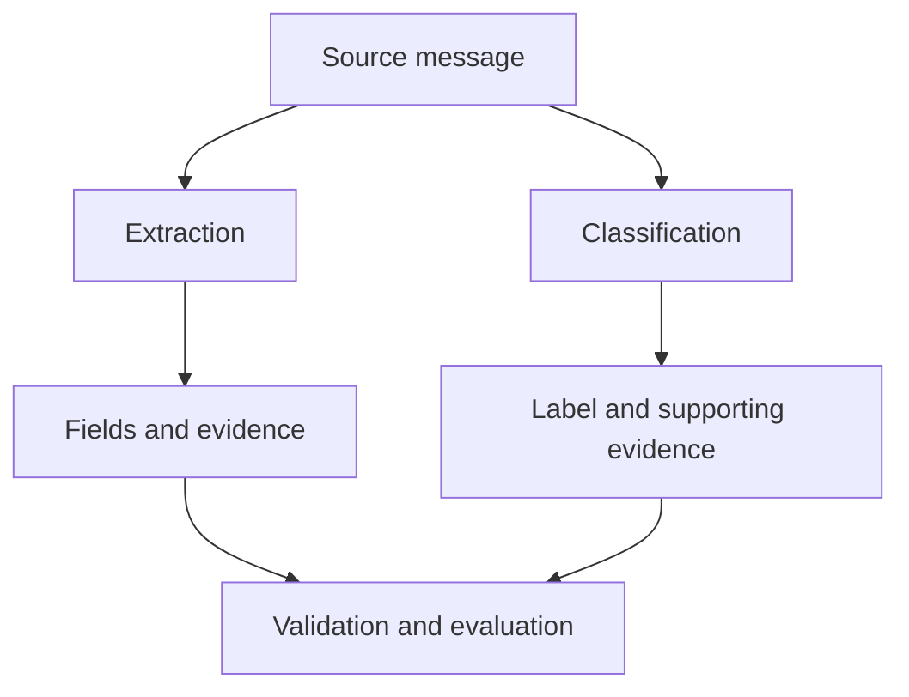

# 09. Extraction and Classification

## 1. Two Common Structured-Output Tasks

**Extraction** identifies information present in an input and returns it in a defined structure. **Classification** assigns an input or part of an input to one or more labels from a defined set.

They are often used together, but they answer different questions.

- Extraction asks: *What information does the source contain?*
- Classification asks: *Which category best fits the source according to the defined criteria?*

For example, a support message might contain a product name, an order number, and a complaint. An extraction task identifies those details. A classification task assigns the message a label such as `delivery_issue`, `billing_issue`, or `technical_issue`.

Both tasks require precise definitions. A prompt that says “extract the important information” leaves the fields unclear. A classifier with vague or overlapping labels may produce inconsistent decisions.



A single workflow can use both stages, but their outputs and evaluation criteria should remain distinguishable.

<br/>

## 2. Define Extraction Fields Before Writing the Prompt

An extraction prompt should specify exactly which fields to return and what each field means.

For every field, define:

1. **Purpose:** what information the field represents.
2. **Source rule:** where the information must come from.
3. **Representation:** exact source text or normalized value.
4. **Multiplicity:** whether one value or several values may be returned.
5. **Missing-data behavior:** what to return when the value is absent or uncertain.
6. **Evidence requirement:** whether the result should include a supporting source span.

<br/>

### Example: support-message extraction contract

Suppose the source message is:

> “My order A-1042 was supposed to arrive on Monday, but it still hasn’t come. Please help.”

A possible field contract is:

| Field | Meaning | Representation | Missing-data behavior |
|---|---|---|---|
| `order_id` | Order identifier explicitly mentioned | Exact source value | `null` if absent |
| `issue_summary` | Short description of the customer's issue | Normalized summary | Empty or unavailable according to the chosen contract |
| `expected_delivery` | Delivery date or time explicitly stated | Normalized date only when unambiguous; otherwise preserve source wording or mark unknown | `null` if absent or not safely resolvable |
| `requested_action` | Action the customer asks the company to take | Normalized short phrase | `null` if no action is requested |

The message gives the order ID and says delivery was expected on Monday. It does not provide enough context to infer a calendar date for “Monday.” The extractor should not invent one.

Example result:

```json
{
  "order_id": "A-1042",
  "issue_summary": "The order has not arrived as expected.",
  "expected_delivery": "Monday",
  "requested_action": "Help resolve the missing delivery"
}
```

Here `expected_delivery` preserves the source wording rather than converting it into a calendar date. If the application needs a normalized date, it should define what context is required and how unresolved relative dates are represented.


<br/>


## 3. Exact Source Text vs. Normalized Values

An extractor must know whether it should preserve the source or transform it.

### Exact source text

Use exact text when wording matters—for example:

- Quotations or contractual language.
- Product codes and identifiers.
- Error messages.
- Evidence spans used for audit.
- User statements that must not be paraphrased.

Example source:

> “It crashes with code ERR-42 after I click Save.”

Exact extraction:

```json
{
  "error_code": "ERR-42",
  "action": "click Save"
}
```

Avoid “correcting” spelling, punctuation, or identifier formatting if exact preservation is required.

<br/>

### Normalized values

Normalization converts different surface forms into a consistent representation.

Examples:

- `"I can't sign in"` → `"login_problem"`
- `"three items"` → `3`
- `"15 Oct 2026"` → `"2026-10-15"` when the date is unambiguous.
- `"charged twice"` → `"duplicate_charge"`

Normalization is useful for analytics, routing, and downstream processing, but it can lose detail or introduce assumptions.

<br/>

### Use separate fields when both are useful

For high-value extraction tasks, store both the source span and the normalized interpretation:

```json
{
  "raw_text": "I was charged twice for the same order.",
  "normalized_issue": "duplicate_charge"
}
```

This lets a downstream system use the stable label while retaining the source wording for review.

**Design rule:** do not ask a single field to be both an exact quotation and a normalized interpretation. Define separate fields when both representations are required.


<br/>


## 4. Preserve Evidence Spans

An **evidence span** is a short portion of the source that supports an extracted value or classification.

Evidence is useful when:
- A reviewer must audit the result.
- A field may be ambiguous.
- The output influences a consequential decision.
- You need to diagnose why a label was assigned.
- The source contains several entities or conflicting claims.

Example:

```json
{
  "issue_label": "delivery_issue",
  "evidence": "it still hasn’t come"
}
```

An evidence span makes the result easier to inspect, but it does not guarantee that the interpretation is correct. The quoted text might be too short, refer to another entity, or fail to support the full claim.

<br/>

### Evidence requirements

A prompt can specify that evidence must:
- Be copied from the supplied source.
- Be as short as practical while preserving meaning.
- Support the particular field or label it accompanies.
- Be empty or absent when no supporting span exists, according to the schema.
- Never be fabricated to satisfy a required field.

When exact character offsets are required, define whether offsets are measured in Unicode code points, bytes, or another indexing scheme. Offsets are fragile if text is normalized or altered before indexing. For simpler applications, a verbatim quote may be sufficient.


<br/>


## 5. Classification: Define the Label Set

A classification task is only as consistent as its label definitions.

For each label, specify:
- **Name:** a stable machine-readable identifier.
- **Definition:** what the label means.
- **Inclusion criteria:** what evidence qualifies.
- **Exclusion criteria:** what should not receive the label.
- **Examples:** representative positive and negative cases.
- **Ambiguous-case policy:** how to handle overlap or insufficient information.

<br/>

### Example label set for support messages

| Label | Inclusion criteria | Exclusions or boundaries |
|---|---|---|
| `delivery_issue` | Missing, late, damaged, or misdelivered order | A general product question with no delivery problem |
| `billing_issue` | Incorrect charge, refund, invoice, or payment problem | A delivery complaint that merely mentions the order price |
| `technical_issue` | Product or service fails, errors, or behaves unexpectedly | A request for product features without a failure |
| `account_issue` | Login, access, account settings, or account security problem | A device or product fault unrelated to account access |
| `other` | A clear issue that does not fit the listed categories | Do not use merely because the message is hard to interpret |
| `insufficient_information` | The message does not provide enough evidence for a reliable label | Do not use when a listed label is clearly supported |

The exact label set depends on the application. Keep it as small as practical while still distinguishing categories that lead to different actions.

<br/>

### Single-label vs. multi-label classification

**Single-label classification** returns one category. It is appropriate when each input should have one primary routing destination.

**Multi-label classification** allows several categories when a message contains multiple distinct issues.

For example:

> “I was charged twice, and my replacement order still hasn’t arrived.”

A single-label system needs a tie-breaking rule, such as selecting the primary issue based on the user's main request. A multi-label system might return both `billing_issue` and `delivery_issue`.

Do not leave this choice implicit. Specify whether labels are mutually exclusive, whether multiple labels are allowed, and how the primary label is chosen when only one is permitted.


<br/>


## 6. Handle Unknown, Missing, and Not Applicable Values

These states are related but not identical.

- **Unknown:** the field may exist in reality, but the source does not establish its value.
- **Missing:** the source does not provide the information needed to populate the field.
- **Not applicable:** the field does not apply to this record.
- **Ambiguous:** the source supports multiple plausible interpretations.
- **Conflicting:** the source contains statements that disagree.

An application may choose to represent some of these states with `null`, but that loses distinctions. If those distinctions affect decisions, model them explicitly.

<br/>

### Example status representation

```json
{
  "value": null,
  "status": "unknown",
  "evidence": []
}
```

Possible status values might include `known`, `unknown`, `not_applicable`, `ambiguous`, and `conflicting`. Define the vocabulary and its meaning before using it.

Do not use an empty string, zero, or a guessed default as a substitute for unknown data unless the domain explicitly defines that behavior.

<br/>

### Relative dates and implicit information

Consider:

> “I will be there next Friday.”

Without a reference date and timezone policy, the intended calendar date may be unresolved. Preserve the wording or mark the date ambiguous rather than silently calculating a date.

Similarly, “my order never arrived” does not identify an order number. The extractor should return the defined missing value, not construct an identifier.


<br/>


## 7. Multiple Entities, Conflicting Statements, and Mixed Categories

Real inputs often contain more than one entity or issue.

### Multiple entities

Example:

> “Order A-1042 arrived late, but order A-1049 never arrived.”

Do not combine the two order IDs into a single issue record without preserving which fact belongs to which order. Use a list of records when each entity has its own attributes.

```json
{
  "orders": [
    {
      "order_id": "A-1042",
      "issue": "late_delivery"
    },
    {
      "order_id": "A-1049",
      "issue": "missing_delivery"
    }
  ]
}
```

<br/>

### Conflicting statements

Example:

> “The appointment email says 10 AM, but the confirmation page says 11 AM.”

The extractor should preserve both claims and indicate the conflict. It should not choose one merely because the schema expects a single time.

```json
{
  "reported_times": [
    {
      "time": "10 AM",
      "source": "appointment email"
    },
    {
      "time": "11 AM",
      "source": "confirmation page"
    }
  ],
  "status": "conflicting"
}
```

A separate resolution policy may determine which source is authoritative. If no such policy exists, keep the conflict explicit.

<br/>

### Mixed-category inputs

A single support message can contain billing and delivery issues, or account access and a technical fault. Decide whether to:
- Return multiple labels.
- Return one primary label plus secondary labels.
- Split the message into issue-level records.
- Route the entire message to a defined general queue.

The correct choice depends on downstream use. A prompt cannot compensate for an undefined classification policy.


<br/>


## 8. Example Extraction Prompt

This prompt extracts facts from synthetic support messages. It defines fields, source rules, and missing-data behavior.

```text
Task:
Extract the requested information from the supplied support message.

Source rules:
- Use only the message as evidence.
- Do not infer facts that are not stated or safely supported.
- Preserve identifiers exactly as written.
- Keep source wording for relative dates when the calendar date is unresolved.

Return these fields:
- order_id: string or null
- issue_summary: concise normalized description
- expected_delivery: source wording or null
- requested_action: concise description or null
- evidence: short exact excerpts supporting the extracted fields
- uncertainties: list of unresolved ambiguities

Missing-data rules:
- Use null when a field cannot be established from the message.
- Do not invent identifiers, dates, locations, or requested actions.
- If two statements conflict, preserve the conflicting claims and describe the conflict in uncertainties.
- Return only the required structured object.
```

<br/>

### Synthetic input A

> “Order B-2077 was meant to arrive on Tuesday. It hasn’t shown up. Can someone check it?”

Possible output:

```json
{
  "order_id": "B-2077",
  "issue_summary": "The order has not arrived as expected.",
  "expected_delivery": "Tuesday",
  "requested_action": "Check the order status",
  "evidence": [
    "Order B-2077",
    "was meant to arrive on Tuesday",
    "It hasn’t shown up",
    "Can someone check it?"
  ],
  "uncertainties": [
    "The calendar date corresponding to Tuesday is not established by the message."
  ]
}
```

<br/>

### Synthetic input B — incomplete example

> “It still hasn’t arrived. Please help.”

Possible output:

```json
{
  "order_id": null,
  "issue_summary": "The referenced item has not arrived.",
  "expected_delivery": null,
  "requested_action": "Help resolve the delivery issue",
  "evidence": [
    "It still hasn’t arrived",
    "Please help"
  ],
  "uncertainties": [
    "The message does not identify the order.",
    "The expected delivery date is not stated."
  ]
}
```

The second output does not invent an order ID or expected date. Whether `issue_summary` and `requested_action` count as safely supported normalized interpretations depends on the definitions in the contract.


<br/>


## 9. Example Classification Prompt

Use a separate prompt when classification labels and criteria differ from extraction fields.

```text
Task:
Classify the support message using the label definitions below.

Allowed labels:
- delivery_issue: a missing, late, damaged, or misdelivered order
- billing_issue: a charge, refund, invoice, or payment problem
- technical_issue: a product or service malfunction or error
- account_issue: login, access, or account-management problem
- other: a clear issue outside the listed categories
- insufficient_information: the message lacks enough evidence for a reliable label

Rules:
- Return all applicable labels if the message contains multiple distinct issues.
- Use insufficient_information only when no reliable issue category can be established.
- Do not infer a problem from facts that are not stated.
- Include a short exact evidence excerpt for each assigned label.
- If the source is ambiguous, state the ambiguity instead of forcing a confident label.
- Return only the specified structured object.
```

<br/>

### Classification examples

| Synthetic support message | Expected label(s) | Why |
|---|---|---|
| “My parcel has not arrived.” | `delivery_issue` | Missing delivery is explicit |
| “I was charged twice for one purchase.” | `billing_issue` | Duplicate charge is explicit |
| “The app crashes when I open settings.” | `technical_issue` | A software failure is described |
| “I can’t log in to my account.” | `account_issue` | Access problem is explicit |
| “Can you tell me more about your service?” | `insufficient_information` or a separate inquiry label, depending on the defined task | No support problem is identified |
| “The refund is missing, and the replacement is late.” | `billing_issue`, `delivery_issue` | Two distinct issues are stated |
| “It is not working.” | `insufficient_information` or a more specific label only if context supports it | The affected product or function is unclear |

The table's labels are examples under the stated definitions. In a production dataset, ambiguous cases should be labeled according to a documented annotation policy.


<br/>

## 10. Evaluate Extraction and Classification Separately

A response may be valid JSON but contain incorrect extracted fields or a wrong classification. Evaluate these dimensions independently.

### Output validity

Measures whether the response satisfies the format and schema:
- Can it be parsed?
- Are required fields present?
- Are values of permitted types?
- Are labels in the allowed set?

<br/>

### Extraction quality

Measure field-level correctness against annotated reference data. Depending on the task, useful measures include:

- **Exact-match accuracy:** whether the extracted field exactly matches the reference.
- **Normalized accuracy:** whether the normalized value matches after applying the same normalization policy.
- **Precision and recall:** useful when extracting multiple entities, spans, or values.
- **Span-level overlap or exact span match:** useful when source offsets or evidence spans matter.

Choose metrics that fit the field. Exact string match may be suitable for an order ID, while a normalized summary may need semantic or rubric-based evaluation.

<br/>

### Classification quality

Compare predicted labels with reference labels. Depending on whether the task is single-label or multi-label, evaluate:
- Accuracy.
- Per-class precision and recall.
- F1 score.
- Confusion matrix.
- Macro or weighted averages when class frequencies differ.
- Multi-label precision, recall, and F1 when multiple labels can apply.

Do not rely on accuracy alone when rare but important labels may be missed.

<br/>

### A practical evaluation table

| Dimension | Example check | What it tells you |
|---|---|---|
| Format validity | JSON parsing and schema validation | Whether the output is usable in the expected shape |
| Field accuracy | Exact order-ID match | Whether a particular field was extracted correctly |
| Evidence quality | Source excerpt supports the field | Whether the result is auditable and grounded |
| Label accuracy | Predicted issue labels vs. annotated labels | Whether classification decisions are correct |
| Unknown handling | Missing fields are not guessed | Whether the system handles incomplete input safely |
| Multi-issue handling | Every applicable label or record is preserved | Whether mixed inputs are represented correctly |

Use a representative, held-out evaluation set with both complete and incomplete messages. Include ambiguous examples and multiple-issue cases. Report the evaluation method and sample size rather than claiming quality based on a few hand-picked examples.


<br/>


## 11. Practice: Build and Test the Prompts

### Task A — Write the extraction contract

For synthetic support messages, define:
- Required fields.
- Exact versus normalized representation.
- Whether evidence excerpts are required.
- The missing-data convention.
- How conflicting statements and multiple orders are represented.

<br/>

### Task B — Write the classification contract

Define:
- The complete label set.
- Inclusion and exclusion criteria for each label.
- Whether classification is single-label or multi-label.
- What to do with unclear messages.
- How evidence should be recorded.

<br/>

### Task C — Test incomplete inputs

Use these messages:

1. “My order never arrived.”
2. “The payment was taken twice, and my parcel is late.”
3. “It does not work.”
4. “The email says Tuesday, but the tracking page says Thursday.”
5. “Order C-501 was delivered on 15 October.” 
6. “Please check this for me.”

For each message:
- Identify what can be extracted directly.
- Identify what is unknown or ambiguous.
- Assign labels only when the definitions support them.
- Provide evidence for the extracted fields and labels.
- Check that the output obeys the schema.

<br/>

### Task D — Evaluate errors separately

Create a small reference set with human-reviewed fields and labels. Track at least:
- Schema validity rate.
- Field-level extraction accuracy.
- Classification precision, recall, and F1 where appropriate.
- The rate of unsupported guesses for missing values.
- The rate of correct handling of ambiguous and multi-issue cases.

A high schema-validity rate does not establish high extraction or classification quality.


<br/>


## 12. Revision Questions

1. How does extraction differ from classification?
2. When should a field preserve exact source text rather than normalize it?
3. Why might an evidence span be useful, and why is it not proof by itself?
4. What is the difference between unknown, not applicable, ambiguous, and conflicting?
5. How should a prompt handle a message that contains multiple orders?
6. What is the difference between single-label and multi-label classification?
7. Why must label inclusion and exclusion criteria be explicit?
8. How can a classifier avoid forcing a guess when information is insufficient?
9. Why should field accuracy and label accuracy be evaluated separately from schema validity?
10. Which evaluation metrics are appropriate for multi-label classification?


<br/>


## 13. Checkpoint: Preventing Forced Guesses

**Checkpoint:** Explain how the prompt and schema prevent forced guesses without guaranteeing perfect extraction.

A strong answer should include:

- **Explicit field definitions** reduce ambiguity about what must be extracted.
- **Exact-versus-normalized rules** prevent accidental paraphrasing or unsupported conversion.
- **Allowed labels and criteria** make classification decisions more consistent.
- **Explicit missing-data states** allow the system to report unknown, ambiguous, or conflicting values instead of filling every field with a guess.
- **Evidence requirements** make important fields and labels easier to audit.
- **Schema validation** checks the output structure and allowed values.
- **Semantic evaluation** is still required because a model can select a valid field value or label that is wrong for the source.
- **Representative testing** is needed to discover errors on incomplete, ambiguous, and multi-issue inputs.

**Model checkpoint answer:**

> A clear prompt defines each extraction field, distinguishes exact source text from normalized values, and gives explicit rules for missing, ambiguous, or conflicting information. A schema enforces the expected fields, types, and permitted labels, while evidence excerpts make the result easier to review. These controls reduce the pressure to invent values and make errors easier to detect. They do not guarantee perfect extraction because the model may overlook a source detail, misinterpret an evidence span, or choose an allowed but incorrect label. I would therefore validate the structure, compare extracted fields and evidence with the source, and evaluate extraction and classification quality separately on representative examples.


<br/>


## Key Takeaways

- Define extraction fields, representation rules, and missing-data behavior before prompting.
- Separate exact source text from normalized interpretations.
- Preserve concise evidence spans when auditability matters.
- Use explicit label definitions, inclusion criteria, and ambiguity rules for classification.
- Model unknown, not-applicable, ambiguous, and conflicting states deliberately.
- Preserve the relationship between multiple entities and their facts.
- Evaluate output validity, field accuracy, evidence quality, and label accuracy as separate dimensions.
- Prompts and schemas reduce forced guesses, but source-grounded checks and evaluation remain necessary.
