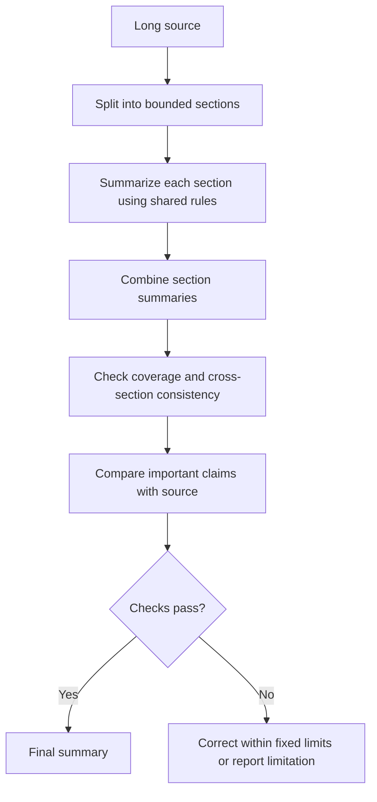

# 10. Summarization and Transformation

## 1. Summarization and Transformation Are Different Tasks

A language model can shorten, rewrite, translate, reformat, or otherwise transform source material. These operations overlap, but each has a different objective.

**Summarization** selects and compresses the most important information for a defined purpose. A good summary is shorter than the source while preserving the information that matters to its audience.

**Transformation** changes the form of the content while preserving the aspects of meaning that the task requires. Examples include rewriting for a different audience, translating into another language, converting prose into a table, or changing a report into bullet points.

The central design question is:

> What is allowed to change, and what must remain faithful to the source?

A summary may omit lower-priority details, but it should not omit a qualification that changes the meaning of a key claim. A style transformation may change tone and sentence structure, but should not silently change dates, names, quantities, or commitments.

<br/>

### Common task types

| Task | Main objective | What should usually remain stable |
|---|---|---|
| Summarization | Reduce content to the most relevant points | Key facts, qualifications, uncertainty, and important disagreements |
| Rewriting | Express the same message more clearly or appropriately | Core meaning, factual claims, and intent |
| Translation | Convey meaning in another language | Meaning, tone where relevant, names, numbers, and qualifications |
| Reformatting | Change the presentation or structure | Content and relationships among facts |
| Normalization | Convert information to a consistent representation | Underlying value and identity |
| Simplification | Make material easier to understand | Essential meaning, conditions, and limitations |

Define the task explicitly. A prompt that says only “make this better” does not identify the desired transformation or the constraints on changing the source.


<br/>


## 2. Define the Summary Before Generating It

A useful summarization prompt specifies at least four things:

1. **Audience:** who will use the summary?
2. **Scope:** which parts of the source matter?
3. **Length:** how much output is appropriate?
4. **Required coverage:** which topics or facts must be included?

It can also define the tone, output format, treatment of uncertainty, and whether the summary should cite or quote the source.

<br/>

### Example: vague vs. specific request

**Vague request**

```text
Summarize this report.
```

**More specific request**

```text
Summarize the supplied project report for a project manager.

Requirements:
- Maximum 180 words.
- Cover the objective, main findings, unresolved risks, and next steps.
- Preserve important dates, quantities, qualifications, and disagreements.
- Do not add facts that are not supported by the report.
- If the report contains conflicting statements, describe the conflict rather than choosing a side.
- If a required topic is not covered by the source, state that it is not specified.
- Return a concise heading followed by one paragraph and a short list of risks.
```

The more specific request makes quality easier to evaluate. It defines not just a target length but also the information that must survive compression.

<br/>

### Audience affects selection

A technical reviewer may need assumptions, limitations, and methodological details. An executive may need the decision, business impact, and key risks. A beginner may need terminology explained.

Changing the audience can change what deserves emphasis, but it should not change the underlying facts. If the audience needs context not present in the source, label that context separately rather than blending it into a source-grounded summary.


<br/>


## 3. Preserve Facts, Qualifications, Disagreements, and Uncertainty

A summary is not simply a list of positive findings or the most frequent statements. It must preserve important information that affects interpretation.

### Facts and numbers

Retain values that are essential to the purpose of the summary. Avoid rounding or simplifying numbers when the change would affect the conclusion.

For example, “revenue increased by 2%” must not become “revenue increased significantly” unless the source supports that characterization.

<br/>

### Qualifications and conditions

Words such as *may*, *approximately*, *in the pilot*, *subject to approval*, and *for the tested group* can materially affect meaning.

Source:

> “The new workflow reduced average processing time by approximately 12% in a small pilot, but the sample was not representative.”

Unfaithful summary:

> “The new workflow reduces processing time by 12%.”

Faithful summary:

> “In a small, non-representative pilot, the workflow reduced average processing time by about 12%.”

The faithful version is still concise, but it preserves the scope and limitation.

<br/>

### Disagreements and conflicting claims

If the source contains competing interpretations, do not silently resolve them unless the task provides an authoritative rule for doing so.

Example:

> “The operations team attributes the delay to supplier issues, while the project team identifies late internal approvals.”

A faithful summary should preserve both explanations and their attribution. Combining them into “The delay was caused by supplier issues” discards a meaningful disagreement.

<br/>

### Source uncertainty

Distinguish among:
- A fact explicitly stated by the source.
- An interpretation offered by a source author.
- An estimate or prediction.
- A question the source leaves unresolved.
- A conflict between source statements.

Do not convert uncertainty into certainty merely to make the summary sound confident. When the source does not establish a value, say so or omit it if it is not needed and omission will not mislead.


<br/>


## 4. Summarization vs. Other Transformations

Each transformation needs its own success criteria.

### Rewriting

Rewriting improves clarity, tone, flow, or audience fit while preserving the message.

Prompt example:

```text
Rewrite the supplied paragraph for a non-technical audience.
Use short sentences and define necessary technical terms.
Preserve every factual claim, limitation, and condition.
Do not add examples or claims that are absent from the source.
```

<br/>

### Translation

Translation changes language, not the underlying claims. Preserve names, identifiers, quantities, dates, negation, and qualifications. Some phrases do not map directly between languages; where ambiguity matters, flag it rather than silently choosing an interpretation.

<br/>

### Reformatting

Reformatting changes presentation—for example, prose to a table or paragraphs to bullets. The information may be rearranged, but relationships must remain clear.

If a source says a risk belongs to a specific project phase, a table must preserve that association rather than listing the risk separately without its context.

<br/>

### Simplification

Simplification reduces linguistic or conceptual complexity. It must not remove a condition that makes the statement true.

A simplified explanation can omit peripheral technical detail, but should preserve essential constraints and caveats.

<br/>

### Separate rubrics

Do not grade all transformations with a single “quality” score. A summary is evaluated for coverage and compression; a rewrite is evaluated for clarity and fidelity; a translation is evaluated for semantic equivalence and language quality; reformatting is evaluated for structural correctness and information preservation.


<br/>


## 5. Specify What Must Remain Unchanged

Some information should be treated as invariant during a transformation.

Common invariants include:
- Names and identifiers.
- Order numbers, ticket IDs, and reference codes.
- Dates, times, quantities, and monetary values.
- Negation and conditional language.
- Attribution: who made a claim or decision.
- Legal, technical, or safety qualifications.
- Relationships between entities and their attributes.
- Explicitly stated commitments, deadlines, and next steps.

<br/>

### Example prompt for a style transformation

```text
Rewrite the message in a professional, courteous tone.

You may change:
- Sentence structure
- Word choice
- Paragraph organization
- Level of formality

You must preserve:
- Names, identifiers, dates, and quantities exactly
- The sender's original intent
- All conditions, qualifications, and commitments
- The distinction between confirmed facts and uncertain claims

Do not add promises, deadlines, or explanations not present in the source.
Return only the rewritten message.
```

A list of invariants makes the task easier to test. For critical identifiers or numbers, the application can compare source and output values programmatically.

However, not every invariant should necessarily be copied literally. A translation may need a locale-specific date format, for example. If formatting changes are permitted, define them explicitly while preserving the underlying value.


<br/>


## 6. Manage Long Sources with a Bounded Staged Approach

A long source may exceed the model's available context or leave insufficient room for a useful output. A staged process can help, but it introduces a risk: information omitted from an intermediate summary may never reach the final summary.

A simple, fixed process is:

1. Divide the source into manageable sections using a defined chunking policy.
2. Summarize each section against the same coverage requirements.
3. Preserve critical facts, qualifications, disagreements, and source references in each section summary.
4. Combine the section summaries into a draft.
5. Check the draft against the original source or relevant source sections.
6. Produce the final summary and disclose any unresolved coverage limitations.



<br/>

### Define bounds

A bounded approach specifies:
- Maximum input size or chunk size.
- Required output fields for each chunk.
- Maximum intermediate summary length.
- A fixed number of processing and correction attempts.
- How source references are retained.
- What happens when the final output cannot be verified.

Avoid repeatedly summarizing summaries without limits. Repeated compression can progressively remove caveats, dissenting views, or details needed to interpret a conclusion.

<br/>

### Preserve traceability

When possible, keep section IDs, page numbers, headings, or other source references alongside intermediate claims. This helps reviewers locate the original evidence.

A section summary is an intermediate artifact, not a replacement for the source. For high-value or high-consequence content, validate the final summary against the original material rather than relying only on earlier summaries.

This chapter covers a fixed, application-controlled process. Autonomous planning and open-ended agent workflows are outside its scope.


<br/>


## 7. Check Omissions, Unsupported Additions, and Changed Meaning

A useful quality review asks three separate questions.

### 7.1 Omission check

Did the output leave out something required or material?

Check:
- Every required topic is covered.
- Important risks and limitations remain.
- Critical numbers and deadlines are retained.
- Disagreements and exceptions are not erased.
- Necessary context remains attached to each claim.

Not every omitted detail is an error. A summary must omit information. The question is whether it omitted something required by the audience, task, or source meaning.

<br/>

### 7.2 Unsupported-addition check

Did the output introduce claims not supported by the source?

Look for:
- New numbers, dates, names, or causal claims.
- Recommendations presented as if they came from the source.
- Inferred motives or intentions.
- Stronger claims than the source makes.
- Examples that were added without being requested or labeled.

If outside context is requested, keep it distinguishable from source-derived content.

<br/>

### 7.3 Meaning-preservation check

Did the transformation change what the source means?

Common failures include:
- Turning a possibility into a certainty.
- Removing a negation.
- Changing who is responsible for an action.
- Changing “some participants” to “participants.”
- Turning correlation into causation.
- Merging conflicting statements into one conclusion.
- Changing a conditional commitment into an unconditional promise.

<br/>

### Validation checklist

```text
[ ] Required topics are covered.
[ ] Key numbers, names, and identifiers are preserved.
[ ] Qualifications, uncertainty, and disagreements remain.
[ ] No unsupported facts or causal claims were added.
[ ] Negation, attribution, and conditions are preserved.
[ ] Output length and format meet the contract.
[ ] Important claims can be traced to the source when needed.
```

Some checks are deterministic, such as word count or exact identifier comparison. Others require semantic review, such as whether a paraphrase preserves a qualification.


<br/>


## 8. Practice: Summarization and Style Transformation

### Synthetic source

> The support team tested a revised ticket workflow during a two-week pilot involving 40 agents. Average handling time decreased by approximately 8%, while customer satisfaction remained broadly unchanged. The team noted that the pilot did not include weekend shifts and that ticket complexity varied across participants. Operations recommended a wider trial before adopting the workflow. The engineering team supported further testing but raised concerns about integration work that has not yet been estimated. No final rollout date has been approved.

### Task A — Produce a summary

Write a summary for an operations manager in no more than 90 words.

Required coverage:
- Pilot scope.
- Main results.
- Important limitations.
- Recommendations or unresolved issues.
- Rollout status.

<br/>

#### Summary rubric

| Criterion | Pass condition |
|---|---|
| Coverage | Includes scope, results, limitations, and next steps |
| Factual fidelity | Numbers and claims match the source |
| Qualification preservation | Retains the pilot's limited scope and uncertainty |
| Attribution | Preserves relevant team recommendations and concerns |
| No unsupported additions | Adds no new result, cause, or rollout commitment |
| Concision | Meets the 90-word limit |

<br/>

### Task B — Transform the same source

Rewrite the source as a concise, professional update for a cross-functional team. Do not summarize away important details; preserve the original claims, caveats, and attributions.

#### Transformation rubric

| Criterion | Pass condition |
|---|---|
| Meaning | All substantive claims remain intact |
| Tone | Professional and clear |
| Invariants | The two-week period, 40 agents, approximately 8%, and no approved rollout date remain accurate |
| Attribution | Operations and engineering positions remain distinct |
| Uncertainty | Unestimated integration work remains unresolved |
| Additions | No new promises or conclusions are introduced |

<br/>

### Task C — Compare the outputs

Answer:
1. Which details were legitimately omitted from the summary?
2. Which details had to remain in the style transformation?
3. Did either output turn a preliminary result into a general conclusion?
4. Did either output imply that a rollout date had been approved?
5. Which rubric criteria can be checked automatically, and which need semantic review?

The summary and rewrite should not be expected to contain the same amount of detail. They should, however, both preserve the meaning required by their respective task contracts.


<br/>


## 9. Revision Questions

1. How does summarization differ from rewriting?
2. Which four parameters should be defined before generating a summary?
3. Why can a short summary be misleading even if every sentence is grammatically correct?
4. How should important qualifications and conflicting claims be handled?
5. What types of information are common transformation invariants?
6. Why should summary quality and transformation fidelity use separate rubrics?
7. What risks arise when a long source is summarized in stages?
8. Why is repeated compression without source checks risky?
9. Which omissions are acceptable in a summary, and which are errors?
10. How can an application detect unsupported additions and changed meaning?


<br/>


## 10. Checkpoint: Concision vs. Fidelity

**Checkpoint:** Distinguish concision from fidelity to the original content.

- **Concision** means expressing the required information with fewer words and less redundancy.
- **Fidelity** means preserving the source's relevant meaning, facts, qualifications, attribution, uncertainty, and relationships.
- A concise output can be unfaithful if it removes a crucial condition, disagreement, or limitation.
- A faithful output need not reproduce every sentence. It must preserve the content that matters for the transformation's purpose.
- A summary may omit low-priority details according to its scope; a style transformation should generally retain all substantive claims unless the prompt explicitly authorizes a content change.
- Word count and exact identifier checks can be automated. Meaning preservation and material omissions often require semantic review against the source.

**Model checkpoint answer:**

> Concision is about reducing length and redundancy, while fidelity is about preserving the source's meaning. A summary can be short yet misleading if it removes an important limitation, changes a qualified result into a certainty, or ignores a disagreement. A style transformation can change wording and organization, but should retain substantive claims, numbers, identifiers, attribution, and conditions. I would use a task-specific rubric, check measurable constraints such as word count and identifier preservation, and review the output against the source for omissions, unsupported additions, and changed meaning.


<br/>


## Key Takeaways

- Define the audience, scope, length, and required coverage before summarizing.
- Preserve facts, important qualifications, disagreements, attribution, and uncertainty.
- Distinguish summarization from rewriting, translation, reformatting, and normalization.
- Explicitly list the information that must remain unchanged.
- Use bounded stages for long sources and retain traceability to the original material.
- Check omissions, unsupported additions, and meaning changes separately.
- Use different rubrics for summarization and style transformation.
- Concision is valuable only when it preserves the meaning required by the task.
