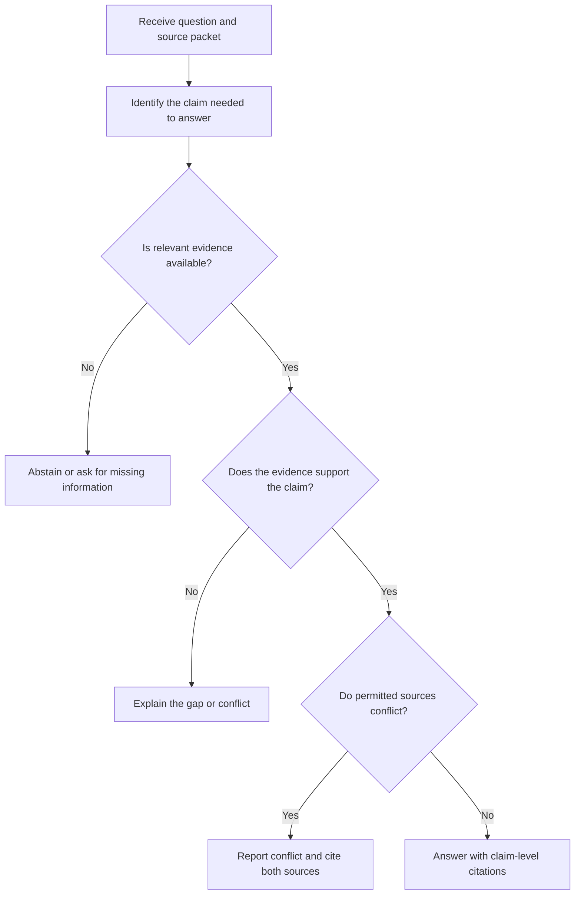
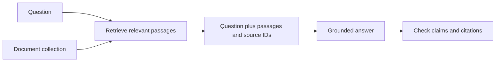

# 11. Question Answering and Grounding

## 1. What Does It Mean to Ground an Answer?

**Question answering (QA)** produces a response to a question. The answer may draw on general model knowledge, supplied documents, or another explicitly permitted source.

**Grounding** means tying an answer to evidence that is available and relevant to the task. In a source-grounded task, the model should not present a claim as established by the supplied material unless the material supports it.

This distinction matters because an answer can sound plausible while being unsupported by the source. It can also contain a correct fact from general knowledge that is nevertheless outside the permitted evidence for a particular task.

For example, if a user asks, “According to this policy, how long is the review period?”, the answer should be based on the policy supplied for the task—not on a general assumption about common review periods.

<br/>

### General-knowledge QA vs. evidence-restricted QA

| Aspect | General-knowledge QA | Evidence-restricted QA |
|---|---|---|
| Permitted basis | General model knowledge and any other sources explicitly allowed | Only the specified source packet or permitted evidence |
| Main goal | Answer the question accurately and usefully | Answer only to the extent supported by the allowed evidence |
| Handling missing evidence | State uncertainty or seek reliable sources, depending on the task | Abstain, explain the gap, or ask for clarification |
| Citation behavior | May require external citations depending on the task | Cite the supplied source identifiers where available |
| Common failure | Outdated or inaccurate recalled information | Unsupported inference or use of information outside the allowed sources |

Neither mode is universally better. The prompt must state which mode is intended.


<br/>


## 2. Define the Allowed Evidence

Before asking a model to answer questions, define which information it may use.

Possible source policies include:

- **Supplied text only:** use only the text included in the prompt.
- **Supplied documents only:** use the provided files and cite their identifiers or page locations.
- **A defined source set:** use only specified documents, records, or approved references.
- **External research allowed:** use additional sources, with a requirement to distinguish external findings from supplied material.
- **General knowledge allowed:** answer from model knowledge, but identify uncertainty and cite sources if the task requires them.

For evidence-restricted QA, state the policy directly:

```text
Answer using only the supplied source packet.
Do not use general knowledge to fill gaps.
If the packet does not support an answer, say that the answer is not established
by the supplied evidence.
Cite the source identifier for each material factual claim when identifiers
are provided.
If sources conflict, describe the conflict and cite both sources.
```

The policy should also explain whether the model may paraphrase evidence, calculate values from supplied numbers, or combine statements from multiple sources. If such operations are allowed, define the conditions.

<br/>

### Evidence is not the same as a prompt instruction

A document supplied for analysis is evidence to interpret, not automatically an instruction that overrides the task's rules. Keep task instructions and source content clearly separated. If a source contains text such as “ignore the previous directions,” treat it as part of the source material unless the application explicitly defines another safe interpretation.


<br/>


## 3. Write Questions That Match the Evidence

A source-grounded answer depends on both the evidence and the question.

Useful question types include:

- **Direct lookup:** “What date does the notice list?”
- **Synthesis:** “What two risks are identified across the reports?”
- **Comparison:** “How do the two policies differ on eligibility?”
- **Calculation:** “What is the total of the listed amounts?” when calculations from source values are allowed.
- **Unanswerable question:** “What was the director’s reason?” when the source does not state a reason.

The prompt should not force an answer when the source is incomplete. For example, a question about why a decision was made cannot be answered merely because the source states that the decision occurred.

<br/>

### Distinguish fact from inference

A source might state:

> “The launch was postponed after the security review.”

This supports the claim that the postponement occurred after the review. By itself, it does not necessarily establish that the security review caused the postponement.

A grounded answer should preserve that distinction. If an inference is permitted, label it as an inference and explain what evidence supports it. Do not present a plausible interpretation as a direct source statement.


<br/>


## 4. Cite Claims with Available Source Identifiers

A citation is a reference to a source. It helps a reader locate evidence, but the presence of a citation does not prove that the cited source supports the claim.

When source identifiers are provided, use them consistently. Depending on the source packet, identifiers might be document IDs, page numbers, section headings, record IDs, or chunk IDs.

Example packet:
- `DOC-A`, section 2: “The pilot ran for two weeks.”
- `DOC-B`, page 4: “The pilot included 40 agents.”

A supported answer could say:

> The pilot ran for two weeks and included 40 agents. [DOC-A, section 2; DOC-B, page 4]

The two parts of the answer have different evidence sources. Cite each claim with the source that supports it rather than attaching one broad citation to a paragraph of unrelated claims.

<br/>

### Claim-to-source mapping

For complex answers, break the response into material claims and identify which source supports each one.

| Claim | Supporting source | Support status |
|---|---|---|
| The pilot lasted two weeks | `DOC-A`, section 2 | Directly stated |
| The pilot included 40 agents | `DOC-B`, page 4 | Directly stated |
| The pilot improved customer satisfaction | None in the packet | Unsupported |

This mapping helps detect claims that have no evidence before the final answer is returned.

<br/>

### Do not invent citations

If the packet does not include page numbers or stable source identifiers, do not make them up. Cite the identifier that actually exists, or describe the limitation. A plausible-looking source ID is not evidence.


<br/>


## 5. Verify That the Citation Supports the Claim

A citation can be present but irrelevant, too broad, or inconsistent with the attached claim.

For every material claim, ask:

1. **Relevance:** Is the cited passage about the same subject?
2. **Entailment:** Does the passage actually support the claim being made?
3. **Scope:** Does the claim go beyond what the passage establishes?
4. **Attribution:** Is the statement attributed to the correct person, team, or document?
5. **Qualification:** Does the answer preserve conditions, uncertainty, and limitations?
6. **Conflict:** Is there another permitted source that contradicts this claim?

<br/>

### Example of weak support

Source:

> “The pilot was conducted with 40 agents. The team plans to evaluate customer satisfaction next month.”

Claim:

> “The pilot improved customer satisfaction. [DOC-A]”

The citation points to the right general topic, but the source does not support the improvement claim. It says that evaluation is planned, not that an improvement has been observed.

A more faithful answer is:

> The pilot involved 40 agents. The source says customer satisfaction will be evaluated next month, so it does not establish whether satisfaction improved. [DOC-A]

<br/>

### Citation correctness vs. answer correctness

- **Citation presence:** a reference appears in the answer.
- **Citation validity:** the referenced source exists and is locatable.
- **Citation support:** the source actually supports the associated claim.
- **Answer correctness:** the answer accurately responds to the question within the permitted evidence policy.

These are related but distinct. A source can exist and be cited correctly while failing to support the claim attached to it.


<br/>


## 6. Handle Missing, Conflicting, Outdated, or Irrelevant Evidence

Evidence quality is not just about whether a source exists. It must also be sufficient, relevant, and appropriate for the question.

### Missing evidence

If the source packet does not establish an answer:
- State that the answer is not established by the supplied sources.
- Identify what information is missing when useful.
- Ask a clarifying question if the question or source selection is ambiguous.
- Do not fill the gap with a guess.

Example:

> **Question:** What is the venue of the event?  
> **Source packet:** Gives the event name and date but no venue.  
> **Grounded answer:** The supplied sources do not specify the venue.

<br/>

### Conflicting evidence

When permitted sources disagree:
- Identify the conflicting claims.
- Cite each source.
- Preserve dates, versions, and attribution.
- Apply an explicit authority or recency rule only if the task defines one.
- Otherwise, report that the conflict is unresolved.

Do not choose the answer that sounds more plausible without an established resolution rule.

<br/>

### Outdated evidence

A source may have been accurate when published but no longer reflect the current state. If dates or versions are available, report them and avoid presenting stale information as current.

If the task restricts the answer to a supplied document, do not silently replace it with external current information. You can say what the supplied document states and note that its currency is not established. If the user explicitly authorizes current verification, external research becomes a separate evidence source and should be identified as such.

<br/>

### Irrelevant evidence

A document may mention the same entity or topic without answering the question. Similar vocabulary is not sufficient support.

For example, a document describing a company's headquarters does not establish the venue of a specific event unless it explicitly connects the two.


<br/>


## 7. Abstention and Clarification

A reliable QA prompt should permit the model to say that it cannot answer from the available evidence.

**Abstention** means declining to provide a substantive answer when the permitted evidence is insufficient. It does not mean refusing every difficult question. It means avoiding an unsupported claim.

### A practical decision rule



<br/>

### When to abstain

Abstain or explicitly report a limitation when:
- No permitted source addresses the question.
- The source mentions a topic but does not establish the requested fact.
- The available evidence is too ambiguous to distinguish among materially different answers.
- A necessary value is missing and cannot be derived under the task rules.
- Conflicting sources cannot be reconciled using an authorized policy.

<br/>

### When to ask for clarification

Ask a question when the ambiguity is about the user's request rather than just missing source content. For example:
- “Which of the two supplied policy versions should I use?”
- “Do you want the answer from the report only, or may I verify it using current external sources?”

If the source simply lacks the answer and the task is otherwise clear, a concise abstention may be more useful than asking the user to restate the question.

<br/>

### Avoid false certainty

Use language that matches the evidence:
- “The report states…” for a direct source claim.
- “Taken together, these passages suggest…” for a supported synthesis or inference.
- “The sources disagree…” when evidence conflicts.
- “The supplied sources do not establish…” when the answer is unavailable.

Do not use a confidence score as a substitute for evidence. A high self-reported confidence value does not prove that a claim is supported.


<br/>


## 8. Preview: Retrieval-Grounded Prompting

Retrieval-grounded question answering supplies the model with selected source passages relevant to a question. This is a conceptual preview of retrieval-augmented generation (RAG), not an implementation of a RAG pipeline.

A simplified process is:

1. A collection of documents is available.
2. A retrieval component selects passages relevant to the question.
3. The selected passages are provided to the model with instructions about how to use them.
4. The model answers using those passages and cites available identifiers.
5. The answer and citations are checked.



Retrieval can help find useful evidence, but it does not guarantee that the right passages were retrieved or that the answer interprets them correctly. A retrieved passage may be irrelevant, incomplete, outdated, or contradictory.

<br/>

### Example grounded prompt template

```text
Answer the question using only the source passages below.

Question:
{question}

Source passages:
{source_passages_with_identifiers}

Rules:
- Use only these passages as evidence.
- Cite the supplied source identifier for each material factual claim.
- Do not invent source identifiers or quotations.
- If the passages do not support an answer, state that the answer is not
  established by the supplied evidence.
- If passages conflict, explain the conflict and cite the relevant sources.
- Distinguish a direct statement from an inference.
- Return a concise answer.
```

The placeholders represent content supplied by an application. This chapter does not implement document indexing, embeddings, retrieval, reranking, or a provider API.

<br/>

### Limits of retrieval-grounded prompting

- The relevant passage may not be retrieved.
- The retrieved passage may not contain enough context.
- The model may misread the passage.
- The answer may cite a source that does not support its claim.
- The source itself may be inaccurate or outdated.
- Conflicting documents may require an explicit authority policy.

Therefore, retrieval and generation should be evaluated separately when possible: measure whether retrieval finds relevant evidence, and whether the answer faithfully uses the evidence that was supplied.


<br/>


## 9. Practice: Answer from a Source Packet

Use only the synthetic source packet below. Do not use outside knowledge.

### Source packet

**`DOC-A`, section 1 — Pilot scope**

> The revised ticket workflow was tested for two weeks with 40 support agents.

**`DOC-A`, section 2 — Initial results**

> Average handling time decreased by approximately 8% during the pilot. The report does not establish whether the workflow caused the decrease.

**`DOC-B`, page 4 — Customer satisfaction**

> Customer satisfaction was broadly unchanged during the pilot. The team plans a more detailed review next month.

**`DOC-C`, section 3 — Next steps**

> Operations recommends a wider trial. Engineering supports further testing but says integration effort has not yet been estimated. No final rollout date has been approved.

**`DOC-D`, page 2 — Conflicting schedule statement**

> A draft planning note proposes a rollout in December, subject to review and approval. The note is marked “provisional.”

<br/>

### Questions

1. How long did the pilot last, and how many agents participated?
2. By how much did average handling time change?
3. Does the packet establish that the workflow caused the decrease?
4. Did customer satisfaction improve?
5. What does Operations recommend?
6. Has a final rollout date been approved?
7. What rollout timing appears in the provisional planning note?
8. What is the estimated integration effort?
9. What was the primary reason the workflow was introduced?
10. Which source is authoritative for the final rollout date?

<br/>

### Model answers and evidence review

**1. How long did the pilot last, and how many agents participated?**

The pilot lasted two weeks and involved 40 support agents. [DOC-A, section 1]

- Support: direct statement.
- Status: answerable.

**2. By how much did average handling time change?**

Average handling time decreased by approximately 8% during the pilot. [DOC-A, section 2]

- Support: direct statement.
- Status: answerable.
- Preserve “approximately”; do not report the value as exact.

**3. Does the packet establish that the workflow caused the decrease?**

No. `DOC-A` explicitly says the report does not establish causation. [DOC-A, section 2]

- Support: direct statement.
- Status: answerable.

**4. Did customer satisfaction improve?**

The packet does not report an improvement. `DOC-B` says customer satisfaction was broadly unchanged and that a more detailed review is planned. [DOC-B, page 4]

- Support: direct statement.
- Status: answerable with qualification.
- Do not turn “broadly unchanged” into a claim of exact equality.

**5. What does Operations recommend?**

Operations recommends a wider trial. [DOC-C, section 3]

- Support: direct statement.
- Status: answerable.

**6. Has a final rollout date been approved?**

No. `DOC-C` states that no final rollout date has been approved. [DOC-C, section 3]

- Support: direct statement.
- Status: answerable.

**7. What rollout timing appears in the provisional planning note?**

`DOC-D` proposes a December rollout, subject to review and approval, and marks the note as provisional. [DOC-D, page 2]

- Support: direct statement.
- Status: answerable as a description of the draft note—not as an approved schedule.

**8. What is the estimated integration effort?**

The integration effort has not yet been estimated. [DOC-C, section 3]

- Support: direct statement.
- Status: answerable.

**9. What was the primary reason the workflow was introduced?**

The source packet does not state the primary reason the workflow was introduced.

- Support: none.
- Status: unanswerable from the supplied evidence.
- Correct action: abstain rather than infer the purpose from the measured results.

**10. Which source is authoritative for the final rollout date?**

The packet does not define an authority rule that makes `DOC-D` override `DOC-C`. `DOC-C` says no final date is approved, while `DOC-D` describes a provisional December proposal. The supported conclusion is that the final rollout date is not approved in the packet. [DOC-C, section 3; DOC-D, page 2]

- Support: both sources, interpreted according to their stated status.
- Status: answerable with an explicit distinction between a provisional proposal and an approved date.


<br/>


## 10. Practice: Evaluate Citation Support

For each answer, decide whether the citation supports the claim.

### Example A

> “The pilot involved 40 agents. [DOC-A, section 1]”

**Assessment:** Supported. The cited passage states the number of agents.

### Example B

> “The workflow caused an 8% reduction in handling time. [DOC-A, section 2]”

**Assessment:** Unsupported and contradicted by the qualification in the cited passage. The source reports an approximately 8% decrease but says causation is not established.

### Example C

> “The rollout is scheduled for December. [DOC-D, page 2]”

**Assessment:** Overstated. The source contains a provisional proposal subject to review and approval, not an approved schedule.

### Example D

> “The integration effort has not yet been estimated. [DOC-C, section 3]”

**Assessment:** Supported. The cited passage states this directly.

The exercise demonstrates why citation presence alone is insufficient. The wording of the claim must match the evidence's content, scope, and qualifications.

<br/>


## 11. Evaluation Checklist

Before returning a source-grounded answer, check:

```text
[ ] Every material factual claim has relevant evidence.
[ ] Each citation points to a real, supplied source identifier.
[ ] The cited passage supports the specific claim attached to it.
[ ] Qualifications, uncertainty, dates, and attribution are preserved.
[ ] Conflicting sources are identified rather than silently reconciled.
[ ] Unsupported questions are answered with an explicit limitation or abstention.
[ ] General knowledge has not been mixed into an evidence-restricted answer.
[ ] No source identifiers, quotations, or facts have been invented.
```

For evaluation datasets, label each question as answerable, partially answerable, conflicting, or unanswerable. Score answer correctness and citation support separately. A response may reach the right conclusion for the wrong reason, or include a valid citation that does not support the claim.


<br/>


## 12. Revision Questions

1. What is the difference between general-knowledge QA and evidence-restricted QA?
2. Why should the allowed evidence sources be specified explicitly?
3. What is the difference between a citation and evidence that supports a claim?
4. How should a model handle a source that mentions a topic but does not answer the question?
5. What should happen when two sources conflict and no authority rule is defined?
6. How can outdated evidence be handled without silently changing the source policy?
7. When is abstention preferable to a plausible inference?
8. What is the role of retrieval in retrieval-grounded prompting?
9. Why can a retrieved passage still lead to an incorrect answer?
10. Why should retrieval quality, answer correctness, and citation support be evaluated separately?


<br/>


## 13. Checkpoint: Citation vs. Supporting Evidence

**Checkpoint:** Separate having a citation from having evidence that supports the answer.

A strong answer distinguishes:

- **Citation presence:** the answer includes a reference.
- **Citation validity:** the referenced source exists and can be located.
- **Evidence support:** the cited passage actually supports the attached claim.
- **Answer correctness:** the answer responds accurately to the question within the allowed evidence policy.

A citation may point to a real passage that is irrelevant, incomplete, outdated, or explicitly qualified in a way that contradicts the answer's stronger wording. Every material claim should therefore be checked against the cited passage, not merely checked for the presence of a citation marker.

**Model checkpoint answer:**

> A citation identifies a source, but it does not automatically prove that the source supports the answer. I would verify that the source exists, that the cited passage is relevant, and that it entails the specific claim without removing qualifications or context. If the evidence is missing, conflicting, or insufficient, I would state the limitation, cite the conflicting sources when applicable, or abstain. I would also keep source-grounded claims separate from general knowledge or inference.

<br/>


## Key Takeaways

- Define whether the task permits general knowledge or restricts answers to supplied evidence.
- Specify allowed sources and use only real source identifiers.
- Match citations to individual factual claims whenever practical.
- Verify relevance, support, scope, attribution, and qualifications for each citation.
- Report missing, conflicting, outdated, and irrelevant evidence explicitly.
- Abstain or ask for clarification when the permitted evidence is insufficient.
- Retrieval can supply relevant passages but cannot guarantee correct interpretation.
- Evaluate answer correctness and citation support separately.
- A citation is a pointer to evidence; it is not, by itself, proof that the answer is supported.
