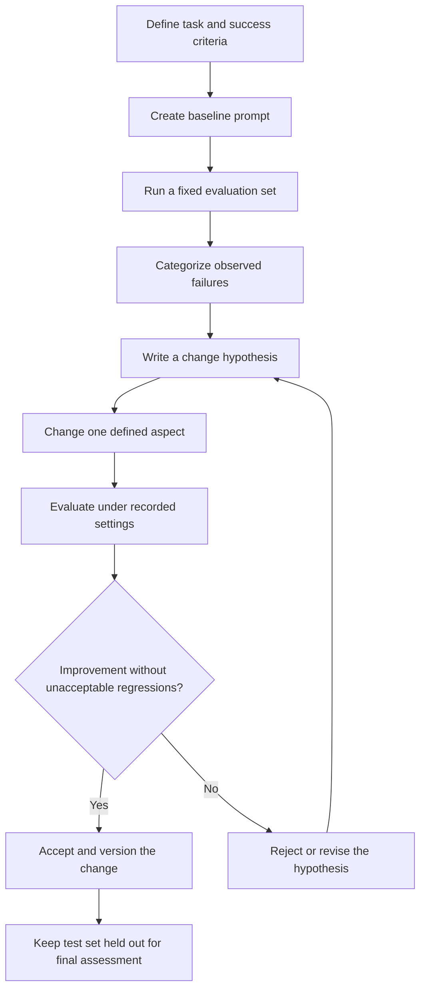
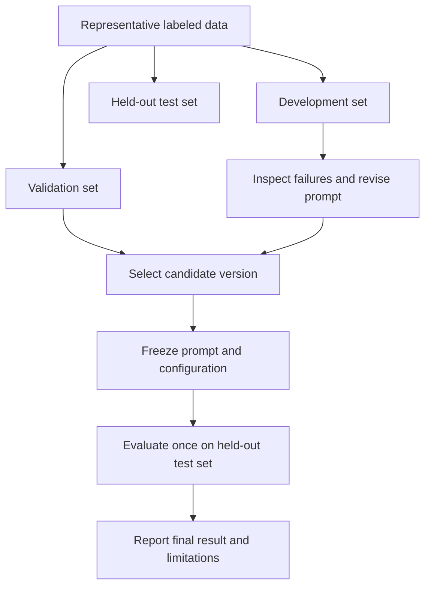

# 12. Prompt Iteration and Versioning

## 1. Why Prompt Iteration Needs a Process

Prompt engineering is an empirical activity: a prompt that looks clear to its author may still produce omissions, unsupported claims, inconsistent formatting, or other failures on real inputs.

**Prompt iteration** is the controlled process of improving a prompt based on observed behavior. **Prompt versioning** records the exact prompt and associated configuration so that results can be reproduced, compared, and reviewed.

A reliable workflow does not change a prompt repeatedly based on intuition alone. It starts with a baseline, collects representative test results, categorizes failures, proposes a specific change, and evaluates the new version against the same controlled cases.

The goal is not simply to make one response look better. The goal is to improve performance consistently without introducing unacceptable regressions.

<br/>

### A controlled iteration cycle



A prompt change should be traceable to an observed failure and a hypothesis about why that failure occurs.


<br/>


## 2. Establish a Baseline

A **baseline** is the initial prompt and configuration against which later versions are compared. Without a baseline, it is difficult to tell whether a revision actually improved the system.

Before testing, define:

- **Task:** what the model must do.
- **Input distribution:** the kinds of inputs the prompt will receive.
- **Output contract:** required fields, format, and constraints.
- **Success criteria:** how quality will be measured.
- **Evaluation set:** examples used to compare prompt versions.
- **Model and settings:** the model identifier and relevant generation parameters.
- **Environment:** relevant SDK, library, schema, or application versions.

<br/>

### Example baseline prompt

Suppose the task is to classify synthetic support messages into a fixed set of labels.

```text
Classify the support message into one of these labels:
delivery_issue, billing_issue, technical_issue, account_issue, other.

Return only the selected label.

Message:
{message}
```

This prompt is intentionally simple. A baseline is not required to be sophisticated; it must be recorded and evaluated so later changes can be compared against it.

<br/>

### Define success before tuning

Possible measures include:
- Label accuracy.
- Per-class precision and recall.
- Rate of unsupported guesses on ambiguous inputs.
- Schema or format validity.
- Performance on incomplete and multi-issue messages.
- Latency and cost, when relevant.

Choose metrics that reflect the actual task. For an imbalanced classification problem, overall accuracy may hide poor performance on a rare but important category.


<br/>


## 3. Categorize Observed Failures

After running the baseline, inspect errors and assign them to consistent categories. Failure categories help identify which aspect of the prompt may need to change.

For the support-message classification task, categories might include:

| Failure category | Example | Possible investigation |
|---|---|---|
| Label ambiguity | Similar messages receive different labels | Clarify label definitions and boundaries |
| Forced guess | An unclear message receives a specific issue label | Add an insufficient-information policy if the task supports it |
| Multi-issue failure | A message with billing and delivery problems gets only one label | Clarify single-label vs. multi-label behavior |
| Format failure | The response includes an explanation when only a label is required | Strengthen the output contract or use appropriate validation |
| Unsupported inference | A label depends on a fact not present in the message | Clarify evidence rules |
| Inconsistent behavior | Equivalent cases receive different labels | Add representative examples or clarify criteria |

Avoid treating every error as a prompt problem. Failures can also arise from ambiguous task definitions, poor source data, an unsuitable evaluation set, model limitations, or incorrect post-processing.

<br/>

### Keep an error log

A useful record contains:
- Test-case ID.
- Expected result.
- Actual result.
- Failure category.
- Relevant prompt version.
- Model and settings.
- Notes on why the result failed.

Store only the source content needed for debugging, and follow applicable privacy and data-retention rules. Sensitive user data should not be copied into general logs without a valid need and appropriate safeguards.


<br/>


## 4. Write a Change Hypothesis

A revision should test a specific idea about the cause of a failure.

A useful hypothesis has three parts:

1. **Observed problem:** what failed and how often or under what conditions.
2. **Proposed change:** the one aspect of the prompt or configuration to modify.
3. **Expected effect:** which metric or failure category should improve, and what regressions to watch for.

<br/>

### Example hypothesis

**Observation:** The baseline assigns a specific label to messages such as “It still doesn't work,” even though the affected product or function is unclear.

**Change:** Add an explicit rule that uses `insufficient_information` when the message does not support a reliable category.

**Expected effect:** Fewer unsupported guesses on ambiguous messages, with no unacceptable decrease in accuracy on clear messages.

This is a testable hypothesis. It does not claim the change will succeed before evaluation.

<br/>

### Change one defined aspect at a time

When practical, change one main aspect per experiment—for example, label definitions, missing-information handling, or output formatting. If several aspects change simultaneously, it becomes harder to identify which change caused an improvement or regression.

There are exceptions: some changes must be made together to remain coherent, such as updating a schema and the prompt instructions that describe it. Record those as a combined change and acknowledge that attribution is less precise.


<br/>


## 5. Evaluate Improvements and Regressions

Run the baseline and candidate prompt under controlled conditions. Use the same test cases and keep the model and settings unchanged when the purpose is to isolate a prompt change.

### Comparison table

| Measure | Baseline | Candidate | Difference |
|---|---:|---:|---:|
| Overall label accuracy |  |  |  |
| Ambiguous-case forced-guess rate |  |  |  |
| Multi-issue handling |  |  |  |
| Output validity |  |  |  |
| Average latency |  |  |  |
| Estimated cost per case |  |  |  |

Fill this table with measured results. Do not invent numbers or assume that one improvement guarantees better overall performance.

<br/>

### Look beyond the headline metric

A candidate may improve overall accuracy while becoming worse on a rare class. It may reduce forced guesses but abstain too often on clear inputs. It may improve formatting but increase latency or token usage.

Review:
- Overall performance.
- Per-class or per-case-category performance.
- New errors and regressions.
- Differences on difficult and incomplete inputs.
- Operational effects such as latency and cost.

For small evaluation sets, a difference of one or two cases may be unstable. Report the sample size and avoid overstating small differences. Where appropriate, use repeated evaluation or a larger representative dataset.

<br/>

### Acceptance criteria

Before running the experiment, define what would count as an improvement. For example:
- The target failure category decreases.
- Core task accuracy does not fall beyond an agreed tolerance.
- Required output validity is maintained.
- Cost and latency remain within budget.

The exact thresholds should be based on the application, not chosen after seeing the result merely to justify the candidate.


<br/>


## 6. Version the Prompt and Its Dependencies Together

A prompt is more than a block of text. Its behavior can depend on examples, schema definitions, model settings, and surrounding application code.

Record the artifacts needed to reproduce a run.

### Recommended version record

| Item | What to record |
|---|---|
| Prompt ID and version | Stable identifier and revision number |
| Prompt text/template | Exact instructions, placeholders, and examples |
| Schema version | The precise output schema or validation model |
| Example set version | Few-shot examples, if used |
| Model identifier | Provider and exact model ID or deployment identifier |
| Generation settings | Temperature, token limits, and other relevant parameters supported by the model |
| Evaluation dataset | Version or immutable test-case IDs |
| Evaluation code | Metric implementation and code version |
| Environment | Relevant SDK, Python, Pydantic, or application versions |
| Timestamp | Date and time of the run |
| Results | Metrics, failure examples, and acceptance decision |

Do not assume a model alias always points to an identical model over time. Record the exact identifier available to the application and any deployment/version metadata exposed by the provider.

Some providers or model configurations may not support every generation setting. Record the settings actually used rather than listing unsupported options.

<br/>

### Suggested directory layout

```text
prompt-evaluation/
├── prompts/
│   ├── support_classifier_v1.txt
│   └── support_classifier_v2.txt
├── schemas/
│   └── support_label_v1.json
├── examples/
│   └── few_shot_examples_v1.json
├── datasets/
│   ├── dev_cases_v1.jsonl
│   └── heldout_test_v1.jsonl
├── configs/
│   └── evaluation_config_v1.yaml
├── results/
│   ├── baseline_v1.json
│   └── candidate_v2.json
└── CHANGELOG.md
```

This is an illustrative layout, not a required standard. The important property is that each result points to the exact artifacts and settings that produced it.

<br/>

### Example experiment metadata

```yaml
experiment_id: support-classifier-2026-10-11-02
prompt_id: support-classifier
prompt_version: "2"
schema_version: "1"
dataset_version: "dev_cases_v1"
model:
  provider: "<provider>"
  model_id: "<exact-model-id>"
generation:
  temperature: "<record-supported-value-or-not-applicable>"
  max_output_tokens: "<recorded-limit>"
environment:
  python_version: "<recorded-version>"
  pydantic_version: "<recorded-version-or-not-used>"
  application_commit: "<commit-id>"
run_timestamp: "<ISO-8601-timestamp>"
```

Replace placeholders with the actual values. The configuration should distinguish an intentionally unset parameter from a value that was not recorded.

Avoid putting API keys, passwords, or other secrets into version-controlled configuration files.


<br/>


## 7. Use a Changelog to Explain Each Revision

A changelog records why a version changed and what happened after evaluation. It should describe the hypothesis and measured effects, not merely say “improved prompt.”

### Example changelog entry

```markdown
## Prompt v2 — Ambiguous-message handling

- **Date:** 2026-10-11
- **Base version:** v1
- **Problem:** Ambiguous messages were sometimes assigned a specific issue label
  without sufficient evidence.
- **Hypothesis:** An explicit insufficient-information rule will reduce
  unsupported guesses on ambiguous cases.
- **Change:** Added a rule defining when to use `insufficient_information`.
- **Held-constant settings:** Same model identifier, generation settings,
  schema, and development test cases.
- **Evaluation:** [Record the actual dataset version and sample size.]
- **Measured effects:** [Insert measured baseline and candidate results.]
- **Regressions:** [Record any new errors or performance changes.]
- **Decision:** [Accepted / rejected / further testing required.]
```

The example intentionally leaves measured results blank. Fill them only after running the experiment.

A good changelog lets another person understand:
- What changed.
- Why it changed.
- How it was tested.
- What improved or regressed.
- Why the revision was accepted or rejected.


<br/>


## 8. Keep Development Data Separate from the Held-Out Test Set

Prompt tuning can overfit just as other optimization processes can. If you repeatedly revise prompts based on the same final test examples, you gradually adapt the prompt to those cases. The reported test performance may then overestimate performance on unseen inputs.

Use separate data roles:

- **Development set:** used frequently to inspect errors and refine the prompt.
- **Validation set:** used to compare candidate versions and make selection decisions.
- **Held-out test set:** reserved for a final assessment after the design has been selected.

For small projects, development and validation data may be combined cautiously, but keep a final held-out set untouched for the final comparison.



Do not use the held-out test set as a recurring prompt-debugging tool. If its results lead to substantial prompt changes, it is no longer an untouched final test set; obtain a new held-out set for a fresh final assessment when feasible.


<br/>


## 9. Reproducibility: What Must Match?

To reproduce a previous comparison, preserve more than the prompt text.

A reproduction attempt should identify:
- Exact prompt version and template variables.
- Exact schema and few-shot examples.
- Model/provider identifier and relevant deployment details.
- Generation settings and output limits.
- Exact test-case IDs and expected labels or outputs.
- Evaluation code and metric definitions.
- Relevant environment versions.
- Date/time and recorded outputs.

<br/>

### Sources of variation

Even when the prompt text is unchanged, results can differ because of:
- A different model or model version.
- Changed generation settings.
- Changed examples, schema, or input preprocessing.
- A different evaluation dataset.
- Changes to parsing, normalization, or scoring code.
- Nondeterminism or provider-side changes.

Recording configuration makes differences diagnosable. It does not guarantee perfect bit-for-bit reproducibility when the model service itself changes or does not provide deterministic execution.


<br/>


## 10. Practice: Create a Prompt Changelog

### Scenario

You have a baseline prompt for classifying synthetic support messages. Evaluation shows that ambiguous messages sometimes receive a specific label even when the message does not identify the problem clearly.

You revise the prompt to define when `insufficient_information` should be returned.

### Task A — Write the hypothesis

Include:
- The observed failure.
- The specific prompt change.
- The expected improvement.
- A possible regression to monitor.

<br/>

### Task B — Define the experiment

Record:
- Baseline and candidate prompt IDs.
- Model identifier and settings.
- Schema and example versions.
- Dataset version and sample size.
- Metrics and acceptance criteria.
- Date and environment details.

<br/>

### Task C — Create the changelog

Use the following table and fill it with actual measured results after evaluation.

| Measure | Baseline v1 | Candidate v2 | Interpretation |
|---|---:|---:|---|
| Overall accuracy |  |  |  |
| Forced-guess rate on ambiguous cases |  |  |  |
| Accuracy on clear cases |  |  |  |
| Output validity |  |  |  |
| Latency/cost |  |  |  |

Do not assume that the candidate improved merely because the new instruction appears more precise.

<br/>

### Task D — Make an acceptance decision

Accept the candidate only if the measured results satisfy the predefined criteria and no unacceptable regression appears. Otherwise, reject it or propose a new hypothesis for another development iteration.


<br/>


## 11. Revision Questions

1. Why is a baseline necessary for prompt iteration?
2. What information belongs in a failure log?
3. What makes a change hypothesis testable?
4. Why is it useful to change one defined aspect at a time?
5. Which settings and artifacts should be versioned with the prompt?
6. Why must improvements and regressions be reviewed separately?
7. How can repeated tuning on a held-out test set create overfitting?
8. What is the role of development, validation, and held-out test data?
9. Why might the same prompt produce different results at a later date?
10. What information is required to reproduce a prior comparison?


<br/>


## 12. Checkpoint: Reproduce a Prior Comparison

**Checkpoint:** Reproduce a prior comparison from recorded prompts, settings, and test cases.

A strong answer should explain that a reproducible comparison requires:

- Exact baseline and candidate prompt text, including template variables and examples.
- Matching schema and other dependent artifacts.
- The model/provider identifier and relevant generation settings.
- The same evaluation cases and reference answers or labels.
- The same preprocessing and metric implementation.
- Relevant environment versions and a timestamp.
- Recorded outputs, results, and the acceptance decision.

If any of these differ, document the difference and avoid claiming that the comparison is an exact reproduction. Model services can change over time, so recorded settings improve reproducibility without guaranteeing identical output in every environment.

**Model checkpoint answer:**

> I would retrieve the exact prompt versions, schemas, examples, model identifier, generation settings, dataset version, and evaluation code used in the original run. I would rerun both prompts on the same test cases under matching conditions, calculate the same metrics, and compare the results with the recorded outputs. I would also record the environment and date. If the model version or execution environment had changed, I would document that limitation rather than claim exact reproducibility. Prompt changes would be selected using development and validation data, while the final held-out test set would remain untouched until the final assessment.


<br/>


## Key Takeaways

- Start from a recorded baseline and categorize observed failures.
- Make each prompt revision a testable hypothesis.
- Change a defined aspect and record the expected effect.
- Version prompts, schemas, examples, model settings, datasets, and evaluation code together.
- Measure improvements and regressions before accepting a revision.
- Use a changelog to record rationale, evidence, and decisions.
- Keep development and validation work separate from final held-out testing.
- Reproduction requires the same artifacts, test cases, settings, and metric definitions.
- Good versioning improves traceability, but it cannot guarantee identical outputs when model services change.
