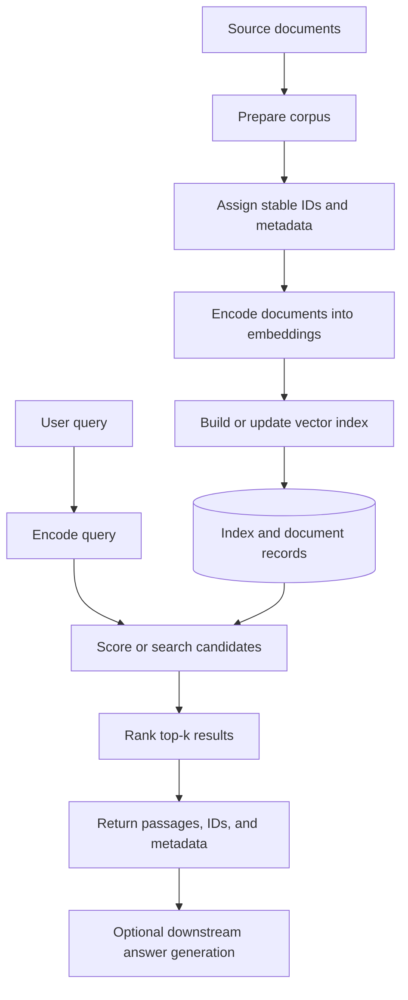
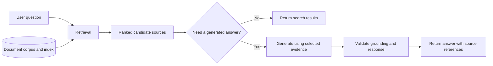

# 01. Embeddings and Semantic Search Overview

## Learning Objectives

By the end of this chapter, you should be able to:

- Define an embedding as a learned numerical representation.
- Distinguish token-level representations from text embeddings used for retrieval.
- Explain the end-to-end semantic-search pipeline.
- Compare semantic relatedness with literal keyword overlap.
- Separate retrieval from answer generation.
- Explain why a retrieved document is a candidate source, not automatically a verified answer.

<br/>

## 1. What Is an Embedding?

An **embedding** is a numerical representation of an item—such as a word, sentence, paragraph, image, or document—mapped into a vector in a learned vector space.

For text, an embedding might look like this:

$$
\mathbf{v} = [0.12,\; -0.38,\; 0.07,\; 0.91,\; \ldots]
$$

Each number is a dimension of the vector. In practical systems, vectors may contain hundreds or thousands of dimensions. The values are learned by a model; individual dimensions usually do not correspond to simple, human-readable features.

The purpose of an embedding model depends on how it was trained. A retrieval-oriented model aims to place texts that are useful or relevant to one another relatively close in the embedding space, according to a chosen similarity or distance measure.

<br/>

### Intuition

Imagine a collection of documents about cars. A query such as *“How can I reduce fuel consumption?”* may be semantically related to a passage that says *“Improving vehicle mileage through regular maintenance”*, even though the two texts do not use exactly the same words.

An embedding model attempts to represent useful relationships between the texts numerically so that a search system can find relevant candidates.

**Important:** Embeddings do not directly store a complete, human-readable meaning of a text. Their behavior depends on the model, training data, encoding method, and task.

<br/>

## 2. Token-Level Representations vs. Text Embeddings

The word *embedding* is used for different representations in language models. It is useful to distinguish token-level representations from the fixed-size text vectors commonly used for retrieval.

### 2.1 Token-level representations

A tokenizer first converts text into tokens and token IDs. An embedding layer maps token IDs to vectors. During transformer processing, the model produces contextual token representations, which can change depending on surrounding text.

For example, the token representation for “bank” can be influenced by whether the sentence discusses a river bank or a financial bank.

A token-level representation is associated with an individual token position. A transformer may produce a sequence of contextual vectors, one for each token position.

<br/>

### 2.2 Text embeddings for retrieval

A retrieval embedding model converts a whole input text—such as a query, sentence, passage, or document—into a vector used to compare it with other text vectors.

Conceptually:

$$
\text{text} \xrightarrow{\text{embedding model}} \mathbf{v}\in\mathbb{R}^{d}
$$

Here, $d$ is the embedding dimension.

A text embedding model may use pooling or another model-specific method to create a single vector from token representations. The exact method depends on the model.

| Aspect | Token-level representation | Text embedding for retrieval |
|---|---|---|
| Represents | A token position, often in context | A whole text input |
| Typical output | A sequence of vectors | One vector per input text |
| Common use | Internal language-model processing and token-level tasks | Semantic search, similarity, clustering, and retrieval |
| Shape example | `(sequence_length, hidden_size)` | `(embedding_dimension,)` per text |

These are conceptual shapes. Actual output structures depend on the model and library.

**Key distinction:** Do not assume that any hidden-state vector from a generative LLM is automatically a good retrieval embedding. Use a model and encoding method designed or validated for the retrieval task.

<br/>

## 3. What Is Semantic Search?

**Semantic search** retrieves content based on estimated meaning or relevance rather than relying only on exact word overlap.

A typical dense semantic-search system:

1. Converts each document or passage into an embedding.
2. Stores the embeddings in an index alongside identifiers and useful metadata.
3. Converts a user's query into an embedding using a compatible model and encoding method.
4. Scores candidate document vectors against the query vector.
5. Returns the highest-ranked candidates.

The search system does not need to generate a natural-language answer. Its main responsibility is to identify and rank potentially useful sources.

<br/>

### Semantic relatedness vs. keyword overlap

Consider these two passages:

- **Passage A:** “Improve vehicle mileage by checking tire pressure and servicing the engine.”
- **Passage B:** “The vehicle was purchased in March and has a blue exterior.”

Query: **“How can I reduce fuel consumption?”**

Passage A may be semantically relevant even if it shares few exact words with the query. Passage B may contain the word “vehicle” but is unlikely to answer the question.

This illustrates why meaning-oriented retrieval can help with paraphrases and vocabulary mismatch.

However, semantic search can still miss exact identifiers, rare names, product codes, error messages, or specific numbers. In those cases, lexical search may be important. Dense semantic retrieval is not universally better than keyword retrieval.

<br/>

## 4. End-to-End Semantic-Search Pipeline

The pipeline has two broad phases:

- **Indexing phase:** Prepare the corpus and store document representations. This is generally performed ahead of user queries and repeated when the corpus or embedding configuration changes.
- **Query-time phase:** Encode a query, search the index, score candidates, and return ranked results.



<br/>

### 4.1 Corpus preparation

The **corpus** is the collection of documents available for search. Before embedding, the application should establish what each record represents and assign stable identifiers.

A simple record might contain:

```python
document = {
    "id": "doc-001",
    "text": "Check tire pressure to improve vehicle mileage.",
    "source": "vehicle_maintenance_guide",
    "language": "en",
}
```

For this introductory chapter, a document can be a short passage. Advanced parsing, chunking, overlap, and ingestion design are covered later in the RAG level.

<br/>

### 4.2 Document encoding

An embedding model converts each document or passage into a numerical vector. The system should record which model and configuration produced the vectors.

All document vectors in a single search space must be compatible with the query vectors. Merely having vectors of the same length does not guarantee compatibility if they were produced by unrelated embedding models.

<br/>

### 4.3 Indexing and storage

The index organizes vectors so that the system can search for nearby candidates. Alongside each vector, the application typically needs a stable document or passage ID and may keep metadata such as source, language, date, version, or access-control attributes.

Depending on the implementation, vectors and metadata may be stored together or in separate systems.

<br/>

### 4.4 Query encoding

At query time, the user's query is encoded with the compatible embedding model and required query-specific settings. Some models document separate query and document instructions or encoding modes; follow the model's documentation.

<br/>

### 4.5 Scoring and ranking

The search system calculates similarity or distance between the query vector and candidate document vectors. It then ranks the candidates according to the configured metric.

For many similarity metrics, larger scores indicate better matches; for distance metrics, smaller values indicate closer vectors. The exact interpretation depends on the metric.

The system returns the top-$k$ results, where $k$ is the requested number of candidates.

**Top-$k$** means “return up to the $k$ highest-ranked results,” subject to the index, filters, and available candidates.

<br/>

### 4.6 Result inspection

A useful search result usually includes more than a raw vector score. It may include:

- Document or passage ID
- Retrieved text
- Source identifier or location
- Similarity score or distance
- Metadata used to interpret the result

The score helps rank candidates, but it does not prove that a result is correct or relevant enough for a particular application.

<br/>

## 5. Stored Data vs. Query-Time Operations

| Usually stored or maintained during indexing | Usually performed at query time |
|---|---|
| Document or passage IDs | Receive and validate the query |
| Source text or a retrievable reference to it | Encode the query |
| Document embeddings | Apply mandatory access and metadata filters |
| Metadata and version information | Search or score eligible candidates |
| Vector index structures | Rank results and select top-\(k\) |
| Index/model configuration records | Return result text, IDs, and metadata |

This is a general pattern, not a universal storage architecture. A system may generate embeddings on demand, cache queries, or use a managed service that hides some index operations.

<br/>

### Why stable IDs matter

The vector index needs a reliable way to connect a matching vector back to its source record. Stable IDs make it possible to inspect results, update a document, remove stale vectors, and test retrieval behavior.

Do not rely on the vector's position in an array as a permanent document identity if the collection may be reordered or updated.

<br/>

## 6. Retrieval Is Not Answer Generation

**Retrieval** selects potentially relevant sources from a corpus.

**Answer generation** uses a language model or another application component to produce a response, possibly based on retrieved sources.

These are separate stages with different responsibilities:

- Retrieval asks: *Which available passages are likely to help?*
- Generation asks: *What response should be composed from the available evidence?*

A semantic-search application can stop after returning ranked results. A RAG application commonly passes selected results into a generation step, with instructions to answer from the supplied evidence and to acknowledge missing evidence.



Retrieval and generation can fail independently:

- **Retrieval failure:** The needed passage is absent, not indexed, filtered out, or ranked too low.
- **Generation failure:** The model misinterprets the retrieved passage, adds unsupported claims, or ignores relevant evidence.
- **Combined failure:** Poor retrieval supplies weak evidence, and generation produces a confident but incorrect answer.

Evaluating these stages separately makes debugging more effective.

<br/>

## 7. Why a Retrieved Result Is Only a Candidate Source

A high-ranked result is not automatically a verified answer. Several reasons explain this:

1. **Similarity is not truth.** An embedding score measures a model-defined relationship between vectors, not factual correctness.
2. **Related does not mean equivalent.** Two texts can discuss the same topic while making different or contradictory claims.
3. **Negation and qualifications matter.** “The feature is supported” and “The feature is not supported” may be semantically close.
4. **The corpus may be incomplete or outdated.** The correct source might not exist in the index, or a retrieved document may have been superseded.
5. **Ranking can be imperfect.** A relevant source may be ranked too low, while a less useful source appears near the top.
6. **Authorization still matters.** A result must be eligible for the current user. Relevance ranking must never replace server-side permission enforcement.
7. **Generation can introduce errors.** A downstream model may make claims that are not supported by the retrieved evidence.

For important applications, inspect the retrieved text, validate source freshness and permissions, and evaluate relevance using representative queries with known relevant documents.

A similarity threshold should not be treated as a universal guarantee of correctness. Thresholds and ranking rules must be calibrated against the actual application and evaluation data.

<br/>

## 8. A Small Conceptual Python Example

The following example illustrates the **shape of a retrieval pipeline** using prepared vectors. It does not call an embedding model and does not demonstrate observed model quality. The vectors are deliberately illustrative.

```python
import numpy as np

documents = [
    {
        "id": "doc-001",
        "text": "Check tire pressure to improve vehicle mileage.",
    },
    {
        "id": "doc-002",
        "text": "The vehicle has a blue exterior.",
    },
    {
        "id": "doc-003",
        "text": "Regular engine maintenance can reduce fuel use.",
    },
]

# Illustrative vectors only; not generated by an embedding model.
document_vectors = np.array([
    [0.9, 0.1, 0.0],
    [0.1, 0.9, 0.0],
    [0.8, 0.2, 0.1],
], dtype=np.float32)

# Illustrative query vector; a real application encodes the query.
query_vector = np.array([0.85, 0.15, 0.05], dtype=np.float32)

def cosine_similarity(a: np.ndarray, b: np.ndarray) -> float:
    denominator = np.linalg.norm(a) * np.linalg.norm(b)
    if denominator == 0:
        raise ValueError("Cosine similarity is undefined for a zero vector.")
    return float(np.dot(a, b) / denominator)

if document_vectors.ndim != 2:
    raise ValueError("Document vectors must be a 2D array.")

if document_vectors.shape[0] != len(documents):
    raise ValueError("Each document must have exactly one vector.")

if query_vector.ndim != 1:
    raise ValueError("Query vector must be one-dimensional.")

if document_vectors.shape[1] != query_vector.shape[0]:
    raise ValueError("Query and document vector dimensions must match.")

scores = [
    cosine_similarity(query_vector, vector)
    for vector in document_vectors
]

ranked = sorted(
    zip(documents, scores),
    key=lambda item: item[1],
    reverse=True,
)

for document, score in ranked[:2]:
    print(document["id"], round(score, 4), document["text"])
```

<br/>

### What this example demonstrates

- One vector is associated with each document.
- The query has a vector in the same illustrative space.
- Each document receives a cosine-similarity score.
- Results are sorted from highest to lowest score.
- The top two candidates are returned.

<br/>

### What it does not demonstrate

- Real text embedding generation
- A persistent or approximate vector index
- Production-grade metadata filtering or access control
- Whether the retrieved passages are factually correct
- Measured performance on a representative dataset

In later chapters, the course will introduce real embedding models, lexical baselines such as BM25, index choices, filtering, and evaluation.

<br/>

## 9. Common Mistakes

- **Treating embeddings as facts:** Vectors are learned representations, not verified knowledge.
- **Mixing incompatible embedding spaces:** Query and document vectors must follow compatible model and encoding conventions.
- **Using similarity scores as probabilities:** A score is not automatically a calibrated probability of relevance.
- **Assuming semantic search replaces keyword search:** Exact identifiers, names, and codes can favor lexical retrieval.
- **Treating top-$k$ results as an answer:** Results are candidates that need inspection or downstream grounding.
- **Ignoring document identity and metadata:** Without reliable IDs and source metadata, results are difficult to inspect and maintain.
- **Confusing retrieval quality with generation quality:** Evaluate candidate selection separately from the answer produced using those candidates.
- **Ignoring access control:** Unauthorized content must be excluded by application-enforced rules before it is returned or passed to a model.

<br/>

## 10. Practice

### Exercise A: Draw and label the pipeline

Draw a semantic-search pipeline containing:

1. Source corpus
2. Corpus preparation and stable IDs
3. Document encoding
4. Vector index
5. User query
6. Query encoding
7. Scoring and ranking
8. Top-$k$ results

Mark which components are generally part of indexing and which run at query time. Include the optional answer-generation stage separately.

<br/>

### Exercise B: Semantic or lexical?

For each query, predict whether dense semantic retrieval, lexical retrieval, or a combination is a sensible starting point.

| Query | Likely consideration |
|---|---|
| “How do I reduce fuel consumption?” | Semantic retrieval may find paraphrases such as “improve mileage.” |
| “Error code E1029” | Lexical retrieval can preserve the exact identifier. |
| “What is the return policy?” | Semantic retrieval may find passages that use “refund conditions.” |
| “Model ZX-410 battery voltage” | Exact model identifiers and technical terms make lexical matching important. |

These are starting hypotheses. Validate them on the actual corpus and query set.

<br/>

### Exercise C: Explain the failure

A search system returns a passage with a high similarity score. The passage discusses the right topic but states the opposite of what the user asked.

Answer:

1. Why might the passage still have a high score?
2. Why does the score not verify factual agreement?
3. What should the application inspect before generating an answer?
4. How could you add a test case for this failure?

<br/>

## 11. Revision Questions and Answers

**1. What is a text embedding?**  
A learned numerical vector representing a text input for a particular model and task.

**2. How is a token-level representation different from a text embedding used for retrieval?**  
A token-level representation corresponds to a token position, while a retrieval embedding commonly represents an entire query or passage as one vector.

**3. What are the main stages of semantic search?**  
Prepare the corpus, encode documents, build or update the index, encode the query, score candidates, rank them, and return results.

**4. Why can semantic search find a passage with few shared keywords?**  
The embedding model may map paraphrases or related concepts to nearby vectors.

**5. When can lexical retrieval be useful?**  
For exact names, identifiers, codes, rare terms, and other queries where literal matching is important.

**6. Does a high similarity score prove that a document answers the query correctly?**  
No. It indicates similarity according to the selected representation and metric, not truth, entailment, or factual agreement.

**7. What is the difference between retrieval and generation?**  
Retrieval selects candidate sources; generation composes a response using instructions and potentially those sources.

**8. Why are stable document IDs useful?**  
They connect indexed vectors to source records and support inspection, updates, deletion, and reproducible evaluation.

**9. Why must retrieval permissions be enforced outside the language model?**  
The application must prevent unauthorized records from being returned or passed downstream; a prompt is not an authorization mechanism.

**10. What is the central limitation to remember?**  
A retrieved result is a candidate source. Its relevance, freshness, factual support, and authorization must be checked for the application.

<br/>

## 12. Chapter Checkpoint

You should now be able to explain:

- What embeddings represent and how retrieval embeddings differ from token-level vectors.
- How documents are encoded and indexed before queries arrive.
- How a query is encoded, scored, and turned into ranked results.
- Why semantic relatedness differs from exact keyword overlap.
- Which data is typically stored and which operations occur at query time.
- Why retrieval and answer generation are separate components.
- Why a retrieved result is evidence to inspect, not a verified answer.

**Checkpoint answer:** A retrieved result is a candidate source because vector similarity estimates a model-defined relationship, not factual truth or agreement with the query. The source may be incomplete, outdated, contradictory, irrelevant in context, or unauthorized. Inspect the source and evaluate retrieval quality before using it to support an answer.

<br/>

## References and Further Reading

- The Level 7 course outline: `README.md` — “Embeddings and Semantic Search Overview.”
- Consult the documentation for the specific embedding model and retrieval library selected for implementation. Verify supported input lengths, query/document encoding conventions, vector dimensions, similarity metrics, and index behavior before relying on them.

**Scope note:** This chapter introduces retrieval fundamentals. Advanced document parsing, chunking, hybrid fusion, reranking, context compression, citations, and grounded answer generation are developed in Level 8. Detailed retrieval evaluation is expanded in later chapters.
