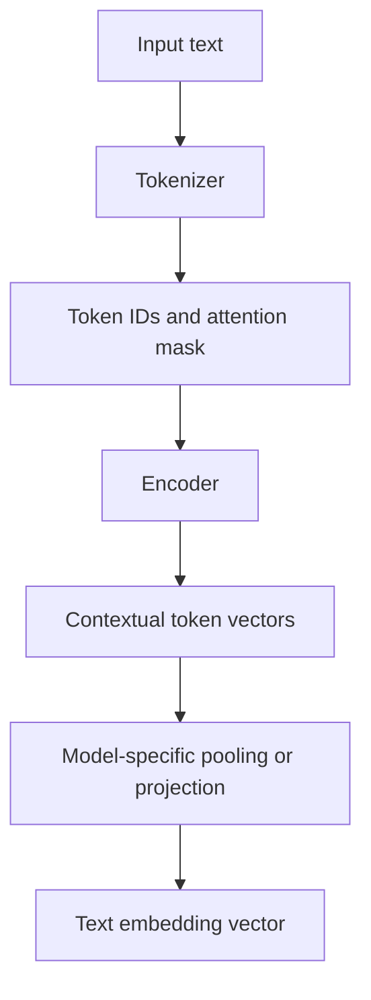
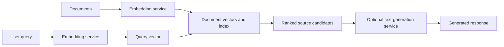

# 02. Text Embedding Models and Their Limitations

## Learning Objectives

By the end of this chapter, you should be able to:

- Explain how retrieval-trained encoders create useful text representations.
- Describe conceptually how token representations can be pooled into a text embedding.
- Understand token limits, truncation, input length, and domain/language coverage.
- Recognize difficult cases involving negation, identifiers, numbers, rare terms, and ambiguous queries.
- Explain why embedding proximity does not prove truth or factual agreement.
- Distinguish embedding services from text-generation services.
- Record the model version, license, and supported input formats for reproducibility.

<br/>

## 1. What Is a Text Embedding Model?

A **text embedding model** maps text to a numerical vector. In semantic search, the vector is used to compare a query with document or passage vectors.

A simplified view is:

$$
\text{text} \longrightarrow \text{tokenization} \longrightarrow
\text{encoder} \longrightarrow \text{text representation}
\longrightarrow \text{embedding vector}
$$

The output vector is designed to be useful for a task such as semantic similarity or retrieval. Its quality depends on the model's training objective, training data, architecture, and intended use.

Not every model that can produce a vector is a good retrieval model. For example, a generative language model may expose hidden states, but those states should not be assumed to work well as general-purpose search embeddings without validation.

<br/>

## 2. Retrieval-Trained Encoders

A **retrieval-trained encoder** is trained or adapted so that its representations support finding relevant items. During training, the model may learn to place useful query–document pairs closer together than irrelevant pairs according to a chosen similarity measure.

Conceptually, training examples may contain:

- A query
- One or more relevant passages
- One or more non-relevant passages

The training objective encourages the model to distinguish useful matches from less useful ones. The exact objective and training procedure vary by model.

<br/>

### 2.1 Query and document encoders

Some retrieval systems use one shared encoder for queries and documents. Others use separate but coordinated encoders, or prescribe different encoding instructions for queries and documents.

This is sometimes called **symmetric** versus **asymmetric** retrieval:

- **Symmetric similarity:** Both inputs are similar kinds of text, such as sentence-to-sentence similarity.
- **Asymmetric retrieval:** A short query is used to retrieve a longer passage or document.

For asymmetric retrieval, a model may expect query-specific and document-specific prefixes, prompts, or encoding methods. Follow the selected model's documentation rather than assuming that every model uses the same convention.

<br/>

### 2.2 Why the training objective matters

An embedding space reflects what the model was optimized to represent. A model trained for sentence similarity may behave differently from one trained for question-to-passage retrieval, code search, or multilingual search.

For engineering work, select a model based on the target retrieval task and evaluate it on representative queries. Do not select a model only because its name includes “embedding” or because it performs well on an unrelated benchmark.

<br/>

## 3. From Token Representations to a Pooled Text Representation

Text is normally tokenized before it is processed by a neural encoder. The encoder can produce a sequence of contextual vectors—one for each token position. A retrieval model then needs a representation suitable for comparing the whole input.

One common approach is **pooling**: combining token-level representations into a single vector. Different models use different approaches, such as:

- **Mean pooling:** Average selected token vectors, often excluding padding tokens.
- **Special-token pooling:** Use the representation associated with a designated token, when the model was trained to use it this way.
- **Model-specific pooling or projection:** Apply a trained transformation to obtain the final embedding.

These approaches are not interchangeable by default. Use the pooling method specified by the model.

<br/>

### Conceptual data flow



The diagram is conceptual. Some embedding APIs hide tokenization, encoder processing, and pooling behind a single request.

<br/>

### Important distinction

Pooling is one way to create a whole-text representation from token-level outputs. It does not mean that every embedding model simply averages every token vector. The correct procedure is model-specific.

<br/>

## 4. Input Length, Token Limits, and Truncation

Embedding models have a maximum supported input length, often expressed in tokens. A token is not necessarily a word: it can be a whole word, part of a word, punctuation, or another tokenization unit.

### 4.1 Why input length matters

If an input exceeds the model's limit, the API or library may:

- Reject the input with an error.
- Truncate tokens beyond the limit.
- Require the application to split the text into smaller inputs.
- Apply another documented model-specific behavior.

Never assume that long input is handled in the same way by every provider.

<br/>

### 4.2 What truncation can break

Suppose a long policy document ends with this sentence:

> “The previous exception does not apply to contractors.”

If the input is truncated before the final sentence, the resulting embedding may not reflect that exception. A search system may then retrieve the document without representing an important qualification.

Truncation can remove:

- A conclusion or exception near the end
- A product identifier or version
- A table row or code fragment
- A negation word such as “not”
- Context needed to interpret an acronym

<br/>

### 4.3 Practical handling

For every embedding model, document:

1. Its supported maximum input length and how that limit is measured.
2. Whether overlong input is rejected, truncated, or handled another way.
3. Whether the client library automatically truncates.
4. How the application detects or logs overlength inputs.
5. The splitting strategy used when an input must be represented in multiple passages.

This chapter focuses on model limitations. Detailed document chunking and ingestion strategies are covered in Level 8.

**Engineering rule:** Do not silently assume that a long document was fully embedded. Make the input-length behavior explicit and test it.

<br/>

## 5. Domain and Language Coverage

Embedding quality depends on how well the model represents the language, terminology, and document types used by the application.

### 5.1 Domain coverage

A general-purpose model may work reasonably well on everyday text but struggle with specialized content such as:

- Medical terminology
- Legal clauses
- Scientific notation
- Financial abbreviations
- Software error messages and code
- Internal product names and company-specific terminology

A domain-specific model is not automatically superior. It must be evaluated against the actual task, corpus, and query distribution.

<br/>

### 5.2 Language coverage

Multilingual models can support several languages, but quality may vary by language, script, dialect, and the mixture of languages in a query or document.

Potential challenges include:

- A query in one language retrieving a passage in another
- Transliteration and spelling variation
- Code-switching within a sentence
- Domain terminology used differently across languages
- Poor representation of low-resource languages

If multilingual retrieval is important, include those languages and realistic query styles in the evaluation set.

<br/>

### 5.3 Evaluation over assumptions

Do not infer retrieval quality from a model's marketing description alone. Test representative examples, including difficult and out-of-domain inputs, and record where retrieval fails.

<br/>

## 6. Difficult Inputs and Failure Modes

Embedding models can produce useful similarities while missing distinctions that matter to the user. The following cases deserve explicit tests.

### 6.1 Negation and contradiction

Consider:

- “The device supports offline mode.”
- “The device does not support offline mode.”

These sentences share most of their vocabulary and discuss the same feature. Their embeddings may be close even though their claims contradict each other.

Embedding proximity does not guarantee that the sentences agree. If a task depends on polarity, exceptions, or contradictions, use additional checks or a suitable downstream verification process.

<br/>

### 6.2 Identifiers and rare terms

Examples include:

- `ERR_CONN_RESET`
- `ZX-410B`
- `ISO-27001`
- An internal ticket number

A model may not represent a rare identifier as reliably as common natural-language concepts. Tokenization can split an identifier into pieces, and semantic retrieval may retrieve a related but incorrect code.

For exact identifiers, lexical search or a hybrid approach may be a better fit. Preserve identifiers during preprocessing and test exact-match behavior.

<br/>

### 6.3 Numbers, units, and dates

Consider:

- “The battery capacity is 4,000 mAh.”
- “The battery capacity is 400 mAh.”

The texts are almost identical but the numerical values differ by a factor of ten. A semantic embedding is not a dependable numeric comparator and may place them close together.

Other risky examples include:

- `5 mg` versus `50 mg`
- `2025` versus `2026`
- `10 km` versus `100 km`
- `0.5` versus `5.0`

When exact numeric correctness matters, preserve and compare structured values using explicit logic. Do not rely on vector similarity to distinguish them.

<br/>

### 6.4 Ambiguous queries

A query such as “jaguar speed” could refer to an animal or a vehicle. The query may not contain enough context to select the intended meaning.

Possible responses include:

- Retrieve candidates from both interpretations.
- Use surrounding application context if it is reliable and authorized.
- Ask the user to clarify.
- Apply a domain or metadata filter when the user's intent supports it.

Do not treat an ambiguous query as unambiguous merely because the model returns a confident ranking.

<br/>

### 6.5 Vocabulary mismatch

A user may ask for “reducing fuel consumption,” while a document discusses “improving mileage.” Dense retrieval can help connect such paraphrases.

However, vocabulary mismatch can also occur in the opposite direction: two passages may share a topic while differing in a crucial condition. Semantic relatedness is useful for candidate discovery, but it does not replace careful interpretation.

<br/>

### 6.6 Summary of failure patterns

| Input challenge | Why embedding retrieval may struggle | Useful mitigation |
|---|---|---|
| Negation or contradiction | Shared wording can dominate the representation | Inspect evidence; add contradiction-focused tests |
| Exact identifiers | Rare strings may be represented inconsistently | Lexical search, exact-match checks, hybrid retrieval |
| Numbers and units | Small textual differences may be semantically underweighted | Parse and validate values explicitly |
| Ambiguous query | Multiple interpretations may be plausible | Clarify intent or use justified metadata filters |
| Long input | Truncation may remove essential context | Detect limits and split input using a documented strategy |
| Specialized domain | Training data may not cover domain terminology well | Evaluate domain examples and compare suitable models |
| Low-resource language | Representation quality may be uneven | Evaluate by language and query type |

These mitigations are design options, not universal guarantees.

<br/>

## 7. Similarity Is Not Truth or Factual Agreement

Embedding similarity is a geometric or scoring relationship between learned vectors. It does not directly answer whether a claim is true, current, logically entailed, or consistent with another claim.

A search system might rank these statements close together:

- “The service stores data for 30 days.”
- “The service does not store data for 30 days.”

The shared topic and wording can make them related in vector space even though the second negates the first.

Therefore:

- Do not interpret similarity as a probability that a statement is true.
- Do not assume that nearby passages support the same conclusion.
- Do not treat the highest-ranked passage as verified evidence without inspection.
- Check source authority, freshness, context, and relevant qualifications where needed.
- Evaluate difficult cases with explicit labels, especially contradictions, numbers, identifiers, and ambiguous queries.

In a RAG application, retrieval supplies candidate evidence. The generation stage must still use that evidence correctly, and the application should handle cases where evidence is missing or conflicting.

<br/>

## 8. Embedding Services vs. Text-Generation Services

Embedding and generation services both process text, but their outputs and purposes differ.

| Aspect | Embedding service | Text-generation service |
|---|---|---|
| Primary purpose | Represent input as vectors | Generate or transform content |
| Typical output | Numerical vector(s) | Text or structured generated output |
| Common use | Semantic search, similarity, clustering | Question answering, summarization, drafting |
| Typical downstream operation | Vector comparison and ranking | Display, validate, or process generated response |
| Key configuration concerns | Dimensions, input limits, encoding conventions, normalization where applicable | Output limits, sampling settings, structured-output support, stop behavior |
| Main evaluation focus | Retrieval relevance and representation behavior | Task quality, correctness, instruction following, and output validity |

Some platforms offer both capabilities through one provider, but they remain different tasks and often use different model endpoints.

<br/>

### A simplified application flow



An embedding model does not normally write the final answer. It helps the application locate candidate content. A generation model can then use the selected content to produce a response.

<br/>

## 9. Model Metadata and Reproducibility

A semantic-search experiment is difficult to reproduce if the embedding model and its configuration are not recorded.

Maintain a model configuration record with fields such as:

| Field | What to record |
|---|---|
| Provider or library | Service provider or model library |
| Model identifier | Exact model name or ID |
| Model version or revision | Pinned version/revision when available; note when the provider does not expose one |
| Retrieval task | For example, query-to-passage retrieval |
| Encoding conventions | Query/document prefixes, instructions, or modes |
| Embedding dimension | Expected output dimension |
| Input limit | Maximum supported length and unit |
| Truncation behavior | Rejection, automatic truncation, or other documented behavior |
| Supported input formats | Text and any additional documented formats |
| Normalization | Whether vectors are normalized by the model, client, or application |
| License and usage terms | Applicable license, commercial-use conditions, and restrictions |
| Date checked | When the documentation and configuration were verified |

<br/>

### Why versions matter

Changing an embedding model or its configuration can change vector values and retrieval rankings. Even if the new model produces vectors with the same dimension, its vectors may belong to a different embedding space.

Do not mix old document vectors and new query vectors unless the model explicitly supports that arrangement. When changing to an incompatible model, plan to re-embed the corpus and rebuild or migrate the index.

<br/>

### Safe configuration practices

- Keep API credentials out of source code and notebooks committed to version control.
- Record model identifiers and non-secret configuration in project documentation.
- Do not log sensitive source text or raw queries unnecessarily.
- Check the provider's current documentation for limits, supported formats, licensing, and data-handling terms.

Specific limits, pricing, licenses, and supported formats vary by model and provider. Verify them for the selected model rather than relying on generic assumptions.

<br/>

## 10. Practice: Compare Related, Unrelated, and Contradictory Texts

### Goal

Use one retrieval embedding model—or prepared illustrative vectors—to compare different types of text pairs. The objective is to identify possible failure modes, not to assume that every model will produce the same scores.

### Suggested test set

| Type | Text A | Text B | What to inspect |
|---|---|---|---|
| Related paraphrase | “How can I reduce fuel consumption?” | “Improve vehicle mileage through maintenance.” | Does the model recognize related intent? |
| Unrelated | “How can I reduce fuel consumption?” | “The museum opens at nine in the morning.” | Are unrelated topics separated? |
| Contradiction | “The device supports offline mode.” | “The device does not support offline mode.” | Are opposite claims still close? |
| Numeric difference | “Battery capacity is 4,000 mAh.” | “Battery capacity is 400 mAh.” | Does the score fail to reflect the important numeric difference? |
| Identifier variation | “Resolve error ERR_CONN_RESET.” | “Resolve error ERR_CONN_REFUSED.” | Does retrieval distinguish the exact codes? |
| Ambiguity | “Jaguar speed” | A passage about the animal versus a passage about the vehicle | Does the query need clarification or context? |

<br/>

### Example implementation using prepared vectors

The following code uses **illustrative vectors only**. It does not generate embeddings or report real model behavior. Replace the vectors with outputs from one actual embedding model to run a meaningful experiment.

```python
import numpy as np

examples = {
    "query": np.array([0.8, 0.2, 0.1]),
    "related_paraphrase": np.array([0.75, 0.25, 0.12]),
    "unrelated_text": np.array([0.1, 0.9, 0.7]),
    "contradictory_text": np.array([0.79, 0.21, 0.11]),
}

def cosine_similarity(a: np.ndarray, b: np.ndarray) -> float:
    denominator = np.linalg.norm(a) * np.linalg.norm(b)
    if denominator == 0:
        raise ValueError("Cosine similarity is undefined for zero vectors.")
    return float(np.dot(a, b) / denominator)

query = examples["query"]

for name, vector in examples.items():
    if name == "query":
        continue
    score = cosine_similarity(query, vector)
    print(f"{name}: {score:.4f}")
```

In this deliberately constructed example, the contradictory text has a vector close to the query vector. This illustrates the central limitation: a similarity score alone cannot establish whether two statements agree.

<br/>

### Running the experiment with a real model

1. Choose a documented retrieval embedding model.
2. Follow its query/document encoding conventions.
3. Embed every sentence using the same compatible setup.
4. Compute the similarity or distance specified by the model's recommended retrieval configuration.
5. Record the model ID, version, dimensions, and preprocessing choices.
6. Inspect the scores alongside human judgments about relatedness, contradiction, numeric correctness, and identifier matching.
7. Repeat for representative domain and language examples.
8. Record failures instead of assuming the model will behave consistently across cases.

For a small test, a similarity table is enough. For a more complete evaluation, create labeled queries and measure retrieval metrics in Chapter 15.

<br/>

## 11. Revision Questions and Answers

**1. What is a retrieval-trained encoder?**  
A model trained or adapted to produce representations that help retrieve relevant items for a particular task.

**2. What is pooling?**  
A method for combining token-level representations into a single text representation. The appropriate method depends on the model.

**3. Why can truncation hurt retrieval?**  
It can remove essential content such as a negation, exception, identifier, or final conclusion before the embedding is created.

**4. Why should domain and language coverage be tested?**  
Model quality can vary across specialized terminology, languages, scripts, dialects, and mixed-language inputs.

**5. Why can contradictory statements have similar embeddings?**  
They may share most of their vocabulary and topic, while a small word such as “not” reverses the claim.

**6. Are embeddings dependable for exact numeric comparison?**  
No. If numeric values or units determine correctness, parse and compare them explicitly.

**7. What is the difference between an embedding service and a generation service?**  
An embedding service returns vector representations; a generation service produces text or other generated output.

**8. Why record a model version or revision?**  
Model changes can alter vector representations and ranking behavior. Version records help reproduce experiments and manage migrations.

**9. If two models produce vectors with the same dimension, can their vectors automatically be compared?**  
No. Equal dimensions do not establish that the vectors use the same embedding space.

**10. What metadata should be recorded for an embedding model?**  
At minimum, the exact model ID and version when available, encoding conventions, dimensions, input limits, truncation behavior, supported formats, normalization, license, and date checked.

<br/>

## 12. Chapter Checkpoint

You should now be able to:

- Explain retrieval-trained encoders and text-level pooling.
- Describe how token limits and truncation can change a representation.
- Identify risks involving domain coverage, language coverage, negation, numbers, identifiers, and ambiguity.
- Distinguish similarity from factual truth and logical agreement.
- Explain the difference between embedding and generation services.
- Record the model configuration needed for reproducible retrieval experiments.

**Checkpoint answer:** Semantic proximity can be misleading when two texts share a topic but differ in a crucial detail. Examples include a statement and its negation, two values with different numbers or units, similar-looking identifiers, ambiguous queries, and outdated or domain-mismatched content. Similarity should be treated as a retrieval signal—not proof of correctness.

<br/>

## References and Further Reading

- Level 7 course outline: `README.md`, Chapter 02 — “Text Embedding Models and Their Limitations.”
- Documentation for the selected embedding model: verify its training purpose, query/document encoding instructions, maximum input length, truncation behavior, supported formats, output dimensions, versioning, license, and data-handling terms.
- Documentation for the selected vector library or database: verify supported distance metrics and how vectors are stored and searched.

<br/>

**Scope note:** This chapter focuses on embedding-model behavior and limitations. Compatible document/query encoding is covered in Chapter 03; vector dimensions and normalization in Chapter 04; similarity metrics in Chapter 05; and retrieval evaluation in Chapter 15.
