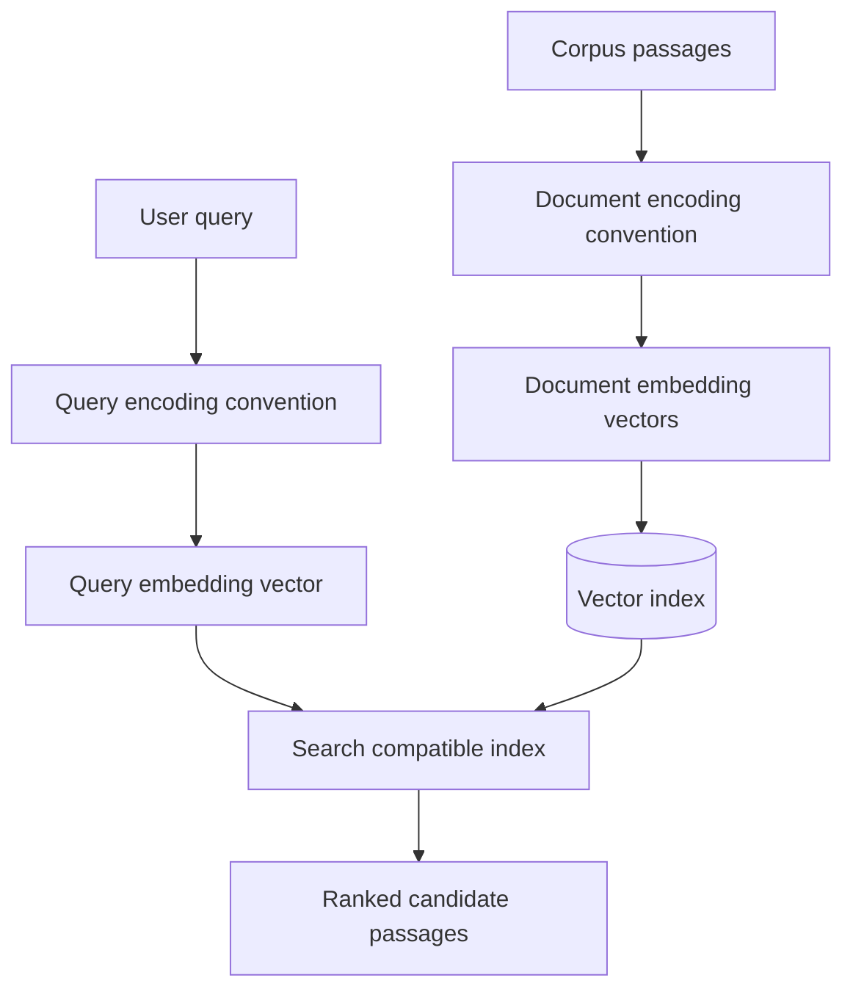

# 03. Document and Query Embeddings

## Learning Objectives

By the end of this chapter, you should be able to:

- Distinguish symmetric similarity tasks from asymmetric query-to-document retrieval.
- Follow model-specific query and document encoding instructions.
- Explain why query and corpus vectors must belong to compatible embedding spaces.
- Prepare stable document or passage IDs and preserve their source text.
- Split overlong documents using a simple, documented strategy.
- Encode documents in batches with validation and bounded resource usage.

<br/>

## 1. Document Embeddings and Query Embeddings

An **embedding** is a numerical vector produced from an input by an embedding model. In a semantic-search application, two common inputs are:

- **Document or passage:** Content stored in the searchable corpus.
- **Query:** The user's search request.

The application encodes both into vectors and compares them using a compatible similarity or distance metric.

Conceptually:

$$
\text{document text} \rightarrow \mathbf{d}
\qquad
\text{query text} \rightarrow \mathbf{q}
$$

Here, $\mathbf{d}$ is a document vector and $\mathbf{q}$ is a query vector. The vectors must be compatible for meaningful comparison.

A query and a document do not have to contain the same words. A retrieval model may represent a query such as “How can I reduce fuel consumption?” near a passage that discusses “improving vehicle mileage.”

<br/>

## 2. Symmetric Similarity vs. Asymmetric Retrieval

### 2.1 Symmetric similarity

In a **symmetric similarity** task, both inputs are usually similar kinds of text. For example:

- Sentence-to-sentence similarity
- Comparing two product descriptions
- Finding near-duplicate paragraphs

The goal is to estimate how similar or related the two inputs are.

<br/>

### 2.2 Asymmetric query-to-document retrieval

In **asymmetric retrieval**, a short query is used to find a longer passage or document. For example:

- Query: “How do I reset my account password?”
- Passage: “To reset your password, open Account Settings and select Reset Password.”

The query and document have different roles and often different lengths. A retrieval model may be trained specifically for this pattern and may require different encoding instructions for each role.

<br/>

### Comparison

| Aspect | Symmetric similarity | Asymmetric retrieval |
|---|---|---|
| Typical inputs | Two sentences or similar text units | A query and a document/passage |
| Main goal | Compare relatedness or similarity | Retrieve useful evidence for a query |
| Input roles | Often interchangeable | Query and document roles differ |
| Encoding conventions | May use the same encoding method | May require distinct query/document modes or instructions |
| Evaluation | Similarity judgments or pair labels | Relevance judgments and ranked retrieval results |

The terms describe task patterns, not a guarantee that every model uses separate encoders. A model can use one shared encoder while still documenting distinct query and document instructions.

<br/>

## 3. Query and Document Encoding Conventions

Embedding models do not all expect the same input format. Depending on the model, the correct encoding procedure may require:

- A shared encoding function for both inputs
- A query-specific prefix or instruction
- A document-specific prefix or instruction
- Separate query and document methods exposed by a library
- Model-specific preprocessing or normalization

For example, a model's documentation might specify that a query should be encoded in a search-query mode and a passage in a document mode. Those names are model-specific; they are not universal API parameters.

**Rule:** Follow the exact documentation for the selected model. Do not invent prefixes or instructions, and do not assume that a convention used by one model applies to another.

<br/>

### Conceptual flow



The diagram shows distinct query and document encoding paths. Some models use different instructions; others use the same encoding method for both.

<br/>

## 4. Compatibility: More Than Matching Dimensions

A vector's **dimension** is the number of numerical components it contains. For example, a vector with 768 values has dimension 768.

Two embedding models may both output 768-dimensional vectors, but that does not mean their vectors can be compared meaningfully. Each model learns its own representation space. The same text can map to unrelated coordinates in two different spaces.

Compatibility depends on more than vector length, including:

- The embedding model and its version or revision
- The intended retrieval task
- Query and document encoding conventions
- Any model-specific projection or normalization
- The metric and index configuration used by the application

<br/>

### Example

Suppose Model A and Model B both return 768-dimensional vectors.

- Model A embeds documents for indexing.
- Model B embeds incoming queries.

A query vector from Model B may not align with relevant document vectors produced by Model A, even though both vectors have 768 values. The search may return a ranking, but the ranking is not necessarily meaningful.

**Engineering rule:** Use a compatible model and configuration for both sides of retrieval. When changing to an incompatible model, plan to re-embed the corpus and rebuild or migrate the index.

<br/>

## 5. Stable Document and Passage IDs

Every searchable record should have a stable identifier that connects its embedding to the source content.

A minimal record might look like this:

```python
document = {
    "id": "guide-001-passage-01",
    "source_id": "guide-001",
    "text": "To reset your password, open Account Settings.",
    "metadata": {
        "language": "en",
        "version": 1,
    },
}
```

Useful fields include:

- `id`: Unique identifier for this indexed passage
- `source_id`: Identifier for the original document
- `text`: The exact text represented by the embedding
- `metadata`: Additional fields used for filtering or source inspection

The structure is illustrative. A production system may use a database record, a document store, or a vector database's metadata fields.

<br/>

### Why stable IDs matter

Stable IDs help the application:

- Match a retrieved vector to its source text
- Display source references
- Update a passage without confusing it with another passage
- Delete stale records
- Test whether the expected document was retrieved
- Keep results reproducible across runs

Avoid using a temporary array position as a permanent ID if the corpus may be reordered or updated.

<br/>

## 6. Simple Passage Splitting for Overlong Documents

An embedding model has a maximum supported input length. If a document exceeds that limit, it may be rejected, truncated, or require splitting according to the model's documented behavior.

For this chapter, use a simple, transparent splitting strategy. For example, split text on paragraph boundaries and combine paragraphs until a configured character limit is reached. This is only a basic illustration; character count is not the same as token count.

<br/>

### Simple paragraph-based splitter

```python
def split_paragraphs(text: str, max_chars: int = 800) -> list[str]:
    # Split text into paragraph groups bounded by a character limit.
    if max_chars <= 0:
        raise ValueError("max_chars must be positive")

    paragraphs = [p.strip() for p in text.split("\n\n") if p.strip()]
    passages = []
    current = ""

    for paragraph in paragraphs:
        # A single paragraph longer than the limit is split simply.
        pieces = [
            paragraph[i:i + max_chars]
            for i in range(0, len(paragraph), max_chars)
        ]

        for piece in pieces:
            candidate = f"{current}\n\n{piece}" if current else piece

            if len(candidate) <= max_chars:
                current = candidate
            else:
                if current:
                    passages.append(current)
                current = piece

    if current:
        passages.append(current)

    return passages


text = (
    "Password reset instructions are available in Account Settings.\n\n"
    "Choose Reset Password and follow the confirmation steps.\n\n"
    "If you cannot access your email, contact support."
)

for i, passage in enumerate(split_paragraphs(text, max_chars=80), start=1):
    print(f"Passage {i}: {passage!r}")
```

<br/>

### Limitations of this splitter

- It uses characters, not the embedding model's token count.
- It can split a long paragraph at an arbitrary character boundary.
- It does not create overlapping passages.
- It does not preserve rich structures such as tables or headings as structured data.
- It is a learning example, not a complete document-ingestion solution.

For a real model, validate each passage against the model's actual token limit and documented input behavior. Advanced parsing, chunking, overlap, and ingestion strategies belong to Level 8.

<br/>

### Passage IDs

When splitting a source, derive unique, stable passage IDs, for example:

- `guide-001-passage-001`
- `guide-001-passage-002`

If passage boundaries can change, use a version or content hash as part of the record design so that stale vectors can be identified and replaced.

<br/>

## 7. Batch Document Encoding

Encoding documents one at a time can add overhead for large collections. Many embedding APIs and local models support batching: submitting multiple texts in one operation.

Batching can improve throughput, but the appropriate batch size depends on the provider's request limits, token limits, hardware, memory, and latency requirements.

### 7.1 Why use bounded batches?

A batch that is too large may cause:

- Request-size or item-count errors
- Memory pressure
- Timeouts
- Rate-limit failures
- Harder-to-recover partial processing

A batch that is too small may add unnecessary overhead. Start conservatively, measure performance, and tune the batch size.

<br/>

### 7.2 Generic batching pattern

The following example shows application-side batching and basic validation. The `embed_texts` function is intentionally a placeholder: replace it with the selected model's documented SDK or local-model call.

```python
from collections.abc import Callable
from typing import TypeAlias

Vector: TypeAlias = list[float]
EmbedBatch: TypeAlias = Callable[[list[str]], list[Vector]]


def embed_in_batches(
    texts: list[str],
    embed_texts: EmbedBatch,
    batch_size: int = 32,
) -> list[Vector]:
    if batch_size <= 0:
        raise ValueError("batch_size must be positive")

    if any(not isinstance(text, str) or not text.strip() for text in texts):
        raise ValueError("Every input must be a non-empty string")

    all_vectors: list[Vector] = []
    expected_dimension: int | None = None

    for start in range(0, len(texts), batch_size):
        batch = texts[start:start + batch_size]
        vectors = embed_texts(batch)

        if len(vectors) != len(batch):
            raise ValueError("Embedding count does not match input count")

        for vector in vectors:
            if not vector:
                raise ValueError("Received an empty embedding")

            if any(not isinstance(value, (int, float)) for value in vector):
                raise ValueError("Embedding contains a non-numeric value")

            if expected_dimension is None:
                expected_dimension = len(vector)
            elif len(vector) != expected_dimension:
                raise ValueError("Inconsistent embedding dimensions")

        all_vectors.extend(vectors)

    return all_vectors
```

This helper validates basic properties but does not handle provider-specific response objects, retries, rate limits, deadlines, token counts, or persistence. Add those according to the actual service and application requirements.

<br/>

### 7.3 Additional production checks

For a production batch-encoding process, consider:

- Validate inputs and model-specific token limits before submission.
- Use bounded concurrency rather than launching unbounded requests.
- Respect provider rate limits and maximum batch sizes.
- Add timeouts and bounded retries for transient failures.
- Preserve the input-to-output order or use explicit IDs to match results.
- Validate vector dimensions and numerical finiteness.
- Record model/configuration versions with the indexed records.
- Avoid logging sensitive source text unnecessarily.
- Make the operation resumable so a failed batch does not require restarting the entire corpus.

<br/>

## 8. Practice: Encode a Small Collection and Retrieve Results

### Goal

Build a small retrieval experiment using one compatible embedding model. The experiment should use stable IDs and the model's documented query/document encoding conventions.

<br/>

### Suggested corpus

```python
documents = [
    {
        "id": "doc-001",
        "text": "Check tire pressure regularly to improve vehicle mileage.",
    },
    {
        "id": "doc-002",
        "text": "To reset your password, open Account Settings.",
    },
    {
        "id": "doc-003",
        "text": "Regular engine maintenance can reduce fuel consumption.",
    },
    {
        "id": "doc-004",
        "text": "The museum opens at nine in the morning.",
    },
]
```

Try queries such as:

1. “How can I use less fuel?”
2. “How do I change my account password?”
3. “When does the museum open?”

<br/>

### Implementation steps

1. Select an embedding model designed or validated for retrieval.
2. Record its exact model ID, version if available, embedding dimension, input limit, and encoding instructions.
3. Encode document texts using the documented document convention.
4. Store each vector with its stable ID and original text.
5. Encode each query using the documented query convention.
6. Calculate the model-recommended similarity or distance score.
7. Return the top-\(k\) document IDs, texts, and scores.
8. Inspect the results manually and record misses or irrelevant matches.

Do not use made-up vectors to claim real retrieval performance. If you use prepared vectors to practice the ranking code, label them as illustrative and separate that exercise from the real embedding experiment.

<br/>

### Suggested result table

| Query | Retrieved IDs | Relevant result? | Failure notes |
|---|---|---|---|
| How can I use less fuel? | Fill after running | Yes/No | Paraphrase or ranking issue |
| How do I change my account password? | Fill after running | Yes/No | Missing or incorrectly ranked source |
| When does the museum open? | Fill after running | Yes/No | Exact answer or context issue |

The table is a recording template, not a report of observed model results.

<br/>

## 9. Common Mistakes

- **Using different embedding models for queries and documents without compatibility guarantees.** Equal vector dimensions do not make vector spaces compatible.
- **Ignoring query/document instructions.** Some retrieval models require role-specific modes or prefixes.
- **Assuming every model is symmetric.** A model designed for query-to-passage retrieval may not be optimized for sentence similarity.
- **Using arbitrary splitting without checking token limits.** A character limit does not guarantee that a passage fits the model.
- **Losing the source mapping.** Every vector should be associated with a stable ID and retrievable source text.
- **Sending unbounded batches.** Excessive batch sizes or concurrency can trigger resource and service failures.
- **Assuming a successful API response means valid data.** Validate result counts, dimensions, numeric values, and input-to-output mapping.
- **Changing models without re-indexing.** A model migration may require regenerating document embeddings and rebuilding the index.

<br/>

## 10. Revision Questions and Answers

**1. What is a document embedding?**  
A vector representing a document or passage for comparison and retrieval.

**2. What is a query embedding?**  
A vector representing the user's query, produced using the selected model's documented query-encoding procedure.

**3. How does symmetric similarity differ from asymmetric retrieval?**  
Symmetric similarity often compares two similar kinds of text, while asymmetric retrieval uses a query to retrieve a document or passage.

**4. Why might query and document encoding instructions differ?**  
The model may be trained for distinct query and document roles and may require role-specific prefixes, prompts, or encoding methods.

**5. Why are equal vector dimensions insufficient for compatibility?**  
Different models can learn different coordinate systems and representation spaces. Equal lengths do not guarantee meaningful cross-model comparisons.

**6. Why assign stable IDs to passages?**  
IDs connect vectors to source text and support result inspection, updates, deletion, and reproducible evaluation.

**7. What should happen when a document exceeds the model's input limit?**  
Follow the documented model behavior and use a validated splitting strategy when needed; do not assume silent truncation is safe.

**8. Why encode documents in batches?**  
Batching can reduce overhead and improve throughput, but batch size and concurrency must remain within resource and provider limits.

**9. What should be validated in a batch response?**  
At minimum, the number of vectors, non-empty numeric values, consistent dimensions, and correct association with input records.

**10. When should the corpus be re-embedded?**  
When the model or configuration changes in a way that makes existing vectors incompatible, or when the indexed source content changes.

<br/>

## 11. Chapter Checkpoint

You should now be able to:

- Explain symmetric similarity and asymmetric query-to-document retrieval.
- Follow the selected model's query/document encoding requirements.
- Maintain compatible document and query embeddings.
- Assign stable IDs and preserve source text.
- Split overlong content using a simple documented method.
- Encode documents in bounded batches and validate the results.

**Checkpoint answer:** Equal vector dimensions only mean that two vectors have the same number of components. Different embedding models can learn different representation spaces, so corresponding coordinates may not have the same meaning. Meaningful retrieval requires compatible model and configuration conventions for query and document encoding—not just matching vector lengths.

<br/>

## References and Further Reading

- Level 7 course outline: `README.md`, Chapter 03 — “Document and Query Embeddings.”
- Documentation for the selected embedding model: verify query/document encoding modes, prefixes or instructions, input limits, output dimensions, batching limits, and compatibility requirements.
- Documentation for the chosen SDK or local embedding library: verify response ordering, error behavior, rate limits, and supported batch sizes.

<br/>

**Scope note:** This chapter uses simple passage splitting only to handle overlong inputs. Advanced parsing, chunking, overlap, metadata-rich ingestion, hybrid retrieval, and full RAG ingestion are developed in Level 8.
