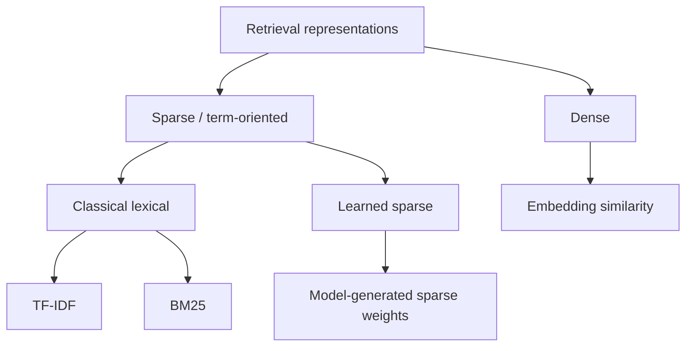
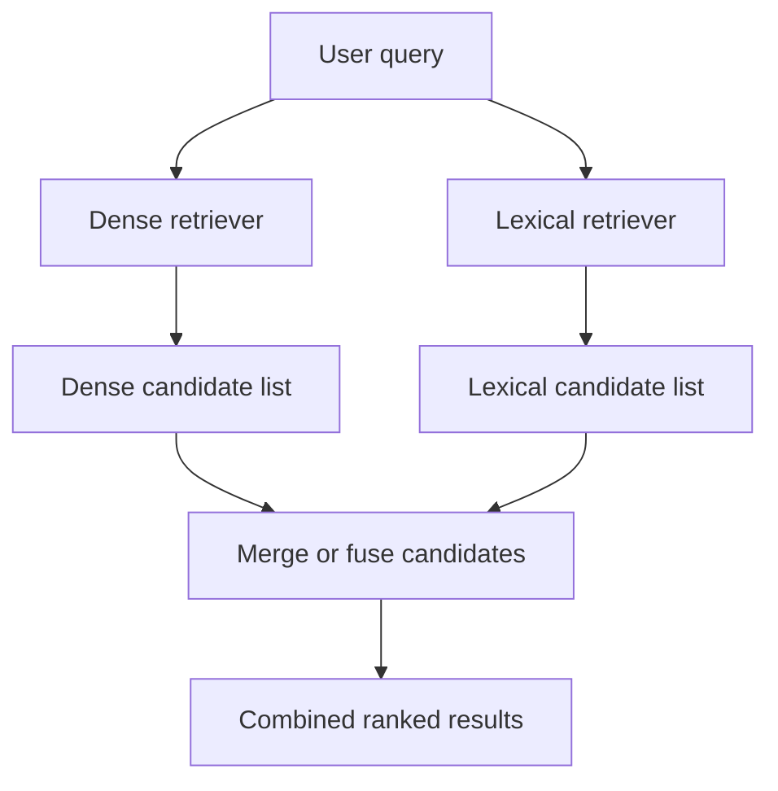

# Chapter 06 — Dense, Lexical, and Sparse Retrieval

## Learning Objectives

By the end of this chapter, you should be able to:

- Compare dense numerical representations with sparse term-based representations.
- Explain why exact lexical matching is valuable for names, codes, technical terms, and identifiers.
- Explain how dense retrieval can help with paraphrases and vocabulary mismatch.
- Distinguish classical lexical retrieval from learned sparse retrieval.
- Recognize that sparse retrieval is broader than BM25.
- Describe hybrid retrieval without assuming dense and lexical scores are directly comparable.

 

## 1. Why Compare Retrieval Approaches?

A search system must decide which documents best match a query. Different retrieval approaches represent queries and documents differently, so they capture different kinds of evidence.

Consider the query:

> My account was charged twice.

Potentially relevant documents might say:

- “Duplicate payment troubleshooting”
- “Resolve a repeated billing transaction”
- “The `ERR_PAY_204` code indicates a payment retry failure.”

A dense retriever may connect the first query with documents that express a similar meaning using different words. A lexical retriever can be especially effective when the query contains a specific token, code, product name, or phrase that also appears in a document.

Neither approach is universally best. Their performance depends on the query type, corpus, representation, scoring method, and retrieval configuration. A practical search system should compare approaches on representative queries.

 

## 2. Dense Retrieval

### 2.1 Representation

Dense retrieval represents each query and document as a fixed-size numerical vector, typically generated by an embedding model.

For example, an embedding model might encode these sentences into nearby vectors:

- Query: “How do I cancel my subscription?”
- Document: “Steps to end a recurring membership.”

The words differ, but the intended meaning is similar. A dense retriever can rank the document highly if the embedding model maps the two texts to nearby representations.

 

### 2.2 Strengths

Dense retrieval can help with:

- **Paraphrases:** “reset my password” versus “recover access credentials.”
- **Vocabulary mismatch:** the query and document express a related concept using different terms.
- **Conceptual similarity:** a document discusses the same underlying topic without repeating the query's exact wording.
- **Natural-language queries:** people can search using complete questions or descriptions.

 

### 2.3 Limitations

Dense retrieval may not reliably preserve every exact token or identifier. It can miss or rank poorly:

- Product codes and ticket IDs.
- Rare names or newly introduced terminology.
- Exact error strings, serial numbers, and version identifiers.
- Small but important differences such as `v1.2` versus `v1.3`.

Embedding quality varies by model and domain. Similarity does not guarantee that a document contains the exact requested identifier or fact.

 

## 3. Lexical Retrieval

### 3.1 Representation

Lexical retrieval compares query terms with terms in documents. Classical methods generally tokenize text and score documents using term occurrence and collection statistics.

A lexical retriever is particularly useful when the actual words matter. If a user searches for `ERR_PAY_204`, a document containing that exact code can be a strong candidate even if the code has little semantic meaning to an embedding model.

 

### 3.2 Strengths

Lexical retrieval is often strong for:

- Exact names and identifiers.
- Error codes, API names, function names, and technical terms.
- Quoted phrases and uncommon words.
- Queries where literal wording is a reliable relevance signal.

 

### 3.3 Limitations

Lexical retrieval can struggle when relevant documents use different wording from the query. For example:

- Query: “How do I get my money back?”
- Document: “Refund eligibility and reimbursement procedure.”

If the query and document share few terms, a basic lexical method may not rank the relevant document highly. Tokenization, stemming, synonyms, and query expansion can affect this behavior, depending on the implementation.

 

## 4. Dense vs. Lexical Retrieval

| Property | Dense retrieval | Classical lexical retrieval |
|---|---|---|
| Main representation | Dense numerical vectors | Terms and term statistics |
| Primary matching signal | Similarity in embedding space | Lexical overlap and term weighting |
| Paraphrases | Often a strength | May struggle without shared terms or expansion |
| Exact identifiers | May be unreliable for strict matching | Often a strength |
| Interpretability | Similarity score can be difficult to explain | Matching terms and weights are often easier to inspect |
| Main dependencies | Embedding model, encoding, metric, index | Tokenization, term statistics, scoring configuration |
| Common failure | Semantically nearby but exact token is absent | Relevant text uses different vocabulary |

This is a general comparison, not a guarantee for every model or corpus. Strong lexical systems can include normalization and query expansion; dense systems can be trained or configured for specialized domains.

 

## 5. Sparse Representations

A sparse vector has many dimensions but only a small number of nonzero values. In text retrieval, dimensions may correspond to vocabulary terms or learned lexical features.

Suppose a simplified vocabulary is:

`["password", "billing", "refund", "ERR_PAY_204", "subscription"]`

A basic term-presence vector for “password reset” might be:

$$
[1, 0, 0, 0, 0]
$$

The vector is sparse because most entries are zero. Real lexical retrieval systems often use weighted term values rather than simple binary presence.

Dense and sparse refer to the structure of the representation, not necessarily to one specific ranking algorithm.

 

## 6. Classical Lexical Retrieval vs. Learned Sparse Retrieval

These are related but distinct approaches.

### 6.1 Classical lexical retrieval

Classical lexical methods use observed terms and hand-designed or statistically defined weighting schemes. Examples include:

- **TF-IDF:** weights terms using their frequency in a document and rarity across the corpus.
- **BM25:** a widely used probabilistic lexical ranking function that incorporates term frequency, inverse document frequency, and document-length normalization.

BM25 is covered in detail in the next chapter. It is an important lexical baseline, but it is not synonymous with all sparse retrieval.

 

### 6.2 Learned sparse retrieval

Learned sparse retrieval uses a trained model to produce sparse term or vocabulary-weighted representations. A model may assign nonzero weights to terms that were not literally present in the original text, depending on the method. This can provide some vocabulary expansion while retaining a sparse, term-oriented representation.

Potential benefits include:

- Sparse matching and efficient inverted-index techniques.
- Learned term importance.
- Some ability to bridge vocabulary mismatch.

Trade-offs can include model inference cost, larger or more complex indexes, and the need to evaluate model-specific behavior. Different learned sparse methods have different designs; do not assume they all work identically.

 

### 6.3 A useful taxonomy

This taxonomy is conceptual. Specific systems may support additional representation and scoring methods.

 

## 7. Hybrid Retrieval

Hybrid retrieval combines results or signals from more than one retrieval approach, commonly dense and lexical retrieval.

It can be useful when an application must handle both:

- Meaning-based queries and paraphrases.
- Exact names, codes, identifiers, and technical strings.

A simple conceptual workflow:

The merge stage matters. Dense cosine scores, dot-product scores, BM25 scores, and other lexical scores have different scales and distributions. A dense score of `0.78` and a BM25 score of `7.8` cannot be compared directly just because one number is larger.

Common combination strategies include:

- **Rank-based fusion:** combine rank positions rather than raw scores. Reciprocal Rank Fusion (RRF) is a common example.
- **Score normalization:** transform scores before combining them, using a method validated for the system.
- **Learned combination:** train a ranking model on suitable relevance judgments.

Do not assume that one fusion method is always best. Evaluate the method on a representative query set and inspect failure cases.

 

## 8. Choosing an Approach by Query Type

| Query type | Likely useful starting point | Why |
|---|---|---|
| “How can I recover access to my account?” | Dense retrieval | The query can match paraphrased guidance |
| `ERR_PAY_204` | Lexical retrieval | Exact error-code matching is important |
| “Cancel recurring membership” | Dense plus lexical comparison | Meaning and literal terms may both help |
| Product model `ZX-410B` | Lexical retrieval | The identifier should be preserved exactly |
| “Why does my application fail after upgrading?” | Dense retrieval, with lexical support for versions/errors | Semantic intent helps, but exact technical tokens may be decisive |
| Mixed natural-language and identifier queries | Hybrid retrieval | Different query components benefit from different signals |

These are starting hypotheses, not final decisions. A benchmark on your own domain should determine the production choice.

 

## 9. Practice: Predict Before Testing

For each query, predict whether dense, classical lexical, learned sparse, or hybrid retrieval is a sensible first experiment.

| Query | Query characteristic | Prediction to test |
|---|---|---|
| “I cannot sign in to my account” | Paraphrasable intent | Dense |
| `HTTP 429` | Exact technical code | Lexical |
| “What is the refund policy?” | Natural language and likely term overlap | Compare dense and lexical |
| “The `ZX-410B` device shows error `E17`” | Exact identifiers plus explanatory intent | Hybrid |
| “How do I terminate a recurring plan?” | Vocabulary may differ from document wording | Dense, with lexical baseline |

For each prediction, write down the expected failure mode. For example, a dense retriever may find conceptually related documents but miss an exact code; a lexical retriever may miss a paraphrase that shares few words with the relevant document.

 

## 10. Small Evaluation Exercise

Create a small corpus containing:

1. A document that uses the query's exact terms.
2. A relevant document that paraphrases the query.
3. A document that shares keywords but is irrelevant.
4. A document containing an exact identifier.
5. An unrelated document.

Then:

1. Write at least five queries, including paraphrases and identifier searches.
2. Label which document IDs are relevant for each query.
3. Run a dense retriever and a lexical baseline on the same corpus.
4. Compare the top results and record misses.
5. Calculate a small retrieval metric such as Recall@K.
6. If useful, test a hybrid method and compare it with both individual retrievers.

Keep the corpus, queries, labels, and settings fixed during comparisons. Otherwise, it becomes difficult to tell whether a change in results came from the retrieval method or a changed test setup.

 

## 11. Common Misconceptions

- **“Dense retrieval is always more intelligent.”** Not necessarily. It can fail on exact identifiers or specialized vocabulary.
- **“Lexical retrieval only finds exact phrases.”** Not necessarily. Methods such as BM25 score term matches and do not require the entire query to appear as an exact phrase.
- **“Sparse retrieval means BM25.”** No. BM25 is one classical lexical method; learned sparse approaches also exist.
- **“A dense score and a lexical score can be directly compared.”** Not without a validated combination method.
- **“Hybrid retrieval automatically improves search.”** It can improve coverage, but it can also add irrelevant candidates or introduce fusion problems. Measure the result.
- **“One retrieval approach should fit every query.”** Query types and domain requirements can differ, so evaluation is essential.

 

## 12. References and Optional Extensions

- Review documentation for the embedding model and its recommended retrieval setup.
- Review the lexical search engine documentation for tokenization, BM25, and scoring behavior.
- Optional extension: compare dense retrieval, BM25, and a rank-fusion method using the same relevance-labeled query set.

 

## Checkpoint

You should be able to explain:

- How dense representations differ from sparse term-oriented representations.
- Why dense retrieval often helps with paraphrases and vocabulary mismatch.
- Why lexical retrieval is often a strong baseline for names, codes, and identifiers.
- How classical lexical retrieval differs from learned sparse retrieval.
- Why BM25 is one lexical method rather than the definition of sparse retrieval.
- Why hybrid retrieval requires a deliberate fusion strategy and empirical evaluation.
- Why dense retrieval should be compared against a lexical baseline on the same queries and relevance labels.
