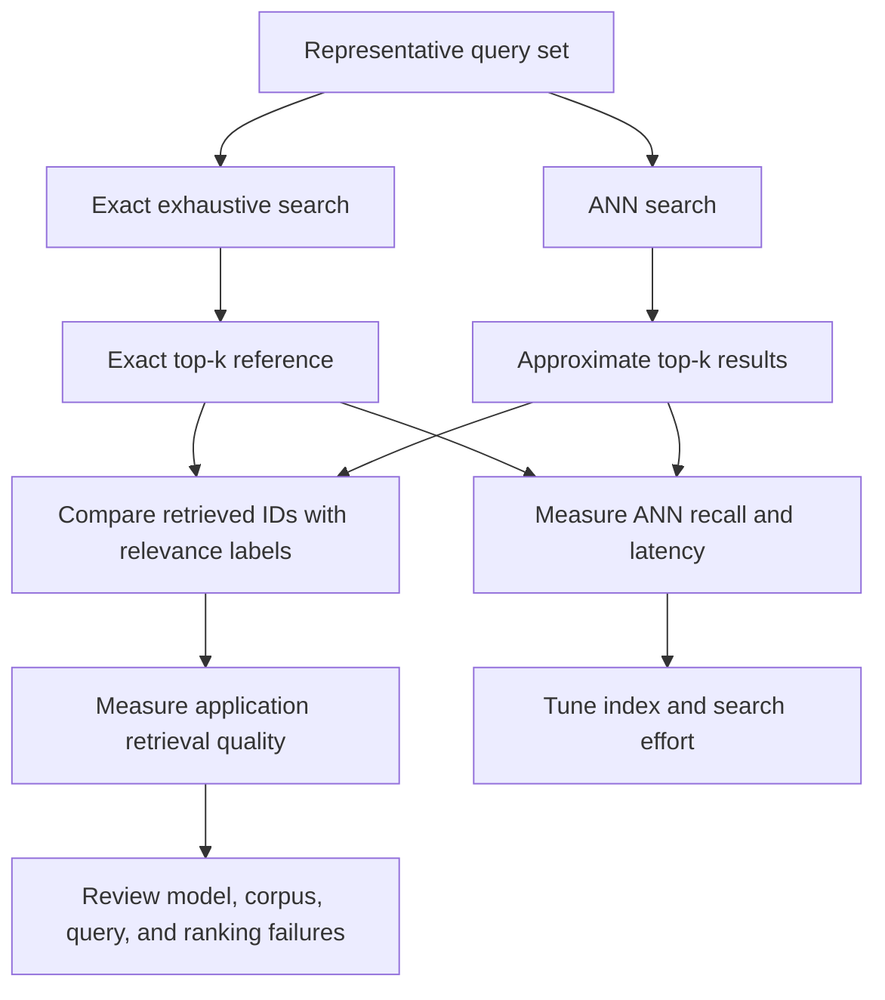

# Chapter 08 — Exact and Approximate Nearest-Neighbor Search

## Learning Objectives

By the end of this chapter, you should be able to:

- Establish exhaustive scoring as an exact reference on a small dataset.
- Explain why large vector collections motivate approximate nearest-neighbor (ANN) search.
- Compare exact and approximate retrieval using recall, latency, index-build time, and memory.
- Explain how candidate exploration and search-effort settings affect ANN behavior.
- Distinguish agreement with exact nearest neighbors from relevance to human judgments.

<br/>

## 1. What Is Nearest-Neighbor Search?

An embedding model maps a query and documents into vectors. Nearest-neighbor search retrieves document vectors that are closest to the query vector according to a selected metric.

For example, a semantic-search system may embed:

- Query: “How can I recover my account?”
- Document A: “Steps to reset a forgotten password.”
- Document B: “Update your billing address.”
- Document C: “Manage subscription settings.”

The search system compares the query vector with the document vectors and returns a ranked candidate list. The result depends on the embedding model, the query/document encoding process, the metric, and the search algorithm.

Two broad approaches are common:

- **Exact nearest-neighbor search:** score every eligible vector and select the true top-$k$ under the configured metric.
- **Approximate nearest-neighbor search (ANN):** use an index or search procedure designed to find good candidates without exhaustively scoring every vector.

<br/>

## 2. Exact Search as a Reference

For a small collection, exact search is often the simplest and clearest approach. Given a query vector $q$, compute its similarity or distance to every document vector, then sort all candidates in the appropriate direction.

- For cosine similarity or dot product, larger scores are generally better.
- For Euclidean distance, smaller scores are better.

A simple exhaustive search provides a reference ranking against which an ANN system can be compared. If both use the same vectors, metric, eligibility filters, and tie-handling rules, the exact top-$k$ result gives the reference set for measuring ANN agreement.

<br/>

### Runnable NumPy example

This example uses small, illustrative vectors rather than embeddings from a trained model.

```python
import numpy as np

query = np.array([1.0, 0.0])

documents = {
    "doc_001": np.array([0.9, 0.1]),
    "doc_002": np.array([0.7, 0.3]),
    "doc_003": np.array([0.0, 1.0]),
    "doc_004": np.array([-0.5, 0.0]),
    "doc_005": np.array([0.8, -0.2]),
}

def cosine_similarity(a, b):
    norm_a = np.linalg.norm(a)
    norm_b = np.linalg.norm(b)
    if norm_a == 0 or norm_b == 0:
        raise ValueError("Cosine similarity is undefined for zero vectors.")
    return float(np.dot(a, b) / (norm_a * norm_b))

def exact_top_k(query_vector, vectors, k=3):
    scores = {
        doc_id: cosine_similarity(query_vector, vector)
        for doc_id, vector in vectors.items()
    }
    return sorted(
        scores.items(),
        key=lambda item: item[1],
        reverse=True,
    )[:k]

print(exact_top_k(query, documents, k=3))
```

This implementation computes a score for every vector. For a dataset of $N$ vectors with dimension $d$, a straightforward scan has roughly $O(Nd)$ scoring work per query, plus the cost of selecting or sorting the top results.

For a small dataset, this is often adequate and useful for validating a more complex index. For large collections, the repeated exhaustive scan may be too expensive for the required latency or throughput.

<br/>

## 3. Why Large Collections Motivate ANN

As the collection grows, exhaustive scoring requires more work per query. At high query volume, this can increase compute cost and latency.

ANN methods use data structures or search strategies to avoid evaluating every vector in the collection for every query. Depending on the algorithm, they may organize vectors into graphs, partitions, clusters, or compressed representations.

The goal is not necessarily to reproduce the exact ranking every time. The goal is to retrieve sufficiently good neighbors within the application's performance and resource constraints.

ANN methods trade some combination of search accuracy, latency, index-build time, and memory. The specific trade-off depends on the index algorithm, data distribution, vector dimension, metric, implementation, and configuration.

<br/>

## 4. Exact vs. Approximate Search

| Dimension | Exact search | Approximate nearest-neighbor search |
|---|---|---|
| Search result | True top-$k$ under the configured metric, assuming correct exhaustive scoring | May miss some exact nearest neighbors |
| Query work | Scores every eligible vector in a simple scan | Explores a subset or uses an index-specific procedure |
| Latency at scale | Can become expensive as the collection grows | Often designed to reduce search time at scale |
| Index construction | May need little or no specialized index | Often requires building and maintaining an index |
| Memory | Can be dominated by stored vectors and metadata | May need extra structures or compressed data |
| Best use | Small collections, reference rankings, correctness checks | Large collections with latency or throughput constraints |

These are general tendencies, not universal performance guarantees. Some indexes use substantial memory to achieve low latency; some approximate methods can be expensive to build; and an exact scan may remain practical for moderate collections or hardware-accelerated workloads.

<br/>

## 5. ANN Recall: Agreement with Exact Neighbors

A common way to assess ANN search quality is to compare its returned neighbors with exact top-$k$ neighbors.

Let:

- $E_k(q)$ be the set of exact top-$k$ document IDs for query $q$.
- $A_k(q)$ be the set of ANN-returned document IDs, also of size $k$.

A common per-query measure is:

$$
\operatorname{ANNRecall@k}(q)
=\frac{|A_k(q)\cap E_k(q)|}{k}
$$

For example, suppose exact search returns:

`[doc_A, doc_B, doc_C, doc_D]`

and ANN returns:

`[doc_A, doc_C, doc_X, doc_D]`

Then the intersection contains three IDs, so:

$$
\operatorname{ANNRecall@4}=\frac{3}{4}=0.75
$$

This means ANN recovered 75% of the exact top-4 neighbor set for this query. It does **not** mean that 75% of the results are relevant to the user's intent.

When averaging this measure across queries, define how queries with ties or fewer than $k$ eligible documents are handled. Compare results under the same metric, corpus version, filters, and top-$k$ definition.

<br/>

## 6. Search Effort and Candidate Exploration

Many ANN indexes expose parameters that control how much work the search procedure performs. Exact parameter names and meanings vary by algorithm and library.

Conceptually, a search may explore more candidate vectors or graph nodes before returning the top-$k$ results.

- **Lower search effort:** often reduces query latency, but can miss more exact neighbors.
- **Higher search effort:** often improves agreement with exact search, but can increase latency and compute work.

This creates a tuning problem. Rather than selecting a setting by intuition, measure several settings using the same query set.

A useful experiment records:

- Search-effort configuration.
- ANN recall against exact top-$k$.
- Query latency, preferably including median and tail latency such as p95.
- Memory and index size.
- Index construction time.
- Any implementation-specific limits or effects.

Index construction parameters and query-time search parameters are not necessarily the same. One can affect index quality and build cost, while another affects how much of the index is explored per query. Consult the selected library's documentation before tuning named parameters.

<br/>

## 7. ANN Recall Is Not Human Relevance

This distinction is critical.

**ANN agreement** asks:

> Did the approximate search return the same neighbors as exhaustive scoring under this embedding model and metric?

**Retrieval relevance** asks:

> Are the returned documents useful and relevant to the user's query?

Exact nearest neighbors are only exact relative to the chosen vector representation and metric. They are not guaranteed to be the documents a human would judge relevant.

For example, an embedding model might place a document about “subscription cancellation” near a query about “subscription renewal,” even if the user needs instructions for renewal. Exact search can faithfully return the nearest vector while the underlying representation fails to distinguish the user's intent.

Therefore, evaluate two separate dimensions:

1. **ANN fidelity:** compare ANN results with exact nearest neighbors.
2. **Application retrieval quality:** compare results with human relevance judgments, using measures such as Recall@K, MRR, or nDCG where appropriate.

High ANN recall with poor relevance suggests the index is reproducing the embedding space accurately, but the representation, query formulation, corpus, or ranking approach may not be suitable for the task. Low ANN recall means the ANN configuration is also losing neighbors relative to the exact reference.

<br/>

## 8. A Two-Layer Evaluation Workflow



The two evaluation paths answer different questions. Do not use ANN recall as a replacement for relevance evaluation.

<br/>

## 9. Practical Experiment Design

Use a small corpus first so that exact results are easy to calculate and inspect.

1. Select a fixed set of document IDs and vectors.
2. Define the metric and any normalization policy.
3. Write representative queries and compute their query vectors.
4. Run exhaustive scoring to obtain exact top-$k$ IDs.
5. Run ANN search with the same vectors, metric, filters, and $k$.
6. Calculate ANN recall for each query.
7. Independently label relevant documents for the same queries.
8. Measure application relevance using an appropriate retrieval metric.
9. Repeat ANN search with different effort settings.
10. Record latency, memory/index size, build time, and relevance results.

For a fair comparison, avoid changing the embedding model, corpus, metric, or filters while measuring ANN behavior. If one of these changes, record it as a separate experiment.

<br/>

## 10. Practice

### Exercise A — Calculate ANN recall

For one query, exact search returns:

`[doc_01, doc_02, doc_03, doc_04, doc_05]`

ANN returns:

`[doc_01, doc_03, doc_04, doc_08, doc_09]`

1. Calculate ANN Recall@5.
2. State which exact neighbors were missed.
3. Explain what this metric does and does not tell you.

<br/>

### Exercise B — Compare relevance separately

Suppose the human relevance labels say that `doc_02` and `doc_08` are relevant, while the other returned documents are not.

1. Which of the exact and ANN lists contains a relevant result?
2. Does a higher ANN recall necessarily imply better human relevance?
3. What extra metrics or judgments would you collect?

<br/>

### Exercise C — Tune search effort

Run an ANN index with three search-effort settings. Create a table containing:

| Setting | ANN Recall@10 | Median latency | p95 latency | Index size |
|---|---:|---:|---:|---:|
| Low | Measure | Measure | Measure | Measure |
| Medium | Measure | Measure | Measure | Measure |
| High | Measure | Measure | Measure | Measure |

Identify a setting that satisfies the application's latency target while providing acceptable ANN recall. Then check whether application relevance also meets its target.

<br/>

### Exercise D — Diagnose a failure

An ANN index achieves 99% recall against exact nearest neighbors, but human evaluators report poor search results.

List at least four possible causes. Consider embedding-model suitability, query/document encoding, corpus coverage, metric choice, ambiguous queries, and relevance-label quality.

<br/>

## 11. Common Mistakes

- **Treating exact search as a human relevance oracle:** it is exact only under the configured vectors and metric.
- **Using ANN recall as the only quality metric:** it measures agreement with exact neighbors, not user relevance.
- **Comparing mismatched configurations:** different metrics, vectors, filters, or corpus versions invalidate the comparison.
- **Ignoring latency and memory:** a high-recall index may still fail the application's performance or resource requirements.
- **Assuming more search effort is always worth it:** the improvement must justify its latency and compute cost.
- **Reporting only average latency:** tail latency can reveal poor user experience under some workloads.
- **Ignoring tie handling:** exact ranking comparisons can be ambiguous when multiple vectors have equal or nearly equal scores.

<br/>

## 12. References and Optional Extensions

- Consult the selected vector index library's documentation for its exact-search and ANN algorithms, configuration parameters, and metric semantics.
- Optional extension: create an experiment report showing ANN recall versus latency across several settings, alongside relevance metrics from labeled queries.

<br/>

## Checkpoint

You should be able to explain:

- How exhaustive scoring produces an exact top-$k$ reference.
- Why large collections can motivate ANN search.
- The trade-offs among ANN recall, latency, index construction, and memory.
- How search effort affects the approximate search process.
- How to calculate ANN Recall@K against exact neighbors.
- Why high ANN recall does not guarantee human relevance.
- Why ANN fidelity and application retrieval quality must be evaluated separately.
