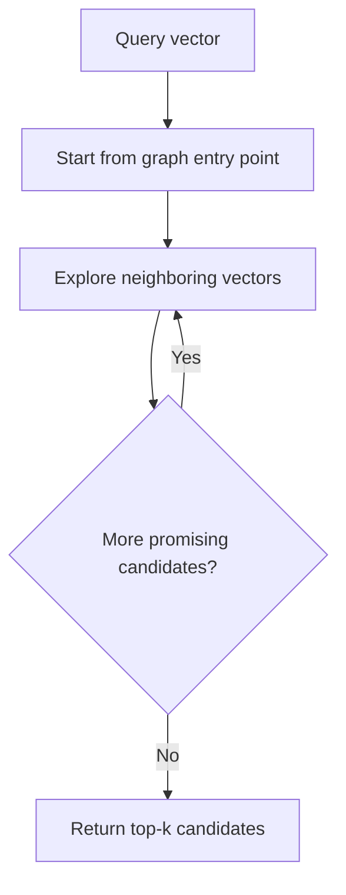
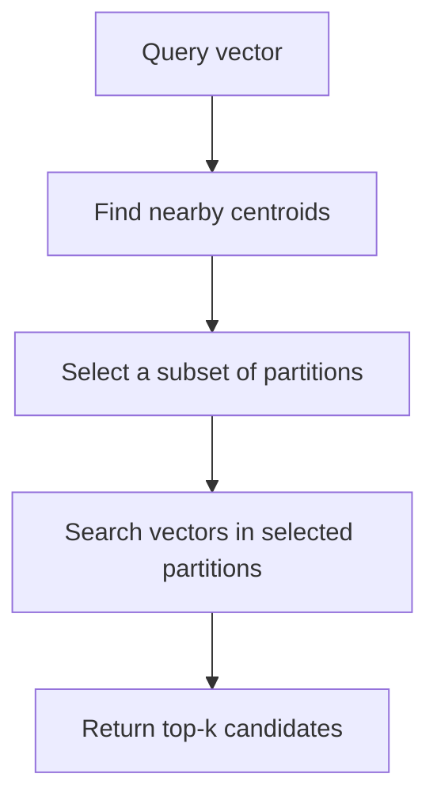

# Chapter 09 — Vector Indexes and Index Trade-offs

## Learning Objectives

By the end of this chapter, you should be able to:

- Compare flat indexes, graph-based indexes such as HNSW, partitioned indexes such as IVF, and compression techniques such as product quantization (PQ).
- Distinguish index construction, optional training, and query-time search configuration.
- Compare memory use, latency, recall, insertion, and deletion behavior.
- Check whether an index supports the required metric, vector dimensions, and persistence behavior.
- Choose an index configuration based on collection size and workload rather than assuming one index is universally best.

 

## 1. What Is a Vector Index?

A vector index is a data structure and search procedure used to find vectors near a query vector. The index can affect which candidates are explored, how much memory is used, how quickly queries run, and whether the system can efficiently add or remove vectors.

An index does not improve the semantic quality of the embedding model by itself. It changes how vectors are stored and searched. Approximate indexes can also miss neighbors that an exhaustive scan would find.

A useful starting point is to keep two questions separate:

1. **Representation quality:** Do the embedding vectors place relevant documents near the query?
2. **Index behavior:** Does the search index retrieve the intended neighbors efficiently and reliably?

Chapter 08 introduced exact search as a reference for evaluating approximate nearest-neighbor (ANN) results. This chapter compares common index families and the trade-offs they introduce.

 

## 2. Flat Indexes: Exhaustive Search

A flat index stores vectors in a straightforward form and evaluates candidates exhaustively for a query. The implementation may use optimized numerical libraries or hardware acceleration, but it does not rely on an ANN structure to skip most vectors.

### Strengths

- Provides an exact reference ranking under the configured metric, subject to numerical precision and tie handling.
- Simple to reason about and useful for validating other indexes.
- Often suitable for small collections or workloads where a scan is fast enough.
- Avoids the index-building complexity of many ANN structures.

 

### Limitations

- Query work grows with the number of eligible vectors.
- High query volume or large collections may make exhaustive scoring too slow or expensive.
- The vectors themselves still consume memory; “flat” does not mean “free.”

For $N$ vectors of dimension $d$, a simple scan performs work proportional to $N d$ per query. Whether this is acceptable depends on hardware, batch size, latency targets, vector dimension, and request volume.

 

## 3. Graph-Based Indexes: HNSW

HNSW stands for **Hierarchical Navigable Small World**. It organizes vectors into a navigable graph. Search starts from an entry point and follows graph connections toward promising candidates instead of scoring every vector.

Conceptually:

The diagram is a simplified intuition, not a specification of every HNSW implementation.

 

### Construction and query controls

HNSW implementations commonly expose parameters with names such as:

- **`M`:** controls graph connectivity, approximately governing how many links are maintained per node. Higher connectivity can increase memory and construction cost.
- **`ef_construction`:** controls construction-time candidate exploration. Higher values often improve graph quality but make index building more expensive.
- **`ef_search`:** controls query-time exploration. Higher values often improve recall at the cost of more query work and latency.

Exact parameter behavior, constraints, defaults, and supported metrics depend on the library. Do not assume identical semantics across products.

 

### Trade-offs

- Often offers low query latency with good recall on suitable workloads.
- Usually requires additional memory for graph connections.
- Index construction can be more expensive than building a flat index.
- Insertions may be supported, but update and deletion semantics vary by implementation.
- Search quality depends on graph parameters, vector distribution, and query effort.

HNSW is not automatically the best choice for every collection. Its memory footprint or update behavior may be a poor fit for some workloads.

 

## 4. Partitioned Indexes: IVF

IVF stands for **Inverted File**. In a common vector-search design, vectors are assigned to partitions or clusters represented by centroids. At query time, the system identifies promising partitions and searches vectors within them rather than scanning the entire collection.

### Conceptual flow

 

### Construction and query controls

An IVF index commonly requires a training or clustering stage to determine centroids. This is different from simply inserting each vector into a flat list.

A common query-time parameter is:

- **`nprobe`:** the number of partitions to inspect. Searching more partitions often improves recall but increases query work.

A common construction choice is:

- **Number of partitions / centroids:** affects how vectors are distributed across partitions. Too few partitions can make each search expensive; too many can make partition selection and data distribution less effective.

Names and exact behavior vary by implementation. Some systems combine IVF with compression, such as IVF-PQ.

 

### Trade-offs

- Can reduce the number of vectors evaluated per query.
- May offer useful control over the recall-versus-latency trade-off.
- Commonly requires training data or a clustering step.
- Search can miss neighbors in partitions that are not probed.
- Poor clustering or an unsuitable partition count can reduce recall or increase work.
- Updates and deletion behavior depend on the implementation and index variant.

IVF can be attractive when its partitioning and query controls match the data distribution and workload. It must be measured against an exact baseline.

 

## 5. Compression: Product Quantization (PQ)

Product quantization is a vector-compression technique. It divides a vector into subvectors and represents each subvector using a code from a learned codebook. Instead of storing every original floating-point component in full precision, the index stores compact codes and may use approximate distance calculations.

PQ is not simply another graph structure or partitioning strategy. It is a compression approach that can be combined with other index designs, including IVF-based systems.

 

### Why use compression?

- Reduce memory needed for vector representations.
- Make larger collections fit within a resource budget.
- Potentially improve search efficiency by reducing memory traffic.

 

### Trade-offs

- Approximate representations can distort distances and change rankings.
- Codebooks generally need to be trained.
- Training data and configuration can affect compression quality.
- Some workflows retain original vectors separately for reranking or other purposes, which changes total memory use.
- Encoding, decoding, and distance calculations depend on the implementation.

Compression is useful when memory is a meaningful constraint, but the resulting retrieval quality must be measured. A smaller index is not automatically a better index.

 

## 6. Compare the Main Index Families

| Approach | Core idea | Construction / training | Main strengths | Main trade-offs |
|---|---|---|---|---|
| Flat / exhaustive | Score all eligible vectors | Usually simple; no ANN structure required | Exact reference, simple behavior | Query work grows with collection size |
| HNSW | Navigate a graph of vector neighbors | Graph construction; construction parameters affect quality and cost | Often low latency with strong recall | Extra graph memory; build and update behavior vary |
| IVF | Partition vectors and probe selected partitions | Usually trains or computes centroids | Search a subset of the collection | Recall depends on partitioning and query probes |
| PQ compression | Store compact codes for subvectors | Learns codebooks | Reduces vector-storage footprint | Approximation can distort distances; training and tuning needed |

These are broad design patterns. Real systems may combine methods—for example, IVF with PQ—or add filtering, quantization, caching, reranking, and hardware-specific optimizations.

 

## 7. Construction-Time vs. Query-Time Parameters

Do not mix up settings that determine the index structure with settings that control an individual query.

| Parameter category | Examples | Typical effect |
|---|---|---|
| Construction-time | HNSW connectivity, graph build effort, IVF partition count, PQ codebook design | Influences index structure, build time, memory, and potential search quality |
| Training-time | IVF centroids, PQ codebooks | Learns or estimates structures from representative vectors |
| Query-time | HNSW search effort, IVF partition probes, requested top-\(k\) | Influences query work, latency, and retrieved-neighbor recall |
| Storage/runtime | Precision, compression mode, persistence settings | Influences memory, storage, numerical behavior, and operational constraints |

Exact names and capabilities vary. Record the actual library, version, parameter values, and defaults used in your experiment.

 

## 8. Operational Trade-offs: Memory, Latency, Recall, Updates

An index should be evaluated as part of a workload, not as an isolated algorithm.

### Memory

Account for more than vector payloads. Total usage may include:

- Original vectors or compressed codes.
- Graph links or partition metadata.
- Centroids and codebooks.
- Document IDs and metadata.
- Temporary memory during construction or updates.
- Replicas, caches, and storage-engine overhead.

 

### Latency and throughput

Measure query latency at the intended concurrency and query volume. A configuration that performs well for one query at a time may behave differently under load. Record at least median and p95 latency where possible.

 

### Recall

Compare ANN results against exact top-\(k\) neighbors under the same metric, vector set, and filters. This measures index fidelity, not human relevance. Also evaluate relevance against labeled queries.

 

### Insertion and deletion

Different indexes have different update characteristics:

- Some support incremental insertion.
- Some require rebuilding or periodic compaction for particular changes.
- Some represent deletion as a logical tombstone before reclaiming storage.
- Some have restrictions on updating vector dimensions or changing index configuration.
- Some need retraining or rebuilding when the distribution of incoming vectors changes significantly.

Do not infer update guarantees from the index family name. Check the exact implementation's documentation and test the operations your application requires.

 

## 9. Check Metric, Dimensions, and Persistence Support

Before choosing an index, verify the specific implementation supports the complete configuration you need.

### Metric compatibility

Confirm support for the required metric, such as cosine similarity, inner product/dot product, or L2 distance. Also verify how the backend interprets and returns scores. Some systems implement cosine search through normalization and another metric internally.

 

### Vector dimensions

Check:

- The index's required vector dimension.
- Whether the dimension is fixed after creation.
- Whether the embedding model's output dimension matches.
- Whether any dimension-reduction or truncation step is explicitly supported and validated.

A query vector with the wrong dimension should be rejected or handled explicitly—not silently compared with incompatible vectors.

 

### Persistence and lifecycle

Confirm whether the index:

- Persists across process or service restarts.
- Requires explicit save/load calls or uses managed storage.
- Supports snapshots, backups, and recovery.
- Persists metadata and IDs together with vectors.
- Supports the required insertion, replacement, and deletion operations.
- Requires rebuilding after a configuration change.

A library that keeps an index only in process memory may be suitable for an experiment but insufficient for an application that requires durable storage.

 

## 10. A Practical Index Selection Process

Use a measured decision process:

1. **Define the workload.** Record collection size, vector dimension, query rate, concurrency, latency target, update frequency, deletion needs, and memory budget.
2. **Build an exact baseline.** Use exhaustive scoring on a manageable sample or the full collection if feasible.
3. **Choose plausible candidates.** Consider flat search, HNSW, IVF, or a compressed variant based on constraints.
4. **Verify support.** Confirm metric, dimensions, persistence, filtering, and lifecycle operations in the chosen library.
5. **Tune one factor at a time.** Record construction and query parameters.
6. **Measure index fidelity.** Calculate ANN Recall@K against exact results.
7. **Measure relevance separately.** Use representative queries and human relevance labels.
8. **Measure operations.** Record build time, insertion/deletion behavior, memory/index size, median latency, and p95 latency.
9. **Choose based on constraints.** Select a configuration that meets quality and operational targets, not simply the one with the highest recall or lowest latency in isolation.
10. **Document limitations.** State the workload and configuration for which the recommendation applies.

 

## 11. Index Comparison Template

Fill this table using measurements from your own corpus and implementation. Avoid presenting illustrative values as universal performance facts.

| Candidate | Metric / dimensions supported? | Build or training time | ANN Recall@K | Median / p95 latency | Memory / index size | Insert / delete behavior | Persistence |
|---|---|---:|---:|---:|---:|---|---|
| Flat | Verify | Measure | Exact reference | Measure | Measure | Verify | Verify |
| HNSW | Verify | Measure | Measure | Measure | Measure | Verify | Verify |
| IVF | Verify | Measure | Measure | Measure | Measure | Verify | Verify |
| IVF + PQ or other compressed variant | Verify | Measure | Measure | Measure | Measure | Verify | Verify |

For each row, record the implementation and version, metric, dimension, parameters, dataset size, hardware, and query set. Measurements are only comparable when the test conditions are controlled.

 

## 12. Practice

### Exercise A — Compare index designs

Create a comparison table for flat search, HNSW, IVF, and one compressed configuration supported by your selected library. Include construction requirements, memory, latency, recall, updates, and persistence.

 

### Exercise B — Run an ANN configuration

If your chosen library supports ANN indexing:

1. Build an exact reference on a small, fixed vector set.
2. Build one approximate index.
3. Run the same queries against both using the same metric and filters.
4. Calculate ANN Recall@K.
5. Record build time, query latency, and memory or index size if available.
6. Explain which trade-off the approximate index introduces.

If ANN support is unavailable in your current environment, document the supported alternatives and use a small manual comparison table rather than inventing measurements.

 

### Exercise C — Explain a recommendation

Choose an index for each hypothetical workload:

- **Workload A:** a few thousand vectors, strict need for exact top-\(k\), low query volume.
- **Workload B:** a very large collection, tight query-latency target, enough memory for an additional graph structure.
- **Workload C:** a large collection where vector memory is the dominant constraint and some approximation is acceptable.

For each, state a candidate index family, what you would measure, and which assumptions could change the choice. These are starting hypotheses, not universal answers.

 

### Exercise D — Lifecycle verification

Using the documentation for your chosen implementation, verify:

- How to insert a vector.
- How to replace an existing vector by ID.
- How to delete a vector.
- Whether deleted data remains in the index temporarily.
- How to save, reload, or otherwise persist the index.
- What happens when the configured metric or dimension changes.

 

## 13. Common Mistakes

- **Claiming HNSW, IVF, or PQ is always best:** each has workload-dependent trade-offs.
- **Treating PQ as only an index structure:** it is a compression technique that can be combined with index designs.
- **Confusing build and query parameters:** they affect different parts of the system.
- **Ignoring exact-search comparison:** without a reference, ANN recall is difficult to measure.
- **Using ANN recall as a relevance metric:** agreement with exact neighbors does not establish human relevance.
- **Ignoring updates and deletions:** an index that is fast for static data may not meet lifecycle requirements.
- **Assuming persistence:** in-memory and durable index behavior differ by implementation.
- **Comparing results under different conditions:** metrics, dimensions, filters, hardware, and corpus versions must be recorded.

 

## 14. References and Optional Extensions

- Consult the official documentation for the exact index library and version you use; parameter names, supported metrics, persistence, and update behavior differ.
- Optional extension: plot ANN Recall@K against median and p95 latency for several query-effort settings, and report memory/index size alongside the results.

 

## Checkpoint

You should be able to explain:

- How flat search differs from graph-based HNSW and partitioned IVF.
- Why product quantization is a compression technique and may be combined with other index designs.
- Which choices are made during construction or training and which are query-time settings.
- How memory, latency, recall, insertion, deletion, and persistence affect index selection.
- How to verify metric, dimension, and storage support in a particular implementation.
- Why index choice depends on collection size and workload.
- How to document measured trade-offs without making universal claims about the best index.
