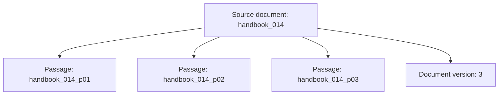
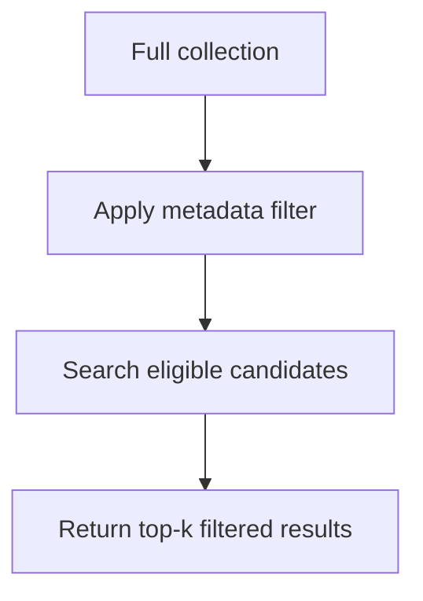
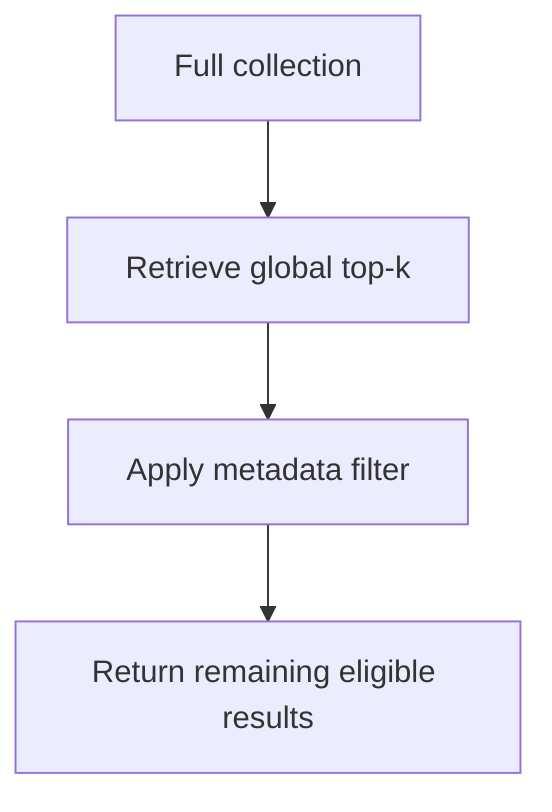

# Chapter 10 — Metadata Design and Filtering

## Learning Objectives

By the end of this chapter, you should be able to:

- Design metadata fields for sources, passages, ownership, language, timestamps, and document versions.
- Validate metadata types and define how missing fields are handled.
- Apply metadata filters to restrict retrieval candidates according to application requirements.
- Explain prefiltering and postfiltering and how each can affect result count and relevance.
- Recognize that selective-filter behavior depends on the vector database and index implementation.
- Return enough source metadata to inspect and trace retrieved results.

<br/>

## 1. Why Metadata Matters in Semantic Search

An embedding represents content as a vector, but a retrieval system usually needs more than a vector and a text string. It also needs metadata to identify the source, distinguish passages, filter candidates, and help application code understand where a result came from.

For example, a passage might contain the text:

> To reset your password, open Account Settings and select Recovery.

Its metadata might include:

```json
{
  "source_id": "handbook_014",
  "passage_id": "handbook_014_p03",
  "category": "account",
  "language": "en",
  "published_at": "2026-04-10T00:00:00Z",
  "document_version": 3
}
```

The vector helps retrieve semantically similar content. Metadata helps answer questions such as:

- Is this passage from an allowed source?
- Is it in the requested language?
- Was it published within the requested date range?
- Does it belong to the right category?
- Which original document and version should be inspected?

Metadata is part of the retrieval data model. Poor metadata design can make filtering, debugging, evaluation, and lifecycle management unreliable.

<br/>

## 2. Core Metadata Fields

The exact schema depends on the application, but the following fields are common.

| Field | Example | Purpose |
|---|---|---|
| `source_id` | `handbook_014` | Identifies the original document or source |
| `passage_id` | `handbook_014_p03` | Identifies one indexed passage or chunk |
| `owner_id` | `team_support` | Associates a record with an owner or scope |
| `language` | `en` | Supports language-specific filtering |
| `category` | `account` | Groups content by topic or application category |
| `published_at` | `2026-04-10T00:00:00Z` | Supports date-based filtering |
| `document_version` | `3` | Distinguishes revisions of the same source |
| `source_uri` | `https://example.org/handbook/014` | Helps locate the original source, when appropriate |
| `title` | `Account Recovery Guide` | Makes results easier to inspect |
| `tenant_id` | `tenant_demo` | Identifies the tenant or data partition in multi-tenant applications |

Use stable IDs rather than deriving identity from mutable text. If a document changes, its `source_id` may remain stable while `document_version` changes. Each indexed passage should have a stable, unique `passage_id` within the intended ID namespace.

**Important:** Ownership and tenant metadata can affect access control. A metadata field is not a security boundary by itself. Authorization must be enforced by trusted application logic and the storage/retrieval design. Access-control-aware retrieval is covered separately in the course.

<br/>

## 3. Source IDs, Passage IDs, and Versions

A source document may be split into multiple passages. Each passage should retain a link to its parent source.



This relationship supports:

- Finding the original document from a retrieved passage.
- Grouping several passages from the same source.
- Replacing or deleting passages when a document changes.
- Investigating whether a result came from an outdated version.
- Reporting source titles and links alongside retrieval results.

A useful schema separates source identity from passage identity. Do not use a source ID as the unique ID for every passage if one source can produce multiple indexed records.

<br/>

### Versioning choices

When a source changes, the application needs a consistent policy. Examples include:

- Replace existing passages in place while retaining stable passage IDs where appropriate.
- Create new passage IDs for a new version and retire old records.
- Keep multiple versions indexed when historical search is required.

Whichever policy is chosen, avoid accidentally returning duplicate or obsolete versions as if they were current. Version behavior should be explicit and tested.

<br/>

## 4. Metadata Types and Validation

Metadata fields should have defined types and allowed values. For example:

- IDs: strings with a documented format.
- `language`: a controlled language code such as `en` or `fr`.
- `category`: a value from a known set where practical.
- `published_at`: a consistently formatted timestamp or native datetime type supported by the backend.
- `document_version`: an integer or another clearly defined version representation.
- `owner_id` and `tenant_id`: stable identifiers, not display names that may change.

<br/>

### Example schema with Pydantic

The following example validates metadata before indexing. It is illustrative and uses Pydantic v2-style model configuration.

```python
from datetime import datetime, timezone
from pydantic import BaseModel, ConfigDict, Field, field_validator

class PassageMetadata(BaseModel):
    model_config = ConfigDict(extra="forbid")

    source_id: str = Field(min_length=1)
    passage_id: str = Field(min_length=1)
    owner_id: str = Field(min_length=1)
    language: str = Field(min_length=2, max_length=10)
    category: str = Field(min_length=1)
    published_at: datetime
    document_version: int = Field(ge=1)
    title: str = Field(min_length=1)

    @field_validator("published_at")
    @classmethod
    def require_timezone(cls, value: datetime) -> datetime:
        if value.tzinfo is None or value.utcoffset() is None:
            raise ValueError("published_at must include a timezone")
        return value.astimezone(timezone.utc)

metadata = PassageMetadata(
    source_id="handbook_014",
    passage_id="handbook_014_p03",
    owner_id="team_support",
    language="en",
    category="account",
    published_at="2026-04-10T00:00:00Z",
    document_version=3,
    title="Account Recovery Guide",
)

print(metadata.model_dump())
```

Validation at the application boundary helps catch missing fields, wrong types, and malformed timestamps before they enter the index. A schema does not guarantee that every backend stores or filters every field in the same way; confirm the database's metadata capabilities.

<br/>

### Missing-field behavior

Define how missing values are handled. For example:

- Reject records missing required identity fields.
- Assign a documented default only when the default is semantically correct.
- Represent genuinely optional fields as nullable or absent according to the backend's conventions.
- Decide whether records with missing `language` or `published_at` should be eligible for filters that require those fields.

Do not silently treat missing metadata as a valid value. A filter for `language = "en"` should not accidentally include records whose language is unknown unless that behavior is explicitly intended.

<br/>

## 5. Metadata Filtering

A metadata filter restricts which records are eligible for retrieval based on structured fields.

Examples:

- `language == "en"`
- `category == "account"`
- `published_at >= 2026-01-01`
- `document_version == 3`

A query might be:

> How can I recover my account?

with filters requiring English-language passages in the `account` category published since a chosen date.

The vector similarity metric still ranks eligible candidates. The filter determines the candidate population to which retrieval is applied. Exact filter syntax differs by database or library, so treat the examples above as logical conditions rather than a universal API.

<br/>

### Synthetic corpus example

```python
records = [
    {
        "passage_id": "p001",
        "source_id": "s001",
        "text": "Reset a forgotten password from account recovery.",
        "language": "en",
        "category": "account",
        "published_at": "2026-04-10",
    },
    {
        "passage_id": "p002",
        "source_id": "s002",
        "text": "Réinitialisez votre mot de passe depuis votre compte.",
        "language": "fr",
        "category": "account",
        "published_at": "2026-03-05",
    },
    {
        "passage_id": "p003",
        "source_id": "s003",
        "text": "Review the latest billing invoice.",
        "language": "en",
        "category": "billing",
        "published_at": "2026-05-12",
    },
    {
        "passage_id": "p004",
        "source_id": "s004",
        "text": "Manage account recovery and security settings.",
        "language": "en",
        "category": "account",
        "published_at": "2025-11-20",
    },
]
```

The metadata allows the application to define candidate rules independently of the text embedding.

<br/>

## 6. Prefiltering vs. Postfiltering

Filtering order can affect how many results are returned and which relevant results survive.

### 6.1 Prefiltering

Prefiltering applies the metadata condition to determine eligible candidates before or during nearest-neighbor search.

Conceptually:



Potential advantages:

- The top-$k$ results are selected from eligible records.
- It can avoid spending result slots on records that do not satisfy the filter.
- It may be necessary when candidate eligibility must be enforced before retrieval.

Implementation detail matters: some indexes can apply filters efficiently during search; others may use different internal strategies or experience performance costs for highly selective filters.

<br/>

### 6.2 Postfiltering

Postfiltering first retrieves top-$k$ candidates from the full collection and then removes candidates that fail the filter.



This can return fewer than $k$ results, even when more than $k$ eligible records exist in the full collection.

Example: global top-5 results contain four French passages and one English passage. If the filter keeps English only, postfiltering returns one result. The corpus might contain many other English passages that were ranked just below the global top five, but they were never considered after the first selection.

This is the key limitation: **postfiltering can reduce the result count and omit eligible candidates that would have ranked highly within the filtered subset.**

<br/>

### 6.3 Filtered search is implementation-dependent

Some vector databases support prefiltering directly; some combine filtering with ANN traversal; some support only certain filter operators or data types. A database may adapt its strategy based on filter selectivity or index design.

Do not assume that the words “prefilter” and “postfilter” imply identical implementation behavior across systems. Check the selected backend's documentation and test the exact filter patterns and collection sizes that matter to your application.

<br/>

## 7. Filter Selectivity and Result Count

**Filter selectivity** describes how much of the collection remains eligible after applying a filter.

- A broad filter keeps most records.
- A selective filter keeps a small fraction of records.

Highly selective filters can change performance and recall behavior. For example, a filter that keeps only one language, a narrow date range, and one category may leave very few eligible records. An ANN index may need implementation-specific handling to find enough eligible neighbors efficiently.

Always distinguish:

- The requested result count, \(k\).
- The number of eligible records in the corpus.
- The number of eligible records returned by the index.
- The number of returned records that are actually relevant.

If only three eligible records exist, a request for top-10 cannot return ten unique eligible records. If 100 eligible records exist but postfiltering returns only two, the filtering order or index implementation may be limiting the result set.

<br/>

## 8. A Small Filtering Exercise in Python

This example demonstrates the *logic* of metadata filtering on a synthetic corpus. It does not implement vector search or a specific vector database API.

```python
from datetime import date

records = [
    {
        "passage_id": "p001",
        "text": "Reset a forgotten password from account recovery.",
        "language": "en",
        "category": "account",
        "published_at": date(2026, 4, 10),
    },
    {
        "passage_id": "p002",
        "text": "Réinitialisez votre mot de passe depuis votre compte.",
        "language": "fr",
        "category": "account",
        "published_at": date(2026, 3, 5),
    },
    {
        "passage_id": "p003",
        "text": "Review the latest billing invoice.",
        "language": "en",
        "category": "billing",
        "published_at": date(2026, 5, 12),
    },
    {
        "passage_id": "p004",
        "text": "Manage account recovery and security settings.",
        "language": "en",
        "category": "account",
        "published_at": date(2025, 11, 20),
    },
]

def matches_filter(record):
    return (
        record.get("language") == "en"
        and record.get("category") == "account"
        and record.get("published_at") >= date(2026, 1, 1)
    )

eligible = [record for record in records if matches_filter(record)]

for record in eligible:
    print(record["passage_id"], record["text"])
```

Expected result: only `p001` meets all three conditions. `p002` has the wrong language, `p003` has the wrong category, and `p004` is older than the date boundary.

The example assumes `published_at` is present and already parsed as a `date`. A production implementation must define behavior for missing or malformed values and should validate metadata before indexing.

<br/>

## 9. Return Metadata Needed to Inspect Results

A search result should usually include more than a score and text snippet. Return the fields needed to identify and inspect the result, subject to application permissions.

A useful result shape might be:

```json
{
  "passage_id": "p001",
  "source_id": "s001",
  "title": "Account Recovery Guide",
  "text": "Reset a forgotten password from account recovery.",
  "language": "en",
  "category": "account",
  "published_at": "2026-04-10",
  "document_version": 3,
  "score": 0.82
}
```

The score above is illustrative, not a relevance probability. Its meaning depends on the metric and backend.

Useful metadata supports:

- Tracing a passage to its original source.
- Reviewing why a result appeared.
- Detecting outdated versions or duplicates.
- Comparing dense and lexical retrieval by shared IDs.
- Debugging filters and result-count problems.
- Evaluating retrieval quality by category, language, or date range.

Return only the metadata the application needs. Sensitive ownership or tenant fields should not be exposed to unauthorized clients.

<br/>

## 10. Practice

### Exercise A — Apply language, date, and category filters

Use the synthetic corpus in Section 5. Search for passages matching all of these conditions:

- `language == "en"`
- `category == "account"`
- `published_at >= 2026-01-01`

Record the eligible passage IDs and explain why each excluded record failed.

<br/>

### Exercise B — Predict prefiltering and postfiltering

Suppose a global top-5 search returns:

| Global rank | Passage | Language | Category |
|---:|---|---|---|
| 1 | `p10` | fr | account |
| 2 | `p11` | fr | account |
| 3 | `p12` | en | billing |
| 4 | `p13` | fr | billing |
| 5 | `p14` | en | account |

The query requires `language == "en"` and `category == "account"`.

1. How many results remain after postfiltering the global top-5?
2. Could prefiltered search return more eligible results?
3. What would you need to know about the collection and index to interpret the result?

<br/>

### Exercise C — Metadata validation

Design a schema for a document collection with source IDs, passage IDs, language, category, timestamps, and versions. State:

- Which fields are required.
- Which fields can be missing.
- How timestamps are normalized.
- How invalid categories and versions are rejected.
- What happens when a query filters on a missing field.

<br/>

### Exercise D — Compare retrieval implementations

On the same synthetic corpus, compare prefiltering and postfiltering for several filters of different selectivity. Record result count, relevance, latency, and any backend restrictions. Do not assume the two methods behave identically across all vector stores.

<br/>

## 11. Common Mistakes

- **Using non-unique passage IDs:** results can overwrite each other or become difficult to trace.
- **Failing to preserve source IDs:** makes debugging and source inspection harder.
- **Using inconsistent timestamp formats:** can cause incorrect date filtering or backend errors.
- **Leaving missing-field behavior undefined:** results become unpredictable across records.
- **Assuming metadata filters are automatically secure:** authorization must be enforced by trusted application logic.
- **Postfiltering a small global top-$k$ and expecting$(k$ filtered results:** ineligible records may consume result slots.
- **Assuming every vector index supports every filter efficiently:** filter operators and index behavior vary by backend.
- **Returning too little metadata:** makes retrieval errors, stale versions, and source identity difficult to inspect.
- **Returning sensitive metadata indiscriminately:** only expose fields appropriate for the caller.

<br/>

## 12. References and Optional Extensions

- Review the selected vector database's documentation for metadata types, filter operators, prefilter/postfilter behavior, and supported index combinations.
- Optional extension: measure result count and latency for broad and selective filters, then compare filtered retrieval quality with a relevance-labeled query set.

<br/>

## Checkpoint

You should be able to explain:

- Why source IDs and passage IDs serve different purposes.
- How ownership, language, timestamps, categories, and versions support retrieval.
- Why metadata types and missing-field behavior need explicit validation.
- How prefiltering differs from postfiltering.
- Why postfiltering after top-$k$ selection may return too few eligible results.
- How filter selectivity and backend implementation affect search behavior.
- Why search results should include enough safe source metadata to inspect and trace retrieved passages.
