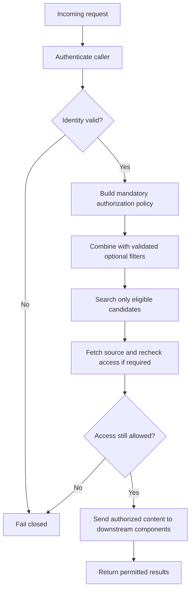

# Chapter 11 — Access-Control-Aware Retrieval

## Learning Objectives

By the end of this chapter, you should be able to:

- Derive user identity and permissions from authenticated application state.
- Enforce tenant, owner, and document-level access restrictions on the server.
- Prevent user-supplied filters from weakening mandatory authorization predicates.
- Avoid returning, logging, or passing unauthorized text and metadata to downstream components.
- Recheck access when fetching source documents and handle permission changes.
- Fail closed when authorization data is missing or invalid.
- Distinguish relevance filtering from security enforcement.

<br/>

## 1. Why Retrieval Needs Access Control

A semantic-search system may contain documents belonging to different users, teams, or tenants. A vector index can retrieve a document because its embedding is similar to a query, but similarity does not establish that the caller is allowed to see it.

Suppose a knowledge base contains:

- A shared password-reset guide available to all employees.
- A private HR document available only to the HR team.
- A tenant-specific support manual available only to one customer organization.

A query such as “How do I update my account?” could be semantically close to all three documents. The retrieval system must enforce authorization before unauthorized content can reach the user or another component.

**Core principle:** relevance determines which eligible documents are useful; authorization determines which documents the caller is allowed to access. Authorization is a security requirement, not a ranking preference.

<br/>

## 2. Identity Must Come from Authenticated Application State

The server should derive the caller's identity from a trusted authentication mechanism, such as a validated session or verified access token. It should not trust a request body, query string, or prompt that simply claims an identity.

Unsafe pattern:

```python
# UNSAFE: the caller controls the claimed identity.
user_id = request.json["user_id"]
tenant_id = request.json["tenant_id"]
```

Safer conceptual pattern:

```python
# Pseudocode: exact APIs depend on the web framework and identity provider.
principal = authenticate_request(request)

if principal is None or not principal.is_valid:
    return unauthorized_response()

user_id = principal.subject_id
tenant_id = principal.tenant_id
permissions = principal.permissions
```

The example is framework-neutral pseudocode, not a drop-in implementation. In a real application, use the authentication framework's verified principal and validate issuer, audience, expiry, signature, and other required claims according to the identity system.

The client may request a search scope, such as a category or date range, but it must not be allowed to invent its own trusted identity or permission set.

<br/>

## 3. Model Access Policy Explicitly

A retrieval record should have enough metadata to support the application's authorization policy. Depending on the use case, fields might include:

- `tenant_id`: the organization or tenant that owns the record.
- `owner_id`: the user or service that owns the record.
- `visibility`: for example, `shared`, `team`, or `private`.
- `allowed_principals`: user, group, or role identifiers allowed to access it.
- `document_id` and `passage_id`: stable identifiers for tracing records to source documents.
- `policy_version` or equivalent metadata, if the application needs to track policy changes.

These fields are examples, not a universal schema. Store only what the authorization model requires, and define the semantics of each field precisely.

A conceptual policy might say:

1. The record must belong to the caller's tenant.
2. The record is shared with the caller, belongs to the caller, or grants access to one of the caller's authorized groups.
3. Any additional document-level restrictions must also pass.

Do not assume that matching `tenant_id` alone grants access to every document in a tenant. The correct policy depends on the application's access model.

<br/>

## 4. Enforce Mandatory Predicates Server-Side

The server must construct mandatory authorization conditions from trusted identity and policy data. User-supplied filters may narrow the eligible set, but must never remove or override the authorization conditions.

Conceptually, if:

* $A(u,d)$ means user $u$ is authorized to access document $d$.
* $F(d)$ means the document matches the user's optional search filters.
* $R(q,d)$ means document $d$ is relevant to query $q$.

Then retrieval should rank documents satisfying both authorization and the optional filter:

$$ \operatorname{Candidates}(u,q)= \{d \mid A(u,d)\land F(d)\} $$

The ranking stage then orders those eligible candidates according to the retrieval method. Authorization is not something to apply only after returning the top results to the caller.

<br/>

### Unsafe filter composition

```python
# UNSAFE pseudocode: client filters replace the security filter.
filters = request.json.get("filters", {})
results = vector_store.search(query_vector, filters=filters)
```

If the caller can submit a filter that omits or changes the tenant restriction, the application may expose records from another tenant.

<br/>

### Safer conceptual composition

```python
# Pseudocode: use a trusted principal and combine mandatory and optional filters.
principal = authenticate_request(request)
if principal is None or not principal.is_valid:
    return unauthorized_response()

authorization_filter = build_authorization_filter(principal)
user_filter = validate_and_translate_allowed_filters(
    request.json.get("filters", {})
)

effective_filter = combine_with_AND(
    authorization_filter,
    user_filter,
)

results = vector_store.search(
    query_vector=embed_query(request.json["query"]),
    filter=effective_filter,
)
```

This is illustrative pseudocode. The actual filter syntax and guarantee depend on the vector store. Verify that the backend applies the effective filter during candidate selection or otherwise prevents unauthorized candidates from being exposed. Do not rely on the client to preserve mandatory predicates.

<br/>

## 5. Filter Composition Must Not Permit Bypass

Suppose the mandatory policy is:

`tenant_id == "tenant_A"`

The caller asks for:

`category == "billing"`

The effective condition should be logically equivalent to:

`tenant_id == "tenant_A" AND category == "billing"`

It must not become:

`tenant_id == "tenant_A" OR category == "billing"`

The latter could admit billing records from other tenants.

Likewise, a caller should not be able to supply a new `tenant_id`, `owner_id`, or `allowed_principals` value and thereby broaden access. A robust design distinguishes:

- **Mandatory security predicates:** created by trusted server-side code.
- **Optional relevance or product filters:** validated user choices, such as language, category, or date range.
- **Retrieval ranking:** scores eligible records for relevance.

Treat the filter builder as security-sensitive code. Test its logic independently from the vector database.

<br/>

## 6. Relevance Filtering Is Not Security Enforcement

A relevance filter asks whether a record is useful for a query. An authorization check asks whether the caller is permitted to access it.

Examples:

- `category == "account"` is usually a relevance or product filter.
- `published_at >= ...` may be a content-selection filter.
- `tenant_id == caller.tenant_id` may be part of an authorization policy.
- `owner_id == caller.user_id` may be required for private records.

Some metadata fields can participate in both product behavior and authorization, but their purpose must be explicit. A document's high similarity score, a prompt instruction, or a model's refusal behavior does not replace a server-side access check.

<br/>

## 7. Protect Every Downstream Boundary

Unauthorized content must not be returned or passed to downstream components. That includes more than the final user-facing answer.

Check the full data path:



Review each boundary:

- **Search results:** do not return unauthorized passage text or metadata.
- **Source fetch:** recheck authorization when the original document is fetched separately, especially if permissions can change.
- **Rerankers and LLMs:** do not pass unauthorized candidates into prompts or model inputs.
- **Caches:** scope cached results to the relevant identity, tenant, and policy context; avoid cross-user cache reuse that bypasses authorization.
- **Logs and traces:** avoid recording unauthorized content. Restrict access to sensitive logs and prefer safe identifiers or redacted diagnostics.
- **Errors:** do not reveal the existence, title, owner, or content of an inaccessible document through error messages.

The safest approach is to prevent unauthorized records from entering the downstream path, rather than trying to remove them after a model has already seen them.

<br/>

## 8. Recheck Access and Handle Permission Changes

Authorization can change after a vector record is indexed. A user may leave a team, a document may become private, a tenant membership may be revoked, or a document may be deleted.

A robust design defines how quickly such changes must take effect and where the authoritative policy lives.

Possible controls include:

- Update access metadata or index records when policies change.
- Invalidate or scope caches when memberships and permissions change.
- Recheck access at source-document fetch when required by the risk model.
- Reject stale or missing authorization data rather than treating it as permission.
- Keep vector metadata and the authoritative document store consistent enough for the application's security requirements.

A recheck is especially important when retrieval returns a passage ID and the application later fetches the full source from another system. The source fetch must not assume that earlier retrieval authorization remains valid indefinitely.

<br/>

## 9. Fail Closed

**Fail closed** means that if the application cannot establish authorization safely, it does not return protected content.

Examples of conditions that should normally fail closed include:

- Missing or invalid authenticated identity.
- Missing tenant or ownership information required by the policy.
- Malformed authorization filters.
- Unavailable policy service when a fresh policy decision is required.
- Unrecognized permission values.
- An ambiguous state in which the application cannot determine whether access is allowed.

Failing closed may reduce availability temporarily, but returning protected content when authorization cannot be verified is a security failure. The exact error response should avoid disclosing sensitive details.

<br/>

## 10. Synthetic Two-User Practice Scenario

Consider this synthetic collection:

| Document ID | Content | Tenant | Owner | Visibility |
|---|---|---|---|---|
| `d_shared` | General account help | `tenant_A` | `system` | `shared` |
| `d_alice` | Alice's private notes | `tenant_A` | `alice` | `private` |
| `d_bob` | Bob's private notes | `tenant_A` | `bob` | `private` |
| `d_other_tenant` | Another organization's support notes | `tenant_B` | `carol` | `private` |

Assume both Alice and Bob are members of `tenant_A`. The policy grants each user access to shared documents in their tenant and to their own private documents, but not to another user's private documents.

Expected access:

| Caller | `d_shared` | `d_alice` | `d_bob` | `d_other_tenant` |
|---|---|---|---|---|
| Alice | Allow | Allow | Deny | Deny |
| Bob | Allow | Deny | Allow | Deny |

These expectations come from the stated synthetic policy. A real application must define and enforce its own policy.

<br/>

### Exercise: test cross-user access attempts

Test at least these cases:

1. Alice searches for general account help.
2. Alice searches for information contained only in Bob's private notes.
3. Bob searches for information contained only in Alice's private notes.
4. Alice supplies `tenant_id = "tenant_B"` in an optional filter.
5. Bob attempts to request a different `owner_id`.
6. A user has a valid session but missing required tenant authorization data.
7. A document's permission is revoked between retrieval and source fetch.

For each case, inspect not only the final answer but also candidate IDs, returned metadata, source fetches, model inputs, cache behavior, and logs. Unauthorized document text must not leak through any of these paths.

<br/>

## 11. Small Policy Logic Example

The following Python example demonstrates the synthetic policy. It is a simple test fixture, not a replacement for production authentication, policy evaluation, or database-side filtering.

```python
documents = [
    {
        "id": "d_shared",
        "tenant_id": "tenant_A",
        "owner_id": "system",
        "visibility": "shared",
    },
    {
        "id": "d_alice",
        "tenant_id": "tenant_A",
        "owner_id": "alice",
        "visibility": "private",
    },
    {
        "id": "d_bob",
        "tenant_id": "tenant_A",
        "owner_id": "bob",
        "visibility": "private",
    },
    {
        "id": "d_other_tenant",
        "tenant_id": "tenant_B",
        "owner_id": "carol",
        "visibility": "private",
    },
]

def is_authorized(principal, document):
    # Fail closed when required principal claims are absent.
    if not principal.get("user_id") or not principal.get("tenant_id"):
        return False

    if not document.get("tenant_id") or not document.get("visibility"):
        return False

    if document["tenant_id"] != principal["tenant_id"]:
        return False

    if document["visibility"] == "shared":
        return True

    if document["visibility"] == "private":
        return document.get("owner_id") == principal["user_id"]

    # Unknown visibility values are not allowed by this policy.
    return False

alice = {"user_id": "alice", "tenant_id": "tenant_A"}
bob = {"user_id": "bob", "tenant_id": "tenant_A"}

for principal in (alice, bob):
    allowed_ids = [
        doc["id"]
        for doc in documents
        if is_authorized(principal, doc)
    ]
    print(principal["user_id"], allowed_ids)
```

Expected output:

```text
alice ['d_shared', 'd_alice']
bob ['d_shared', 'd_bob']
```

This function illustrates the policy logic. In a real system, the trusted principal must be created by authentication middleware, document permissions may be more complex than a single owner field, and authorization should be enforced before protected content is exposed. Unit tests should cover missing fields, unknown visibility values, cross-tenant records, and permission changes.

<br/>

## 12. Security Test Checklist

Use this checklist when testing a retrieval implementation:

- [ ] Caller identity comes from validated authentication state, not request-supplied identity fields.
- [ ] Mandatory tenant, owner, and document-access predicates are created server-side.
- [ ] Optional filters can narrow candidates but cannot replace or weaken mandatory predicates.
- [ ] Unknown or missing authorization fields fail closed.
- [ ] Unauthorized text and metadata are not returned to the caller.
- [ ] Unauthorized candidates are not passed to rerankers, LLMs, or other downstream components.
- [ ] Source fetches recheck access when required.
- [ ] Cache keys and cache invalidation respect identity and permission scope.
- [ ] Logs and traces do not expose unauthorized content.
- [ ] Cross-user and cross-tenant tests verify expected allow/deny outcomes.
- [ ] Permission revocation and stale index metadata are tested.
- [ ] Errors do not reveal protected document existence or details.

<br/>

## 13. Common Mistakes

- **Trusting a user-supplied `user_id` or `tenant_id`:** callers can claim another identity unless the server derives identity from validated authentication state.
- **Allowing optional filters to replace mandatory predicates:** this can turn a safe query into a cross-tenant query.
- **Applying authorization only after top-\(k\) retrieval:** unauthorized text may already have reached logs or downstream components, and postfiltering can also reduce result count.
- **Relying on the LLM to refuse unauthorized content:** a prompt cannot enforce storage or retrieval permissions.
- **Checking access only once:** permissions can change before the original source is fetched.
- **Ignoring caches and logs:** protected data can leak outside the final response.
- **Treating missing policy data as public access:** uncertainty must not grant permission.
- **Confusing relevance with authorization:** a highly relevant document can still be forbidden to the caller.

<br/>

## 14. References and Optional Extensions

- Review the authentication framework's documentation for validating identities and claims.
- Review the vector database's documentation for server-side filtering and access-control integration; do not assume a metadata filter is itself a complete authorization system.
- Optional extension: write automated allow/deny tests for the synthetic two-user corpus, including filter-tampering and permission-revocation scenarios.

<br/>

## Checkpoint

You should be able to explain:

- Why identity and permissions must come from trusted authenticated application state.
- How the server combines mandatory authorization predicates with optional search filters.
- Why user-supplied filters must not weaken tenant or ownership restrictions.
- Why unauthorized text and metadata must not enter logs, caches, rerankers, or model inputs.
- When a source-document fetch should recheck access.
- What fail-closed behavior means when authorization data is missing or invalid.
- Why an LLM prompt cannot enforce retrieval permissions and why relevance filtering is not a security control.
