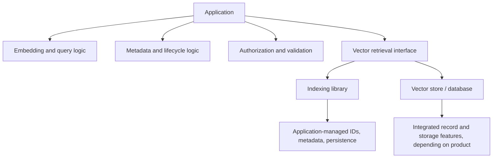

# Chapter 12 — Vector Indexing Libraries and Vector Stores/Databases

## Learning Objectives

By the end of this chapter, you should be able to:

- Distinguish a nearest-neighbor indexing library from a complete persistence and data-management service.
- Use FAISS as an example of a vector indexing library and explain why IDs, metadata, and lifecycle logic may need separate handling.
- Compare Chroma, Pinecone, and Weaviate at the capability level.
- Evaluate persistence, metadata filters, updates, deletion, deployment, authentication, and operational effort.
- Choose one backend for the core semantic-search exercise rather than implementing every product.
- Verify current APIs, licensing, and service behavior before adopting a backend.

> **Version note:** APIs and product capabilities evolve. The code examples below illustrate a small retrieval interface, not a promise that every version or deployment has identical behavior. Before using them in a real project, check the linked official documentation for the exact client/server version, service plan, and license terms.

<br/>

## 1. Indexing Library vs. Vector Store/Database

These terms overlap in casual conversation, but they describe different responsibility boundaries.

### Nearest-neighbor indexing library

An indexing library primarily provides data structures and algorithms for vector similarity search. Depending on the library, it may support exact search, approximate indexes, clustering, compression, and saving/loading index files.

It generally does **not** automatically provide the complete application data layer. Your application may still need to manage:

- Stable document and passage IDs.
- Text and metadata records.
- Mapping from vector positions to source records.
- Durable writes and consistency between vector and metadata storage.
- Updates, deletion, versioning, and recovery procedures.
- Network service, authentication, authorization, backups, monitoring, and deployment.

<br/>

### Vector store or database

A vector store/database typically offers a higher-level interface for storing vectors together with IDs and metadata, querying them, and managing records. Depending on the product and deployment, it may also provide persistence, filtering, CRUD operations, APIs, authentication, and managed operations.

The term “database” does not guarantee every feature in every deployment. Verify specific capabilities and service limits.



The diagram is conceptual: a database may itself use an indexing library internally, and an application can still need substantial metadata, authorization, and lifecycle logic when using a database.

<br/>

## 2. FAISS: A Vector Indexing Library

FAISS (Facebook AI Similarity Search) is a library for efficient similarity search and clustering of dense vectors. It provides several index types and supports different accuracy, memory, and speed trade-offs. Its repository states that FAISS is MIT-licensed. See the [FAISS repository](https://github.com/facebookresearch/faiss) and [license](https://github.com/facebookresearch/faiss/blob/main/LICENSE).

FAISS is useful when you want direct control over vector indexing and are prepared to own more of the surrounding data-management logic.

<br/>

### 2.1 Minimal exact-search example

Install FAISS using the package appropriate for your platform and environment. Package availability can differ by operating system, Python version, and CPU/GPU requirements; follow the official installation instructions.

```python
import numpy as np
import faiss

# Toy vectors: rows are documents, columns are vector dimensions.
vectors = np.array(
    [
        [1.0, 0.0],
        [0.9, 0.1],
        [0.0, 1.0],
    ],
    dtype="float32",
)

# Exact inner-product search over the stored vectors.
index = faiss.IndexFlatIP(vectors.shape[1])
index.add(vectors)

query = np.array([[0.95, 0.05]], dtype="float32")
scores, positions = index.search(query, k=2)

print("Scores:", scores[0].tolist())
print("Vector positions:", positions[0].tolist())
```

`IndexFlatIP` performs exhaustive inner-product search. If cosine similarity is required, normalize nonzero document and query vectors before using inner product, and make sure that this matches the intended retrieval configuration. See the earlier chapter on similarity and distance metrics.

This example returns **positions**, not application-level source IDs. The application must map those positions back to its own records.

<br/>

### 2.2 Keep IDs and metadata separately

A small teaching example can use a sidecar mapping:

```python
records = {
    0: {
        "passage_id": "p001",
        "source_id": "s001",
        "text": "Reset a forgotten password.",
        "category": "account",
    },
    1: {
        "passage_id": "p002",
        "source_id": "s002",
        "text": "Resolve a billing dispute.",
        "category": "billing",
    },
    2: {
        "passage_id": "p003",
        "source_id": "s003",
        "text": "Manage account security.",
        "category": "account",
    },
}
```

If vectors are inserted, deleted, reordered, or rebuilt, a simple positional mapping can become unsafe unless it is maintained consistently. For a more robust design, use stable IDs and an explicit mapping/index structure, such as a suitable FAISS ID-mapping index, together with a durable metadata store.

Do not assume that saving a FAISS index file automatically saves the original text, metadata, authorization policy, or every application-level mapping. Save and restore all required components as one versioned dataset, and test that they remain consistent.

<br/>

### 2.3 Responsibilities you still own with FAISS

Typically, your application or supporting infrastructure must define how to:

- Store source text and metadata.
- Resolve vector IDs to passage IDs and source documents.
- Apply structured metadata filters.
- Enforce authorization before protected data is returned.
- Update or delete records across vector and metadata storage.
- Persist, back up, restore, and version index files and sidecar data.
- Run the retrieval service and secure its network/API boundary.

Exact responsibilities depend on the architecture you build around FAISS.

<br/>

## 3. Chroma: A Higher-Level Retrieval Store

Chroma provides storage for embeddings, documents, metadata, and IDs, plus similarity search and metadata filtering. Its official documentation describes local/self-hosted and hosted options, including Chroma Cloud. The Chroma repository identifies the project as Apache 2.0 licensed. Check the [Chroma documentation](https://docs.trychroma.com/), [repository](https://github.com/chroma-core/chroma), and [license](https://github.com/chroma-core/chroma/blob/main/LICENSE).

Chroma is often convenient for learning and small application prototypes because a local persistent client can store a collection without requiring you to build a separate metadata store first.

<br/>

### 3.1 Example: local persistent collection with explicit embeddings

This example uses a local Chroma persistent client and provides embeddings explicitly, so the retrieval flow does not depend on an automatically selected embedding function. Check the current Chroma API before running it, and use a real embedding model for meaningful semantic search.

```bash
pip install chromadb
```

```python
import chromadb

client = chromadb.PersistentClient(path="./chroma_data")

collection = client.get_or_create_collection(
    name="support_passages",
    # The distance space is an index configuration choice.
    # Ensure it matches the intended embedding/metric setup.
    metadata={"hnsw:space": "cosine"},
)

# Illustrative vectors only; replace them with embeddings from your model.
collection.upsert(
    ids=["p001", "p002", "p003"],
    documents=[
        "Reset a forgotten password.",
        "Resolve a billing dispute.",
        "Manage account security.",
    ],
    metadatas=[
        {"source_id": "s001", "category": "account", "language": "en"},
        {"source_id": "s002", "category": "billing", "language": "en"},
        {"source_id": "s003", "category": "account", "language": "en"},
    ],
    embeddings=[
        [0.90, 0.10],
        [0.05, 0.95],
        [0.80, 0.20],
    ],
)

results = collection.query(
    query_embeddings=[[0.88, 0.12]],
    n_results=2,
    where={"category": "account"},
    include=["documents", "metadatas", "distances"],
)

print(results)
```

This toy example demonstrates record storage, metadata filtering, and query structure. The vectors are hand-authored and are **not** meaningful semantic embeddings. For a real experiment, use the same trained embedding model, query/document encoding, dimensions, and metric configuration as your dense baseline.

Chroma's API includes record operations such as add/upsert, query/get, update, and delete. Metadata filter syntax and missing-field behavior are documented by Chroma and should be checked against the version you deploy. See its [usage guide](https://docs.trychroma.com/).

<br/>

## 4. Pinecone: Managed Vector Database Service

Pinecone offers managed vector indexing and retrieval, with API-based data operations and deployment options. Its current documentation describes metadata filtering, namespaces, upsert, update, delete, and authentication with API keys. The Python SDK documentation also distinguishes existing vector APIs from newer schema-based document APIs, so examples from different generations should not be mixed without checking the index type and SDK version.

Official resources:
- [Pinecone documentation](https://docs.pinecone.io/)
- [Upserting and querying vectors](https://github.com/pinecone-io/python-sdk/blob/main/docs/how-to/vectors/upsert-and-query.md)
- [Production checklist](https://docs.pinecone.io/guides/operations/moving-to-production)
- [Pinecone Documents API overview](https://www.pinecone.io/learn/pinecone-documents-api/)

<br/>

### Typical strengths

- Managed service reduces the need to operate the database servers and index infrastructure yourself.
- API-based operations support vector insertion, querying, updates, and deletion.
- Metadata filters and namespaces can help structure search and partition data.
- Security and operational controls are documented for production use, with availability depending on plan and configuration.

<br/>

### Trade-offs and responsibilities

- The service is accessed through credentials and a network API; protect API keys and manage permissions.
- Cost, limits, region availability, service behavior, and supported features depend on current product plans and index configuration.
- The application still owns authentication of its end users, application authorization policy, query design, data quality, evaluation, and safe error handling.
- Data portability, backup, retention, and migration should be planned rather than assumed.

Pinecone is a hosted commercial service; do not treat the existence of an open-source SDK as meaning the hosted service itself is open source. Review the current service terms, pricing, and plan-specific limits before adopting it.

<br/>

## 5. Weaviate: Vector Database with Structured and Vector Search

Weaviate stores objects and vectors and supports vector search, structured filtering, and other search modes. Its documentation describes persistent storage, object updates and deletion, and filters applied before vector search. It offers managed cloud and self-managed deployment paths.

Official resources:
- [Weaviate documentation](https://docs.weaviate.io/)
- [Storage concepts](https://docs.weaviate.io/weaviate/concepts/storage)
- [Deployment options](https://docs.weaviate.io/deploy)
- [Authentication](https://docs.weaviate.io/deploy/configuration/authentication)
- [Repository licensing information](https://github.com/weaviate/weaviate)

<br/>

### Typical strengths

- Stores vectors together with structured object properties.
- Supports structured filtering and multiple search APIs.
- Offers self-managed and hosted deployment options.
- Documents authentication options such as API keys and OpenID Connect (OIDC), with authorization/RBAC capabilities depending on configuration and edition.

<br/>

### Trade-offs and responsibilities

- Self-managed deployments require capacity planning, updates, backups, monitoring, security configuration, and incident response.
- Managed deployments reduce some infrastructure work but introduce service-plan, cost, and provider considerations.
- Feature availability can vary by edition and deployment.
- The current Weaviate repository contains code under different licenses: much of the community code is BSD 3-Clause, while code in the `wl` directory is under a separate enterprise license. Review the exact files and edition you intend to use; do not assume a single repository-level label covers every feature.

<br/>

## 6. Capability Matrix

This matrix summarizes broad architectural distinctions, not a feature guarantee. Product capabilities evolve; verify the exact version, plan, and deployment.

| Capability | FAISS | Chroma | Pinecone | Weaviate |
|---|---|---|---|---|
| Main category | Indexing library | Retrieval store/database | Managed vector database service | Vector database |
| Vector search | Yes | Yes | Yes | Yes |
| Stores documents and metadata with vectors | Not as a complete built-in application record service; usually external mapping/storage | Yes | Yes, through metadata or supported document/index APIs | Yes, as object properties |
| Metadata filtering | Usually application-managed unless paired with another layer | Supported | Supported; details depend on index/API | Supported |
| Persistence | Index save/load; application must coordinate associated data | Local persistence and other deployment modes | Managed service storage | Persistent storage in self-managed and cloud deployments |
| Update/delete lifecycle | Application coordinates index and sidecar data | Record-level operations documented | Record-level operations documented | Object-level operations documented |
| Managed service option | Not by itself | Chroma Cloud | Yes | Weaviate Cloud |
| Self-managed option | Run inside your application/service | Yes | Product is primarily a hosted service; check current deployment offerings | Yes |
| Authentication / API boundary | Application must provide it | Depends on local/server/cloud deployment and configuration | API keys and service controls | API keys/OIDC and authorization options, depending on configuration |
| Operational burden | Higher application/infrastructure ownership | Low for local prototype; varies by deployment | Lower database operations burden, more provider dependence | Varies by managed vs self-managed deployment |
| License / terms | FAISS library: MIT | Chroma repository: Apache 2.0 | Hosted service terms and plans; SDK license is a separate question | Mixed repository licensing; check edition and exact feature |

<br/>

### How to read the matrix

- **“Supports” is not the same as “configured securely.”** Authentication and authorization still require correct setup.
- **Persistence is not a complete backup strategy.** Test restoration and consistency.
- **Metadata filtering is not automatically end-user authorization.** Build and test mandatory access predicates server-side.
- **An SDK's license is not the service's commercial agreement.** Check the applicable terms.
- **Feature names can hide implementation differences.** Test filter ordering, update consistency, deletion behavior, and result semantics.

<br/>

## 7. Choosing a Backend for the Core Exercise

You do not need to implement all four options to learn vector retrieval. Pick one implementation for the core prototype, document why it fits, and keep the application-facing retrieval interface small.

A reasonable learning progression is:

1. **FAISS** if the goal is to understand vector indexes directly and you are willing to manage IDs, metadata, persistence, and lifecycle logic separately.
2. **Chroma** if the goal is a local persistent prototype with document records and metadata filtering and minimal infrastructure setup.
3. **Pinecone** if the goal is to learn a managed service and evaluate network APIs, service plans, namespaces, and operational controls.
4. **Weaviate** if the goal is to explore a database-oriented model combining vector search, structured properties, filtering, and self-managed or hosted deployment.

These are starting points, not a universal ranking. Select based on workload, required features, deployment constraints, budget, security needs, licensing, and measured retrieval quality.

<br/>

## 8. A Small Backend-Neutral Retrieval Interface

Keep your application code independent of vendor-specific method names where practical. This makes it easier to test and compare implementations.

```python
from typing import Any, Protocol

class RetrievalBackend(Protocol):
    def upsert(
        self,
        ids: list[str],
        texts: list[str],
        embeddings: list[list[float]],
        metadatas: list[dict[str, Any]],
    ) -> None:
        ...

    def search(
        self,
        query_embedding: list[float],
        top_k: int,
        filters: dict[str, Any] | None = None,
    ) -> list[dict[str, Any]]:
        ...

    def delete(self, ids: list[str]) -> None:
        ...
```

This protocol is an application design example, not a standard shared by all vendors. Each adapter must translate the common contract into the selected backend's API and normalize its results.

Define a result contract too. For example, every returned result should contain:

- `passage_id`
- `source_id`
- `text`
- `metadata`
- `score` or `distance`, with explicit semantics

Do not expose a generic `score` without recording whether higher or lower values are better and which metric produced it.

<br/>

## 9. Backend Adapter Responsibilities

A small adapter should handle vendor-specific details without absorbing all application logic.

### Adapter responsibilities

- Convert application inputs into the backend's required record format.
- Validate vector dimensions and required IDs.
- Translate supported metadata filters.
- Normalize backend result shapes into the application's result schema.
- Interpret score/distance semantics correctly.
- Handle backend-specific errors and retry rules.
- Expose update/delete operations with documented behavior.

<br/>

### Application responsibilities

- Authenticate the end user and enforce access control.
- Decide which records are eligible to be searched.
- Generate query and document embeddings consistently.
- Validate metadata and maintain stable source/passage IDs.
- Define versioning, deletion, retention, and data-refresh policy.
- Evaluate retrieval relevance and ANN behavior.
- Manage secrets, logging, observability, and error responses.
- Plan backups, recovery, and migration according to the system architecture.

A managed database can take over some infrastructure responsibilities, but it does not automatically take over your application's authorization and relevance decisions.

<br/>

## 10. Practice

### Exercise A — Fill the capability matrix

For FAISS, Chroma, Pinecone, and Weaviate, record:

- Search/indexing capability.
- Metadata and document storage.
- Metadata filter behavior.
- Persistence and recovery.
- Update and deletion semantics.
- Deployment choices.
- Authentication and authorization options.
- Current license and service terms relevant to your intended use.

Use official documentation and record the date/version you checked.

<br/>

### Exercise B — Implement one backend

Choose one backend for a small synthetic corpus. Implement:

1. Upsert records with stable IDs and metadata.
2. Search using query embeddings.
3. Apply a metadata filter.
4. Return IDs, text, metadata, and explicit score semantics.
5. Update a record.
6. Delete a record.
7. Restart or reload the system and verify persistence if the backend claims to support it.

<br/>

### Exercise C — Compare with exact search

If the selected backend uses approximate search, compare its top-\(k\) IDs with an exact baseline on a small dataset. Measure ANN Recall@K and query latency, and separately assess relevance against labels.

<br/>

### Exercise D — Identify ownership boundaries

For each operation—authentication, metadata validation, query embedding, vector search, authorization, source fetch, deletion, backup, and relevance evaluation—identify whether it belongs to the application, the indexing library, the database, or a shared boundary.

<br/>

## 11. Common Mistakes

- **Treating FAISS as a complete database:** vector indexing does not automatically provide a full record-management service.
- **Losing the ID mapping:** returned vector positions must resolve to stable application records.
- **Saving only the index file:** text, metadata, mappings, and version information may also need persistence.
- **Assuming every database has identical filters:** supported operators, filtering strategy, and missing-field behavior differ.
- **Assuming managed means no operations:** credentials, quotas, costs, backups, monitoring, and incident handling still matter.
- **Assuming an SDK license describes the hosted service:** libraries and commercial services can have different terms.
- **Assuming all repository files share one license:** some repositories include enterprise-only components or mixed licensing.
- **Leaking end-user authorization into the adapter alone:** trusted application policy must remain explicit and tested.
- **Comparing vendor scores directly:** normalize result schemas, but do not treat different metrics' raw scores as comparable.

<br/>

## 12. References and Optional Extensions

Check these official sources before implementation. They were reviewed for this chapter, but API details and service terms may change:

- **FAISS:** [Repository and index library](https://github.com/facebookresearch/faiss), [MIT license](https://github.com/facebookresearch/faiss/blob/main/LICENSE).
- **Chroma:** [Documentation](https://docs.trychroma.com/), [repository and Apache 2.0 license](https://github.com/chroma-core/chroma), [usage guide for filtering and record operations](https://github.com/chroma-core/docs/blob/main/docs/usage-guide.md).
- **Pinecone:** [Documentation](https://docs.pinecone.io/), [vector upsert/query/update/delete guide](https://github.com/pinecone-io/python-sdk/blob/main/docs/how-to/vectors/upsert-and-query.md), [production checklist](https://docs.pinecone.io/guides/operations/moving-to-production), [Documents API overview](https://www.pinecone.io/learn/pinecone-documents-api/).
- **Weaviate:** [Documentation](https://docs.weaviate.io/), [storage](https://docs.weaviate.io/weaviate/concepts/storage), [deployment](https://docs.weaviate.io/deploy), [authentication](https://docs.weaviate.io/deploy/configuration/authentication), [repository license details](https://github.com/weaviate/weaviate).

Optional extension: implement the same small retrieval contract for a second backend and compare retrieval quality, operational steps, filter behavior, and lifecycle correctness on the same corpus.

<br/>

## Checkpoint

You should be able to explain:

- The difference between a nearest-neighbor indexing library and a vector store/database.
- Why FAISS users often need separate ID, metadata, persistence, and lifecycle handling.
- How Chroma, Pinecone, and Weaviate differ in architecture and deployment model.
- Why API, filtering, persistence, and authentication capabilities must be verified for the exact version and deployment.
- Why licenses for source code, SDKs, and hosted services are not interchangeable.
- Which responsibilities belong to the index/backend and which remain in the application.
- Why the core exercise should use one backend with a clear, testable retrieval interface rather than requiring every product.
